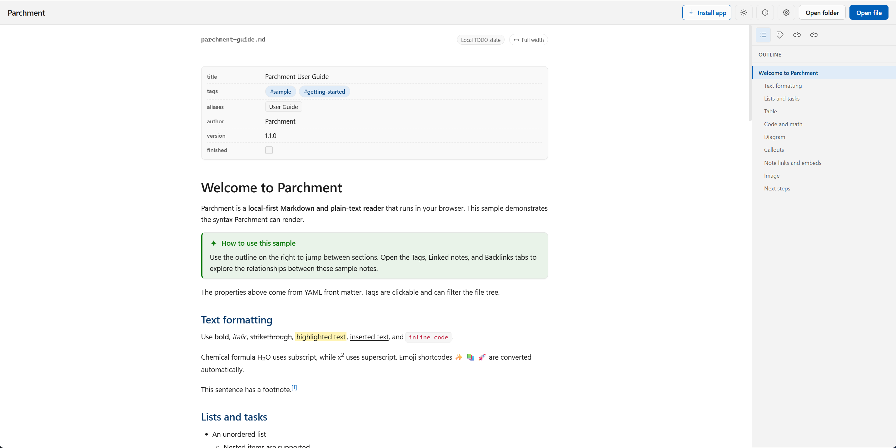
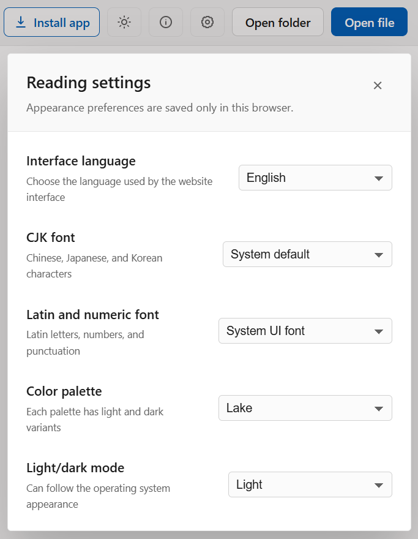

<p align="center">
  
</p>

<h1 align="center">Parchment</h1>

<p align="center">
  Read your local Markdown and plain-text notes in the browser — read-only, and your files never leave your device.
</p>

<p align="center">
  <a href="https://parchment.stack-base.com/"></a>
  <a href="LICENSE"></a>
  
  
  <a href="https://github.com/bruce-yang-422/parchment/releases/download/extension-v1.1.1/parchment-extension-1.1.1.zip"></a>
  <a href="https://github.com/bruce-yang-422/parchment/releases/download/android-v1.1.4/parchment-android-1.1.4.apk"></a>
</p>

<p align="center">
  <a href="README.md">繁體中文</a> · <strong>English</strong>
</p>

---

Parchment is a local-first static web app for safely reading `.md` and `.txt` files. It opens files with read-only access and renders them entirely in the browser — no server, no account, no uploads. Open a whole notes folder to browse it as a file tree, search across every note, and follow Wiki Links from one note to another.

The interface supports Traditional Chinese, Simplified Chinese, English, Japanese, Korean, French, German, and Spanish. Parchment detects the browser language on first use, falls back to English when it cannot find a match, and lets the user override the language in Settings.

**[Try it online →](https://parchment.stack-base.com/)**

<p align="center">
  <a href="https://parchment.stack-base.com/"></a>
</p>
<p align="center"><sub>Parchment folder view brings file navigation, rendered notes, and document information into one workspace.</sub></p>

## Table of contents

- [Features](#features)
- [Getting started](#getting-started)
- [Usage](#usage)
- [Browser support](#browser-support)
- [Privacy](#privacy)
- [Development](#development)
- [Browser extension](#browser-extension)
- [Flutter mobile app](#flutter-mobile-app)
- [Deployment](#deployment)
- [Contributing](#contributing)
- [License](#license)

## Features

- **Read-only and local**: files are opened with read permission and rendered only in your browser. Nothing is modified or uploaded.
- **Rich Markdown**: tables, syntax highlighting, footnotes, KaTeX math, Mermaid and Graphviz diagrams, and more.
- **Notes folder navigation**: file tree, Wiki Links, note embeds, tag filtering, backlinks and full-text search.
- **Comfortable reading**: five color palettes with light and dark variants, separate CJK and Latin font settings, and a switchable reading width.
- **Responsive mobile layout**: documents use the full width on narrow screens, with the file tree and document information available as touch-friendly side drawers and wide tables contained without shifting the page.
- The **Back to top** shortcut appears automatically in the reading pane's lower-right corner after scrolling down 160 px on desktop. On mobile, it appears after two screenfuls in documents longer than four screens.
- **Eight interface languages**: Traditional Chinese, Simplified Chinese, English, Japanese, Korean, French, German and Spanish, with automatic browser-language detection and a manual selector.
- **Browser extension**: a Chrome and Edge extension opens Parchment from the toolbar and renders local `.md` files you open in the browser.
- **Installable and offline**: install it as a PWA to open and read local files without a network connection.
- **Native mobile app**: `mobile-app/` contains the shared Flutter Android/iOS core. Android can open a whole notes folder, receive documents shared by other apps, and safely write back confirmed TODO checkbox changes.

### Reading

- GitHub-flavored Markdown plus common extensions: tables, task lists, footnotes, emoji, abbreviations, definition lists, subscript and superscript, inserted and marked text.
- Code blocks highlighted with highlight.js, with one-click copy and optional line numbers.
- Select an inline footnote number to preview it. Closing the preview returns focus to that reference.
- KaTeX math, and diagrams from `mermaid` and `dot` / `graphviz` code blocks.
- Images and diagrams scale to the reading column; click one to zoom and pan in a lightbox, or save it as PNG. If an image fails to load, select the placeholder to see why.
- Remembers your reading position in each document, and reloads automatically when a file changes on disk.
- Task-list checkboxes can be ticked; their state is stored in the browser and never written back to the file.
- The mobile toolbar's About Parchment shortcut shows the version, author, last update, source code, and privacy policy.

### Notes

- **Wiki Links**: `[[Note]]`, `[[Note#Heading]]`, `[[Note|Alias]]`, resolved by file name anywhere in the folder.
- **Embeds**: `![[image.png|300]]` for images, and `![[Note]]`, `![[Note#Heading]]`, `![[Note#^block]]` for other notes or sections.
- **Callouts**: `> [!note]`, `> [!tip]- Foldable title` and more. GitHub's `> [!NOTE]` alerts work too.
- **YAML front matter**: rendered as a properties block; its `tags` are clickable and filter the file tree.
- **Side panel**: a tree-style outline, tags, linked notes, backlinks, and document details such as file name, size, modification time, word count, task progress, and folder-relative path when available.

### Browsing and search

- Sort the file tree by name or by modified time, and collapse or expand all folders at once.
- Full-text search across file names, paths and contents, with multiple keywords and quoted phrases.
- Opening a search result highlights the keywords and scrolls to the first match.
- Remembers recently opened files and folders, and lets you switch between previously authorized folders.

### Appearance

| Palette | Style |
| --- | --- |
| Parchment (default) | Warm, paper-like browns |
| Amethyst | Graphite surfaces with violet accents; a knowledge-base notes look |
| Ink | Minimal black and white with compact spacing; a clean document look |
| Lake | Light grey surfaces with rounded cards; a system-documentation look |
| Aluminum | Silver surfaces with large radii; a desktop help-viewer look |

Each palette has light and dark variants and its own reading layout — column width, font size, headings, code, quotes and tables. Light/dark mode can follow your system setting.

<p align="center">
  
</p>
<p align="center"><sub>Reading settings provide separate controls for the interface language, CJK and Latin fonts, color palette, and appearance mode.</sub></p>

## Getting started

### Use it online

1. Open **[Parchment](https://parchment.stack-base.com/)**.
2. If it's your first time, click **開啟範例文件** (Open sample document) to see how each syntax is rendered. Otherwise choose **開啟檔案** (Open file), or drag a `.md` / `.txt` file onto the page.
3. To browse a notes folder, use Wiki Links or full-text search, choose **開啟資料夾** (Open folder).

### Install as an app

In browsers that support installation, click **安裝 App** (Install app) in the top-right corner. On iPhone and iPad, use **Add to Home Screen** from the browser's share menu. Desktop browsers that support the File Handling API can make the installed Parchment the default app for `.md` and `.txt` files.

### Run locally

The site assets are prebuilt, so any static HTTP server can serve the project:

```sh
git clone https://github.com/bruce-yang-422/parchment.git
cd parchment
python -m http.server 8080
```

## Usage

### Opening files

| Method | Description |
| --- | --- |
| Open file | Opens a single `.md` or `.txt` file |
| Drag and drop | Drop a file onto the page to read it |
| Open folder | Shows the file tree and enables relative images, cross-document links, Wiki Links, embeds and full-text search |
| Recent items | Reopen from the home page or the folder switcher in the bottom-left corner; read permission is requested when needed |
| Sample documents | Opens the localized guide and linked note for the current interface language; both are available offline |

> [!NOTE]
> Wiki Links, image and note embeds, and full-text search need to know which folder a document belongs to, so they are only available in folder mode.

### Reading navigation

- **Document outline.** Guide lines show how headings are nested. Use a branch arrow to expand or collapse it, or use the controls next to the outline title to expand or collapse all branches. Select a heading to jump to it. If the current section is in a collapsed branch, the outline highlights its nearest visible parent.
- **Back to home.** On desktop, select the Parchment feather badge in the upper-left corner to return to the home screen and keep your reading position and recent items. To jump to the beginning of the open document, use **Back to top** in the reading pane.

### Keyboard shortcuts

| Key | Where | Action |
| --- | --- | --- |
| `Ctrl` + `Shift` + `F` (macOS: `⌘` + `Shift` + `F`) | Folder mode | Focus full-text search |
| `Enter` / `↓` | Search box | Move to the results |
| `Esc` | Search box | Clear the search |
| `Enter` / `Space` | Focused outline button | Expand or collapse a branch, or jump to the selected heading |
| Scroll wheel / trackpad pinch | Lightbox | Zoom around the pointer |
| `+` / `-` / `0` | Lightbox | Zoom in / zoom out / fit to window |
| Double-click | Lightbox | Toggle between zoomed and fit to window |
| `S` | Lightbox | Save as PNG |
| `Esc` | Lightbox, dialogs | Close |

### Settings

The settings button in the top-right corner offers the options below. All preferences are stored in the current browser only.

- Interface language: Traditional Chinese, Simplified Chinese, English, Japanese, Korean, French, German, or Spanish
- Color palette and light/dark mode (follow system, light, dark)
- CJK font and Latin / numeral font
- Text size (50%–200%), line spacing, and code line numbers
- Reading width: switch between standard and full width with the button at the right of the file name row

## Browser support

Parchment uses the [File System Access API](https://developer.mozilla.org/docs/Web/API/File_System_API) when it is available, and falls back to standard file pickers when it is not.

| Feature | Chromium-based browsers (Chrome, Edge, etc.) | Firefox, Safari |
| --- | :---: | :---: |
| Open file, drag and drop | ✅ | ✅ |
| Open folder | ✅ | ✅ (via the `webkitdirectory` picker) |
| Recent items, folder switching | ✅ | — |
| Automatic reload on file changes | ✅ | — |
| Install as a PWA | ✅ | Depends on browser and platform |

> [!TIP]
> Installing the PWA and using it offline require the site to be served over HTTPS or from `localhost`.

## Privacy

See the full [privacy policy](https://parchment.stack-base.com/privacy.html). In short:

- Documents are read and rendered only in your browser; source files are opened read-only.
- Handles to recently opened files and folders are kept in IndexedDB. Reading positions, appearance preferences and task-list state are kept in `localStorage`.
- **Save as PNG** converts and downloads images locally; nothing is uploaded.
- The service worker caches only the site's own assets. If a document references external resources such as remote images, the browser requests them from their URLs.

## Development

### Requirements

- [Node.js](https://nodejs.org/) 22 (recommended) and npm
- A static HTTP server for previewing, such as `python -m http.server`

### Setup and scripts

```sh
npm ci
```

| Command | Purpose |
| --- | --- |
| `npm test` | Checks JavaScript syntax and runs all unit tests |
| `npm run css` | Compiles `src/styles/` into `assets/css/style.css` with Tailwind CSS 3.4 |
| `npm run pwa` | Builds the styles and generates the offline cache list in `service-worker.js` from the site assets |
| `npm run vendor` | Rebuilds the third-party bundles in `assets/vendor/` from `node_modules`, then runs `npm run pwa` |
| `npm run extension` | Builds the browser extension into `browser-extension/dist/` and a zip for the store |

> [!IMPORTANT]
> After changing anything in `assets/`, `src/styles/` or `index.html`, run `npm run pwa` so the offline cache version is updated. Otherwise users who have installed the app may keep receiving the old files.

The browser rendering test page [`tests/renderer-smoke.html`](tests/renderer-smoke.html) checks Markdown, the extended syntax and the diagram engines; serve it from a local server to run it.

### Project structure

```text
parchment/
├── index.html             # Application entry point
├── privacy.html           # Privacy policy page
├── sitemap.xml            # Sitemap
├── robots.txt             # Crawler rules
├── CNAME                  # GitHub Pages custom domain
├── .nojekyll              # Disables Jekyll so the .md samples are served as-is
├── manifest.webmanifest   # PWA metadata and file associations
├── service-worker.js      # Offline cache generated by npm run pwa
├── assets/
│   ├── js/                # Vanilla JavaScript (ES modules)
│   ├── css/style.css      # Compiled styles
│   └── vendor/            # Bundled third-party libraries and their licenses
├── src/styles/            # Tailwind style sources, including palettes and reading layouts
├── samples/               # Sample notes opened by the home page's sample button
├── browser-extension/     # Chrome / Edge extension sources, build script and store listing
├── mobile-app/            # Flutter Android / iOS reader and packaged APK output
├── scripts/               # Build scripts for third-party bundles and the PWA
└── tests/                 # Unit tests and the browser rendering test page
```

For architecture, browser API usage and design decisions, see the [concept memo](md-reader-concept-memo.md) (in Traditional Chinese).

## Browser extension

`browser-extension/` packages Parchment as a Chrome and Edge extension (Manifest V3). The site code is copied from the project root at build time.

- Click the toolbar icon to open the full Parchment app in a new tab; everything works offline.
- Open a local `.md` file in the browser and it is rendered by Parchment automatically. This needs "Allow access to file URLs" turned on in the extension's details page.
- It only requests the `storage` and `file:///*` permissions and never accesses websites.

Download [Parchment Browser Extension v1.1.1](https://github.com/bruce-yang-422/parchment/releases/download/extension-v1.1.1/parchment-extension-1.1.1.zip), extract the archive, and load it through Chrome or Edge developer mode. See the [extension installation guide](browser-extension/README.md#安裝已發布版本) for the complete steps.

Run `npm run pwa` and then `npm run extension` to build it. See [browser-extension/README.md](browser-extension/README.md) (in Traditional Chinese) for loading it for testing, publishing to the Chrome Web Store, and the privacy policy.

## Flutter mobile app

`mobile-app/` is the Android/iOS app built on a shared Dart core. It keeps the same open-source, read-only-first, local-first, and Obsidian-compatible positioning. Mermaid, Graphviz, KaTeX, the bundled fonts, and their assets ship inside the app, so reading and rendering work without a network connection when using the system or bundled fonts; a connection is needed only for Google Fonts typefaces, external links, or remote images.

Download [Parchment Android v1.1.4](https://github.com/bruce-yang-422/parchment/releases/download/android-v1.1.4/parchment-android-1.1.4.apk) (Android 7.0 or later), open it on your phone, and allow the installation. The Google Play build is signed differently, so the two cannot update each other; uninstall first to switch sources. All versions are listed on [GitHub Releases](https://github.com/bruce-yang-422/parchment/releases).

- Single-file and whole-folder modes accept `.md` and `.txt` documents; Android can also open files shared from LINE, Gmail and other apps.
- Syntax matches the web version, including footnotes with non-ASCII labels (the end-of-document back button is a drawn vector icon). Common HTML (`<kbd>`, `<details>`, `<u>`, centring and more) is turned into native layout through an allowlist; `<script>` and similar tags are removed.
- Wide code blocks show a horizontal scrollbar. An optional **Show line numbers** setting keeps the gutter aligned with blank lines, multilingual text, and italic code; it is off by default.
- Android folder mode provides a file tree, Wiki Links, note and image embeds, full-text search, tags, and backlinks.
- Markdown and allow-listed HTML support raster images, GIF, and SVG. Missing or inaccessible relative images show the actual reason instead of assuming that opening a folder will fix them; centered logos and badges wrap naturally to the available width.
- Diagrams use sanitized SVG, remain sharp when zoomed in the lightbox, and preserve source plus an error message when syntax is invalid.
- Open-source notices use a concise summary, package-name search, and collapsible cards; full legal text is shown only when a component is expanded.
- TODO checkboxes are the sole exception to read-only behavior: changes are written only after explicit confirmation, only checkbox markers are changed, and external modifications are detected first.
- The bilingual [privacy policy](privacy.html) covers the website, PWA, browser extension, and Android/iOS app, including file grants, local preferences, offline diagrams, and external links.
- Five palettes each imitate a familiar environment: Parchment, Amethyst (Obsidian), Ink (Notion), Lake (Windows 11) and Aluminum (iOS/macOS). Beyond colours, buttons, sheets, quotes, checkboxes, tables, callout icons and code blocks change with the palette.
- Fonts: Taipei Sans TC, jf open huninn, Iansui, Naikai, GenJyuu Gothic, LINE Seed JP and Pretendard are bundled; Google Fonts are downloaded only when chosen. Each interface language lists only fonts that cover its script, with a sample line per choice.
- The interface is available in eight languages (Traditional and Simplified Chinese, English, Japanese, Korean, French, German, Spanish). Language, fonts, palette, appearance, text size and line spacing are remembered.
- The document info sheet is ordered by everyday relevance and shows word count, size, modified time, to-do progress, a plain-language location and the full path on the phone; the advanced section adds encoding, line endings and SHA-256.
- Android 7.0 (API 24) is the minimum. Google Play serves the appropriate content from the AAB; the direct-download Universal APK contains ARM32, ARM64, and x86_64 and is not tied to any phone brand.
- Android file picking, incoming Open With actions, document metadata, and file reads run away from the UI thread, so a slow document provider does not block the interface with a synchronous query.

See the [mobile app README](mobile-app/README.md) (Traditional Chinese) for development, platform differences, tests, and Android packaging. `mobile-app/apk/` locally contains the Google Play AAB and a Universal APK for direct installation on supported Android devices; release binaries are not committed to Git.

## Deployment

Parchment is a fully static site and can be hosted on any static host. To deploy to GitHub Pages:

1. Run `npm run pwa`, or `npm run vendor` if you updated third-party packages.
2. Commit the sources together with the generated `assets/css/style.css` and `service-worker.js` (and `assets/vendor/` if you rebuilt the bundles).
3. In the repository's **Settings → Pages**, choose **Deploy from a branch** and publish from `/ (root)` on the `main` branch.
4. The root `.nojekyll` file turns off GitHub Pages' Jekyll processing. Without it, `samples/*.md` files with front matter are converted to HTML, so the samples cannot be opened and the offline cache fails to install.
5. The project uses the custom domain `parchment.stack-base.com`, recorded in the root `CNAME` file. To deploy to another domain, change `CNAME` and update the URLs in `index.html`, `privacy.html`, `sitemap.xml` and `robots.txt`.

## Contributing

Bug reports and suggestions are welcome in [Issues](https://github.com/bruce-yang-422/parchment/issues), and pull requests are welcome too. Before submitting, please make sure that:

1. `npm test` passes.
2. You have run `npm run pwa` and committed the generated files.
3. New features fit Parchment's read-only, local-only scope.

## License

Parchment is released under the [MIT License](LICENSE). Bundled third-party libraries and their licenses are listed in [THIRD_PARTY_LICENSES.md](THIRD_PARTY_LICENSES.md).
