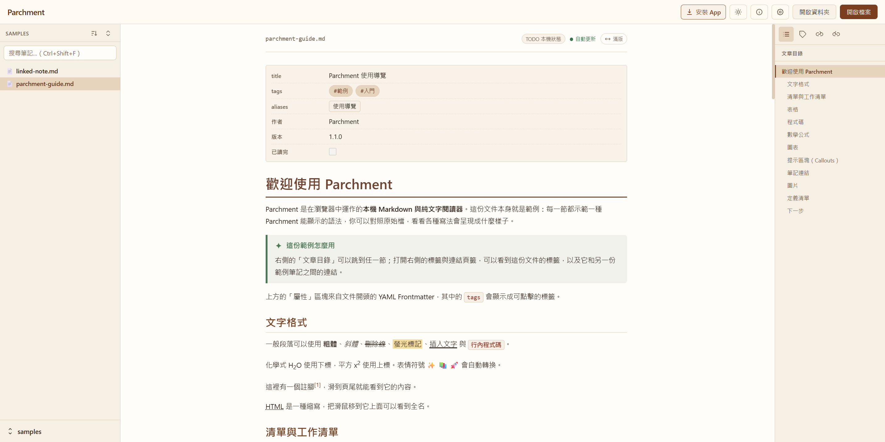
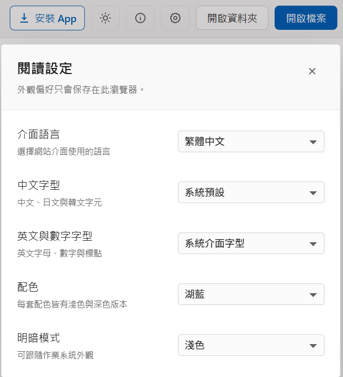

<p align="center">
  
</p>

<h1 align="center">Parchment</h1>

<p align="center">
  在瀏覽器中唯讀閱讀本機 Markdown 與純文字筆記，文件不離開你的裝置。
</p>

<p align="center">
  <a href="https://parchment.stack-base.com/"></a>
  <a href="LICENSE"></a>
  
  
  <a href="https://github.com/bruce-yang-422/parchment/releases/download/v1.1.1/parchment-extension-1.1.1.zip"></a>
</p>

<p align="center">
  <strong>繁體中文</strong> · <a href="README.en.md">English</a>
</p>

---

Parchment 是一個本機優先（local-first）的靜態網頁應用程式，用來安全地閱讀 `.md` 與 `.txt` 文件。它以唯讀權限開啟檔案，在瀏覽器內完成渲染，不需要伺服器、帳號或上傳。開啟整個筆記資料夾後，可以用檔案樹瀏覽、全文搜尋，並跟隨 Wiki Links 在筆記之間跳轉。

**[立即線上使用 →](https://parchment.stack-base.com/)**

<p align="center">
  <a href="https://parchment.stack-base.com/"></a>
</p>
<p align="center"><sub>Parchment 資料夾閱讀模式：檔案導覽、格式化文章與筆記資訊集中在同一個畫面。</sub></p>

## 目錄

- [特色](#特色)
- [快速開始](#快速開始)
- [使用說明](#使用說明)
- [瀏覽器支援](#瀏覽器支援)
- [隱私](#隱私)
- [開發](#開發)
- [瀏覽器外掛](#瀏覽器外掛)
- [Flutter 手機 App](#flutter-手機-app)
- [部署](#部署)
- [參與貢獻](#參與貢獻)
- [授權](#授權)

## 特色

- **唯讀且本機處理**：以讀取權限開啟文件，內容只在瀏覽器中渲染，不會被修改或上傳。
- **完整的 Markdown 支援**：表格、程式碼高亮、註腳、KaTeX 數學公式、Mermaid 與 Graphviz 圖表等。
- **筆記資料夾導覽**：檔案樹、Wiki Links、內嵌筆記、標籤篩選、雙向連結與全文搜尋。
- **舒適的閱讀體驗**：五套各含淺色與深色版本的配色、中英文字型分開設定、可切換的閱讀寬度。
- **手機版閱讀介面**：窄螢幕使用完整寬度閱讀，檔案樹與文件資訊改以觸控友善的側邊抽屜開啟，並隔離寬表格造成的水平溢位。
- **智慧回到頂端**：桌面版將滑鼠移到閱讀欄右下角即可顯示快捷按鈕；手機版僅在文章超過四個畫面且已捲動兩個畫面後顯示。
- **八語介面**：支援繁體中文、簡體中文、英文、日文、韓文、法文、德文與西班牙文；首次使用時自動偵測瀏覽器語言，無法匹配時使用英文，也可在設定中自行切換。
- **瀏覽器外掛**：Chrome 與 Edge 外掛可從工具列開啟 Parchment，並以 Parchment 顯示你在瀏覽器中開啟的本機 `.md` 檔。
- **可安裝、可離線**：安裝為 PWA 後，即使沒有網路也能開啟並閱讀本機文件。
- **原生手機 App**：`mobile-app/` 提供 Flutter Android／iOS 核心；Android 可開啟整個筆記資料夾、接收其他 App 分享的文件，並在確認後安全寫回 TODO 勾選。

### 閱讀

- 支援 GitHub 風格 Markdown 與常見擴充：表格、工作清單、註腳、表情符號、縮寫、定義清單、上下標、插入與標記文字。
- 使用 highlight.js 為程式碼區塊上色，並提供一鍵複製。
- KaTeX 數學公式，以及 `mermaid`、`dot`／`graphviz` 程式碼區塊繪製的圖表。
- 圖片與圖表會縮放至閱讀欄寬；點擊即可在燈箱中縮放、拖曳檢視，或存成 PNG。
- 自動記住每份文件的閱讀位置；檔案在外部被修改時自動重新載入。
- 工作清單可以勾選，狀態只保存在瀏覽器，不會寫回檔案。
- 手機版標題列保留文件資訊入口，可查看版本、作者、最後更新時間、原始碼與隱私權政策。

### 筆記

- **Wiki Links**：`[[筆記]]`、`[[筆記#標題]]`、`[[筆記|別名]]`，依檔名在整個資料夾中尋找目標。
- **內嵌**：`![[圖片.png|300]]` 內嵌圖片，`![[筆記]]`、`![[筆記#標題]]`、`![[筆記#^區塊]]` 內嵌其他筆記或段落。
- **Callouts**：`> [!note]`、`> [!tip]- 可收合的標題` 等提示區塊，GitHub 的 `> [!NOTE]` 也適用。
- **YAML Frontmatter**：渲染為屬性區塊，其中的 `tags` 可點擊並用來篩選文件。
- **右側資訊面板**：文章目錄、標籤、連結筆記與雙向連結。

### 瀏覽與搜尋

- 資料夾樹可依檔案名稱或編輯時間排序，並可一鍵全部折疊或展開。
- 全文搜尋所有筆記的檔名、路徑與內容，支援多個關鍵字與以引號包住的片語。
- 開啟搜尋結果後，會標示關鍵字並捲動到第一個符合處。
- 記住最近開啟的檔案與資料夾，並可快速切換曾授權的資料夾。

### 外觀

| 配色 | 風格 |
| --- | --- |
| 羊皮紙（預設） | 暖棕紙張色調 |
| 紫晶 | 石墨灰底、紫色強調的知識庫筆記風格 |
| 墨白 | 極簡黑白、緊湊段落的文件風格 |
| 湖藍 | 淺灰底、圓角卡片的系統文件風格 |
| 鋁銀 | 銀灰底、大圓角的桌面說明文件風格 |

每套配色都有淺色與深色版本，也有各自的閱讀欄寬、字級、標題、程式碼、引用與表格樣式。明暗模式可跟隨系統設定。

<p align="center">
  
</p>
<p align="center"><sub>閱讀設定可分別調整介面語言、中文與英數字型、配色及明暗模式。</sub></p>

## 快速開始

### 線上使用

1. 開啟 **[Parchment](https://parchment.stack-base.com/)**。
2. 第一次使用可以按 **開啟範例文件**，看看各種語法的顯示效果；或選擇 **開啟檔案**，把 `.md`／`.txt` 檔案拖進頁面。
3. 要瀏覽整個筆記資料夾、使用 Wiki Links 或全文搜尋時，選擇 **開啟資料夾**。

### 安裝為應用程式

在支援安裝的瀏覽器中，按右上角的 **安裝 App**。iPhone 與 iPad 請使用瀏覽器分享選單中的 **加入主畫面**。支援 File Handling API 的桌面瀏覽器，可以把已安裝的 Parchment 設為 `.md`、`.txt` 的開啟方式。

### 在本機執行

網站資產已預先建置，任何靜態 HTTP 伺服器都能直接執行：

```sh
git clone https://github.com/bruce-yang-422/parchment.git
cd parchment
python -m http.server 8080
```

## 使用說明

### 開啟方式

| 方式 | 說明 |
| --- | --- |
| 開啟檔案 | 開啟單一 `.md` 或 `.txt` 檔案 |
| 拖放 | 把檔案拖進頁面即可閱讀 |
| 開啟資料夾 | 顯示檔案樹，並啟用相對圖片、跨文件連結、Wiki Links、內嵌與全文搜尋 |
| 最近開啟 | 從首頁或左下角的資料夾切換器重新開啟，必要時會請求讀取授權 |
| 範例文件 | 依目前介面語言開啟對應的使用指南與連結筆記，可離線閱讀 |

> [!NOTE]
> Wiki Links、內嵌圖片、內嵌筆記與全文搜尋，需要知道文件所在的資料夾，因此只能在資料夾模式中使用。

### 鍵盤快捷鍵

| 按鍵 | 位置 | 動作 |
| --- | --- | --- |
| `Ctrl` + `Shift` + `F`（macOS：`⌘` + `Shift` + `F`） | 資料夾模式 | 聚焦全文搜尋框 |
| `Enter`／`↓` | 搜尋框 | 移到搜尋結果 |
| `Esc` | 搜尋框 | 清除搜尋 |
| 滾輪／觸控板捏合 | 燈箱 | 以游標為中心縮放 |
| `+`／`-`／`0` | 燈箱 | 放大／縮小／符合視窗 |
| 雙擊 | 燈箱 | 在放大與符合視窗之間切換 |
| `S` | 燈箱 | 存成 PNG |
| `Esc` | 燈箱、對話框 | 關閉 |

### 設定

右上角的設定提供以下選項，所有偏好只保存在目前的瀏覽器：

- 介面語言：繁體中文、簡體中文、英文、日文、韓文、法文、德文、西班牙文
- 配色與明暗模式（跟隨系統、淺色、深色）
- 中文字型與英文／數字字型
- 閱讀寬度：可用檔名列右側的按鈕，在標準寬度與滿版之間切換

## 瀏覽器支援

Parchment 會先使用 [File System Access API](https://developer.mozilla.org/docs/Web/API/File_System_API)，瀏覽器不支援時，自動改用一般的檔案選擇器。

| 功能 | Chromium 系瀏覽器（Chrome、Edge 等） | Firefox、Safari |
| --- | :---: | :---: |
| 開啟檔案、拖放 | ✅ | ✅ |
| 開啟資料夾 | ✅ | ✅（使用 `webkitdirectory` 選擇器） |
| 最近開啟、資料夾切換 | ✅ | — |
| 檔案自動更新 | ✅ | — |
| 安裝為 PWA | ✅ | 依瀏覽器與平台而定 |

> [!TIP]
> PWA 安裝與離線使用，需要透過 HTTPS 或 `localhost` 開啟網站。

## 隱私

完整內容請見 [隱私權政策](https://parchment.stack-base.com/privacy.html)。重點如下：

- 文件只在你的瀏覽器中讀取與渲染，來源檔案以唯讀方式開啟。
- 最近開啟的檔案與資料夾控制代碼保存在 IndexedDB；閱讀位置、外觀偏好與工作清單狀態保存在 `localStorage`。
- 「存成 PNG」在本機轉換並直接下載，不會上傳任何內容。
- Service Worker 只快取網站本身的資產。如果文件引用外部圖片等資源，瀏覽器會向該資源的網址送出請求。

## 開發

### 需求

- [Node.js](https://nodejs.org/) 22（建議）與 npm
- 用於預覽的靜態 HTTP 伺服器，例如 `python -m http.server`

### 安裝與指令

```sh
npm ci
```

| 指令 | 用途 |
| --- | --- |
| `npm test` | 檢查 JavaScript 語法並執行所有單元測試 |
| `npm run css` | 用 Tailwind CSS 3.4 將 `src/styles/` 編譯為 `assets/css/style.css` |
| `npm run pwa` | 編譯樣式，並依網站資產內容產生 `service-worker.js` 的離線快取清單 |
| `npm run vendor` | 從 `node_modules` 重新打包第三方套件到 `assets/vendor/`，接著執行 `npm run pwa` |
| `npm run extension` | 建置瀏覽器外掛，輸出 `browser-extension/dist/` 與上架用 zip |

> [!IMPORTANT]
> 修改 `assets/`、`src/styles/` 或 `index.html` 後，請執行 `npm run pwa`，讓離線快取的版本號跟著更新；否則已安裝的使用者可能會繼續拿到舊版檔案。

瀏覽器渲染測試頁 [`tests/renderer-smoke.html`](tests/renderer-smoke.html) 用來驗證 Markdown、擴充語法與圖表引擎，需透過本機伺服器開啟。

### 專案結構

```text
parchment/
├── index.html             # 應用程式入口
├── privacy.html           # 隱私權政策頁
├── sitemap.xml            # 網站地圖
├── robots.txt             # 搜尋引擎索引規則
├── CNAME                  # GitHub Pages 自訂網域
├── .nojekyll              # 停用 Jekyll，讓 .md 範例檔原樣提供
├── manifest.webmanifest   # PWA 安裝資訊與檔案關聯
├── service-worker.js      # 由 npm run pwa 產生的離線快取
├── assets/
│   ├── js/                # 原生 JavaScript（ES Modules）
│   ├── css/style.css      # 編譯後的樣式
│   └── vendor/            # 打包後的第三方套件與授權
├── src/styles/            # Tailwind 樣式原始碼（含配色與閱讀版面）
├── samples/               # 首頁「開啟範例文件」使用的範例筆記
├── browser-extension/     # Chrome／Edge 外掛的原始碼、建置腳本與上架資料
├── mobile-app/            # Flutter Android／iOS 閱讀器與 APK 封裝輸出
├── scripts/               # 第三方套件與 PWA 的建置腳本
└── tests/                 # 單元測試與瀏覽器渲染測試頁
```

架構、瀏覽器 API 的使用方式與設計決策，請參閱 [概念備忘錄](md-reader-concept-memo.md)。

## 瀏覽器外掛

`browser-extension/` 將 Parchment 包裝為 Chrome 與 Edge 外掛（Manifest V3），網站程式碼在建置時從專案根目錄複製。

- 點擊工具列圖示，在新分頁開啟完整的 Parchment，所有功能皆可離線使用。
- 在瀏覽器中開啟本機 `.md` 檔時，自動以 Parchment 顯示。需要在擴充功能詳細資料中開啟「允許存取檔案網址」。
- 只要求 `storage` 與 `file:///*` 權限，不存取任何網站。

使用者可下載 [Parchment Browser Extension v1.1.1](https://github.com/bruce-yang-422/parchment/releases/download/v1.1.1/parchment-extension-1.1.1.zip)，解壓縮後透過 Chrome 或 Edge 的開發人員模式載入。完整步驟請參閱 [外掛安裝說明](browser-extension/README.md#安裝已發布版本)。

先執行 `npm run pwa`，再執行 `npm run extension` 即可建置。載入測試、上架 Chrome Web Store 與隱私權政策，請參閱 [browser-extension/README.md](browser-extension/README.md)。

## Flutter 手機 App

`mobile-app/` 是共用 Dart 核心的 Android／iOS App，定位同樣是開源、唯讀優先、本機運作與相容 Obsidian Markdown。Mermaid、Graphviz、KaTeX 及相關資產全部隨 App 封裝，沒有網路也能渲染。

- 單檔與整個資料夾模式皆支援 `.md`／`.txt`，選檔器會限制可開啟的文件類型。
- Android 資料夾模式提供檔案樹、Wiki Links、內嵌筆記與圖片、全文搜尋、標籤及雙向連結。
- 圖表使用清理後的 SVG 顯示，燈箱縮放不失真；語法錯誤會保留原始碼與錯誤訊息。
- TODO 勾選是唯讀原則的唯一例外：只有使用者明確儲存時才寫回，且只修改勾選字元並檢查外部變更。
- 介面採用 iOS／macOS 風格的半圓膠囊按鈕、輕量 Dock 與圓角面板，支援五套深淺配色、文字大小及行距。
- Android 最低支援 7.0（API 24）；Google Play AAB 會依手機自動提供 ARM32／ARM64 內容，三星直接下載版只提供 ARM64。

開發、平台差異、測試與 Android 封裝方式請參閱 [手機 App README](mobile-app/README.md)。`mobile-app/apk/` 只保留 Google Play 上架 AAB 與三星 Galaxy A／S 系列使用的 ARM64 APK。

## 部署

Parchment 是純靜態網站，可以部署到任何靜態主機。部署到 GitHub Pages 的步驟：

1. 執行 `npm run pwa`；如果更新了第三方套件，改為執行 `npm run vendor`。
2. 提交原始碼，以及產生的 `assets/css/style.css`、`service-worker.js`（重建第三方套件時，也一併提交 `assets/vendor/`）。
3. 在儲存庫的 **Settings → Pages** 選擇 **Deploy from a branch**，發布來源設為 `main` 分支的 `/ (root)`。
4. 根目錄的 `.nojekyll` 用來停用 GitHub Pages 的 Jekyll 處理；否則含 Frontmatter 的 `samples/*.md` 會被轉成 HTML，範例無法開啟，離線快取也會安裝失敗。
5. 本專案使用自訂網域 `parchment.stack-base.com`，設定記錄在根目錄的 `CNAME`。若要部署到其他網域，請修改 `CNAME`，並一併更新 `index.html`、`privacy.html`、`sitemap.xml`、`robots.txt` 中的網址。

## 參與貢獻

歡迎透過 [Issues](https://github.com/bruce-yang-422/parchment/issues) 回報問題或提出建議，也歡迎發送 Pull Request。送出前請確認：

1. `npm test` 全部通過。
2. 已執行 `npm run pwa`，並提交產生的檔案。
3. 新功能符合 Parchment 唯讀、本機處理的定位。

## 授權

Parchment 以 [MIT 授權](LICENSE) 釋出。隨附的第三方套件及其授權列於 [THIRD_PARTY_LICENSES.md](THIRD_PARTY_LICENSES.md)。
