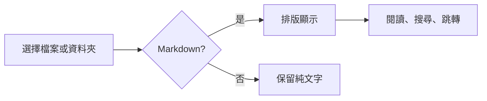

# 歡迎使用 Parchment

Parchment 是在瀏覽器中運作的**本機 Markdown 與純文字閱讀器**。這份文件本身就是範例：每一節都示範一種 Parchment 能顯示的語法，你可以對照原始檔，看看各種寫法會呈現成什麼樣子。

> [!tip] 這份範例怎麼用
> 右側的「文章目錄」可以跳到任一節；打開右側的標籤與連結頁籤，可以看到這份文件的標籤，以及它和另一份範例筆記之間的連結。

上方的「屬性」區塊來自文件開頭的 YAML Frontmatter，其中的 `tags` 會顯示成可點擊的標籤。

## 文字格式

一般段落可以使用 **粗體**、*斜體*、~~刪除線~~、==螢光標記==、++插入文字++ 與 `行內程式碼`。

化學式 H~2~O 使用下標，平方 x^2^ 使用上標。表情符號 :sparkles: :books: :rocket: 會自動轉換。

這裡有一個註腳[^read-only]，滑到頁尾就能看到它的內容。

HTML 是一種縮寫，把滑鼠移到它上面可以看到全名。

*[HTML]: HyperText Markup Language

[^read-only]: Parchment 以唯讀方式開啟檔案，不會修改你的任何文件。

## 清單與工作清單

- 無序清單
  - 可以巢狀
- 第二項

1. 有序清單
2. 第二步

- [x] 打開這份範例
- [ ] 試著勾選這個項目（勾選狀態只存在瀏覽器中，不會改到檔案）
- [ ] 打開自己的筆記資料夾

## 表格

| 功能 | 單檔模式 | 資料夾模式 |
| --- | :---: | :---: |
| Markdown 排版 | ✅ | ✅ |
| 相對圖片與連結 | — | ✅ |
| Wiki Links 與內嵌 | — | ✅ |
| 全文搜尋 | — | ✅ |

## 程式碼

程式碼區塊會自動上色，滑過區塊右上角可以一鍵複製。

```js
// 以唯讀方式讀取使用者選擇的檔案
const [handle] = await window.showOpenFilePicker();
const file = await handle.getFile();
console.log(await file.text());
```

## 數學公式

行內公式：質能等價 $E = mc^2$。

區塊公式：

$$
\int_{0}^{1} x^2 \, dx = \frac{1}{3}
$$

## 圖表

Mermaid 流程圖會自動縮放到閱讀欄寬，**點擊圖表**可以放大、拖曳，或存成 PNG。



Graphviz（`dot`）圖表：


## 提示區塊（Callouts）

> [!note]
> 一般的補充說明。

> [!warning] 自訂標題
> 標題可以自訂，內文也可以使用 **Markdown**。

> [!question]- 可以收合嗎？
> 可以。在類型後面加上 `-` 會預設收合，加上 `+` 則預設展開。

> [!NOTE]
> GitHub 風格的提示區塊也能顯示。

## 筆記連結

用兩個中括號就能連到另一份筆記：[[linked-note]]。也可以指定顯示文字與標題：[[linked-note#可以被內嵌的段落|跳到另一份筆記的段落]]。

把整個段落直接內嵌進來：

![[linked-note#可以被內嵌的段落]]

或只內嵌某一個區塊：

![[linked-note#^summary]]

## 圖片

一般的 Markdown 相對路徑圖片，**點擊圖片**可以在燈箱中放大：


也可以只寫檔名並指定寬度，Parchment 會在整個資料夾中尋找：

![[parchment-logo-transparent.png|96]]

## 定義清單

唯讀
: 只讀取檔案內容，不做任何修改。

本機優先
: 文件在瀏覽器中處理，不會上傳。

## 下一步

1. 按右上角的 **開啟資料夾**，選擇你自己的筆記資料夾。
2. 在左側欄的搜尋框輸入關鍵字，搜尋所有筆記。
3. 按右上角的設定按鈕，試試不同的配色與字型。

在手機上，檔案樹與文件資訊會從側邊抽屜開啟。文章超過四個畫面時，捲動兩個畫面後右下角才會顯示回到頂端按鈕；短文章不會顯示。桌面版則可將滑鼠移到閱讀欄右下角叫出按鈕。

---

這份範例會隨網站一起提供，離線時也能開啟。
