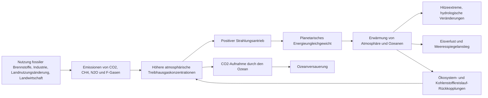
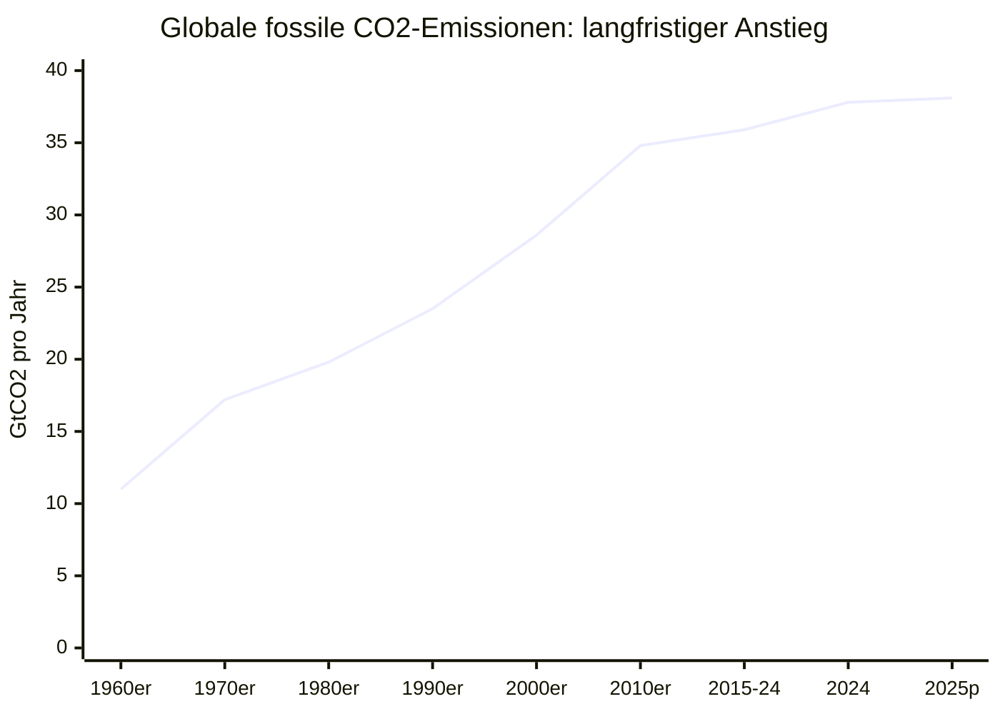
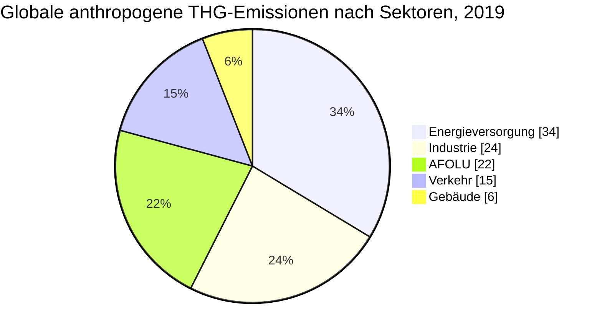
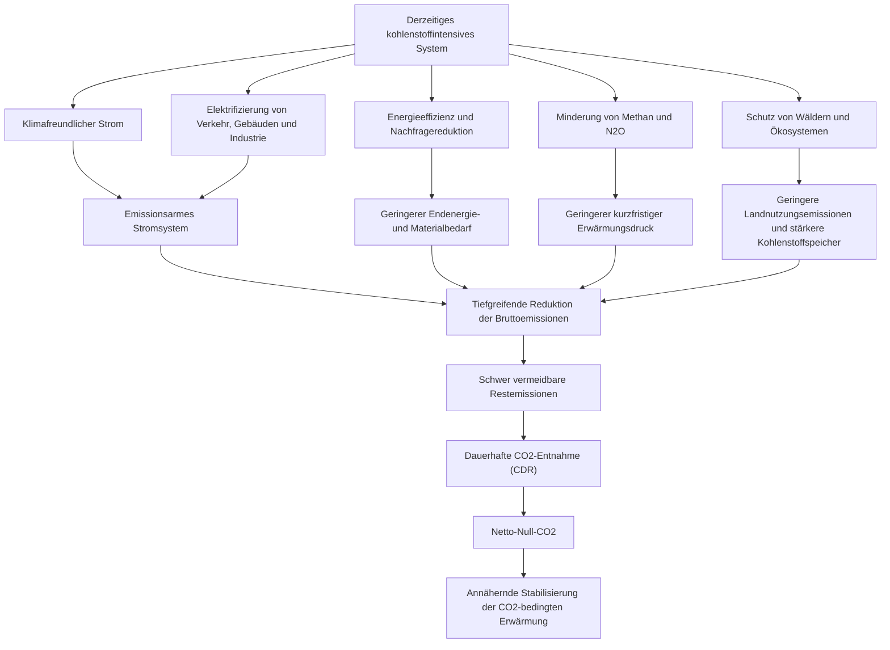

# Kohlenstoffemissionen und CO₂-Fußabdrücke: Auswirkungen auf das globale Klimasystem

## Zusammenfassung

> **Zentrales Ergebnis.** Die Belege dafür, dass anthropogene Treibhausgasemissionen die Hauptursache der modernen globalen Erwärmung sind, sind eindeutig. Kohlenstoffdioxid (CO₂) leistet aufgrund der enormen kumulativ emittierten Menge, seines langlebigen Einflusses auf den Kohlenstoffkreislauf und des nahezu linearen Zusammenhangs zwischen kumulativen CO₂-Emissionen und der globalen Mitteltemperatur den größten Einzelbeitrag. Methan (CH₄), Lachgas (N₂O) und fluorierte Gase erzeugen einen erheblichen zusätzlichen Strahlungsantrieb.[^3] [^5]

Menschliche Aktivitäten haben die globale Oberflächentemperatur im Zeitraum **2011–2020 auf etwa 1,1 °C über den Durchschnitt von 1850–1900** ansteigen lassen. Der IPCC schätzt, dass die gesamte durch den Menschen verursachte Erwärmung von 1850–1900 bis 2010–2019 etwa **1,07 °C** betrug, während natürliche solare und vulkanische Einflüsse nur einen geringen Beitrag zur beobachteten langfristigen Veränderung leisteten. Treibhausgase allein hätten eine noch stärkere Erwärmung hervorgerufen, doch ein Teil ihrer Wirkung wurde durch anthropogene Aerosole maskiert.[^5]

Das Ausmaß der zugrunde liegenden Störung des Kohlenstoffkreislaufs ist in der instrumentellen Beobachtungsperiode beispiellos. Die atmosphärische CO₂-Konzentration lag **vor der Industrialisierung bei etwa 270–280 ppm** und erreichte laut NOAA im Jahr **2025 ein globales Jahresmittel in der marinen Grenzschicht von 425,62 ± 0,05 ppm**. Der kombinierte effektive Strahlungsantrieb langlebiger Treibhausgase erreichte im Jahr **2025 3,59 W m⁻² gegenüber vorindustriellen Bedingungen** – ein Anstieg von 56 % im Vergleich zum entsprechenden Strahlungsantrieb im Jahr 1990. Allein CO₂ trug **2,37 W m⁻²** bei, also rund zwei Drittel des Gesamtbeitrags der langlebigen Treibhausgase.[^7]

Dennoch sind die globalen Emissionen weiter gestiegen. Der IPCC schätzte die anthropogenen Netto-Treibhausgasemissionen im Jahr 2019 auf **59 ± 6,6 GtCO₂-Äq**, was 54 % über dem Niveau von 1990 liegt. Das Global Carbon Budget 2025 bezifferte die globalen fossilen CO₂-Emissionen auf **37,8 ± 2 GtCO₂ im Jahr 2024** und projizierte für **2025 etwa 38,1 GtCO₂**, wobei sich die methodischen Definitionen zwischen den Datensätzen unterscheiden. Die IEA schätzte unabhängig davon die energiebedingten CO₂-Emissionen im Jahr 2025 auf nahezu **38,4 GtCO₂**. Diese Zahlen sollten nicht als austauschbar behandelt werden, da sich ihre sektoralen Systemgrenzen unterscheiden.[^1] [^2] [^4] [^6]

CO₂-Fußabdrücke erweitern die Analyse über territoriale Emissionen hinaus. Ein *produktionsbasiertes (territoriales) Emissionsinventar* ordnet Emissionen dem Ort zu, an dem sie physisch entstehen; ein *konsumbasierter CO₂-Fußabdruck* rechnet gebundene Emissionen entlang internationaler Lieferketten den Endverbraucherinnen und Endverbrauchern zu. Diese Unterscheidung ist von Bedeutung, da der internationale Handel es konsumstarken Regionen ermöglicht, einen Teil ihrer territorialen Emissionen zu verlagern. Multiregionale Input-Output-Studien weisen jedoch größere strukturelle und datenbedingte Unsicherheiten auf als nationale Verbrennungsinventare.[^4] [^10]

Die Verteilung der Verantwortung ist höchst ungleich. Im Jahr 2019 entfielen auf die 10 % der Haushalte mit den höchsten Emissionen etwa **34–45 % der globalen konsumbasierten Treibhausgasemissionen privater Haushalte**, während auf die 50 % mit den niedrigsten Emissionen lediglich **13–15 %** entfielen. Die regionalen Unterschiede sind ähnlich ausgeprägt: Die Treibhausgasemissionen in Nordamerika lagen 2019 bei rund **19 tCO₂-Äq pro Person**, verglichen mit etwa **2,5 tCO₂-Äq pro Person** in Südasien.[^4]

Zu den bereits beobachteten klimatischen Folgen zählen zunehmende Hitzeextreme, stärkere Niederschläge in vielen Regionen, Veränderungen des Dürrerisikos, Ozeanerwärmung, Kryosphärenverlust, ein sich beschleunigender Meeresspiegelanstieg sowie Ozeanversauerung. Der globale mittlere Meeresspiegel stieg zwischen **1901 und 2018 um etwa 0,20 m**, wobei sich die Anstiegsrate im Zeitraum **2006–2018 auf 3,7 [3,2–4,2] mm Jahr⁻¹** erhöhte. Der pH-Wert des Oberflächenozeans ist **seit Beginn des Industriezeitalters um etwa 0,1 Einheiten** gesunken, was einer Zunahme der Wasserstoffionenkonzentration um rund 30 % entspricht.[^5] [^9]

Die stärkste physikalische Randbedingung für die zukünftige Erwärmung ist die kumulative CO₂-Menge. Der IPCC bewertet den besten Schätzwert für die transiente Klimareaktion auf kumulative Emissionen (TCRE) mit etwa **0,45 °C pro 1.000 GtCO₂**, bei einer wahrscheinlichen Bandbreite von 0,27–0,63 °C. Folglich erfordert die Stabilisierung der vom Menschen verursachten Erwärmung, dass sich die globalen anthropogenen Netto-CO₂-Emissionen null annähern; anhaltend positive Emissionen führen zu weiterer Erwärmung.[^3]

Minderungstechnologien stehen bereits in erheblichem Umfang zur Verfügung. IPCC-Bewertungen zeigen, dass Optionen mit Kosten von **100 US$ tCO₂-Äq⁻¹ oder weniger die globalen Treibhausgasemissionen bis 2030 gegenüber dem Niveau von 2019 mindestens halbieren könnten**, wobei mehr als die Hälfte dieses bewerteten Potenzials weniger als 20 US$ tCO₂-Äq⁻¹ kostet. Zu den wichtigsten kostengünstigen Optionen zählen Solar- und Windenergie, Energieeffizienz, Methanminderung sowie die Vermeidung der Umwandlung von Wäldern und anderen natürlichen Ökosystemen. Die Umsetzbarkeit hängt jedoch nicht nur von den technischen Kosten ab, sondern auch von Netzinfrastruktur, Finanzierung, Institutionen, Flächenbeschränkungen, Verhaltensänderungen, gesellschaftlicher Akzeptanz und Verteilungswirkungen.[^4]

## Abstract und Einleitung

Dieser Beitrag untersucht den Zusammenhang zwischen **Kohlenstoffemissionen, CO₂-Fußabdrücken, der Anreicherung von Treibhausgasen in der Atmosphäre, dem Strahlungsantrieb und dem Klimawandel** etwa von 1850 bis in die Gegenwart. Sofern nicht anders angegeben, ist der analytische Rahmen global. Der Beitrag unterscheidet physische Emissionen von konsumbasierten CO₂-Fußabdrücken, bewertet die Stärke der wissenschaftlichen Evidenz für den Zusammenhang zwischen Emissionen und Klimafolgen, benennt zentrale Unsicherheiten und beurteilt die wichtigsten Minderungspfade.

Der Begriff **Kohlenstoffemissionen** wird hier in erster Linie für CO₂ verwendet, das durch die Verbrennung fossiler Brennstoffe, industrielle Prozesse und Landnutzungsänderungen freigesetzt wird, während *Treibhausgasemissionen* zusätzlich CH₄, N₂O und fluorierte Gase einschließen. Ein **CO₂-Fußabdruck** bezeichnet weiter gefasst die direkten und indirekten Treibhausgasemissionen, die einem Produkt, einer Aktivität, einer Organisation, einem Haushalt oder einer Bevölkerung zurechenbar sind, und wird üblicherweise in Tonnen Kohlenstoffdioxid-Äquivalent (tCO₂-Äq) angegeben. Konsumbasierte Fußabdrücke erfassen auch Emissionen, die in importierten Gütern und Dienstleistungen gebunden sind, und unterscheiden sich damit konzeptionell von territorialen nationalen Inventaren.[^4] [^10]

Die Aggregation mehrerer Treibhausgase zu CO₂-Äquivalent-Emissionen stützt sich auf eine Klimametrik, in der Regel das **100-jährige Treibhauspotenzial (GWP₁₀₀)**. Der GWP₁₀₀-Schätzwert des IPCC AR6 beträgt 1 für CO₂, etwa **29,8 für fossiles CH₄**, **27,0 für nicht-fossiles CH₄** und **273 für N₂O**, wobei erhebliche Unsicherheiten bestehen. Ein Gas mit einem GWP₁₀₀ von 273 erzeugt demnach pro emittierter Masseneinheit unter den Annahmen dieser Metrik über 100 Jahre eine integrierte Strahlungswirkung, die etwa 273-mal so groß ist wie die Referenzwirkung derselben Masse CO₂. GWP-Werte dürfen nicht als exakte physikalische Äquivalenzen über jeden Zeithorizont hinweg interpretiert werden.[^3]

Die grundlegende Kausalkette lautet:

**Abbildung 1. Konzeptionelle Kausalkette von anthropogenen Aktivitäten zu klimatischen und biogeochemischen Auswirkungen.** Die Richtung des zentralen Treibhausgaspfads wird durch mehrere beobachtungs-, theorie- und modellgestützte Evidenzlinien gestützt, die vom IPCC bewertet wurden.[^3] [^5]

### Explizite Annahmen

1. **Geografischer Rahmen:** global, mit regionalen Vergleichen, sofern belastbare Datensätze vorliegen.
2. **Historischer Zeitraum:** etwa 1850 bis Gegenwart, sofern kein anderer Zeitraum angegeben ist.
3. **Emissionsbilanzierung:** Produktionsbasierte Emissionen werden für physische globale Gesamtmengen verwendet; konsumbasierte Maße werden ausdrücklich als Fußabdrücke ausgewiesen.
4. **Klimametrik:** CO₂-Äquivalent-Werte basieren grundsätzlich auf dem GWP₁₀₀ des AR6, sofern die Quelle nichts anderes angibt.
5. **Neueste Beobachtungen:** Da vollständige Inventare der Echtzeit hinterherhinken, unterscheidet der Beitrag zwischen *beobachteten historischen Daten* und *vorläufigen oder projizierten Werten*.
6. **Minderungskosten:** Angegebene Kostenspannen sind globale technisch-ökonomische Schätzungen und keine garantierten Projektkosten vor Ort.

Die zentrale Forschungsfrage lautet daher nicht mehr bloß, ob Emissionen das Klima verändern – diese Zuordnung ist bereits umfassend belegt –, sondern **wie Emissionsmengen, Quellen, geografische Verantwortung, Konsummuster, Atmosphärenphysik und Prozesse des Kohlenstoffkreislaufs zusammenwirken und Ausmaß sowie Dauerhaftigkeit des Klimawandels bestimmen**.

## Methoden und Datenquellen

Die Analyse folgt einer Hierarchie wissenschaftlicher Evidenz. Höchste Priorität genießt der **Sechste Sachstandsbericht des IPCC (AR6)**, da er Tausende begutachteter Fachstudien mithilfe kalibrierter Konfidenzsprache und mehrerer unabhängiger Evidenzlinien zusammenführt. Die physikalisch-wissenschaftliche Analyse stützt sich vor allem auf die Arbeitsgruppe I des AR6, die Bewertung von Emissionen und Minderung auf die Arbeitsgruppe III und die integrierte Folgenabschätzung auf den Synthesebericht 2023.[^3] [^4] [^5]

Aktuelle Emissions- und Kohlenstoffkreislaufdaten stammen primär aus dem **Global Carbon Budget 2025**, veröffentlicht in *Earth System Science Data*. Dessen Bilanz integriert fossile CO₂-Emissionen, Landnutzungsänderungen, atmosphärische Anreicherung, ozeanische Aufnahme, terrestrische Aufnahme sowie eine explizite Bilanzlücke. Für den Zeitraum 1850–2024 wurden kumulative anthropogene Emissionen von **745 ± 65 GtC** geschätzt, die sich näherungsweise in 290 ± 5 GtC Verbleib in der Atmosphäre, 200 ± 40 GtC Aufnahme durch den Ozean, 175 ± 50 GtC Aufnahme durch terrestrische Kohlenstoffsenken sowie eine verbleibende Bilanzlücke aufteilen.[^1]

Daten zu atmosphärischen Konzentrationen und zum Strahlungsantrieb stammen aus dem **Global Monitoring Laboratory der NOAA**. Das langjährige globale Messnetz der NOAA liefert Messungen von CO₂, CH₄, N₂O sowie weiteren langlebigen Treibhausgasen und erstellt den Annual Greenhouse Gas Index (AGGI).[^7] [^8]

Angaben zu energiebedingtem CO₂ werden durch die **Internationale Energieagentur (IEA)** ergänzt, insbesondere dort, wo aktuelle sektorale Entwicklungen erforderlich sind. Die IEA-Daten verwenden eine andere Bilanzierungsgrenze als das Global Carbon Budget; numerische Gesamtmengen werden daher erst nach Klärung ihres jeweiligen Geltungsbereichs verglichen.[^6]

Die Evidenz zu konsumbasierten Fußabdrücken basiert auf IPCC-Bewertungen sowie begutachteter Forschung mit multiregionalen Input-Output-Modellen (MRIO). Solche Modelle verfolgen monetäre und physische Lieferketten über den internationalen Handel. Sie eignen sich zur Zuordnung indirekter Emissionen zum Konsum, doch ergeben sich Unsicherheiten aus der Sektoraggregation, Handelsstatistiken, der Harmonisierung von Emissionsfaktoren sowie Unterschieden zwischen MRIO-Datenbanken. Ein Vergleich von fünf großen MRIO-Systemen zeigte deutliche Abweichungen in den geschätzten konsumbasierten Kohlenstoffbilanzen, was verdeutlicht, warum Fußabdruckschätzungen nicht als exakte Inventargrößen aufgefasst werden sollten.[^10]

### Zentrale physikalische Beziehungen

Eine weit verbreitete Näherung erster Ordnung für den CO₂-Strahlungsantrieb lautet

\[
\boxed{\Delta F_{CO_2}\approx 5.35\ln\left(\frac{C}{C_0}\right)\;\text{W m}^{-2}}
\]

wobei \(C_0\) die Referenzkonzentration von CO₂ und \(C\) die gestörte Konzentration ist. Dieser logarithmische Zusammenhang bedeutet, dass jeder proportionale Anstieg von CO₂ einen annähernd vergleichbaren zusätzlichen Strahlungsantrieb erzeugt; im AR6 werden für formale Bewertungen aktualisierte spektroskopische Ansätze verwendet, die logarithmische Näherung bleibt jedoch didaktisch hilfreich.[^3]

Das globale Kohlenstoffbudget lässt sich schematisch darstellen als

\[
E_{\mathrm{FOS}}+E_{\mathrm{LUC}}
=
G_{\mathrm{ATM}}
+
S_{\mathrm{OCEAN}}
+
S_{\mathrm{LAND}}
+
B_{\mathrm{IM}},
\]

wobei \(E_{\mathrm{FOS}}\) die fossilen und industriellen CO₂-Emissionen, \(E_{\mathrm{LUC}}\) die Emissionen aus Landnutzungsänderungen, \(G_{\mathrm{ATM}}\) die Anreicherung in der Atmosphäre, \(S_{\mathrm{OCEAN}}\) und \(S_{\mathrm{LAND}}\) die ozeanische beziehungsweise terrestrische Senke und \(B_{\mathrm{IM}}\) die verbleibende Bilanzlücke bezeichnen. Für den Zeitraum 2015–2024 schätzte das Global Carbon Budget, dass sich rund **50 %** der gesamten anthropogenen CO₂-Emissionen in der Atmosphäre anreicherten, **29 %** vom Ozean aufgenommen wurden und **21 %** in die terrestrische Senke gelangten – bei einer im Dekadenmittel nahezu ausgeglichenen Bilanzlücke.[^1]

Für die Temperatur gibt der AR6 den näherungsweisen kumulativen Zusammenhang an:

\[
\Delta T \approx \mathrm{TCRE}\times
\frac{E_{\mathrm{cum}}}{1000\ \mathrm{GtCO_2}},
\]

mit

\[
\mathrm{TCRE}_{\text{bester Schätzwert}}\approx0.45^{\circ}\mathrm{C}\; / \;1000\ \mathrm{GtCO_2}.
\]

Dieser nahezu lineare Zusammenhang ist ein wesentlicher Grund dafür, dass kumulative CO₂-Emissionen – und nicht allein die Emissionsrate eines einzelnen Jahres – im Mittelpunkt der Klimapolitik stehen.[^3]

Für Nicht-CO₂-Gase ist das GWP über den Zeithorizont \(H\) konzeptionell definiert als

\[
\mathrm{GWP}_i(H)
=
\frac{\int_0^H RF_i(t)\,dt}
{\int_0^H RF_{CO_2}(t)\,dt},
\]

wobei \(RF_i(t)\) der zeitabhängige Strahlungsantrieb infolge einer Pulsemission der Komponente \(i\) ist. Der gewählte Zeithorizont verändert die scheinbare relative Bedeutung kurzlebiger Gase wie CH₄.[^3]

## Ergebnisse

Die globalen anthropogenen Emissionen sind seit Beginn der Industrialisierung stark angestiegen. Die historischen kumulativen Netto-CO₂-Emissionen von **1850 bis 2019 betrugen etwa 2.400 ± 240 GtCO₂**, wobei rund 42 % dieser kumulativen Menge im Zeitraum 1990–2019 freigesetzt wurden. Dies verdeutlicht die außergewöhnlich rasche Anhäufung von Emissionen in den vergangenen Jahrzehnten.[^4]

Das Global Carbon Budget zeigt dasselbe langfristige Muster für fossiles CO₂. Die durchschnittlichen fossilen Emissionen stiegen von etwa **3,0 GtC Jahr⁻¹ in den 1960er-Jahren** auf **9,8 GtC Jahr⁻¹ im Zeitraum 2015–2024**, was rund 11 beziehungsweise 36 GtCO₂ Jahr⁻¹ entspricht. Die fossilen CO₂-Emissionen erreichten 2024 rund 37,8 GtCO₂ und lagen damit 69 % über dem Wert von 1990.[^1]

**Abbildung 2. Näherungsweiser globaler Trend der fossilen CO₂-Emissionen.** Dekadische Werte wurden mithilfe des Faktors \(44/12\) von GtC in GtCO₂ umgerechnet; der Wert für 2025 ist die Projektion des Global Carbon Budget 2025 und kein abschließendes Inventar.[^1] [^2]

### Sektorale und regionale Emissionsmuster

Im Jahr 2019 entfielen etwa **34 %** der globalen anthropogenen Netto-Treibhausgasemissionen auf die Energieversorgung, 24 % auf die Industrie, 22 % auf AFOLU (Land- und Forstwirtschaft sowie sonstige Landnutzung), 15 % auf den Verkehr und 6 % auf Gebäude. Diese Kategorien summieren sich aufgrund von Rundungen auf etwa 101 %. Werden die Emissionen aus Strom- und Wärmeerzeugung vom Sektor Energieversorgung auf die Endverbraucher umgelegt, steigen die relativen Anteile von Industrie und Gebäuden beträchtlich, was zeigt, dass Sektoranteile von den jeweiligen Bilanzierungskonventionen abhängen.[^4]

**Abbildung 3. Näherungsweise Sektoranteile an den anthropogenen Netto-Treibhausgasemissionen im Jahr 2019.** Die Werte sind IPCC-Schätzungen in CO₂-Äquivalent auf Grundlage von AR6-GWP₁₀₀.[^4]

| Bilanzierungsdimension | Hauptquelle / Region | Ungefähre Größenordnung | Einordnung |
|---|---|---:|---|
| **Sektor, THG 2019** | Energieversorgung | 20 GtCO₂-Äq; 34 % | Weltweit größter direkter Sektor.[^4] |
|  | Industrie | 14 GtCO₂-Äq; 24 % | Umfasst industrielle Energie- und Prozessemissionen.[^4] |
|  | AFOLU | 13 GtCO₂-Äq; 22 % | Umfasst Landwirtschaft, Forstwirtschaft und Landnutzungsänderungen.[^4] |
|  | Verkehr | 8,7 GtCO₂-Äq; 15 % | Geprägt von Verkehrssystemen mit fossilen Kraftstoffen.[^4] |
|  | Gebäude | 3,3 GtCO₂-Äq; 6 % direkt | Der Anteil steigt auf etwa 16 %, wenn indirekte Strom-/Wärmeemissionen den Nutzern zugerechnet werden.[^4] |
| **Fossiles CO₂, 2024** | China | 12,3 GtCO₂; 31,7 % | Größter territorialer Emittent von fossilem CO₂.[^2] |
|  | Vereinigte Staaten | 4,9 GtCO₂; 12,7 % | Pro-Kopf-Emissionen aus fossilem CO₂ rund 14,2 tCO₂.[^2] |
|  | Indien | 3,2 GtCO₂; 8,3 % | Pro-Kopf-Emissionen aus fossilem CO₂ rund 2,2 tCO₂.[^2] |
|  | EU-27 | 2,4 GtCO₂; 6,3 % | Pro-Kopf-Emissionen aus fossilem CO₂ rund 5,4 tCO₂.[^2] |
|  | Russland | 1,8 GtCO₂; 4,6 % | Pro-Kopf-Emissionen aus fossilem CO₂ rund 12,3 tCO₂.[^2] |
| **Konsum-Fußabdruck** | Nordamerika | ~13,4 tCO₂-Äq Kopf⁻¹ in der zitierten Fußabdruckbewertung | Haushaltsbezogene konsumbasierte Fußabdrücke bleiben hoch.[^4] |
|  | Europa | ~7,5 tCO₂-Äq Kopf⁻¹ | Niedriger als in Nordamerika, aber deutlich über einkommensschwachen Regionen.[^4] |
|  | Afrika und Naher Osten* | ~1,7 tCO₂-Äq Kopf⁻¹ | Verdeutlicht große globale Ungleichheit; die Gruppierung der Quelle ist breit gefasst.[^4] |

**Tabelle 1. Wesentliche Emissionsquellen nach Sektor und Region.** Sektorale THG-Werte, territoriale fossile CO₂-Werte und konsumbasierte Fußabdrücke verwenden unterschiedliche Systemgrenzen und dürfen nicht addiert oder unmittelbar durcheinander ersetzt werden. *Die zitierte Quelle zum konsumbasierten Fußabdruck fasst Afrika und den Nahen Osten zusammen und sollte daher nicht als homogener Regionalwert interpretiert werden.[^4] [^10]

Die regionale Verteilung ändert sich zudem je nachdem, ob die Analyse jährliche Emissionen, historische kumulative Verantwortung, Pro-Kopf-Emissionen oder konsumbasierte Fußabdrücke betrachtet. Industrieländer haben im Allgemeinen einen größeren Anteil zu den historischen kumulativen CO₂-Emissionen beigetragen, als es ihrem heutigen Bevölkerungsanteil entspricht, während der Anteil Ostasiens an den gegenwärtigen jährlichen Emissionen seit 2000 stark zugenommen hat. Der IPCC stellt fest, dass Industrieländer im Jahr 2019 im Durchschnitt etwa **9,5 tCO₂ an fossilem und industriellem CO₂ pro Kopf** emittierten, verglichen mit rund **4,4 tCO₂ im asiatisch-pazifischen Raum, 2,7 tCO₂ in Lateinamerika und der Karibik sowie 1,2 tCO₂ in Afrika**.[^4]

### Strahlungsantrieb und Klimareaktion

Die physikalische Verbindung zwischen Emissionen und Erwärmung wirkt über atmosphärische Konzentrationen und den Strahlungsantrieb. Der AR6 schätzte den effektiven Strahlungsantrieb im Jahr 2019 relativ zu 1750 für CO₂ auf **2,16 [1,90–2,41] W m⁻²**, für CH₄ auf **0,54 [0,43–0,65] W m⁻²**, für N₂O auf **0,21 [0,18–0,24] W m⁻²** und für halogenierte Gase auf **0,41 [0,33–0,49] W m⁻²**.[^3]

Der jüngere beobachtungsbasierte Index der NOAA zeigt, dass der Strahlungsantrieb weiter gestiegen ist: Im Jahr 2025 erreichte der kombinierte effektive Strahlungsantrieb der im AGGI erfassten langlebigen Gase rund **3,59 W m⁻² gegenüber vorindustriellen Bedingungen**, wobei CO₂ etwa **66 %** und CH₄ 16 % ausmachten. Seit 1990 entfielen etwa 81 % des Anstiegs des Strahlungsantriebs langlebiger Treibhausgase auf CO₂.[^7]

Dieser Strahlungsantrieb erzeugt ein planetarisches Energieungleichgewicht. Der AR6 kam zu dem Ergebnis, dass die beobachtete durchschnittliche Erwärmungsrate des Klimasystems von etwa **0,50 [0,32–0,69] W m⁻² im Zeitraum 1971–2006** auf **0,79 [0,52–1,06] W m⁻² im Zeitraum 2006–2018** anstieg. Der größte Teil der überschüssigen Wärme sammelt sich im Ozean an, während weitere Energie zur Erwärmung der Atmosphäre, zum Abschmelzen von Landeis, zum Meeresspiegelanstieg und zu anderen Veränderungen im Erdsystem beiträgt.[^3]

### Beobachtete Klimafolgen

Die Belege für die Erwärmung selbst sowie für zahlreiche damit verbundene Folgen sind außergewöhnlich stark. Der IPCC kommt zu dem Schluss, dass menschliche Aktivitäten – vor allem Treibhausgasemissionen – **eindeutig die globale Erwärmung verursacht haben**. Es ist praktisch sicher, dass Hitzeextreme seit den 1950er-Jahren in den meisten Landregionen häufiger und intensiver geworden sind, während der menschliche Einfluss sehr wahrscheinlich zur etwa zweifachen Zunahme der Häufigkeit mariner Hitzewellen seit den 1980er-Jahren beigetragen hat.[^3] [^5]

Hydrologische Auswirkungen sind räumlich weniger einheitlich, dennoch aber erheblich. Wärmere Luft kann mehr Wasserdampf aufnehmen, was Starkniederschläge in vielen Regionen verstärkt; zugleich erhöht die Erwärmung die potenzielle Verdunstung und kann landwirtschaftliche sowie ökologische Dürren verschärfen, sofern Niederschläge dies nicht ausgleichen. Die Stärke der Zuordnung variiert je nach Region und Gefahr, weshalb Aussagen zu globalen Hitzeextremen im Allgemeinen ein höheres Vertrauen genießen als Aussagen zu lokalen Dürren oder einzelnen Stürmen.[^3]

Die Veränderung des Meeresspiegels liefert ein weiteres integriertes Maß. Der globale mittlere Meeresspiegel stieg zwischen **1901 und 2018 um etwa 0,20 [0,15–0,25] m**. Der mittlere Anstieg beschleunigte sich von 1,3 mm Jahr⁻¹ im Zeitraum 1901–1971 auf 3,7 mm Jahr⁻¹ im Zeitraum 2006–2018, wobei der menschliche Einfluss seit mindestens 1971 sehr wahrscheinlich der Haupttreiber war.[^5]

Darüber hinaus verändert CO₂ die Meereschemie unabhängig von der Erwärmung. Über längere Zeiträume nimmt der Ozean rund 30 % des in die Atmosphäre freigesetzten anthropogenen CO₂ auf, wodurch Kohlensäure entsteht und die Wasserstoffionenkonzentration steigt. Der durchschnittliche pH-Wert des Oberflächenozeans ist seit der Industriellen Revolution um etwa **0,1 pH-Einheiten** gesunken, was die Verfügbarkeit von Carbonationen für Korallen, Mollusken und andere kalkbildende Organismen verringert.[^9]

## Diskussion: Evidenz, Unsicherheit und Interpretation von CO₂-Fußabdrücken

Eine fundierte Bewertung muss zwischen **Unsicherheit über das Ausmaß** und **Unsicherheit über die Ursache** unterscheiden. Die ursächliche Rolle anthropogener Treibhausgase für die gegenwärtige globale Erwärmung ist keine wesentliche ungelöste wissenschaftliche Frage; Unsicherheiten betreffen vielmehr das genaue Ausmaß und den zeitlichen Verlauf der Reaktionen, regionale Muster, die Stärke von Rückkopplungen, zukünftige sozioökonomische Emissionen sowie die Wirksamkeit der Umsetzung von Minderungsmaßnahmen.[^3] [^5]

| Fragestellung | Stärke der Evidenz | Wesentliche Belege | Zentrale Unsicherheit |
|---|---|---|---|
| Anthropogene THG verursachen die moderne globale Erwärmung | **Eindeutig / sehr stark** | Beobachtete Erwärmung, Strahlungsphysik, Attributionsstudien, Modelle, paläoklimatische Randbedingungen.[^5] | Exakte Aufteilung zwischen einzelnen Antriebsfaktoren und Rückkopplungen. |
| Kumulatives CO₂ bestimmt die langfristige Erwärmung näherungsweise linear | **Hohes Vertrauen** | TCRE-Beziehung über Beobachtungen und Modelle hinweg.[^3] | Wahrscheinliche TCRE-Bandbreite von 0,27–0,63 °C pro 1.000 GtCO₂. |
| Hitzeextreme haben sich infolge menschlichen Einflusses verstärkt | **Sehr stark** | Beobachtungen sowie Ereignis- und Langzeitattribution.[^3] | Ausmaß variiert regional. |
| Starkniederschläge und Dürrerisiken verändern sich | **Stark, aber räumlich heterogen** | Beobachtungen, Thermodynamik, Attributionsstudien.[^3] | Natürliche Variabilität und regionale Zirkulation verursachen größere Unsicherheiten als bei der Temperatur. |
| Der Meeresspiegel steigt infolge von Erwärmung und Landeisverlust | **Hohes Vertrauen** | Pegelmessungen, Satellitenaltimetrie, Gletscher-/Eisschildbeobachtungen, thermische Ausdehnung des Ozeans.[^5] | Eisschilddynamik dominiert langfristige Extremwertunsicherheiten. |
| Ozeanversauerung wird primär durch die Aufnahme von atmosphärischem CO₂ verursacht | **Sehr stark** | Carbonatchemie und direkte Messungen.[^9] | Biologische Folgen variieren je nach Art und Ökosystem. |
| Konsumbasierte Fußabdrücke weichen von territorialen Emissionen ab | **Stark** | MRIO-Handelsbilanzierung.[^10] | Datenbankstruktur, Sektoraggregation sowie Unsicherheiten bei Handelsdaten und Emissionsfaktoren. |
| Gegenwärtige Land- und Ozeansenken werden dauerhaft einen konstanten Anteil aufnehmen | **Nicht belegt** | Senkenstärke variiert mit dem Klima und Kohlenstoffkreislauf-Rückkopplungen.[^1] [^2] | Künftige Senkensättigung und regionale Rückkopplungen bleiben unsicher. |

**Tabelle 2. Stärke der Evidenz und zentrale Unsicherheiten.** Die Vertrauensbegriffe folgen – soweit verfügbar – der Richtung der IPCC-Bewertungen und stellen keine eigenständigen statistischen Wahrscheinlichkeiten dar.

CO₂-Fußabdrücke sind insbesondere für die Einordnung von **Verantwortung** wichtig. Die territoriale Bilanzierung beantwortet die Frage: „Wo sind die Emissionen physisch entstanden?“ Die konsumbasierte Bilanzierung fragt: „Wessen Endnachfrage hat die Produktion ausgelöst?“ Ein Smartphone, das in einem Land hergestellt, aber in einem anderen gekauft wird, erhöht daher die territorialen Emissionen des Herstellerlandes, während es zum konsumbasierten Fußabdruck des Käuferlandes beiträgt. Keine der beiden Kennzahlen ist für jeden politischen Zweck per se „richtig“; sie beantworten unterschiedliche Fragen.[^4] [^10]

Dieser Unterschied hat Konsequenzen für die Klimagerechtigkeit. Der IPCC stellt fest, dass die **obersten 10 % der Haushalte nach Pro-Kopf-Emissionen 34–45 % der globalen konsumbasierten Treibhausgasemissionen privater Haushalte verursachen**, während die untere Hälfte lediglich 13–15 % beiträgt. Diese Ungleichheiten bedeuten, dass nationale Durchschnittswerte deutlich größere innerstaatliche Unterschiede verdecken können, die mit Einkommen, Wohnen, Mobilität, Energiezugang und Konsum zusammenhängen.[^4]

Eine neuere länderübergreifende MRIO-Studie verdeutlicht das Ausmaß potenzieller nachfrageseitiger Einsparungen und schätzt, dass ein Maßnahmenpaket für klimafreundlichere Konsumgewohnheiten, das auf die obersten 23,7 % der Emittenten in 116 Ländern ausgerichtet ist, die modellierten konsumbasierten Treibhausgasemissionen privater Haushalte um rund **10,4 GtCO₂-Äq** senken könnte – das entspricht 40,1 % der in jener Analyse erfassten Haushaltsemissionen. Solche Ergebnisse sind Szenarioschätzungen und keine Prognosen: Sie setzen bestimmte Verhaltensänderungen und Anpassungen in den Lieferketten voraus und sollten daher nicht als garantierte Einsparungen interpretiert werden.[^11]

Unsicherheiten im Kohlenstoffkreislauf bilden einen weiteren entscheidenden Bereich. Für den Zeitraum 1850–2024 wies das Global Carbon Budget eine kumulative Bilanzlücke von rund **80 GtC** aus – etwa 11 % der geschätzten Gesamtemissionen –, was auf Unstimmigkeiten zwischen unabhängig geschätzten Quellen und Senken hinweist. Für den besser beobachteten Zeitraum 1959–2024 ist diese Bilanzlücke kleiner. Diese Abweichungen stellen den Treibhauseffekt nicht infrage; sie quantifizieren vielmehr die Unsicherheit bei der Rekonstruktion großer globaler Kohlenstoffflüsse aus heterogenen Beobachtungen und Modellen.[^1]

Ein wichtiger aktueller Anlass zur Sorge sind Klimarückkopplungen auf natürliche Kohlenstoffsenken. Das Global Carbon Budget 2025 schätzte, dass Klimawandel und Klimavariabilität im Zeitraum 2015–2024 die Landsenke um etwa **25 %** und die Ozeansenke um rund **7 %** gegenüber einem kontrafaktischen Szenario ohne diese Einflüsse verringert haben. Dies deutet auf eine potenzielle Schwächung der natürlichen Pufferkapazität hin, die historisch einen großen Teil der anthropogenen Emissionen aufgenommen hat, wenngleich jährliche und dekadische Schwankungen erheblich bleiben.[^2]

### Datenlücken

Mehrere Einschränkungen beeinflussen quantitative Vergleiche. Globales CO₂ aus fossilen Brennstoffen ist besser eingegrenzt als CO₂ aus Landnutzungsänderungen; Letzteres hängt von historischen Rekonstruktionen der Landbedeckung, Annahmen zum Waldwachstum und Ökosystemmodellen ab. Nationale Inventarmethoden unterscheiden sich, insbesondere bei Methan und Landnutzung. Konsumbasierte Fußabdrücke stützen sich auf Handelstabellen, die häufig zeitlich verzögert vorliegen und heterogene Produkte zusammenfassen. Emissionsfaktoren für Landwirtschaft, Nicht-CO₂-Effekte des Luftverkehrs, Schifffahrt, informelle Wirtschaftstätigkeit und einzelne fluorierte Gase sind weniger vollständig als Statistiken zur Verbrennung fossiler Brennstoffe.[^1] [^10]

Darüber hinaus besteht eine zeitliche Diskrepanz zwischen den Datensätzen: Sektorale Vergleiche des IPCC AR6 beziehen sich überwiegend auf 2019, vollständige Daten des Global Carbon Budget reichen bis 2024 mit einer Projektion für 2025, atmosphärische Beobachtungen der NOAA reichen bis ins Jahr 2026 und Energiedatensätze liefern bereits vorläufige Schätzungen für 2025. Scheinbare Widersprüche sollten daher zunächst auf Unterschiede hinsichtlich *Bezugsjahr, Systemgrenze, einbezogener Treibhausgase und Bilanzierungsmethode* geprüft werden, bevor sie als wissenschaftlicher Dissens gedeutet werden.[^4] [^6] [^8]

## Minderungspfade

Klimaschutzmaßnahmen lassen sich entlang von vier sich ergänzenden Strategien gliedern: **Vermeidung vermeidbarer Emissionen, Senkung der Energie- und Materialnachfrage, Ersatz kohlenstoffintensiver Technologien sowie Entnahme verbleibender CO₂-Emissionen aus der Atmosphäre**. Eine wirksame Klimastabilisierung erfordert rasche Minderungen über mehrere Gase hinweg, doch kommt CO₂ eine Sonderstellung zu, da seine kumulativen Emissionen die langfristige Erwärmung maßgeblich bestimmen.[^3] [^4]

**Abbildung 4. Minderungspfad von der Reduktion der Bruttoemissionen zu Netto-Null-CO₂.** Netto-Null darf nicht als Ersatz für rasche Bruttoreduktionen verstanden werden; der IPCC betrachtet die CO₂-Entnahme (CDR) vor allem als Ergänzung zum Ausgleich von Restemissionen und in manchen Szenarien zur Umkehr einer zeitweisen Überschreitung (Overshoot).[^4]

| Minderungsoption | Indikative Wirksamkeit | Kostencharakterisierung | Umsetzbarkeit und Hemmnisse |
|---|---|---|---|
| **Solar- und Windstrom** | Zählen zu den größten vom IPCC für 2030 bewerteten Minderungspotenzialen.[^4] | Große Anteile unter 20 US$ tCO₂-Äq⁻¹ bewertet.[^4] | Hohe technische Reife; Übertragungsnetze, Speicher, Genehmigungsverfahren und Netzflexibilität können den Ausbau begrenzen. |
| **Energieeffizienz** | Großes sektorübergreifendes Potenzial in Gebäuden, Industrie und Verkehr.[^4] | Viele Maßnahmen weisen niedrige oder negative Lebenszykluskosten auf. | Rebound-Effekte, das Nutzer-Investor-Dilemma, Finanzierung und lange Erneuerungszyklen verlangsamen die Umsetzung. |
| **Elektrifizierung** | Kann Endverbrauchsemissionen drastisch senken, sofern der Strom emissionsarm ist.[^4] | Kontextabhängig; sinkende Kosten sauberer Technologien verbessern die Wirtschaftlichkeit.[^4] | Erfordert Stromnetze, Ladeinfrastruktur, Wärmepumpen und die Umgestaltung industrieller Prozesse. |
| **Methanminderung** | Besonders wertvoll zur Begrenzung der kurzfristigen Erwärmung, da CH₄ stark wirksam, aber relativ kurzlebig ist.[^3] [^4] | Viele Maßnahmen in Öl-/Gas-, Kohle- und Abfallsektoren liegen unter 20 US$ tCO₂-Äq⁻¹.[^4] | Überwachung, Leckageerkennung, landwirtschaftliche Praktiken und regulatorische Durchsetzung sind entscheidend. |
| **Vermiedene Ökosystemumwandlung** | Großes Minderungspotenzial im Landsektor.[^4] | Erhebliches Potenzial unter 20 US$ tCO₂-Äq⁻¹.[^4] | Governance, Landnutzungsrechte, Ernährungssicherheit, Dauerhaftigkeit und Verlagerungseffekte (Leakage) müssen adressiert werden. |
| **Wieder-/Aufforstung und verbesserte Waldbewirtschaftung** | Kann terrestrische Kohlenstoffspeicher stärken; der IPCC schätzt ein Potenzial von mehreren Gigatonnen in Landsektor-Portfolios.[^4] | Regional stark unterschiedlich; Kosten im Forstsektor steigen mit dem Umfang. | Kohlenstoffspeicher können durch Feuer, Dürre, Holzeinschlag oder Landnutzungsänderungen wieder verloren gehen. |
| **Materialsubstitution / Prozessreform in der Industrie** | Wichtig für Zement, Stahl und Chemie. | Variabel; einige Optionen sind vergleichsweise günstig, andere kostenintensiv.[^4] | Langlebiger Kapitalstock und Hochtemperaturprozesse erzeugen Pfadabhängigkeiten. |
| **CCS für ausgewählte Industrie-/Fossilprozesse** | Potenziell hilfreich für schwer vermeidbare Prozessemissionen.[^4] | Oft teurer als die kostengünstigsten Erneuerbaren- und Effizienzoptionen; standortspezifisch. | Erfordert Abscheidungsinfrastruktur, Transport, geeignete Speicherstätten und langfristige Überwachung. |
| **CO₂-Entnahme (CDR)** | In den meisten modellierten Pfaden notwendig, um bestimmte Restemissionen auszugleichen.[^4] | Breite Kostenspanne je nach Verfahren. | Flächenbedarf, Energiebedarf, Dauerhaftigkeit, Skalierbarkeit, Überwachung und ökologische Zielkonflikte variieren stark. |

**Tabelle 3. Zentrale Minderungsoptionen, Wirksamkeit, Kosten und Umsetzbarkeit.** Kostenschätzungen sind als globale Literaturspannen zu verstehen, nicht als allgemeingültige Projektpreise. IPCC-Schätzungen zeigen, dass alle Optionen bis 100 US$ tCO₂-Äq⁻¹ zusammengenommen die Emissionen bis 2030 gegenüber dem Niveau von 2019 mindestens halbieren könnten; das tatsächlich realisierbare Potenzial hängt jedoch von Infrastruktur, Politik und lokalen Rahmenbedingungen ab.[^4]

Aktuelle Energiedaten belegen, dass der Ausbau von Technologien die Emissionspfade spürbar verändern kann. Die IEA schätzt, dass Photovoltaik, Windkraft, Kernenergie, Elektrofahrzeuge und Wärmepumpen zusammen im Jahr **2025 rund 3 GtCO₂ an jährlichen Emissionen vermieden haben**, verglichen mit einer kontrafaktischen Entwicklung ohne deren Ausbau. Dennoch stiegen die energiebedingten CO₂-Emissionen 2025 um rund 0,4 % auf nahezu 38,4 GtCO₂, was zeigt, dass das Wachstum sauberer Energien weltweit noch nicht ausreicht, um den Anstieg der gesamten Energienachfrage und der verbleibenden Nutzung fossiler Brennstoffe zu übertreffen.[^6]

Die Unterscheidung zwischen **Brutto-** und **Nettoemissionen** ist wesentlich. Ein Pfad kann Netto-Null-CO₂ durch eine Kombination aus tiefgreifenden Bruttoreduktionen und atmosphärischen Entnahmen erreichen, doch eine starke Abhängigkeit von künftigen Entnahmen erhöht die Anfälligkeit für technologische, ökologische und Dauerhaftigkeitsrisiken. Der physikalische Zusammenhang zwischen kumulativem CO₂ und Erwärmung bedeutet, dass jede heute vermiedene Emission die Menge verringert, die später wieder entnommen werden muss, um ein vorgegebenes kumulatives Kohlenstoffbudget einzuhalten.[^3] [^4]

Das Global Carbon Budget 2025 schätzte, dass ab Anfang 2026 etwa **170 GtCO₂ für eine Wahrscheinlichkeit von 50 % verblieben, die Erwärmung auf 1,5 °C zu begrenzen** – das entspricht rund vier Jahren Emissionen auf dem Niveau von 2025. Die verbleibenden Budgets für 1,7 °C und 2 °C wurden auf etwa 525 beziehungsweise 1.055 GtCO₂ geschätzt. Diese Budgets sind keine exakten Stichtage: Sie hängen vom Nicht-CO₂-Strahlungsantrieb, von Rückkopplungen im Erdsystem, vom gewählten Wahrscheinlichkeitsschwellenwert sowie von methodischen Aktualisierungen ab.[^1] [^2]

Die Minderung konsumbasierter Fußabdrücke kann die angebotsseitige Dekarbonisierung ergänzen. Zu den besonders wirksamen Ansätzen gehören die Verringerung vermeidbarer fossil betriebener Mobilität, die Steigerung der Gebäudeeffizienz, die Verlängerung von Produktlebensdauern, die Reduktion von Materialdurchsatz und Lebensmittelverschwendung, die Umstellung auf emissionsärmere Energieträger und Ernährungsweisen dort, wo dies angemessen ist, sowie die Dekarbonisierung der Lieferketten konsumierter Güter. Nachfrageseitige Minderungsmaßnahmen sollten stets im Verteilungskontext bewertet werden, da in einkommensschwachen Bevölkerungsgruppen, deren gegenwärtige Fußabdrücke weit unter denen wohlhabender Konsumentinnen und Konsumenten liegen, nach wie vor große Defizite bei der Energie-Grundversorgung bestehen.[^4]

## Schlussfolgerung

Die wissenschaftliche Evidenz stützt eine kohärente kausale Erklärung: **Menschliche Aktivitäten emittieren Treibhausgase; diese Emissionen erhöhen die atmosphärischen Konzentrationen; höhere Konzentrationen erzeugen einen positiven Strahlungsantrieb; das daraus resultierende planetarische Energieungleichgewicht erwärmt das Klimasystem; Erwärmung und erhöhtes CO₂ verändern wiederum die atmosphärische Zirkulation, den Wasserkreislauf, die Ozeane, das Eis, den Meeresspiegel, die Ökosysteme und die Kohlenstoffsenken.** Unabhängige Beobachtungen von Temperatur, atmosphärischer Zusammensetzung, Ozeanwärme, Meeresspiegel und Kohlenstoffflüssen stimmen konsistent mit diesem Rahmen überein.[^3] [^5]

CO₂ ist von besonderer Bedeutung, weil die Klimareaktion eng an seine kumulativen Emissionen gekoppelt ist. Bereits zwischen 1850 und 2019 wurden etwa 2.400 ± 240 GtCO₂ an anthropogenem Netto-CO₂ emittiert, und die fossilen Emissionen verharren nahe Rekordwerten. Die atmosphärische CO₂-Konzentration überschritt im Jahr 2025 im globalen Jahresmittel 425 ppm und lag damit mehr als 50 % über der vorindustriellen Konzentration.[^4] [^7]

CO₂-Fußabdrücke machen eine zusätzliche Dimension sichtbar, die territoriale Inventare nicht erfassen können: die Klimafolgen von **Konsum und globalen Lieferketten**. Ihre Auswertung offenbart ausgeprägte Ungleichheiten zwischen Regionen, Staaten und Haushalten. Da die emissionsstärksten Gruppen einen überproportional großen Anteil zu den Konsumemissionen beitragen, können Minderungsstrategien, die sich ausschließlich auf nationale Durchschnittswerte konzentrieren, sowohl Verantwortung als auch besonders wirksame Einsparpotenziale verdecken.[^4] [^10]

Unsicherheiten bleiben wichtig, müssen aber zutreffend verortet werden. Über die Richtung des Treibhauseffekts oder die dominante anthropogene Ursache der heutigen Erwärmung besteht vergleichsweise wenig Unsicherheit. Größere Unsicherheiten betreffen Emissionen aus Landnutzungsänderungen, regionale Klimareaktionen, zukünftige sozioökonomische Pfade, Rückkopplungen im Kohlenstoffkreislauf, Eisschilddynamik, die Bilanzierung konsumbasierter Fußabdrücke sowie die Geschwindigkeit, mit der Minderungstechnologien und Institutionen skaliert werden können.[^1] [^10]

Die Minderungsevidenz zeigt, dass ein großer Teil der technisch verfügbaren Einsparungen zu moderaten oder niedrigen wirtschaftlichen Kosten erzielt werden kann, insbesondere durch klimafreundlichen Strom, Effizienz, Methanminderung und Ökosystemschutz. Das Fortbestehen globaler Rekordemissionen macht jedoch deutlich, dass technische Verfügbarkeit allein nicht ausreicht. Eine wirksame Klimastabilisierung erfordert einen beschleunigten Ausbau, Infrastrukturinvestitionen, institutionelle Leistungsfähigkeit, politische Koordination, Verhaltens- und Nachfrageänderungen, den Schutz natürlicher Kohlenstoffspeicher sowie eine sorgfältig gesteuerte CO₂-Entnahme für Restemissionen.[^4] [^6]

Die zentrale physikalische Schlussfolgerung ist daher eindeutig:

\[
\boxed{\text{Anhaltend netto positive CO₂-Emissionen}
\;\Rightarrow\;
\text{höhere kumulative CO₂-Emissionen}
\;\Rightarrow\;
\text{zusätzliche langfristige Erwärmung}}
\]

und umgekehrt:

\[
\boxed{\text{Netto-Null bei anthropogenem CO₂}
\;\approx\;
\text{notwendige Bedingung für die Stabilisierung der CO₂-bedingten Erwärmung}.}
\]

Diese Schlussfolgerung ergibt sich unmittelbar aus dem vom IPCC bewerteten nahezu linearen Zusammenhang zwischen kumulativen anthropogenen CO₂-Emissionen und dem Anstieg der globalen Oberflächentemperatur.[^3]

## Literaturverzeichnis

[^1]: **Friedlingstein, P., et al. (2026).** *Global Carbon Budget 2025.* **Earth System Science Data, 18**, 3211–3288. Die Bewertung liefert globale fossile und landnutzungsbedingte CO₂-Emissionen, die atmosphärische Anreicherung, terrestrische und ozeanische Senken, regionale Trends, Unsicherheiten sowie verbleibende Kohlenstoffbudgets.

[^2]: **Global Carbon Project. (Aktualisierung 2025/2026).** *Global Carbon Budget 2025 datasets and key messages.* Der Datensatz umfasst nationale fossile Kohlenstoffemissionen und korrigierte Komponenten zu Landnutzungsänderungen; Werte für 2025 sind, wo ausdrücklich ausgewiesen, Projektionen.

[^3]: **Intergovernmental Panel on Climate Change. (2021).** *Climate Change 2021: The Physical Science Basis. Contribution of Working Group I to the Sixth Assessment Report.* Cambridge University Press. Verwendet für Strahlungsantrieb, Klimasensitivität, Extremereignis-Attribution, Treibhausgasmetriken und die transiente Klimareaktion auf kumulative CO₂-Emissionen.

[^4]: **Intergovernmental Panel on Climate Change. (2022).** *Climate Change 2022: Mitigation of Climate Change. Contribution of Working Group III to the Sixth Assessment Report.* Cambridge University Press. Verwendet für sektorale und regionale Emissionen, konsumbasierte Fußabdrücke, Minderungskosten, Technologien und Umsetzbarkeit.

[^5]: **Intergovernmental Panel on Climate Change. (2023).** *Climate Change 2023: Synthesis Report.* IPCC. Verwendet für integrierte Attribution, beobachtete Folgen, Emissionstrends, Meeresspiegelveränderungen und bewertete Konfidenzaussagen.

[^6]: **International Energy Agency. (2026).** *Global Energy Review 2026: Energy Demand and CO₂.* IEA, Paris. Liefert die erste umfassende Bewertung des Energiesektors für das Jahr 2025, einschließlich energiebedingter CO₂-Emissionen und der geschätzten vermiedenen Emissionen durch den jüngsten Ausbau sauberer Technologien.

[^7]: **NOAA Global Monitoring Laboratory. (2026).** *Annual Greenhouse Gas Index.* National Oceanic and Atmospheric Administration. Liefert beobachtungsbasierte Schätzungen der atmosphärischen Treibhausgashäufigkeit und des effektiven Strahlungsantriebs bis einschließlich 2025.

[^8]: **NOAA Global Monitoring Laboratory. (2026).** *Trends in Atmospheric Carbon Dioxide.* Liefert global gemittelte CO₂-Beobachtungen an der Meeresoberfläche sowie vorläufige Monatsmessungen für 2026.

[^9]: **NOAA.** *Ocean Acidification.* National Oceanic and Atmospheric Administration. Liefert den beobachtungsbasierten und chemischen Kontext zur anthropogenen CO₂-Aufnahme, zum sinkenden pH-Wert der Ozeane und zu Auswirkungen auf das Carbonatsystem.

[^10]: **Wood, R., Moran, D. D., Rodrigues, J. F. D., et al. (2019).** „Variation in trends of consumption based carbon accounts.“ *Scientific Data, 6*, 99. Vergleicht mehrere multiregionale Input-Output-Datenbanken und dokumentiert methodische Unsicherheiten in der konsumbasierten Kohlenstoffbilanzierung.

[^11]: **Aktuelle globale Haushalts-Fußabdruck-Analyse. (2025).** „Unlocking global carbon reduction potential by embracing low-carbon lifestyles.“ *Nature Communications.* Nutzt ein globales multiregionales Input-Output-Rahmenwerk, um das modellierte Minderungspotenzial von Veränderungen im Haushaltskonsum in 116 Ländern zu schätzen.
