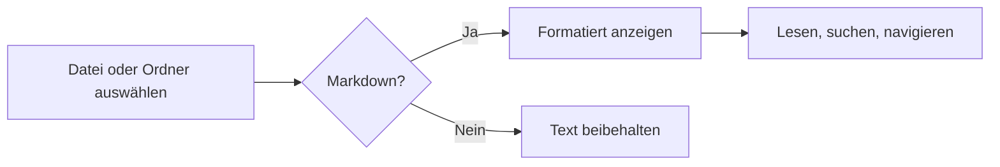

# Willkommen bei Parchment

Parchment ist ein **lokaler Markdown- und Text-Reader**, der im Browser läuft. Dieses Beispiel zeigt die wichtigsten unterstützten Schreibweisen.

> [!tip] Dieses Beispiel verwenden
> Über das „Inhaltsverzeichnis“ rechts können Sie zwischen Abschnitten wechseln. Die Registerkarten „Tags“, „Verknüpfte Notizen“ und „Rückverweise“ zeigen die Beziehungen zwischen den Notizen.

Die Eigenschaften oben stammen aus dem YAML Frontmatter. Klicken Sie auf einen Tag, um den Dateibaum zu filtern.

## Textformatierung

Verwenden Sie **Fettdruck**, *Kursivschrift*, ~~Durchstreichung~~, ==Hervorhebung==, ++eingefügten Text++ und `Inline-Code`.

H~2~O verwendet Tiefstellung und x^2^ Hochstellung. Emoji-Codes wie :sparkles: :books: :rocket: werden automatisch umgewandelt.

Hier ist eine Fußnote.[^read-only]

*[HTML]: HyperText Markup Language

[^read-only]: Parchment öffnet Dateien schreibgeschützt und verändert das Quelldokument nicht.

## Listen und Aufgaben

- Ungeordnete Liste
  - Verschachtelte Einträge werden unterstützt
- Weiterer Eintrag

1. Geordnete Liste
2. Zweiter Schritt

- [x] Dieses Beispiel öffnen
- [ ] Diese Aufgabe umschalten; der Status bleibt im Browser
- [ ] Eigenen Notizordner öffnen

## Tabelle

| Funktion | Einzeldatei | Ordner |
| --- | :---: | :---: |
| Markdown-Darstellung | ✅ | ✅ |
| Relative Bilder und Links | — | ✅ |
| Wiki-Links und Einbettungen | — | ✅ |
| Volltextsuche | — | ✅ |

## Code und Formeln

```js
const [handle] = await window.showOpenFilePicker();
const file = await handle.getFile();
console.log(await file.text());
```

Inline-Formel: $E = mc^2$.

$$
\int_{0}^{1} x^2 \, dx = \frac{1}{3}
$$

## Diagramm



## Hinweise

> [!note]
> Eine normale Notiz.

> [!warning] Eigener Titel
> Hinweise können **Markdown** enthalten.

> [!question]- Kann der Hinweis eingeklappt werden?
> Ja. Ein `-` nach dem Typ klappt ihn standardmäßig ein.

## Notizlinks und Einbettungen

Öffnen Sie [[linked-note]] oder springen Sie zu [[linked-note#Einbettbarer Abschnitt|einem Abschnitt der verknüpften Notiz]].

![[linked-note#Einbettbarer Abschnitt]]

![[linked-note#^summary]]

## Bild


![[parchment-logo-transparent.png|96]]

## Nächste Schritte

1. Wählen Sie **Ordner öffnen** und öffnen Sie Ihren Notizordner.
2. Durchsuchen Sie alle Notizen über die linke Seitenleiste.
3. Probieren Sie in den Einstellungen eine andere Sprache, Palette oder Schriftart aus.

Dieses Beispiel ist auch offline verfügbar.
