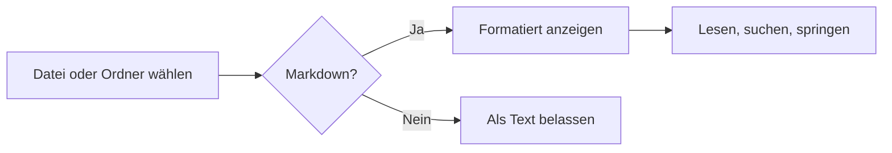
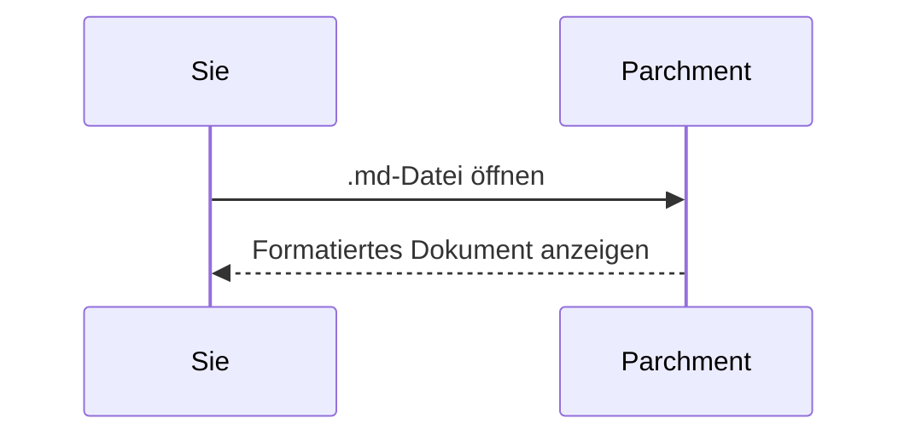
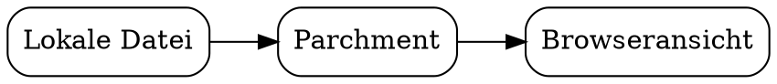

# Willkommen bei Parchment

Parchment ist ein **lokaler Reader für Markdown und reinen Text**, der in Ihrem Browser läuft. Dieses Dokument ist selbst ein Beispiel: Jeder Abschnitt zeigt eine Art von Inhalt, die Parchment darstellen kann, sodass Sie Quelltext und Ergebnis vergleichen können.

> [!tip] So verwenden Sie dieses Beispiel
> - Über das Inhaltsverzeichnis rechts springen Sie zu jedem Abschnitt; Einträge mit Unterüberschriften lassen sich zuklappen.
> - Öffnen Sie die Registerkarten Tags, Verknüpfte Notizen und Rückverweise, um die Tags dieses Dokuments und seine Verbindung zur zweiten Beispielnotiz zu sehen.
> - Bilder und Diagramme lassen sich per **Klick vergrößern** und als PNG speichern.

Die Eigenschaften oben stammen aus dem YAML-Front-Matter am Anfang der Datei: `tags` werden zu anklickbaren Tags, die übrigen Felder erscheinen als Tabelle.

## Textformatierung

Absätze können **fett**, *kursiv*, ***fett kursiv***, ~~durchgestrichen~~, ==hervorgehoben==, ++eingefügt++ und `Inline-Code` enthalten.

Die Formel H~2~O verwendet Tiefstellung, x^2^ Hochstellung. Emojis lassen sich direkt eingeben 🎉 oder als Kurzcodes schreiben :sparkles: :books: :rocket:.

Tasten werden als <kbd>Strg</kbd> + <kbd>F</kbd> dargestellt; HTML-<mark>Hervorhebung</mark>, <u>Unterstreichung</u> und H<sub>2</sub>O funktionieren ebenfalls.

Hier steht eine Fußnote[^read-only]; klicken Sie darauf, um sie zu lesen. HTML ist eine Abkürzung: Fahren Sie mit der Maus darüber, um den vollen Namen zu sehen.

*[HTML]: HyperText Markup Language

[^read-only]: Parchment öffnet Dateien schreibgeschützt und verändert Ihre Dokumente nie.

## Überschriften und Inhaltsverzeichnis

Überschriften von `#` bis `######` erscheinen automatisch im Inhaltsverzeichnis rechts, je nach Ebene eingerückt.

### Überschrift Ebene 3

Tiefere Überschriften werden unter der darüberliegenden Überschrift gruppiert.

#### Überschrift Ebene 4

Klicken Sie im Inhaltsverzeichnis auf den Pfeil neben einer Überschrift, um diese Ebene zu- oder aufzuklappen.

## Listen und Aufgaben

- Aufzählung
  - Verschachtelt
    - Noch eine Ebene tiefer
- Zweiter Punkt

1. Nummerierte Liste
2. Zweiter Schritt
   1. Teilschritt
3. Dritter Schritt

- [x] Dieses Beispiel öffnen
- [ ] Diesen Punkt abhaken (der Status wird nur im Browser gespeichert und ändert die Datei nicht)
- [ ] Einen eigenen Notizordner öffnen

## Zitate

> Wer immer strebend sich bemüht, den können wir erlösen.
> — Johann Wolfgang von Goethe, *Faust II*

> Zitate lassen sich verschachteln
>> Zweite Ebene
>>> Dritte Ebene

## Tabellen

Spalten lassen sich links, zentriert oder rechts ausrichten:

| Funktion | Einzeldatei | Ordner |
| :--- | :---: | :---: |
| Markdown-Darstellung | ✅ | ✅ |
| Relative Bilder und Links | — | ✅ |
| Wiki-Links und Einbettungen | — | ✅ |
| Volltextsuche | — | ✅ |

Tabellen mit vielen Spalten passen ihre Breite automatisch an und lassen sich nur seitlich scrollen, wenn sie nicht hineinpassen:

| Nr. | Name | Kategorie | Preis | Bestand | Herkunft | Erschienen | Hinweise |
| --- | --- | --- | ---: | ---: | --- | --- | --- |
| 001 | Pergament-Notizbuch | Schreibwaren | 11,00 € | 25 | Taiwan | 2026-01-15 | Handgebunden |
| 002 | Füllertinte | Schreibwaren | 15,50 € | 8 | Japan | 2026-03-02 | Blauschwarz, wasserfest |

## Code

Codeblöcke werden je nach Sprache farbig hervorgehoben. Fahren Sie mit der Maus in die rechte obere Ecke, um einen Block zu kopieren.

```js
// Vom Nutzer gewählte Datei schreibgeschützt lesen
const [handle] = await window.showOpenFilePicker();
const file = await handle.getFile();
console.log(await file.text());
```

```python
def greet(name: str) -> str:
    return f"Hallo, {name}!"
```

## Mathematische Formeln

Formel im Text: Äquivalenz von Masse und Energie $E = mc^2$, Kreisfläche $A = \pi r^2$.

Abgesetzte Formeln:

$$
\int_{0}^{1} x^2 \, dx = \frac{1}{3}
$$

$$
x = \frac{-b \pm \sqrt{b^2 - 4ac}}{2a}
$$

## Diagramme

Diagramme passen sich der Lesebreite an. **Klicken Sie auf ein Diagramm**, um es zu vergrößern, zu verschieben oder als PNG zu speichern.

Mermaid-Flussdiagramm:



Mermaid-Sequenzdiagramm:



Graphviz-Diagramm (`dot`):



## Hinweisboxen

> [!note]
> Eine gewöhnliche Notiz.

> [!success] Erledigt
> Kennzeichnet etwas, das abgeschlossen ist.

> [!warning] Eigener Titel
> Der Titel ist frei wählbar, und der Inhalt kann **Markdown** enthalten.

> [!danger] Gefahr
> Warnt vor Aktionen, die sich nicht rückgängig machen lassen.

> [!example] Beispiel
> Außerdem gibt es die Typen info, tip, question, failure, bug, quote und abstract, jeweils mit eigenem Symbol und eigener Farbe.

> [!question]- Lassen sie sich zuklappen?
> Ja. Mit `-` nach dem Typ ist die Box anfangs zugeklappt, mit `+` aufgeklappt.

> [!NOTE]
> Hinweise im GitHub-Format werden ebenfalls angezeigt.

## Aufklappbare Inhalte

<details>
<summary>Zum Aufklappen klicken</summary>

Mit den HTML-Tags `<details>` und `<summary>` lassen sich längere Inhalte einklappen.

</details>

## Notizlinks

Doppelte eckige Klammern verlinken eine andere Notiz: [[linked-note]]. Sie können auch Anzeigetext und Überschrift angeben: [[linked-note#Einbettbarer Abschnitt|zu einem Abschnitt der verknüpften Notiz springen]].

Webadressen öffnen sich in einem neuen Tab: [Parchment auf GitHub](https://github.com/bruce-yang-422/parchment). Auch innerhalb dieses Dokuments können Sie springen: [zurück zu den Tabellen](#tabellen).

Einen ganzen Abschnitt einbetten:

![[linked-note#Einbettbarer Abschnitt]]

Oder nur einen Block:

![[linked-note#^summary]]

Wenn eine andere Notiz hierher verlinkt, zeigt die Registerkarte Rückverweise rechts die Quelle an.

## Bilder

Ein normales Markdown-Bild mit relativem Pfad. **Klicken Sie auf das Bild**, um es zu vergrößern:


Sie können auch nur den Dateinamen und eine Breite angeben; Parchment sucht die Datei im ganzen Ordner:

![[parchment-logo-transparent.png|96]]

## Definitionsliste

Schreibgeschützt
: Liest Dateiinhalte, ohne etwas zu verändern.

Lokal zuerst
: Dokumente werden im Browser verarbeitet und nie hochgeladen.

## Mehr Syntax ansehen

Das [Markdown-Lesetest-Dokument](https://github.com/bruce-yang-422/parchment/blob/main/samples/de/parchment_markdown_reader_test.md) zeigt noch mehr: Texte in vielen Sprachen, alle 13 Hinweisbox-Typen, Bilder aus dem Web sowie weitere Programmiersprachen und Diagramme. Laden Sie es herunter und öffnen Sie es in Parchment, um alles auf einmal zu sehen.

## Nächste Schritte

1. Wählen Sie oben rechts **Ordner öffnen** und dann Ihren eigenen Notizordner.
2. Geben Sie Suchbegriffe in das Suchfeld der linken Seitenleiste ein, um alle Notizen zu durchsuchen.
3. Probieren Sie über die Einstellungen oben rechts andere Farbschemata und Schriften aus.

Auf dem Smartphone öffnen sich Dateibaum und Dokumentinformationen als seitliche Schubladen. Bei Dokumenten, die länger als vier Bildschirme sind, erscheint die Schaltfläche „Nach oben“ unten rechts, nachdem Sie zwei Bildschirme gescrollt haben; kurze Dokumente zeigen sie nicht. Am Desktop bewegen Sie den Mauszeiger in die rechte untere Ecke des Lesebereichs, um sie einzublenden.

---

Dieses Beispiel wird mit der Website bereitgestellt und funktioniert auch offline.
