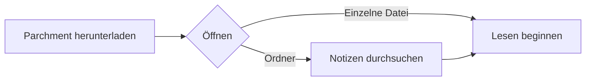
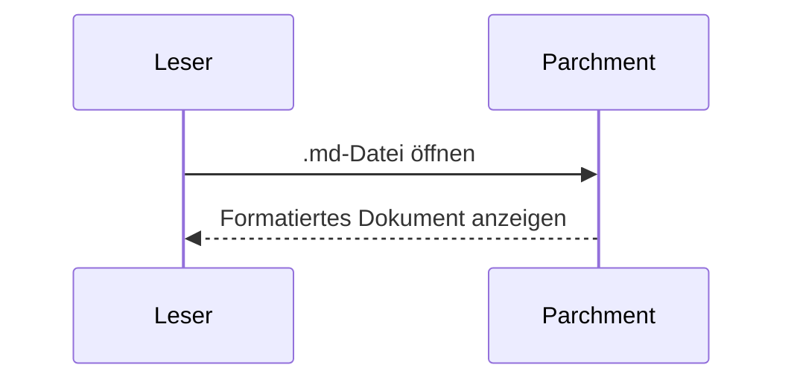
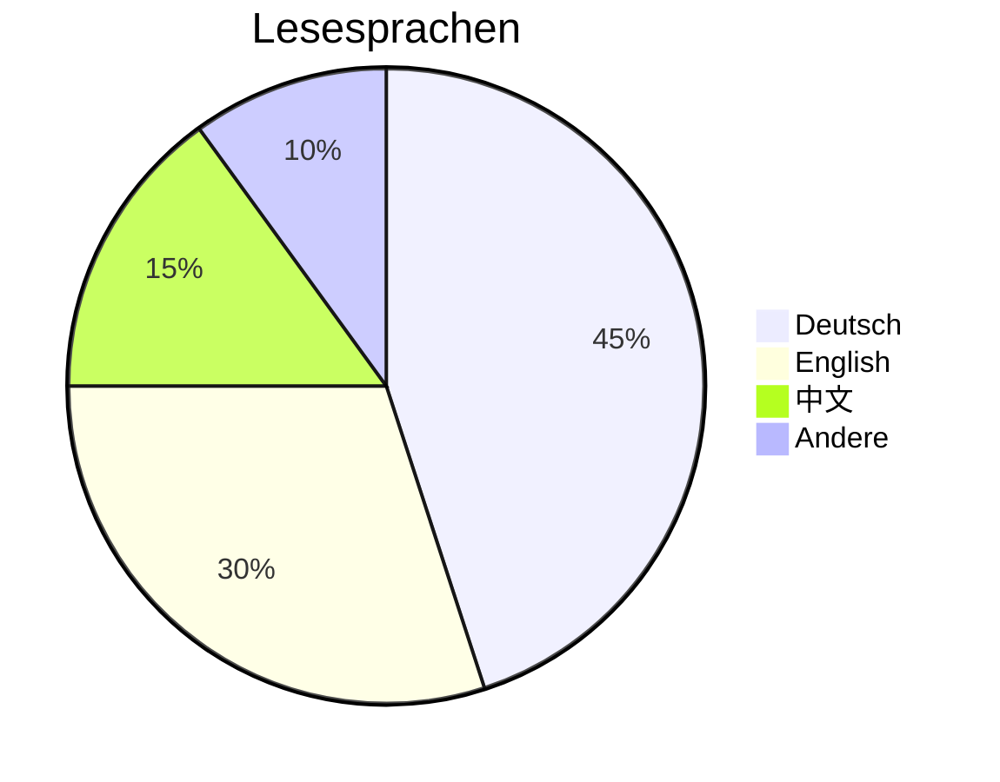

# Parchment-Lesetest

Willkommen bei **Parchment**! Dieses Dokument enthält viele Arten von Markdown-Syntax und Texte in vielen Sprachen. Laden Sie es herunter und öffnen Sie es in Parchment, um alles zu sehen, was die App darstellen kann.

> [!tip] So verwenden Sie dieses Dokument
> 1. Öffnen Sie diese Datei in Parchment.
> 2. Tippen Sie oben rechts auf Inhalt, um zu einem Abschnitt zu springen.
> 3. Probieren Sie unter Leseeinstellungen verschiedene Farbschemata, Schriften und Schriftgrößen aus.

---

## 1. Überschriften

# Überschrift Ebene 1
## Überschrift Ebene 2
### Überschrift Ebene 3
#### Überschrift Ebene 4
##### Überschrift Ebene 5
###### Überschrift Ebene 6

Eine andere Schreibweise (unterstrichen)
========================================

Zweite Ebene (unterstrichen)
----------------------------

---

## 2. Textformatierung

| Wirkung | Schreibweise | Ergebnis |
| --- | --- | --- |
| Fett | `**fett**` | **Fett** |
| Kursiv | `*kursiv*` | *Kursiv* |
| Fett kursiv | `***fett kursiv***` | ***Fett kursiv*** |
| Durchgestrichen | `~~durchgestrichen~~` | ~~Durchgestrichen~~ |
| Hervorgehoben | `==hervorgehoben==` | ==Hervorgehoben== |
| Unterstrichen | `++unterstrichen++` | ++Unterstrichen++ |
| Hochgestellt | `x^2^` | x^2^ |
| Tiefgestellt | `H~2~O` | H~2~O |
| Inline-Code | `` `code` `` | `print("hi")` |

Unterstriche funktionieren auch: _kursiv_, __fett__.

Maskierte Zeichen: \*nicht kursiv\*, \# keine Überschrift, \[kein Link\].

Diese Zeile endet mit zwei Leerzeichen  
daher bricht der Text hier um (harter Zeilenumbruch).

---

## 3. Mehrsprachig

Die folgenden Texte prüfen nur, ob die Schriften richtig angezeigt werden (keine Kästchen „□“ oder unleserlichen Zeichen). Sie müssen sie nicht verstehen.

### 繁體中文
落霞與孤鶩齊飛，秋水共長天一色。Parchment 是一款讓你安靜閱讀 Markdown 筆記的 App。

### 简体中文
落霞与孤鹜齐飞，秋水共长天一色。Parchment 是一款让你安静阅读 Markdown 笔记的 App。

### English
The quick brown fox jumps over the lazy dog. *Parchment* lets you read your Markdown notes in peace.

### 日本語
いろはにほへと ちりぬるを わかよたれそ つねならむ。**Parchment** は Markdown のノートを静かに読むためのアプリです。

### 한국어
다람쥐 헌 쳇바퀴에 타고파. **Parchment**는 Markdown 노트를 조용히 읽을 수 있는 앱입니다.

### Français
Portez ce vieux whisky au juge blond qui fume. Ça, c'est l'été à Noël — « déjà vu » !

### Deutsch
Victor jagt zwölf Boxkämpfer quer über den großen Sylter Deich. Straße, Größe, Übung.

### Español
El veloz murciélago hindú comía feliz cardillo y kiwi. ¿Dónde está la señal? ¡Olé!

### Italiano · Português
Quel vituperabile xenofobo zelante assaggia il whisky ed esclama: alleluja!
Luís argüia à Júlia que «brações, fé, chá, óxido, pôr, zângão» eram palavras do português.

### Русский
Съешь же ещё этих мягких французских булок, да выпей чаю.

### Ελληνικά
Ξεσκεπάζω την ψυχοφθόρα βδελυγμία.

### Tiếng Việt
Tiếng Việt có dấu: ă â đ ê ô ơ ư — Trăm năm trong cõi người ta.

### ภาษาไทย
เป็นมนุษย์สุดประเสริฐเลิศคุณค่า

### हिन्दी
ऋषियों को सताने वाले दुष्ट राक्षसों के राजा रावण का सर्वनाश करने वाले विष्णु।

### Von rechts nach links
- العربية: مرحبًا بك في Parchment.
- עברית: ברוכים הבאים ל־Parchment.

### Gemischt
Deutsch English 中文 日本語 한국어 in einer Zeile, mit Ziffern 1234567890 sowie 「Satzzeichen」 in voller und (Satzzeichen) in halber Breite nebeneinander.

---

## 4. Emojis

Direkt eingegeben: 😀 🎉 📚 ✍️ 🌏 🇩🇪 🇦🇹 🇨🇭 👍🏽 👨‍👩‍👧‍👦

Kurzcodes: :smile: :heart: :rocket: :books: :+1:

---

## 5. Listen

### Aufzählung
- Apfel
- Banane
  - Zweite Ebene
    - Dritte Ebene
* Sternchen gehen auch
+ Pluszeichen ebenfalls

### Nummerierte Liste
1. Erster Schritt
2. Zweiter Schritt
   1. Teilschritt 2.1
   2. Teilschritt 2.2
3. Dritter Schritt

Nummerierung ab 5:

5. Fünf
6. Sechs

### Aufgabenliste (abhaken und in der Datei speichern)
- [x] Parchment herunterladen
- [x] Dieses Testdokument öffnen
- [ ] Ein anderes Farbschema ausprobieren
- [ ] Eine andere Schrift ausprobieren
- [ ] Hier tippen, um das Kästchen abzuhaken

---

## 6. Links

- Normaler Link: [Parchment auf GitHub](https://github.com/bruce-yang-422/parchment)
- Automatischer Link: <https://www.markdownguide.org>
- Link mit Titel: [Markdown-Leitfaden](https://www.markdownguide.org "Wird beim Darüberfahren angezeigt")
- Referenzlink: [CommonMark][cm]
- Link innerhalb des Dokuments: [Zurück zum Abschnitt Tabellen](#8-tabellen)
- Wiki-Links: [[Eine andere Notiz]], [[Eine andere Notiz|Angezeigter Name]]

[cm]: https://commonmark.org

---

## 7. Bilder

### Bild aus dem Web
Benötigt eine Internetverbindung:


### Bild aus Wikipedia
*Reisende zwischen Bergen und Bächen* von Fan Kuan, Nördliche Song-Dynastie (Nationales Palastmuseum, Taipeh; gemeinfrei; Quelle: [Wikimedia Commons](https://commons.wikimedia.org/wiki/File:Fan_Kuan_-_Travelers_Among_Mountains_and_Streams_-_Google_Art_Project.jpg)). Ein hohes Bild; tippen Sie darauf, um es zu vergrößern:


### Verlinktes Bild (Flickr)
Ein Bild in einem Link, wie es die Teilen-Funktion von Flickr erzeugt, um verlinkte Bilder zu testen:

[](https://flic.kr/p/nqShrs "IMG_2247")

*Aufgenommen im Frühling 2014 am Algenriff Laomei in Shimen, Neu-Taipeh. Leuchtend grüne Algen bedecken die von Wellen ausgewaschenen Vulkangesteinsrinnen; die Langzeitbelichtung lässt die Brandung wie Nebel wirken.*

### Breite per HTML festgelegt


### Fehlendes Bild
Dieses Bild fehlt absichtlich, um die Fehlermeldung zu testen:


---

## 8. Tabellen

| Sprache | Gruß | Schreibrichtung |
| :--- | :---: | ---: |
| Deutsch | Guten Tag | LTR |
| English | Hello | LTR |
| 繁體中文 | 你好 | LTR |
| 日本語 | こんにちは | LTR |
| 한국어 | 안녕하세요 | LTR |
| Français | Bonjour | LTR |
| Español | Hola | LTR |
| العربية | مرحبا | RTL |

### Breite Tabelle (seitlich scrollen)

| Nr. | Name | Kategorie | Preis | Bestand | Herkunft | Erschienen | Hinweise |
| --- | --- | --- | ---: | ---: | --- | --- | --- |
| 001 | Pergament-Notizbuch | Schreibwaren | 11,00 € | 25 | Taiwan | 2026-01-15 | Handgebunden, langlebig |
| 002 | Füllertinte | Schreibwaren | 15,50 € | 8 | Japan | 2026-03-02 | Blauschwarz, wasserfest |
| 003 | Notebook A5 | Stationery | 12,50 € | 140 | Deutschland | 2026-05-20 | Gepunktet, 120 g/m² |

---

## 9. Zitate

> Wer immer strebend sich bemüht, den können wir erlösen.
> — Johann Wolfgang von Goethe, *Faust II*

> Erste Ebene
>> Zweite Ebene
>>> Dritte Ebene

> Zitate können **Fettdruck**, `Code` und Listen enthalten:
> - Punkt eins
> - Punkt zwei

---

## 10. Hinweisboxen

> [!note] Notiz
> Eine gewöhnliche Notiz.

> [!info] Info
> Zusätzliche Informationen.

> [!tip] Tipp
> Text lange drücken, um ihn zu kopieren.

> [!success] Erfolg
> Erledigt!

> [!question] Frage
> Welches Farbschema gefällt Ihnen am besten?

> [!warning] Achtung
> Erstellen Sie vor dem Bearbeiten eine Sicherung.

> [!danger] Gefahr
> Dieser Vorgang kann nicht rückgängig gemacht werden.

> [!failure] Fehlgeschlagen
> Datei nicht gefunden.

> [!bug] Fehler
> Bitte fügen Sie einer Fehlermeldung einen Screenshot bei.

> [!example] Beispiel
> Dies ist ein Beispiel.

> [!quote] Zitat
> Übung macht den Meister.

> [!abstract] Zusammenfassung
> Dieses Dokument testet die Darstellung in Parchment.

> [!tip]- Aufklappbare Hinweisbox (standardmäßig zugeklappt, zum Öffnen tippen)
> Sie haben den versteckten Inhalt gefunden! 🎉

---

## 11. Code

Inline-Code: `const name = 'Parchment';`

### Dart
```dart
void main() {
  final greeting = 'Hallo, Parchment!';
  print(greeting);
}
```

### Python
```python
def greet(name: str) -> str:
    """Mehrsprachiger Gruß / Multilingual greeting"""
    return f"Hallo, {name}!"

print(greet("Parchment"))
```

### JavaScript
```javascript
const langs = ['de', 'en', 'zh-TW', 'zh-CN', 'ja', 'ko', 'fr', 'es'];
langs.forEach((lang, i) => console.log(`${i + 1}. ${lang}`));
```

### JSON
```json
{
  "app": "Parchment",
  "languages": ["Deutsch", "English", "繁中", "日本語", "한국어"],
  "offline": true
}
```

### Shell
```bash
# Eine sehr lange Befehlszeile, um das waagerechte Scrollen in einem Codeblock zu testen, die weit über den Rand hinausgeht
echo "Hallo, Parchment" && ls -la ~/Documents/notes/markdown/very/deep/folder/structure/
```

### SQL
```sql
SELECT title, author FROM notes WHERE lang = 'Deutsch' ORDER BY updated_at DESC;
```

### Ohne Sprachangabe
```
Codeblock als reiner Text
  Einrückung bleibt erhalten
```

### Eingerückter Code (vier Leerzeichen)

    Auch das ist ein Codeblock
    Indented code block

---

## 12. Mathematische Formeln

Formel im Text: Äquivalenz von Masse und Energie $E = mc^2$, Kreisfläche $A = \pi r^2$.

Abgesetzte Formeln:

$$
x = \frac{-b \pm \sqrt{b^2 - 4ac}}{2a}
$$

$$
\int_0^\infty e^{-x^2}\,dx = \frac{\sqrt{\pi}}{2}
$$

$$
\sum_{n=1}^{\infty} \frac{1}{n^2} = \frac{\pi^2}{6}
$$

---

## 13. Diagramme

### Mermaid-Flussdiagramm


### Mermaid-Sequenzdiagramm


### Mermaid-Kreisdiagramm


### Graphviz


---

## 14. Fußnoten

Parchment unterstützt Fußnoten[^1], Fußnoten mit Wortnamen[^hinweis] und längere Fußnoten[^long].

[^1]: Das ist die erste Fußnote. Tippen Sie auf den Rückpfeil am Ende, um zum Text zurückzukehren.
[^hinweis]: Fußnoten mit Wortnamen lassen sich ebenfalls normal öffnen.
[^long]: Fußnoten können **Fettdruck**, `Code` und [Links](https://commonmark.org) enthalten.

---

## 15. HTML-Tags

- Tastatur: <kbd>Strg</kbd> + <kbd>C</kbd> zum Kopieren
- <mark>HTML-Hervorhebung</mark>, <u>unterstrichen</u>, <s>durchgestrichen</s>
- Chemie H<sub>2</sub>O, Quadrat x<sup>2</sup>
- Zeilen<br>umbruch mit dem br-Tag

<details>
<summary>Zum Aufklappen klicken</summary>

Dieser Inhalt bleibt zugeklappt, bis Sie ihn öffnen.

- Verstecktes Element eins
- Verstecktes Element zwei

</details>

---

## 16. Definitionsliste

Markdown
: Eine leichtgewichtige Auszeichnungssprache, um formatierte Dokumente als reinen Text zu schreiben.

Parchment
: Eine App, um Markdown ohne Ablenkung zu lesen.
: Ein Begriff kann eine zweite Erklärung haben.

---

## 17. Abkürzungen

HTML und CSS sind die Grundlagen des Webs, und PDF wird oft zum Drucken verwendet.

*[HTML]: HyperText Markup Language
*[CSS]: Cascading Style Sheets
*[PDF]: Portable Document Format

---

## 18. Trennlinien

Alle drei Schreibweisen sehen gleich aus:

***

---

___

---

## 19. Langer Absatz

Test von Layout und flüssigem Scrollen: Lorem ipsum dolor sit amet, consectetur adipiscing elit, sed do eiusmod tempor incididunt ut labore et dolore magna aliqua. 春眠不覺曉，處處聞啼鳥。夜來風雨聲，花落知多少。Ut enim ad minim veniam, quis nostrud exercitation ullamco laboris nisi ut aliquip ex ea commodo consequat. 古池や蛙飛び込む水の音。Duis aute irure dolor in reprehenderit in voluptate velit esse cillum dolore eu fugiat nulla pariatur. 산에는 꽃 피네 꽃이 피네 갈 봄 여름 없이 꽃이 피네. Excepteur sint occaecat cupidatat non proident, sunt in culpa qui officia deserunt mollit anim id est laborum.

Eine sehr lange Adresse oder ein Wort ohne Leerzeichen, um den Zeilenumbruch zu testen: https://example.com/a/very/long/path/that/keeps/going/and/going/without/any/spaces/to/break/the/line/naturally/index.html

---

## Test abgeschlossen 🎉

Wenn Sie das lesen, wurde das ganze Dokument geladen. Mit der Schaltfläche Nach oben unten rechts kehren Sie zum Anfang zurück.

Wenn etwas nicht richtig angezeigt wird, melden Sie es bitte unter [GitHub Issues](https://github.com/bruce-yang-422/parchment/issues). Vielen Dank für Ihre Hilfe!
