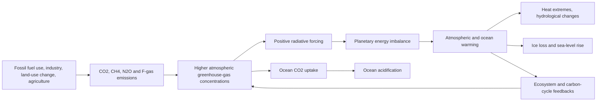
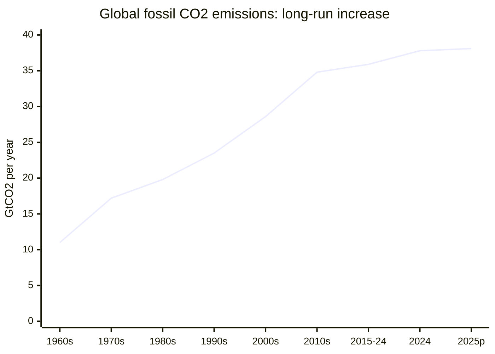
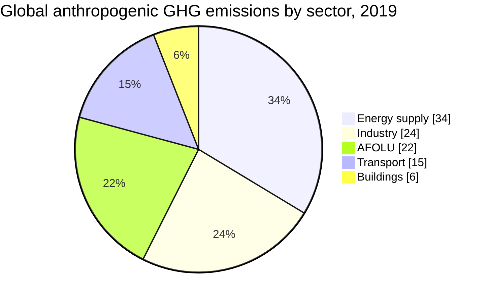
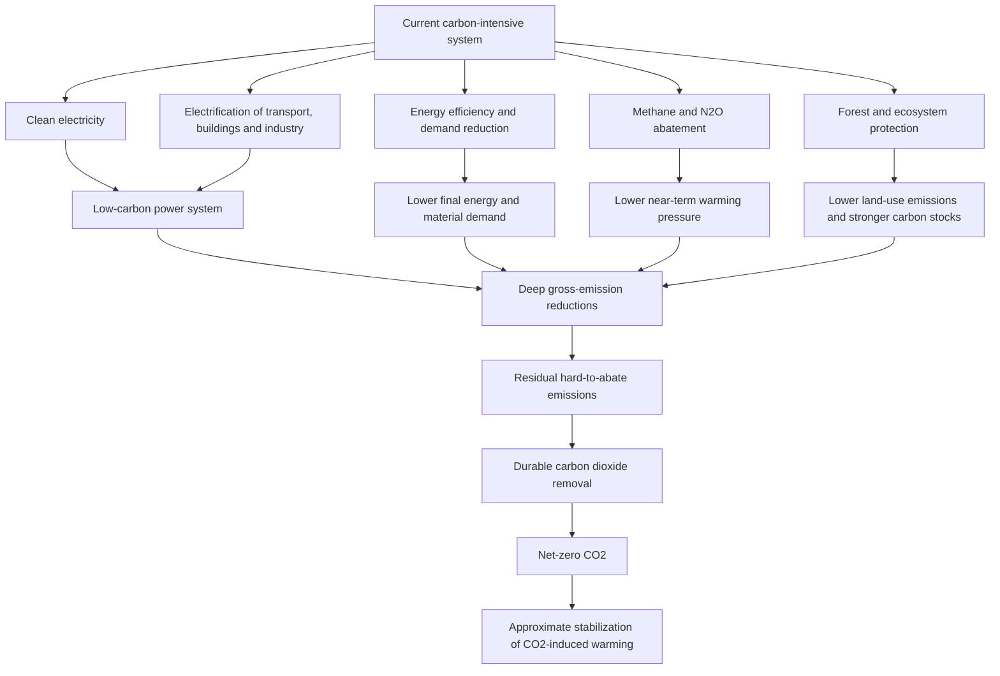

# Carbon Emissions and Carbon Footprints: Impacts on the Global Climate System

## Executive Summary

> **Central finding.** The evidence that anthropogenic greenhouse-gas emissions are the dominant cause of modern global warming is unequivocal. Carbon dioxide (CO₂) is the largest single contributor because of the enormous cumulative quantity emitted, its long-lived influence on the carbon cycle, and the near-linear relationship between cumulative CO₂ emissions and global mean temperature. Methane (CH₄), nitrous oxide (N₂O), and fluorinated gases add substantial additional forcing.[^3] [^5]

Human activities had raised global surface temperature to about **1.1°C above the 1850–1900 average in 2011–2020**. The IPCC estimates that total human-caused warming over 1850–1900 to 2010–2019 was about **1.07°C**, while natural solar and volcanic influences made only a small contribution to the observed long-term change. Greenhouse gases alone would have produced more warming, but part of their effect has been masked by anthropogenic aerosols.[^5]

The scale of the underlying carbon perturbation is unprecedented in the observational era. Atmospheric CO₂ was approximately **270–280 ppm before industrialization** and reached a global marine-boundary-layer annual mean of **425.62 ± 0.05 ppm in 2025**, according to NOAA. The combined effective radiative forcing of long-lived greenhouse gases reached **3.59 W m⁻² above pre-industrial conditions in 2025**, 56% above the equivalent forcing in 1990. CO₂ alone contributed **2.37 W m⁻²**, or about two-thirds of the long-lived-greenhouse-gas total.[^7]

Global emissions have nevertheless continued to increase. The IPCC estimated **59 ± 6.6 GtCO₂-eq** of net anthropogenic greenhouse-gas emissions in 2019, 54% above 1990. The Global Carbon Budget 2025 estimated global fossil CO₂ emissions at **37.8 ± 2 GtCO₂ in 2024** and projected approximately **38.1 GtCO₂ in 2025**, although methodological definitions differ between datasets. The IEA independently estimated nearly **38.4 GtCO₂ of energy-related CO₂ emissions in 2025**. These figures should not be treated as interchangeable because their sectoral boundaries differ.[^1] [^2] [^4] [^6]

Carbon footprints extend the analysis beyond territorial emissions. A *production-based inventory* assigns emissions to the place where they physically occur; a *consumption-based carbon footprint* reallocates embodied emissions through international supply chains to final consumers. This distinction matters because traded goods allow high-consuming regions to externalize part of their territorial emissions. Multi-regional input-output studies nevertheless contain greater structural and data uncertainty than national combustion inventories.[^4] [^10]

The distribution of responsibility is highly unequal. In 2019 the highest-emitting 10% of households accounted for roughly **34–45% of global consumption-based household greenhouse-gas emissions**, whereas the lowest-emitting 50% accounted for only **13–15%**. Regional differences are similarly large: North American greenhouse-gas emissions were around **19 tCO₂-eq per person** in 2019, compared with approximately **2.5 tCO₂-eq per person** in Southern Asia.[^4]

The climatic consequences already observed include increasing heat extremes, heavier precipitation in many regions, changes in drought risk, ocean warming, cryosphere loss, accelerating sea-level rise, and ocean acidification. Global mean sea level rose approximately **0.20 m from 1901 to 2018**, while its rate increased to **3.7 [3.2–4.2] mm yr⁻¹ during 2006–2018**. Surface-ocean pH has declined by about **0.1 units since the industrial era**, corresponding to roughly a 30% increase in hydrogen-ion concentration.[^5] [^9]

The strongest physical constraint on future warming is cumulative CO₂. The IPCC assesses a best-estimate transient climate response to cumulative emissions of approximately **0.45°C per 1,000 GtCO₂**, with a likely range of 0.27–0.63°C. Consequently, stabilizing human-induced warming requires global net anthropogenic CO₂ emissions to approach zero; continuing positive emissions causes additional warming.[^3]

Mitigation technologies are already available at significant scale. IPCC assessments indicate that options costing **US$100 tCO₂-eq⁻¹ or less could reduce global greenhouse-gas emissions by at least half of the 2019 level by 2030**, with more than half of that assessed potential costing below US$20 tCO₂-eq⁻¹. Major low-cost opportunities include solar and wind power, energy efficiency, methane abatement, and avoiding conversion of forests and other natural ecosystems. Feasibility, however, depends not only on engineering cost but also on grid infrastructure, financing, institutions, land constraints, behavioral change, social acceptance, and distributional consequences.[^4]

## Abstract and Introduction

This paper examines the relationship between **carbon emissions, carbon footprints, atmospheric greenhouse-gas accumulation, radiative forcing, and climatic change** from approximately 1850 to the present. The analytical scope is global unless otherwise specified. It distinguishes physical emissions from consumption-based carbon footprints, evaluates the strength of evidence linking emissions to climate impacts, identifies major uncertainties, and assesses principal mitigation pathways.

The term **carbon emissions** is used here primarily for CO₂ released by fossil-fuel combustion, industrial processes, and land-use change, while *greenhouse-gas emissions* additionally include CH₄, N₂O, and fluorinated gases. A **carbon footprint** refers more broadly to direct and indirect greenhouse-gas emissions attributable to a product, activity, organization, household, or population, commonly expressed in tonnes of carbon-dioxide equivalent (tCO₂-eq). Consumption-based footprints include emissions embodied in imported goods and services, making them conceptually different from territorial national inventories.[^4] [^10]

The aggregation of multiple greenhouse gases into CO₂-equivalent emissions relies on a climate metric, usually the **100-year Global Warming Potential, GWP₁₀₀**. The IPCC AR6 GWP₁₀₀ estimate is 1 for CO₂, approximately **29.8 for fossil CH₄**, **27.0 for non-fossil CH₄**, and **273 for N₂O**, although uncertainties are substantial. A gas with a GWP₁₀₀ of 273 therefore produces, per unit mass emitted, an integrated radiative influence over 100 years approximately 273 times the reference influence of an equal mass of CO₂ under the metric’s assumptions. GWP values should not be interpreted as exact physical equivalences at every time horizon.[^3]

The fundamental causal sequence is:

**Figure 1. Conceptual causal chain from anthropogenic activities to climatic and biogeochemical impacts.** The direction of the principal greenhouse-gas pathway is supported by multiple observational, theoretical, and modeling lines of evidence assessed by the IPCC.[^3] [^5]

### Explicit assumptions

1. **Geographic scope:** global, with regional comparisons where robust datasets permit.
2. **Historical period:** approximately 1850–present unless another period is identified.
3. **Emission accounting:** production-based emissions are used for physical global totals; consumption-based measures are identified explicitly as footprints.
4. **Climate metric:** CO₂-equivalent values generally use AR6 GWP₁₀₀ unless the source specifies otherwise.
5. **Latest observations:** because complete inventories lag real time, the paper distinguishes *observed historical data* from *provisional or projected values*.
6. **Mitigation costs:** reported cost ranges are global technical-economic estimates rather than guaranteed project-level costs.

The main research question is therefore not simply whether emissions alter climate—this attribution is already well established—but **how emission quantities, sources, geographic responsibility, consumption patterns, atmospheric physics, and carbon-cycle processes combine to determine the scale and persistence of climate change**.

## Methods and Data Sources

The analysis uses a hierarchy of scientific evidence. Highest priority is given to the **IPCC Sixth Assessment Report (AR6)** because it synthesizes thousands of peer-reviewed studies using calibrated confidence language and multiple independent lines of evidence. The physical-science analysis relies primarily on AR6 Working Group I, the emissions and mitigation assessment on Working Group III, and the integrated impacts assessment on the 2023 Synthesis Report.[^3] [^4] [^5]

Recent emissions and carbon-cycle data are drawn primarily from the **Global Carbon Budget 2025**, published in *Earth System Science Data*. Its budget integrates fossil CO₂ emissions, land-use change, atmospheric accumulation, ocean uptake, terrestrial uptake, and an explicit budget imbalance. For 1850–2024 it estimated cumulative anthropogenic emissions of **745 ± 65 GtC**, partitioned approximately into 290 ± 5 GtC retained in the atmosphere, 200 ± 40 GtC absorbed by the ocean, 175 ± 50 GtC absorbed by terrestrial sinks, plus a residual budget imbalance.[^1]

Atmospheric concentration and radiative-forcing data are taken from **NOAA’s Global Monitoring Laboratory**. NOAA’s long-running global network provides measurements of CO₂, CH₄, N₂O and other long-lived greenhouse gases and produces the Annual Greenhouse Gas Index.[^7] [^8]

Energy-related CO₂ information is supplemented by the **International Energy Agency**, particularly where recent sectoral trends are needed. IEA data use a different accounting perimeter from the Global Carbon Budget; consequently, numerical totals are compared only after defining their scopes.[^6]

Consumption-based footprint evidence is based on IPCC assessments and peer-reviewed multi-regional input-output research. Such models trace monetary and physical supply chains through international trade. They are useful for attributing indirect emissions to consumption, but uncertainty arises from sector aggregation, trade statistics, emission-factor harmonization, and differences among MRIO databases. A comparison of five major MRIO systems found meaningful variation in consumption-based carbon-account estimates, illustrating why footprint estimates should not be treated as exact inventory quantities.[^10]

### Core physical relationships

A widely used first-order approximation for CO₂ radiative forcing is

\[
\boxed{\Delta F_{CO_2}\approx 5.35\ln\left(\frac{C}{C_0}\right)\;\text{W m}^{-2}}
\]

where \(C_0\) is the reference CO₂ concentration and \(C\) is the perturbed concentration. This logarithmic relationship means that each proportional increase in CO₂ produces approximately comparable incremental forcing; AR6 uses updated spectroscopic treatments for formal assessments, but the logarithmic approximation remains useful pedagogically.[^3]

The global carbon budget may be expressed schematically as

\[
E_{\mathrm{FOS}}+E_{\mathrm{LUC}}
=
G_{\mathrm{ATM}}
+
S_{\mathrm{OCEAN}}
+
S_{\mathrm{LAND}}
+
B_{\mathrm{IM}},
\]

where \(E_{\mathrm{FOS}}\) is fossil and industrial CO₂ emissions, \(E_{\mathrm{LUC}}\) is land-use-change emissions, \(G_{\mathrm{ATM}}\) is atmospheric accumulation, \(S_{\mathrm{OCEAN}}\) and \(S_{\mathrm{LAND}}\) are ocean and terrestrial sinks, and \(B_{\mathrm{IM}}\) is the residual budget imbalance. Over 2015–2024, the Global Carbon Budget estimated that approximately **50%** of total anthropogenic CO₂ emissions accumulated in the atmosphere, **29%** entered the ocean, and **21%** entered the terrestrial sink, with a near-zero mean imbalance over that decade.[^1]

For temperature, AR6 gives the approximate cumulative relationship

\[
\Delta T \approx \mathrm{TCRE}\times
\frac{E_{\mathrm{cum}}}{1000\ \mathrm{GtCO_2}},
\]

with

\[
\mathrm{TCRE}_{\text{best estimate}}\approx0.45^{\circ}\mathrm{C}\; / \;1000\ \mathrm{GtCO_2}.
\]

This near-linear relationship is one reason cumulative CO₂ emissions, rather than only a single year’s emission rate, are central to climate policy.[^3]

For non-CO₂ gases, the GWP over horizon \(H\) is conceptually

\[
\mathrm{GWP}_i(H)
=
\frac{\int_0^H RF_i(t)\,dt}
{\int_0^H RF_{CO_2}(t)\,dt},
\]

where \(RF_i(t)\) is the time-dependent radiative forcing following a pulse emission of species \(i\). The selected time horizon alters the apparent relative importance of short-lived gases such as CH₄.[^3]

## Results

Global anthropogenic emissions have risen sharply since industrialization. Historical cumulative net CO₂ emissions from **1850 to 2019 were about 2,400 ± 240 GtCO₂**, and approximately 42% of that cumulative amount was emitted during 1990–2019. This demonstrates the unusually rapid accumulation of emissions in recent decades.[^4]

The Global Carbon Budget shows the same long-term pattern for fossil CO₂. Average fossil emissions increased from approximately **3.0 GtC yr⁻¹ in the 1960s** to **9.8 GtC yr⁻¹ during 2015–2024**, equivalent to roughly 11 and 36 GtCO₂ yr⁻¹ respectively. Fossil CO₂ emissions reached approximately 37.8 GtCO₂ in 2024, 69% above 1990.[^1]

**Figure 2. Approximate global fossil CO₂ emission trend.** Decadal figures are converted from GtC to GtCO₂ using \(44/12\); 2025 is the Global Carbon Budget 2025 projection rather than a finalized inventory.[^1] [^2]

### Sectoral and regional emission patterns

In 2019, energy supply accounted for approximately **34%** of global net anthropogenic greenhouse-gas emissions, industry 24%, AFOLU 22%, transport 15%, and buildings 6%. These categories sum to about 101% because the reported shares are rounded. When electricity and heat emissions are reassigned from the energy-supply sector to final users, the relative contributions of industry and buildings rise considerably, demonstrating that sectoral shares depend on accounting conventions.[^4]

**Figure 3. Approximate sector shares of net anthropogenic GHG emissions in 2019.** Values are IPCC estimates expressed in CO₂-equivalent using AR6 GWP₁₀₀.[^4]

| Accounting dimension | Major source / region | Approximate magnitude | Interpretation |
|---|---|---:|---|
| **Sector, 2019 GHG** | Energy supply | 20 GtCO₂-eq; 34% | Largest direct sector globally.[^4] |
|  | Industry | 14 GtCO₂-eq; 24% | Includes industrial energy and process emissions.[^4] |
|  | AFOLU | 13 GtCO₂-eq; 22% | Includes agriculture, forestry and land-use change.[^4] |
|  | Transport | 8.7 GtCO₂-eq; 15% | Dominated by fossil-fuel transport systems.[^4] |
|  | Buildings | 3.3 GtCO₂-eq; 6% direct | Share becomes about 16% when indirect electricity/heat is allocated to users.[^4] |
| **Fossil CO₂, 2024** | China | 12.3 GtCO₂; 31.7% | Largest territorial fossil emitter.[^2] |
|  | United States | 4.9 GtCO₂; 12.7% | Per-capita fossil CO₂ about 14.2 tCO₂.[^2] |
|  | India | 3.2 GtCO₂; 8.3% | Per-capita fossil CO₂ about 2.2 tCO₂.[^2] |
|  | EU-27 | 2.4 GtCO₂; 6.3% | Per-capita fossil CO₂ about 5.4 tCO₂.[^2] |
|  | Russia | 1.8 GtCO₂; 4.6% | Per-capita fossil CO₂ about 12.3 tCO₂.[^2] |
| **Consumption footprint** | North America | ~13.4 tCO₂-eq capita⁻¹ in cited footprint assessment | Household-linked consumption footprints remain high.[^4] |
|  | Europe | ~7.5 tCO₂-eq capita⁻¹ | Lower than North America but well above low-income regions.[^4] |
|  | Africa and Middle East* | ~1.7 tCO₂-eq capita⁻¹ | Illustrates large global inequality; source grouping is broad.[^4] |

**Table 1. Major emissions sources by sector and region.** Sectoral GHG figures, territorial fossil-CO₂ figures, and consumption-based footprints use different system boundaries and should not be summed or directly substituted for one another. *The cited consumption-footprint source aggregates Africa and the Middle East and should therefore not be interpreted as a homogeneous regional value.[^4] [^10]

The regional distribution also changes depending on whether analysis considers annual emissions, cumulative historical responsibility, per-capita emissions, or consumption-based footprints. Developed economies have generally contributed a larger share of cumulative historical CO₂ emissions than their present population shares, while East Asia’s share of contemporary annual emissions has risen greatly since 2000. The IPCC notes that developed countries averaged about **9.5 tCO₂ of fossil-and-industrial CO₂ per capita in 2019**, versus roughly **4.4 tCO₂ in Asia-Pacific, 2.7 tCO₂ in Latin America and the Caribbean, and 1.2 tCO₂ in Africa**.[^4]

### Radiative forcing and climate response

The physical link between emissions and warming operates through atmospheric concentrations and radiative forcing. AR6 estimated 2019 effective radiative forcing relative to 1750 from CO₂ at **2.16 [1.90–2.41] W m⁻²**, CH₄ at **0.54 [0.43–0.65] W m⁻²**, N₂O at **0.21 [0.18–0.24] W m⁻²**, and halogenated gases at **0.41 [0.33–0.49] W m⁻²**.[^3]

NOAA’s later observationally based index shows that forcing has continued to increase: in 2025 the combined effective radiative forcing from the long-lived gases in its AGGI reached approximately **3.59 W m⁻² relative to pre-industrial conditions**, with CO₂ responsible for approximately **66%** and CH₄ 16%. Since 1990, CO₂ accounted for about 81% of the increase in long-lived greenhouse-gas forcing.[^7]

That forcing creates a planetary energy imbalance. AR6 assessed that the observed average rate of heating of the climate system increased from approximately **0.50 [0.32–0.69] W m⁻² in 1971–2006** to **0.79 [0.52–1.06] W m⁻² in 2006–2018**. Most excess heat accumulates in the ocean, while additional energy contributes to atmospheric warming, melting land ice, sea-level rise and other Earth-system changes.[^3]

### Observed climatic impacts

Evidence for warming itself and for many associated impacts is exceptionally strong. The IPCC concludes that human activities, principally greenhouse-gas emissions, have **unequivocally caused global warming**. It is virtually certain that hot extremes have become more frequent and intense across most land regions since the 1950s, while human influence has very likely contributed to the approximately twofold increase in marine heatwave frequency since the 1980s.[^3] [^5]

Hydrological effects are less spatially uniform but nevertheless substantial. Warmer air can hold more water vapor, intensifying heavy precipitation in many regions; warming also increases evaporative demand and can intensify agricultural and ecological drought where precipitation does not compensate. Attribution strength varies by region and hazard, which is why statements about global heat extremes generally carry higher confidence than statements about local drought or individual storms.[^3]

Sea-level change provides another integrated measure. Global mean sea level increased approximately **0.20 [0.15–0.25] m between 1901 and 2018**. The average rise accelerated from 1.3 mm yr⁻¹ during 1901–1971 to 3.7 mm yr⁻¹ during 2006–2018, with human influence very likely the main driver since at least 1971.[^5]

CO₂ also alters marine chemistry independently of warming. Roughly 30% of anthropogenic CO₂ released to the atmosphere is taken up by the ocean on broad time scales, producing carbonic acid and increasing hydrogen-ion concentration. Average surface-ocean pH has declined by about **0.1 pH units** since the industrial revolution, reducing carbonate-ion availability for corals, mollusks and other calcifying organisms.[^9]

## Discussion: Evidence, Uncertainty, and Carbon-Footprint Interpretation

A rigorous assessment must distinguish **uncertainty about magnitude** from **uncertainty about causation**. The causal role of anthropogenic greenhouse gases in present global warming is not a major unresolved scientific question; uncertainty instead concerns the exact magnitude and timing of responses, regional patterns, feedback strengths, future socioeconomic emissions, and the effectiveness of mitigation implementation.[^3] [^5]

| Issue | Evidence strength | Principal evidence | Important uncertainty |
|---|---|---|---|
| Anthropogenic GHGs cause modern global warming | **Unequivocal / very strong** | Observed warming, radiative physics, attribution studies, models, paleoclimate constraints.[^5] | Exact partitioning among individual forcing agents and feedbacks. |
| Cumulative CO₂ determines long-term warming approximately linearly | **High confidence** | TCRE relationship across observations and models.[^3] | TCRE likely range 0.27–0.63°C per 1,000 GtCO₂. |
| Heat extremes intensified because of human influence | **Very strong** | Observations and event/long-term attribution.[^3] | Magnitude differs regionally. |
| Heavy precipitation and drought risks are changing | **Strong but spatially heterogeneous** | Observations, thermodynamics, attribution studies.[^3] | Natural variability and regional circulation produce larger uncertainty than for temperature. |
| Sea level is rising because of warming and land-ice loss | **High confidence** | Tide gauges, satellite altimetry, glacier/ice-sheet observations, ocean thermal expansion.[^5] | Ice-sheet dynamics dominate long-tail future uncertainty. |
| Ocean acidification is caused primarily by atmospheric CO₂ uptake | **Very strong** | Carbonate chemistry and direct measurements.[^9] | Biological consequences vary among species and ecosystems. |
| Consumption-based footprints differ from territorial emissions | **Strong** | MRIO trade accounting.[^10] | Database structure, sector aggregation and trade/emission-factor uncertainty. |
| Current land and ocean sinks will absorb a constant fraction indefinitely | **Not supported** | Sink strength varies with climate and carbon-cycle feedbacks.[^1] [^2] | Future sink saturation and regional feedbacks remain uncertain. |

**Table 2. Evidence strength and principal uncertainties.** Confidence terminology follows the direction of IPCC assessments where available rather than representing an independent statistical probability.

Carbon footprints are particularly important for interpreting **responsibility**. Territorial accounting answers, “Where did emissions physically occur?” Consumption accounting asks, “Whose final demand caused the production?” A smartphone manufactured in one country but purchased in another therefore increases the producer’s territorial emissions while contributing to the purchaser’s consumption footprint. Neither measure is inherently “correct” for every policy purpose; they answer different questions.[^4] [^10]

The difference has implications for climate equity. The IPCC finds that the **top 10% of households by per-capita emissions contribute 34–45% of global consumption-based household GHG emissions**, while the bottom half contributes only 13–15%. These inequalities mean that average national footprints can conceal much larger within-country differences associated with income, housing, mobility, energy access, and consumption.[^4]

A recent multi-country MRIO study illustrates the scale of potential demand-side reductions, estimating that a package of low-carbon consumption changes targeted at the top 23.7% of emitters in 116 countries could reduce modeled household consumption-based GHG emissions by about **10.4 GtCO₂-eq**, equivalent to 40.1% of household emissions represented in that analysis. Such results are scenario estimates, not forecasts: they assume specific behavioral substitutions and supply-chain responses and therefore should not be interpreted as guaranteed reductions.[^11]

Carbon-cycle uncertainty is another critical area. For 1850–2024, the Global Carbon Budget reported a cumulative budget imbalance of about **80 GtC**, approximately 11% of estimated total emissions, indicating inconsistencies among independently estimated sources and sinks. For the better-observed 1959–2024 period, the imbalance is smaller. These discrepancies do not invalidate the greenhouse effect; rather, they quantify uncertainty in reconstructing large global carbon fluxes from heterogeneous observations and models.[^1]

A significant recent concern is climate feedback on natural sinks. The Global Carbon Budget 2025 estimated that, during 2015–2024, climate change and climate variability reduced the land sink by roughly **25%** and the ocean sink by about **7%** relative to a counterfactual without those influences. This implies a potential weakening of the natural buffering capacity that has historically absorbed a large fraction of anthropogenic emissions, though annual and decadal variability remains substantial.[^2]

### Data gaps

Several limitations affect quantitative comparisons. Global fossil-fuel CO₂ is better constrained than land-use CO₂; the latter depends on historical land-cover reconstructions, forest regrowth assumptions and ecosystem models. National inventory methods differ, particularly for methane and land use. Consumption footprints depend on trade tables that frequently lag real time and aggregate heterogeneous products. Emission factors for agriculture, aviation non-CO₂ effects, shipping, informal economic activity and some fluorinated gases are less complete than fossil-fuel combustion statistics.[^1] [^10]

There is also a temporal mismatch among datasets: IPCC AR6 sectoral comparisons primarily describe 2019, complete Global Carbon Budget data extend through 2024 with a 2025 projection, NOAA atmospheric observations extend into 2026, and energy datasets can provide preliminary 2025 estimates. Apparent discrepancies should therefore first be checked for differences in *year, system boundary, greenhouse gases included, and accounting method* before being interpreted as scientific disagreement.[^4] [^6] [^8]

## Mitigation Pathways

Mitigation can be organized around four complementary strategies: **eliminating avoidable emissions, reducing energy and material demand, replacing high-carbon technologies, and removing residual CO₂ from the atmosphere**. Effective climate stabilization requires rapid reductions across multiple gases, but CO₂ has a special status because its cumulative emissions largely determine long-run warming.[^3] [^4]

**Figure 4. Mitigation pathway from gross emission reductions to net-zero CO₂.** Net-zero should not be interpreted as a substitute for rapid gross reductions; the IPCC treats carbon dioxide removal principally as a complement for counterbalancing residual emissions and, in some scenarios, reversing overshoot.[^4]

| Mitigation option | Indicative effectiveness | Cost characterization | Feasibility and constraints |
|---|---|---|---|
| **Solar and wind electricity** | Among the largest 2030 mitigation potentials assessed by IPCC.[^4] | Large portions assessed below US$20 tCO₂-eq⁻¹.[^4] | High technical maturity; transmission, storage, permitting and grid flexibility can constrain deployment. |
| **Energy efficiency** | Large cross-sector potential in buildings, industry and transport.[^4] | Many measures have low or negative lifetime cost. | Rebound effects, split incentives, financing and equipment turnover slow uptake. |
| **Electrification** | Can sharply reduce end-use emissions when electricity is low-carbon.[^4] | Context-dependent; falling clean-technology costs improve economics.[^4] | Requires grids, charging infrastructure, heat pumps and industrial process redesign. |
| **Methane abatement** | Particularly valuable for reducing near-term warming because CH₄ is potent but relatively short-lived.[^3] [^4] | Many oil/gas, coal and waste measures are below US$20 tCO₂-eq⁻¹.[^4] | Monitoring, leakage detection, agricultural practices and regulatory enforcement are critical. |
| **Avoided ecosystem conversion** | Large land-sector mitigation potential.[^4] | Significant potential below US$20 tCO₂-eq⁻¹.[^4] | Governance, land tenure, food security, permanence and leakage must be addressed. |
| **Re/afforestation and improved forest management** | Can enhance terrestrial carbon stocks; IPCC estimates multi-Gt potential in land-sector portfolios.[^4] | Highly variable by region; forest-sector costs rise with scale. | Carbon stocks can be reversed by fire, drought, harvesting or land-use change. |
| **Industrial material substitution / process reform** | Important for cement, steel and chemicals. | Variable; some options relatively inexpensive, others high-cost.[^4] | Long-lived capital stock and high-temperature process needs create inertia. |
| **CCS for selected industrial/fossil processes** | Potentially useful for hard-to-abate process emissions.[^4] | Often above lowest-cost renewables/efficiency options; site-specific. | Requires capture infrastructure, transport, suitable storage and long-term monitoring. |
| **Carbon dioxide removal** | Necessary in most modeled pathways to counterbalance some residual emissions.[^4] | Wide cost range depending on method. | Land, energy, permanence, scalability, monitoring and ecological trade-offs vary substantially. |

**Table 3. Principal mitigation options, effectiveness, cost and feasibility.** Cost estimates should be interpreted as global literature ranges, not universal project prices. IPCC estimates indicate that all options costing up to US$100 tCO₂-eq⁻¹ together could cut emissions by at least half of the 2019 level by 2030, but actual realizable potential depends on infrastructure, policy and local conditions.[^4]

Recent energy data provide evidence that technological deployment can materially alter emissions trajectories. The IEA estimates that solar PV, wind, nuclear generation, electric cars and heat pumps together avoided around **3 GtCO₂ of annual emissions in 2025** relative to a counterfactual without their expansion. Nevertheless, energy-related CO₂ still increased by roughly 0.4% in 2025 to nearly 38.4 GtCO₂, demonstrating that clean-energy growth has not yet globally outpaced increases in total energy demand and remaining fossil-fuel use.[^6]

The distinction between **gross** and **net** emissions is important. A pathway can reach net-zero CO₂ through a combination of deep gross reductions and atmospheric removals, but heavy dependence on future removals increases exposure to technological, ecological and permanence risks. The physical relationship between cumulative CO₂ and warming implies that avoiding an emission now reduces the amount that must later be removed to achieve a given cumulative carbon budget.[^3] [^4]

The Global Carbon Budget 2025 estimated that, from the beginning of 2026, approximately **170 GtCO₂ remained for a 50% probability of limiting warming to 1.5°C**, equivalent to roughly four years of emissions at the 2025 rate. Remaining budgets for 1.7°C and 2°C were estimated at approximately 525 and 1,055 GtCO₂ respectively. These budgets are not precise deadlines: they depend on non-CO₂ forcing, Earth-system feedbacks, the probability threshold selected, and methodological updates.[^1] [^2]

Mitigation of consumption-based footprints can complement supply-side decarbonization. High-impact interventions include reducing unnecessary fossil-fueled mobility, improving building efficiency, extending product lifetimes, reducing material throughput and food waste, shifting toward lower-emission energy and diets where appropriate, and decarbonizing the supply chains that produce consumed goods. Demand-side mitigation should be evaluated with distributional context because basic-energy deficits remain large in low-income populations whose current footprints are far below those of affluent consumers.[^4]

## Conclusion

The scientific evidence supports a coherent causal interpretation: **human activities emit greenhouse gases; those emissions increase atmospheric concentrations; increased concentrations create positive radiative forcing; the resulting planetary energy imbalance warms the climate system; warming and elevated CO₂ then alter atmospheric circulation, the hydrological cycle, oceans, ice, sea level, ecosystems and carbon sinks.** Independent observations of temperature, atmospheric composition, ocean heat, sea level and carbon fluxes are mutually consistent with this framework.[^3] [^5]

CO₂ is especially important because climate response is strongly related to its cumulative emissions. Approximately 2,400 ± 240 GtCO₂ of net anthropogenic CO₂ had already been emitted during 1850–2019, and fossil emissions remain near record levels. Atmospheric CO₂ exceeded 425 ppm on an annual global basis in 2025, more than 50% above the pre-industrial concentration.[^4] [^7]

Carbon footprints reveal an additional dimension that territorial inventories cannot: the climate consequences of **consumption and global supply chains**. Their interpretation demonstrates pronounced inequalities among regions, nations and households. Because the highest-emitting groups contribute a disproportionately large fraction of consumption emissions, mitigation strategies that focus only on national averages can obscure both responsibility and high-leverage reduction opportunities.[^4] [^10]

Uncertainty remains important but should be located correctly. There is comparatively little uncertainty about the direction of the greenhouse effect or the dominant anthropogenic cause of present warming. Greater uncertainties concern land-use emissions, regional climate responses, future socioeconomic pathways, carbon-cycle feedbacks, ice-sheet dynamics, consumption-footprint accounting and the speed at which mitigation technologies and institutions can scale.[^1] [^10]

The mitigation evidence indicates that a large fraction of technically available reductions can be achieved at moderate or low economic cost, especially through clean electricity, efficiency, methane control and ecosystem protection. However, the persistence of record global emissions demonstrates that technical availability alone is insufficient. Effective climate stabilization requires accelerated deployment, infrastructure investment, institutional capacity, policy coordination, behavioral and demand-side change, protection of natural carbon stocks, and carefully governed carbon removal for residual emissions.[^4] [^6]

The central physical implication is therefore straightforward:

\[
\boxed{\text{Continued net positive CO₂ emissions}
\;\Rightarrow\;
\text{higher cumulative CO₂}
\;\Rightarrow\;
\text{additional long-term warming}}
\]

and, conversely,

\[
\boxed{\text{Net-zero anthropogenic CO₂}
\;\approx\;
\text{necessary condition for stabilizing CO₂-induced warming}.}
\]

This conclusion follows directly from the IPCC-assessed near-linear relationship between cumulative anthropogenic CO₂ emissions and global surface-temperature increase.[^3]

## References

[^1]: **Friedlingstein, P., et al. (2026).** *Global Carbon Budget 2025.* **Earth System Science Data, 18**, 3211–3288. The assessment provides global fossil and land-use CO₂ emissions, atmospheric accumulation, terrestrial and ocean sinks, regional trends, uncertainties and remaining carbon budgets.

[^2]: **Global Carbon Project. (2025/2026 update).** *Global Carbon Budget 2025 datasets and key messages.* The dataset includes national fossil-carbon emissions and corrected land-use-change components; 2025 values are projections where explicitly identified.

[^3]: **Intergovernmental Panel on Climate Change. (2021).** *Climate Change 2021: The Physical Science Basis. Contribution of Working Group I to the Sixth Assessment Report.* Cambridge University Press. Used for radiative forcing, climate sensitivity, extreme-event attribution, greenhouse-gas metrics and the transient climate response to cumulative CO₂ emissions.

[^4]: **Intergovernmental Panel on Climate Change. (2022).** *Climate Change 2022: Mitigation of Climate Change. Contribution of Working Group III to the Sixth Assessment Report.* Cambridge University Press. Used for sectoral and regional emissions, consumption footprints, mitigation costs, technologies and feasibility.

[^5]: **Intergovernmental Panel on Climate Change. (2023).** *Climate Change 2023: Synthesis Report.* IPCC. Used for integrated attribution, observed impacts, emissions trends, sea-level change and assessed confidence statements.

[^6]: **International Energy Agency. (2026).** *Global Energy Review 2026: Energy Demand and CO₂.* IEA, Paris. Provides the first comprehensive energy-sector assessment for 2025, including energy-related CO₂ emissions and the estimated avoided emissions from recent clean-technology deployment.

[^7]: **NOAA Global Monitoring Laboratory. (2026).** *Annual Greenhouse Gas Index.* National Oceanic and Atmospheric Administration. Provides observational estimates of atmospheric greenhouse-gas abundance and effective radiative forcing through 2025.

[^8]: **NOAA Global Monitoring Laboratory. (2026).** *Trends in Atmospheric Carbon Dioxide.* Provides globally averaged marine-surface CO₂ observations and preliminary 2026 monthly measurements.

[^9]: **NOAA.** *Ocean Acidification.* National Oceanic and Atmospheric Administration. Provides observational and chemical context for anthropogenic CO₂ uptake, declining ocean pH and carbonate-system impacts.

[^10]: **Wood, R., Moran, D. D., Rodrigues, J. F. D., et al. (2019).** “Variation in trends of consumption based carbon accounts.” *Scientific Data, 6*, 99. Compares multiple multi-regional input-output databases and documents methodological uncertainty in consumption-based carbon accounting.

[^11]: **Recent global household-footprint analysis. (2025).** “Unlocking global carbon reduction potential by embracing low-carbon lifestyles.” *Nature Communications.* Uses a global multi-regional input-output framework to estimate the modeled reduction potential of household consumption changes across 116 countries.
