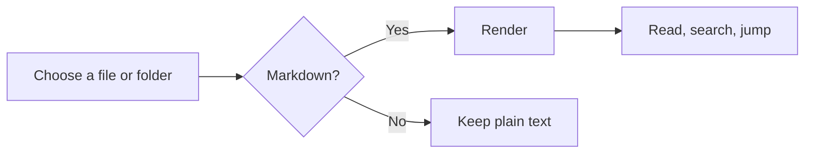
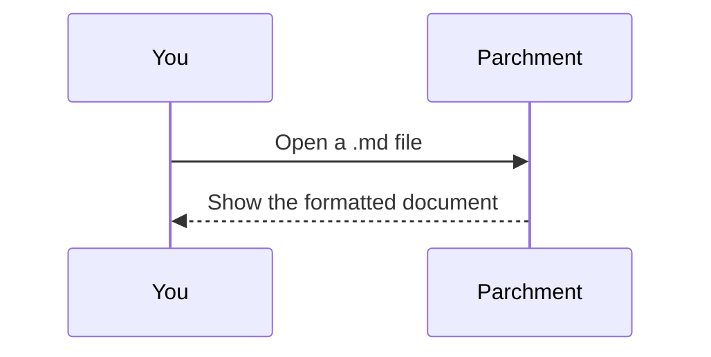

# Welcome to Parchment

Parchment is a **local-first Markdown and plain-text reader** that runs in your browser. This document is itself a sample: each section shows one kind of content Parchment can display, so you can compare the source with the result.

> [!tip] How to use this sample
> - Use the Outline on the right to jump to any section; entries with subheadings can be collapsed.
> - Open the Tags, Linked notes and Backlinks tabs to see this note's tags and how it connects to the other sample note.
> - Images and diagrams can be **clicked to zoom**, and saved as PNG.

The properties above come from the YAML front matter at the top of the file: `tags` become clickable tags, and the other fields are shown as a table.

## Text formatting

Paragraphs can use **bold**, *italic*, ***bold italic***, ~~strikethrough~~, ==highlight==, ++inserted text++ and `inline code`.

The chemical formula H~2~O uses subscript, and x^2^ uses superscript. Emoji can be typed directly 🎉 or written as shortcodes :sparkles: :books: :rocket:.

Keyboard keys look like <kbd>Ctrl</kbd> + <kbd>F</kbd>; HTML <mark>highlight</mark>, <u>underline</u> and H<sub>2</sub>O work too.

Here is a footnote[^read-only]; click it to read it. HTML is an abbreviation: hover over it to see the full name.

*[HTML]: HyperText Markup Language

[^read-only]: Parchment opens files read-only and never modifies your documents.

## Headings and outline

Headings from `#` to `######` are collected into the Outline on the right, indented by level.

### Third-level heading

Deeper headings are grouped under the heading above them.

#### Fourth-level heading

Click the arrow next to a heading in the Outline to collapse or expand that level.

## Lists and tasks

- Unordered list
  - Nested item
    - One level deeper
- Second item

1. Ordered list
2. Second step
   1. Sub-step
3. Third step

- [x] Open this sample
- [ ] Try checking this item (the state is stored only in your browser and never changes the file)
- [ ] Open your own notes folder

## Blockquotes

> The journey of a thousand miles begins with a single step.
> — Laozi

> Quotes can be nested
>> Second level
>>> Third level

## Tables

Columns can be aligned left, center or right:

| Feature | Single file | Folder |
| :--- | :---: | :---: |
| Markdown rendering | ✅ | ✅ |
| Relative images and links | — | ✅ |
| Wiki Links and embeds | — | ✅ |
| Full-text search | — | ✅ |

Tables with many columns adjust their widths automatically, and scroll sideways only when they do not fit:

| No. | Name | Category | Price | Stock | Origin | Listed on | Notes |
| --- | --- | --- | ---: | ---: | --- | --- | --- |
| 001 | Parchment notebook | Stationery | 12.00 | 25 | Taiwan | 2026-01-15 | Hand-bound |
| 002 | Fountain pen ink | Stationery | 16.50 | 8 | Japan | 2026-03-02 | Blue-black, waterproof |

## Code

Code blocks are highlighted by language. Hover over the top-right corner to copy one.

```js
// Read a file the user picks, read-only
const [handle] = await window.showOpenFilePicker();
const file = await handle.getFile();
console.log(await file.text());
```

```python
def greet(name: str) -> str:
    return f"Hello, {name}!"
```

## Math

Inline math: mass–energy equivalence $E = mc^2$, area of a circle $A = \pi r^2$.

Display math:

$$
\int_{0}^{1} x^2 \, dx = \frac{1}{3}
$$

$$
x = \frac{-b \pm \sqrt{b^2 - 4ac}}{2a}
$$

## Diagrams

Diagrams scale to the reading width. **Click a diagram** to zoom, pan, or save it as PNG.

Mermaid flowchart:



Mermaid sequence diagram:



Graphviz (`dot`) diagram:


## Callouts

> [!note]
> A regular note.

> [!success] Done
> Marks something that is finished.

> [!warning] Custom title
> Titles can be customized, and the body can use **Markdown**.

> [!danger] Danger
> Warns about actions that cannot be undone.

> [!example] Example
> There are also info, tip, question, failure, bug, quote and abstract types, each with its own icon and color.

> [!question]- Can callouts collapse?
> Yes. Add `-` after the type to collapse it by default, or `+` to expand it by default.

> [!NOTE]
> GitHub-style alerts are supported too.

## Collapsible content

<details>
<summary>Click to show more</summary>

HTML `<details>` and `<summary>` tags let you tuck longer content away.

</details>

## Note links

Use double brackets to link to another note: [[linked-note]]. You can also set the label and a heading: [[linked-note#Embeddable section|jump to a section in the linked note]].

Web addresses open in a new tab: [Parchment on GitHub](https://github.com/bruce-yang-422/parchment). You can also jump within this document: [back to Tables](#tables).

Embed a whole section:

![[linked-note#Embeddable section]]

Or embed just one block:

![[linked-note#^summary]]

When another note links back here, the Backlinks tab on the right lists it.

## Images

A regular Markdown image with a relative path. **Click the image** to zoom in the lightbox:


You can also write just the file name and a width; Parchment looks for it in the whole folder:

![[parchment-logo-transparent.png|96]]

## Definition list

Read-only
: Reads file contents without modifying anything.

Local-first
: Documents are processed in the browser and never uploaded.

## See more syntax

The [Markdown reading test](https://github.com/bruce-yang-422/parchment/blob/main/samples/en/parchment_markdown_reader_test.md) covers even more: text in many languages, all 13 callout types, web images, and more code and diagram types. Download it and open it in Parchment to see everything at once.

## Next steps

1. Choose **Open folder** in the top-right corner and select your own notes folder.
2. Type in the search box in the left sidebar to search all notes.
3. Use the settings button in the top-right corner to try other themes and fonts.

On phones, the file tree and document details open as side drawers. On documents longer than four screens, the back-to-top button appears in the bottom-right corner after you scroll two screens; short documents do not show it. On desktop, move the pointer to the lower-right corner of the reading pane to reveal it.

---

This sample ships with the website and works offline.
