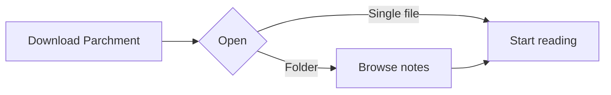
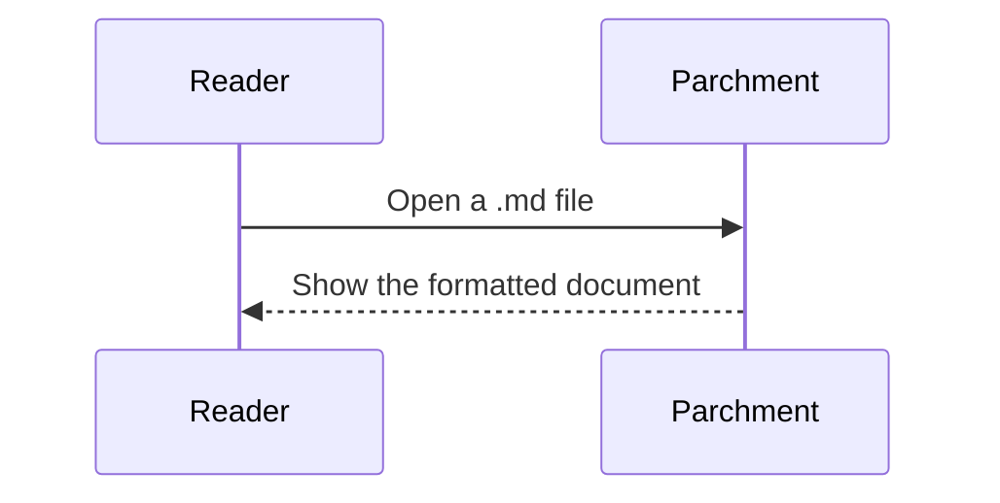
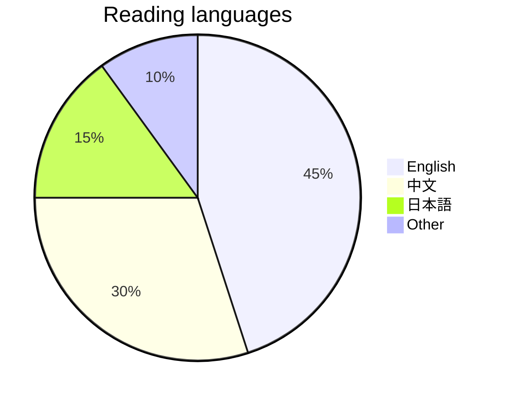

# Parchment Reading Test

Welcome to **Parchment**! This document collects many kinds of Markdown syntax and text in many languages. Download it and open it in Parchment to see everything the app can display.

> [!tip] How to use this document
> 1. Open this file in Parchment.
> 2. Tap Contents in the top-right corner to jump to any section.
> 3. Open Reading settings and try different themes, fonts and text sizes.

---

## 1. Headings

# Heading level 1
## Heading level 2
### Heading level 3
#### Heading level 4
##### Heading level 5
###### Heading level 6

Another way to write it (underlined)
====================================

Second level (underlined)
-------------------------

---

## 2. Text Styles

| Style | Syntax | Result |
| --- | --- | --- |
| Bold | `**bold**` | **Bold** |
| Italic | `*italic*` | *Italic* |
| Bold italic | `***bold italic***` | ***Bold italic*** |
| Strikethrough | `~~strikethrough~~` | ~~Strikethrough~~ |
| Highlight | `==highlight==` | ==Highlight== |
| Underline | `++underline++` | ++Underline++ |
| Superscript | `x^2^` | x^2^ |
| Subscript | `H~2~O` | H~2~O |
| Inline code | `` `code` `` | `print("hi")` |

Underscores work too: _italic_, __bold__.

Escaped characters: \*not italic\*, \# not a heading, \[not a link\].

This line ends with two spaces  
so the text breaks here (hard line break).

---

## 3. Multilingual

The text below only checks that fonts display correctly (no boxes "□" or garbled characters). You do not need to understand it.

### 繁體中文
落霞與孤鶩齊飛，秋水共長天一色。Parchment 是一款讓你安靜閱讀 Markdown 筆記的 App。

### 简体中文
落霞与孤鹜齐飞，秋水共长天一色。Parchment 是一款让你安静阅读 Markdown 笔记的 App。

### English
The quick brown fox jumps over the lazy dog. *Parchment* lets you read your Markdown notes in peace.

### 日本語
いろはにほへと ちりぬるを わかよたれそ つねならむ。**Parchment** は Markdown のノートを静かに読むためのアプリです。

### 한국어
다람쥐 헌 쳇바퀴에 타고파. **Parchment**는 Markdown 노트를 조용히 읽을 수 있는 앱입니다.

### Français
Portez ce vieux whisky au juge blond qui fume. Ça, c'est l'été à Noël — « déjà vu » !

### Deutsch
Victor jagt zwölf Boxkämpfer quer über den großen Sylter Deich. Straße, Größe, Übung.

### Español
El veloz murciélago hindú comía feliz cardillo y kiwi. ¿Dónde está la señal? ¡Olé!

### Italiano · Português
Quel vituperabile xenofobo zelante assaggia il whisky ed esclama: alleluja!
Luís argüia à Júlia que «brações, fé, chá, óxido, pôr, zângão» eram palavras do português.

### Русский
Съешь же ещё этих мягких французских булок, да выпей чаю.

### Ελληνικά
Ξεσκεπάζω την ψυχοφθόρα βδελυγμία.

### Tiếng Việt
Tiếng Việt có dấu: ă â đ ê ô ơ ư — Trăm năm trong cõi người ta.

### ภาษาไทย
เป็นมนุษย์สุดประเสริฐเลิศคุณค่า

### हिन्दी
ऋषियों को सताने वाले दुष्ट राक्षसों के राजा रावण का सर्वनाश करने वाले विष्णु।

### Right-to-left
- العربية: مرحبًا بك في Parchment.
- עברית: ברוכים הבאים ל־Parchment.

### Mixed
English 中文 日本語 한국어 on the same line, with numbers 1234567890, full-width 「punctuation」 and half-width (punctuation) side by side.

---

## 4. Emoji

Typed directly: 😀 🎉 📚 ✍️ 🌏 🇺🇸 🇬🇧 🇯🇵 👍🏽 👨‍👩‍👧‍👦

Shortcodes: :smile: :heart: :rocket: :books: :+1:

---

## 5. Lists

### Unordered list
- Apple
- Banana
  - Nested level 2
    - Nested level 3
* Asterisks work too
+ So do plus signs

### Ordered list
1. Step one
2. Step two
   1. Sub-step 2.1
   2. Sub-step 2.2
3. Step three

Numbering that starts at 5:

5. Five
6. Six

### Task list (tick a box and save it back to the file)
- [x] Download Parchment
- [x] Open this test document
- [ ] Try switching themes
- [ ] Try changing fonts
- [ ] Tap here to tick this box

---

## 6. Links

- Regular link: [Parchment GitHub](https://github.com/bruce-yang-422/parchment)
- Automatic link: <https://www.markdownguide.org>
- Link with a title: [Markdown Guide](https://www.markdownguide.org "Shown on hover")
- Reference link: [CommonMark][cm]
- Link within this document: [Back to the Tables section](#8-tables)
- Wiki links: [[Another note]], [[Another note|Display alias]]

[cm]: https://commonmark.org

---

## 7. Images

### Web image
Needs an internet connection:


### Wikipedia image
*Travelers Among Mountains and Streams* by Fan Kuan, Northern Song dynasty (National Palace Museum, Taipei; public domain; source: [Wikimedia Commons](https://commons.wikimedia.org/wiki/File:Fan_Kuan_-_Travelers_Among_Mountains_and_Streams_-_Google_Art_Project.jpg)). A tall image; tap it to zoom in:


### Linked image (Flickr)
An image wrapped in a link, as produced by Flickr’s Share button, to test linked images:

[](https://flic.kr/p/nqShrs "IMG_2247")

*Taken in spring 2014 at the Laomei Algae Reef in Shimen, New Taipei. Bright green algae cover the wave-carved volcanic grooves, and a long exposure turns the surf into mist.*

### Width set with HTML


### Missing image
This image does not exist on purpose, to test the error message:


---

## 8. Tables

| Language | Greeting | Direction |
| :--- | :---: | ---: |
| English | Hello | LTR |
| 繁體中文 | 你好 | LTR |
| 日本語 | こんにちは | LTR |
| 한국어 | 안녕하세요 | LTR |
| Français | Bonjour | LTR |
| Deutsch | Guten Tag | LTR |
| Español | Hola | LTR |
| العربية | مرحبا | RTL |

### Wide table (scroll sideways)

| No. | Name | Category | Price | Stock | Origin | Listed on | Notes |
| --- | --- | --- | ---: | ---: | --- | --- | --- |
| 001 | Parchment notebook | Stationery | 12.00 | 25 | Taiwan | 2026-01-15 | Hand-bound, made to last |
| 002 | Fountain pen ink | Stationery | 16.50 | 8 | Japan | 2026-03-02 | Blue-black, waterproof |
| 003 | Notebook A5 | Stationery | 12.50 | 140 | Germany | 2026-05-20 | Dot grid, 120 g/m² |

---

## 9. Blockquotes

> The journey of a thousand miles begins with a single step.
> — Laozi

> First level
>> Second level
>>> Third level

> Quotes can contain **bold text**, `code` and lists:
> - Item one
> - Item two

---

## 10. Callouts

> [!note] Note
> A regular note.

> [!info] Info
> Additional information.

> [!tip] Tip
> Long-press text to copy it.

> [!success] Success
> Done!

> [!question] Question
> Which theme do you like best?

> [!warning] Warning
> Make a backup before you edit.

> [!danger] Danger
> This cannot be undone.

> [!failure] Failure
> File not found.

> [!bug] Bug
> Please attach a screenshot when you report a problem.

> [!example] Example
> This is an example.

> [!quote] Quote
> Practice makes perfect.

> [!abstract] Abstract
> This document tests how Parchment displays Markdown.

> [!tip]- Collapsible callout (collapsed by default, tap to expand)
> You found the hidden content! 🎉

---

## 11. Code

Inline code: `const name = 'Parchment';`

### Dart
```dart
void main() {
  final greeting = 'Hello, Parchment!';
  print(greeting);
}
```

### Python
```python
def greet(name: str) -> str:
    """Multilingual greeting"""
    return f"こんにちは、{name}！"

print(greet("Parchment"))
```

### JavaScript
```javascript
const langs = ['en', 'zh-TW', 'zh-CN', 'ja', 'ko', 'fr', 'de', 'es'];
langs.forEach((lang, i) => console.log(`${i + 1}. ${lang}`));
```

### JSON
```json
{
  "app": "Parchment",
  "languages": ["English", "繁中", "简中", "日本語", "한국어"],
  "offline": true
}
```

### Shell
```bash
# This is a very long command line to test horizontal scrolling inside a code block, so it keeps going past the edge
echo "Hello, Parchment" && ls -la ~/Documents/notes/markdown/very/deep/folder/structure/
```

### SQL
```sql
SELECT title, author FROM notes WHERE lang = 'English' ORDER BY updated_at DESC;
```

### No language specified
```
Plain-text code block
  indentation is kept
```

### Indented code (four spaces)

    This is also a code block
    Indented code block

---

## 12. Math

Inline math: mass–energy equivalence $E = mc^2$, area of a circle $A = \pi r^2$.

Display math:

$$
x = \frac{-b \pm \sqrt{b^2 - 4ac}}{2a}
$$

$$
\int_0^\infty e^{-x^2}\,dx = \frac{\sqrt{\pi}}{2}
$$

$$
\sum_{n=1}^{\infty} \frac{1}{n^2} = \frac{\pi^2}{6}
$$

---

## 13. Diagrams

### Mermaid flowchart


### Mermaid sequence diagram


### Mermaid pie chart


### Graphviz


---

## 14. Footnotes

Parchment supports footnotes[^1], footnotes named with words[^note], and longer footnotes[^long].

[^1]: This is the first footnote. Tap the return arrow at the end to go back to the text.
[^note]: Footnotes with word names open normally too.
[^long]: Footnotes can contain **bold text**, `code` and [links](https://commonmark.org).

---

## 15. HTML Tags

- Keyboard keys: press <kbd>Ctrl</kbd> + <kbd>C</kbd> to copy
- <mark>HTML highlight</mark>, <u>underline</u>, <s>strikethrough</s>
- Chemistry H<sub>2</sub>O, square x<sup>2</sup>
- Line<br>break with a br tag

<details>
<summary>Click to expand</summary>

This content is collapsed until you open it.

- Hidden item one
- Hidden item two

</details>

---

## 16. Definition List

Markdown
: A lightweight markup language for writing formatted documents in plain text.

Parchment
: An app for reading Markdown without distractions.
: A term can have a second definition.

---

## 17. Abbreviations

HTML and CSS are the building blocks of the web, and PDF is common for printing.

*[HTML]: HyperText Markup Language
*[CSS]: Cascading Style Sheets
*[PDF]: Portable Document Format

---

## 18. Horizontal Rules

All three look the same:

***

---

___

---

## 19. Long Paragraph

Testing layout and smooth scrolling: Lorem ipsum dolor sit amet, consectetur adipiscing elit, sed do eiusmod tempor incididunt ut labore et dolore magna aliqua. 春眠不覺曉，處處聞啼鳥。夜來風雨聲，花落知多少。Ut enim ad minim veniam, quis nostrud exercitation ullamco laboris nisi ut aliquip ex ea commodo consequat. 古池や蛙飛び込む水の音。Duis aute irure dolor in reprehenderit in voluptate velit esse cillum dolore eu fugiat nulla pariatur. 산에는 꽃 피네 꽃이 피네 갈 봄 여름 없이 꽃이 피네. Excepteur sint occaecat cupidatat non proident, sunt in culpa qui officia deserunt mollit anim id est laborum.

A very long URL or word without spaces, to test line wrapping: https://example.com/a/very/long/path/that/keeps/going/and/going/without/any/spaces/to/break/the/line/naturally/index.html

---

## Test complete 🎉

If you can read this, the whole document loaded. Tap the Back to top button in the bottom-right corner to return to the start.

If something does not display correctly, please report it on [GitHub Issues](https://github.com/bruce-yang-422/parchment/issues). Thank you for your help!
