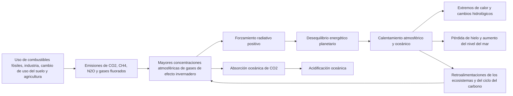
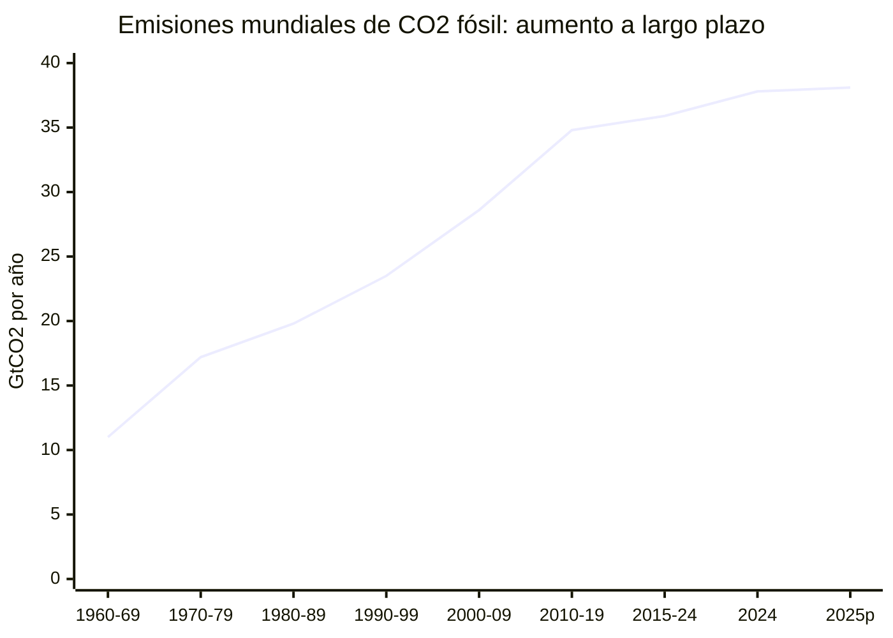
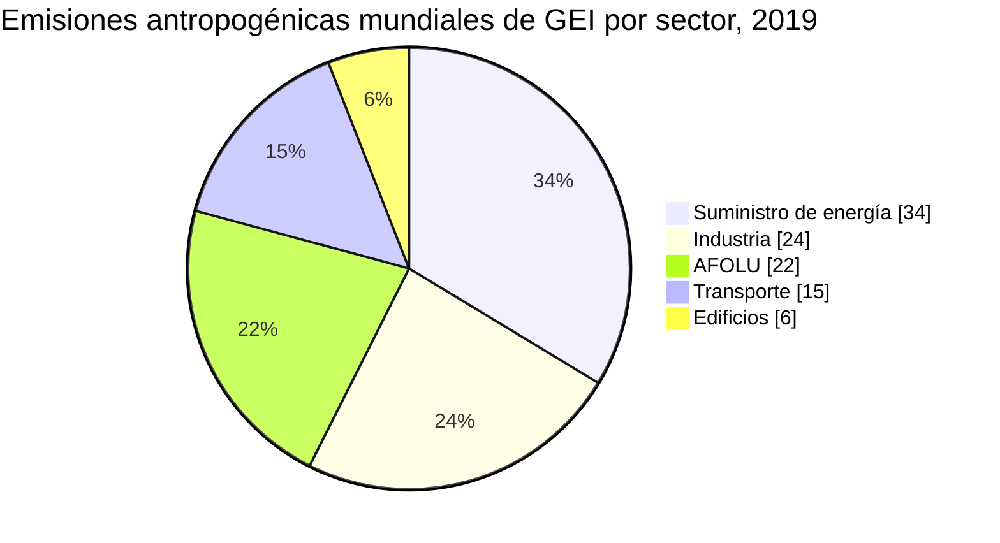
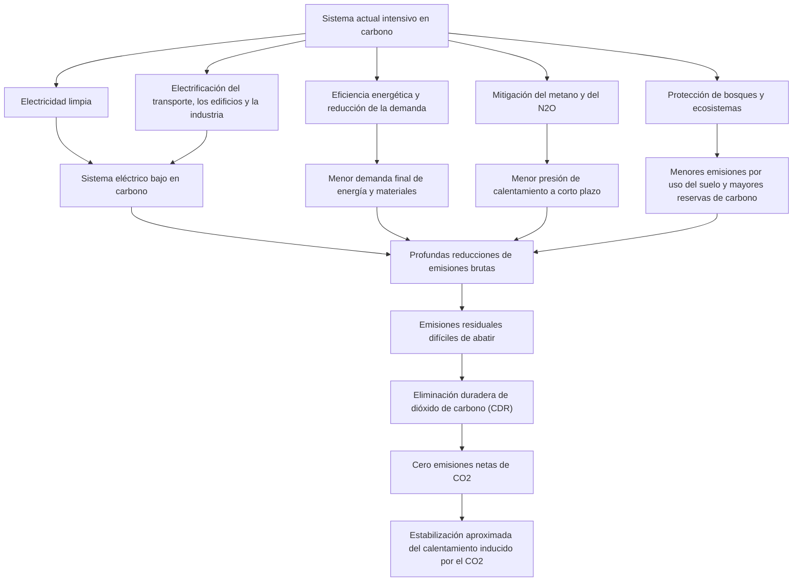

# Emisiones de carbono y huellas de carbono: impactos en el sistema climático global

## Resumen ejecutivo

> **Hallazgo central.** La evidencia de que las emisiones antropogénicas de gases de efecto invernadero son la causa dominante del calentamiento global moderno es inequívoca. El dióxido de carbono (CO₂) es el mayor contribuyente individual debido a la enorme cantidad acumulada emitida, su influencia de larga duración en el ciclo del carbono y la relación casi lineal entre las emisiones acumuladas de CO₂ y la temperatura media global. El metano (CH₄), el óxido nitroso (N₂O) y los gases fluorados añaden un forzamiento adicional sustancial.[^3] [^5]

Las actividades humanas elevaron la temperatura superficial global hasta aproximadamente **1,1 °C por encima del promedio de 1850–1900 en el período 2011–2020**. El IPCC estima que el calentamiento total causado por el ser humano entre 1850–1900 y 2010–2019 fue de alrededor de **1,07 °C**, mientras que las influencias naturales solares y volcánicas solo hicieron una pequeña contribución al cambio observado a largo plazo. Los gases de efecto invernadero por sí solos habrían producido un mayor calentamiento, pero parte de su efecto ha sido enmascarado por los aerosoles antropogénicos.[^5]

La escala de la perturbación subyacente del carbono no tiene precedentes en la era observacional. El CO₂ atmosférico se situaba en aproximadamente **270–280 ppm antes de la industrialización** y alcanzó un promedio anual global en la capa límite marina de **425,62 ± 0,05 ppm en 2025**, según la NOAA. El forzamiento radiativo efectivo combinado de los gases de efecto invernadero de larga vida alcanzó **3,59 W m⁻² por encima de las condiciones preindustriales en 2025**, un 56 % más que el forzamiento equivalente en 1990. El CO₂ por sí solo contribuyó con **2,37 W m⁻²**, es decir, alrededor de dos tercios del total de los gases de efecto invernadero de larga vida.[^7]

No obstante, las emisiones mundiales han seguido aumentando. El IPCC estimó **59 ± 6,6 GtCO₂-eq** de emisiones antropogénicas netas de gases de efecto invernadero en 2019, un 54 % por encima de 1990. El *Global Carbon Budget 2025* estimó las emisiones mundiales de CO₂ fósil en **37,8 ± 2 GtCO₂ en 2024** y proyectó aproximadamente **38,1 GtCO₂ en 2025**, aunque las definiciones metodológicas difieren entre conjuntos de datos. La AIE estimó de forma independiente casi **38,4 GtCO₂ de emisiones de CO₂ relacionadas con la energía en 2025**. Estas cifras no deben tratarse como intercambiables porque sus límites sectoriales difieren.[^1] [^2] [^4] [^6]

Las huellas de carbono amplían el análisis más allá de las emisiones territoriales. Un *inventario basado en la producción* asigna las emisiones al lugar donde ocurren físicamente; una *huella de carbono basada en el consumo* reasigna las emisiones incorporadas a lo largo de las cadenas de suministro internacionales a los consumidores finales. Esta distinción es importante porque los bienes comercializados permiten a las regiones de alto consumo externalizar parte de sus emisiones territoriales. Sin embargo, los estudios basados en modelos insumo-producto multirregionales presentan una mayor incertidumbre estructural y de datos que los inventarios nacionales de combustión.[^4] [^10]

La distribución de la responsabilidad es sumamente desigual. En 2019, el 10 % de los hogares con mayores emisiones representó aproximadamente entre el **34 % y el 45 % de las emisiones mundiales de gases de efecto invernadero de los hogares basadas en el consumo**, mientras que el 50 % con menores emisiones representó solo el **13–15 %**. Las diferencias regionales son igualmente amplias: las emisiones de gases de efecto invernadero en América del Norte fueron de alrededor de **19 tCO₂-eq por persona** en 2019, frente a aproximadamente **2,5 tCO₂-eq por persona** en Asia Meridional.[^4]

Las consecuencias climáticas ya observadas incluyen el aumento de los extremos de calor, precipitaciones más intensas en muchas regiones, cambios en el riesgo de sequía, calentamiento de los océanos, pérdida de la criosfera, aceleración del aumento del nivel del mar y acidificación oceánica. El nivel medio global del mar aumentó aproximadamente **0,20 m entre 1901 y 2018**, mientras que su tasa se incrementó hasta **3,7 [3,2–4,2] mm año⁻¹ durante 2006–2018**. El pH de la superficie oceánica ha disminuido alrededor de **0,1 unidades desde la era industrial**, lo que corresponde aproximadamente a un aumento del 30 % en la concentración de iones de hidrógeno.[^5] [^9]

La restricción física más determinante sobre el calentamiento futuro es el CO₂ acumulado. El IPCC evalúa una mejor estimación de la respuesta climática transitoria a las emisiones acumuladas de aproximadamente **0,45 °C por cada 1000 GtCO₂**, con un rango probable de 0,27–0,63 °C. En consecuencia, estabilizar el calentamiento inducido por el ser humano requiere que las emisiones antropogénicas netas mundiales de CO₂ se acerquen a cero; mantener emisiones positivas continuas provoca calentamiento adicional.[^3]

Las tecnologías de mitigación ya están disponibles a una escala significativa. Las evaluaciones del IPCC indican que las opciones con un costo de **100 US$ tCO₂-eq⁻¹ o menos podrían reducir las emisiones mundiales de gases de efecto invernadero al menos a la mitad del nivel de 2019 para 2030**, y más de la mitad de ese potencial evaluado cuesta menos de 20 US$ tCO₂-eq⁻¹. Entre las principales oportunidades de bajo costo se encuentran la energía solar y eólica, la eficiencia energética, la mitigación del metano y la prevención de la conversión de bosques y otros ecosistemas naturales. No obstante, la viabilidad depende no solo del costo de ingeniería, sino también de la infraestructura de red, el financiamiento, las instituciones, las limitaciones del uso de la tierra, el cambio de comportamiento, la aceptación social y las consecuencias distributivas.[^4]

## Resumen e introducción

Este documento examina la relación entre **las emisiones de carbono, las huellas de carbono, la acumulación atmosférica de gases de efecto invernadero, el forzamiento radiativo y el cambio climático** desde aproximadamente 1850 hasta el presente. El alcance analítico es global, salvo que se especifique lo contrario. Distingue las emisiones físicas de las huellas de carbono basadas en el consumo, evalúa la solidez de la evidencia que vincula las emisiones con los impactos climáticos, identifica las principales incertidumbres y evalúa las principales trayectorias de mitigación.

El término **emisiones de carbono** se utiliza aquí principalmente para referirse al CO₂ liberado por la combustión de combustibles fósiles, los procesos industriales y el cambio de uso del suelo, mientras que las *emisiones de gases de efecto invernadero* incluyen además CH₄, N₂O y gases fluorados. Una **huella de carbono** se refiere de manera más amplia a las emisiones directas e indirectas de gases de efecto invernadero atribuibles a un producto, actividad, organización, hogar o población, comúnmente expresadas en toneladas de dióxido de carbono equivalente (tCO₂-eq). Las huellas basadas en el consumo incluyen las emisiones incorporadas en los bienes y servicios importados, lo que las hace conceptualmente distintas de los inventarios territoriales nacionales.[^4] [^10]

La agregación de múltiples gases de efecto invernadero en emisiones equivalentes de CO₂ se basa en una métrica climática, generalmente el **potencial de calentamiento global a 100 años, GWP₁₀₀**. La estimación del GWP₁₀₀ del Sexto Informe de Evaluación (AR6) del IPCC es de 1 para el CO₂, aproximadamente **29,8 para el CH₄ fósil**, **27,0 para el CH₄ no fósil** y **273 para el N₂O**, aunque las incertidumbres son sustanciales. Por lo tanto, un gas con un GWP₁₀₀ de 273 produce, por unidad de masa emitida, una influencia radiativa integrada a lo largo de 100 años aproximadamente 273 veces superior a la influencia de referencia de una masa igual de CO₂ bajo los supuestos de la métrica. Los valores de GWP no deben interpretarse como equivalencias físicas exactas en todos los horizontes temporales.[^3]

La secuencia causal fundamental es:

**Figura 1. Cadena causal conceptual desde las actividades antropogénicas hasta los impactos climáticos y biogeoquímicos.** La dirección de la trayectoria principal de los gases de efecto invernadero está respaldada por múltiples líneas de evidencia observacionales, teóricas y de modelización evaluadas por el IPCC.[^3] [^5]

### Supuestos explícitos

1. **Alcance geográfico:** global, con comparaciones regionales cuando los conjuntos de datos sólidos lo permiten.
2. **Período histórico:** aproximadamente desde 1850 hasta el presente, salvo que se indique otro período.
3. **Contabilidad de emisiones:** se utilizan emisiones basadas en la producción para los totales físicos globales; las medidas basadas en el consumo se identifican explícitamente como huellas.
4. **Métrica climática:** los valores en CO₂-equivalente utilizan generalmente el GWP₁₀₀ del AR6, salvo que la fuente especifique lo contrario.
5. **Observaciones más recientes:** dado que los inventarios completos presentan un rezago respecto al tiempo real, el documento distingue entre *datos históricos observados* y *valores provisionales o proyectados*.
6. **Costos de mitigación:** los rangos de costos reportados son estimaciones técnico-económicas globales y no costos garantizados a nivel de proyecto.

Por consiguiente, la pregunta principal de investigación no es simplemente si las emisiones alteran el clima —esta atribución ya está sólidamente establecida—, sino **cómo se combinan las cantidades de emisiones, las fuentes, la responsabilidad geográfica, los patrones de consumo, la física atmosférica y los procesos del ciclo del carbono para determinar la escala y la persistencia del cambio climático**.

## Métodos y fuentes de datos

El análisis emplea una jerarquía de evidencia científica. Se otorga la máxima prioridad al **Sexto Informe de Evaluación del IPCC (AR6)** porque sintetiza miles de estudios revisados por pares mediante un lenguaje de confianza calibrado y múltiples líneas independientes de evidencia. El análisis de la ciencia física se basa principalmente en el Grupo de Trabajo I del AR6, la evaluación de emisiones y mitigación en el Grupo de Trabajo III y la evaluación integrada de impactos en el Informe de Síntesis de 2023.[^3] [^4] [^5]

Los datos recientes sobre emisiones y el ciclo del carbono provienen principalmente del **Global Carbon Budget 2025**, publicado en *Earth System Science Data*. Su balance integra las emisiones de CO₂ fósil, el cambio de uso del suelo, la acumulación atmosférica, la absorción oceánica, la absorción terrestre y un desequilibrio explícito del balance. Para el período 1850–2024 estimó emisiones antropogénicas acumuladas de **745 ± 65 GtC**, repartidas aproximadamente en 290 ± 5 GtC retenidas en la atmósfera, 200 ± 40 GtC absorbidas por el océano, 175 ± 50 GtC absorbidas por los sumideros terrestres, más un desequilibrio residual del balance.[^1]

Los datos de concentración atmosférica y forzamiento radiativo proceden del **Laboratorio de Monitoreo Global de la NOAA** (*NOAA Global Monitoring Laboratory*). La red global de larga trayectoria de la NOAA proporciona mediciones de CO₂, CH₄, N₂O y otros gases de efecto invernadero de larga vida, y elabora el Índice Anual de Gases de Efecto Invernadero (AGGI, por sus siglas en inglés).[^7] [^8]

La información sobre el CO₂ relacionado con la energía se complementa con datos de la **Agencia Internacional de la Energía (AIE)**, en particular cuando se requieren tendencias sectoriales recientes. Los datos de la AIE utilizan un perímetro contable diferente al del *Global Carbon Budget*; por ello, los totales numéricos se comparan únicamente tras definir sus respectivos alcances.[^6]

La evidencia sobre las huellas basadas en el consumo se fundamenta en evaluaciones del IPCC e investigaciones revisadas por pares con modelos insumo-producto multirregionales (MRIO). Dichos modelos rastrean las cadenas de suministro monetarias y físicas a través del comercio internacional. Son útiles para atribuir emisiones indirectas al consumo, pero la incertidumbre surge de la agregación sectorial, las estadísticas comerciales, la armonización de los factores de emisión y las diferencias entre bases de datos MRIO. Una comparación de cinco grandes sistemas MRIO halló una variación significativa en las estimaciones de las cuentas de carbono basadas en el consumo, lo que ilustra por qué las estimaciones de huella no deben tratarse como cantidades exactas de inventario.[^10]

### Relaciones físicas fundamentales

Una aproximación de primer orden ampliamente utilizada para el forzamiento radiativo del CO₂ es

\[
\boxed{\Delta F_{CO_2}\approx 5.35\ln\left(\frac{C}{C_0}\right)\;\text{W m}^{-2}}
\]

donde \(C_0\) es la concentración de referencia de CO₂ y \(C\) es la concentración perturbada. Esta relación logarítmica significa que cada incremento proporcional de CO₂ produce un forzamiento incremental aproximadamente comparable; el AR6 utiliza tratamientos espectroscópicos actualizados para evaluaciones formales, pero la aproximación logarítmica sigue siendo útil desde el punto de vista pedagógico.[^3]

El balance global de carbono puede expresarse esquemáticamente como

\[
E_{\mathrm{FOS}}+E_{\mathrm{LUC}}
=
G_{\mathrm{ATM}}
+
S_{\mathrm{OCEAN}}
+
S_{\mathrm{LAND}}
+
B_{\mathrm{IM}},
\]

donde \(E_{\mathrm{FOS}}\) representa las emisiones fósiles e industriales de CO₂, \(E_{\mathrm{LUC}}\) las emisiones por cambio de uso del suelo, \(G_{\mathrm{ATM}}\) la acumulación atmosférica, \(S_{\mathrm{OCEAN}}\) y \(S_{\mathrm{LAND}}\) los sumideros oceánicos y terrestres, y \(B_{\mathrm{IM}}\) el desequilibrio residual del balance. Durante 2015–2024, el *Global Carbon Budget* estimó que aproximadamente el **50 %** del total de las emisiones antropogénicas de CO₂ se acumuló en la atmósfera, el **29 %** ingresó al océano y el **21 %** ingresó al sumidero terrestre, con un desequilibrio medio cercano a cero durante esa década.[^1]

Para la temperatura, el AR6 presenta la relación acumulada aproximada

\[
\Delta T \approx \mathrm{TCRE}\times
\frac{E_{\mathrm{cum}}}{1000\ \mathrm{GtCO_2}},
\]

con

\[
\mathrm{TCRE}_{\text{mejor estimación}}\approx0.45^{\circ}\mathrm{C}\; / \;1000\ \mathrm{GtCO_2}.
\]

Esta relación casi lineal es una de las razones por las que las emisiones acumuladas de CO₂, y no únicamente la tasa de emisión de un solo año, son centrales para la política climática.[^3]

Para los gases distintos del CO₂, el GWP en un horizonte \(H\) se define conceptualmente como

\[
\mathrm{GWP}_i(H)
=
\frac{\int_0^H RF_i(t)\,dt}
{\int_0^H RF_{CO_2}(t)\,dt},
\]

donde \(RF_i(t)\) es el forzamiento radiativo dependiente del tiempo tras un pulso de emisión de la especie \(i\). El horizonte temporal seleccionado modifica la importancia relativa aparente de gases de vida corta como el CH₄.[^3]

## Resultados

Las emisiones antropogénicas mundiales han aumentado bruscamente desde la industrialización. Las emisiones históricas netas acumuladas de CO₂ desde **1850 hasta 2019 fueron de aproximadamente 2400 ± 240 GtCO₂**, y cerca del 42 % de esa cantidad acumulada se emitió durante 1990–2019. Esto demuestra la acumulación inusualmente rápida de emisiones en las últimas décadas.[^4]

El *Global Carbon Budget* muestra el mismo patrón a largo plazo para el CO₂ fósil. Las emisiones fósiles promedio aumentaron de aproximadamente **3,0 GtC año⁻¹ en la década de 1960** a **9,8 GtC año⁻¹ durante 2015–2024**, lo que equivale aproximadamente a 11 y 36 GtCO₂ año⁻¹, respectivamente. Las emisiones de CO₂ fósil alcanzaron alrededor de 37,8 GtCO₂ en 2024, un 69 % por encima de 1990.[^1]

**Figura 2. Tendencia aproximada de las emisiones mundiales de CO₂ fósil.** Las cifras decenales se convierten de GtC a GtCO₂ mediante el factor \(44/12\); el dato de 2025 corresponde a la proyección del *Global Carbon Budget 2025* y no a un inventario definitivo.[^1] [^2]

### Patrones sectoriales y regionales de emisión

En 2019, el suministro de energía representó aproximadamente el **34 %** de las emisiones antropogénicas netas mundiales de gases de efecto invernadero, la industria el 24 %, AFOLU el 22 %, el transporte el 15 % y los edificios el 6 %. Estas categorías suman alrededor del 101 % debido al redondeo de las proporciones reportadas. Cuando las emisiones de electricidad y calor se reasignan del sector de suministro de energía a los usuarios finales, las contribuciones relativas de la industria y los edificios aumentan considerablemente, lo que demuestra que las participaciones sectoriales dependen de las convenciones contables.[^4]

**Figura 3. Participación sectorial aproximada de las emisiones antropogénicas netas de GEI en 2019.** Los valores son estimaciones del IPCC expresadas en CO₂-equivalente utilizando el GWP₁₀₀ del AR6.[^4]

| Dimensión contable | Fuente / región principal | Magnitud aproximada | Interpretación |
|---|---|---:|---|
| **Sector, GEI de 2019** | Suministro de energía | 20 GtCO₂-eq; 34 % | Mayor sector emisor directo a nivel mundial.[^4] |
|  | Industria | 14 GtCO₂-eq; 24 % | Incluye emisiones energéticas y de procesos industriales.[^4] |
|  | AFOLU | 13 GtCO₂-eq; 22 % | Incluye agricultura, silvicultura y cambio de uso del suelo.[^4] |
|  | Transporte | 8,7 GtCO₂-eq; 15 % | Dominado por sistemas de transporte basados en combustibles fósiles.[^4] |
|  | Edificios | 3,3 GtCO₂-eq; 6 % directo | La participación asciende a cerca del 16 % al asignar a los usuarios las emisiones indirectas de electricidad y calor.[^4] |
| **CO₂ fósil, 2024** | China | 12,3 GtCO₂; 31,7 % | Mayor emisor territorial de CO₂ fósil.[^2] |
|  | Estados Unidos | 4,9 GtCO₂; 12,7 % | CO₂ fósil per cápita de aproximadamente 14,2 tCO₂.[^2] |
|  | India | 3,2 GtCO₂; 8,3 % | CO₂ fósil per cápita de aproximadamente 2,2 tCO₂.[^2] |
|  | UE-27 | 2,4 GtCO₂; 6,3 % | CO₂ fósil per cápita de aproximadamente 5,4 tCO₂.[^2] |
|  | Rusia | 1,8 GtCO₂; 4,6 % | CO₂ fósil per cápita de aproximadamente 12,3 tCO₂.[^2] |
| **Huella de consumo** | América del Norte | ~13,4 tCO₂-eq cápita⁻¹ en la evaluación de huella citada | Las huellas de consumo vinculadas a los hogares siguen siendo elevadas.[^4] |
|  | Europa | ~7,5 tCO₂-eq cápita⁻¹ | Menor que América del Norte, pero muy por encima de las regiones de bajos ingresos.[^4] |
|  | África y Oriente Medio* | ~1,7 tCO₂-eq cápita⁻¹ | Ilustra la gran desigualdad mundial; la agrupación de la fuente es amplia.[^4] |

**Tabla 1. Principales fuentes de emisiones por sector y región.** Las cifras sectoriales de GEI, las cifras territoriales de CO₂ fósil y las huellas basadas en el consumo emplean distintos límites del sistema y no deben sumarse ni sustituirse directamente entre sí. *La fuente citada para la huella de consumo agrupa a África y Oriente Medio, por lo que no debe interpretarse como un valor regional homogéneo.[^4] [^10]

La distribución regional también cambia según si el análisis considera las emisiones anuales, la responsabilidad histórica acumulada, las emisiones per cápita o las huellas basadas en el consumo. En general, las economías desarrolladas han contribuido con una mayor proporción de las emisiones históricas acumuladas de CO₂ que su participación actual en la población mundial, mientras que la participación de Asia Oriental en las emisiones anuales contemporáneas ha aumentado considerablemente desde el año 2000. El IPCC señala que los países desarrollados promediaron alrededor de **9,5 tCO₂ de CO₂ fósil e industrial per cápita en 2019**, frente a aproximadamente **4,4 tCO₂ en Asia-Pacífico, 2,7 tCO₂ en América Latina y el Caribe, y 1,2 tCO₂ en África**.[^4]

### Forzamiento radiativo y respuesta climática

El vínculo físico entre las emisiones y el calentamiento opera a través de las concentraciones atmosféricas y el forzamiento radiativo. El AR6 estimó el forzamiento radiativo efectivo de 2019 en relación con 1750 en **2,16 [1,90–2,41] W m⁻²** para el CO₂, **0,54 [0,43–0,65] W m⁻²** para el CH₄, **0,21 [0,18–0,24] W m⁻²** para el N₂O y **0,41 [0,33–0,49] W m⁻²** para los gases halogenados.[^3]

El índice posterior basado en observaciones de la NOAA muestra que el forzamiento ha seguido aumentando: en 2025, el forzamiento radiativo efectivo combinado de los gases de larga vida en su AGGI alcanzó aproximadamente **3,59 W m⁻² respecto a las condiciones preindustriales**, con el CO₂ como responsable de alrededor del **66 %** y el CH₄ del 16 %. Desde 1990, el CO₂ representó cerca del 81 % del incremento en el forzamiento de los gases de efecto invernadero de larga vida.[^7]

Ese forzamiento genera un desequilibrio energético planetario. El AR6 evaluó que la tasa media observada de calentamiento del sistema climático aumentó de aproximadamente **0,50 [0,32–0,69] W m⁻² en 1971–2006** a **0,79 [0,52–1,06] W m⁻² en 2006–2018**. La mayor parte del exceso de calor se acumula en el océano, mientras que la energía adicional contribuye al calentamiento atmosférico, el derretimiento del hielo continental, el aumento del nivel del mar y otros cambios en el sistema terrestre.[^3]

### Impactos climáticos observados

La evidencia del calentamiento en sí y de muchos impactos asociados es excepcionalmente sólida. El IPCC concluye que las actividades humanas, principalmente las emisiones de gases de efecto invernadero, han **causado inequívocamente el calentamiento global**. Es prácticamente seguro que los extremos cálidos se han vuelto más frecuentes e intensos en la mayoría de las regiones terrestres desde la década de 1950, mientras que es muy probable que la influencia humana haya contribuido al incremento de aproximadamente el doble en la frecuencia de las olas de calor marinas desde la década de 1980.[^3] [^5]

Los efectos hidrológicos son menos uniformes espacialmente, pero igualmente sustanciales. El aire más cálido puede retener más vapor de agua, intensificando las precipitaciones fuertes en muchas regiones; el calentamiento también incrementa la demanda evaporativa y puede intensificar las sequías agrícolas y ecológicas cuando la precipitación no lo compensa. La solidez de la atribución varía según la región y la amenaza, razón por la cual las afirmaciones sobre extremos de calor globales suelen conllevar una mayor confianza que las relativas a sequías locales o tormentas individuales.[^3]

El cambio del nivel del mar proporciona otra medida integrada. El nivel medio global del mar aumentó aproximadamente **0,20 [0,15–0,25] m entre 1901 y 2018**. El ritmo medio de ascenso se aceleró de 1,3 mm año⁻¹ durante 1901–1971 a 3,7 mm año⁻¹ durante 2006–2018, siendo muy probable que la influencia humana haya sido el principal factor impulsor al menos desde 1971.[^5]

El CO₂ también altera la química marina de manera independiente al calentamiento. Aproximadamente el 30 % del CO₂ antropogénico liberado a la atmósfera es absorbido por el océano en escalas temporales amplias, lo que produce ácido carbónico y aumenta la concentración de iones de hidrógeno. El pH medio de la superficie oceánica ha disminuido alrededor de **0,1 unidades de pH** desde la revolución industrial, reduciendo la disponibilidad de iones carbonato para corales, moluscos y otros organismos calcificadores.[^9]

## Discusión: evidencia, incertidumbre e interpretación de la huella de carbono

Una evaluación rigurosa debe distinguir la **incertidumbre sobre la magnitud** de la **incertidumbre sobre la causalidad**. El papel causal de los gases de efecto invernadero antropogénicos en el calentamiento global actual no es una gran cuestión científica sin resolver; la incertidumbre concierne más bien a la magnitud y el momento exactos de las respuestas, los patrones regionales, la intensidad de las retroalimentaciones, las emisiones socioeconómicas futuras y la eficacia de la implementación de la mitigación.[^3] [^5]

| Cuestión | Solidez de la evidencia | Evidencia principal | Incertidumbre importante |
|---|---|---|---|
| Los GEI antropogénicos causan el calentamiento global moderno | **Inequívoca / muy sólida** | Calentamiento observado, física radiativa, estudios de atribución, modelos, restricciones paleoclimáticas.[^5] | Reparto exacto entre agentes de forzamiento individuales y retroalimentaciones. |
| El CO₂ acumulado determina el calentamiento a largo plazo de forma aproximadamente lineal | **Confianza alta** | Relación TCRE en observaciones y modelos.[^3] | Rango probable de la TCRE de 0,27–0,63 °C por cada 1000 GtCO₂. |
| Los extremos de calor se intensificaron debido a la influencia humana | **Muy sólida** | Observaciones y atribución de eventos y tendencias a largo plazo.[^3] | La magnitud difiere según la región. |
| Los riesgos de precipitaciones intensas y sequías están cambiando | **Sólida pero espacialmente heterogénea** | Observaciones, termodinámica, estudios de atribución.[^3] | La variabilidad natural y la circulación regional generan mayor incertidumbre que en el caso de la temperatura. |
| El nivel del mar está subiendo por el calentamiento y la pérdida de hielo continental | **Confianza alta** | Mareógrafos, altimetría satelital, observaciones de glaciares y mantos de hielo, expansión térmica del océano.[^5] | La dinámica de los mantos de hielo domina la incertidumbre de cola larga en el futuro. |
| La acidificación oceánica es causada principalmente por la absorción de CO₂ atmosférico | **Muy sólida** | Química de carbonatos y mediciones directas.[^9] | Las consecuencias biológicas varían entre especies y ecosistemas. |
| Las huellas basadas en el consumo difieren de las emisiones territoriales | **Sólida** | Contabilidad comercial mediante modelos MRIO.[^10] | Estructura de las bases de datos, agregación sectorial e incertidumbre en comercio y factores de emisión. |
| Los sumideros terrestres y oceánicos actuales absorberán una fracción constante indefinidamente | **No respaldada** | La intensidad de los sumideros varía con el clima y las retroalimentaciones del ciclo del carbono.[^1] [^2] | La saturación futura de los sumideros y las retroalimentaciones regionales siguen siendo inciertas. |

**Tabla 2. Solidez de la evidencia e incertidumbres principales.** La terminología de confianza sigue la orientación de las evaluaciones del IPCC cuando está disponible, en lugar de representar una probabilidad estadística independiente.

Las huellas de carbono son especialmente importantes para interpretar la **responsabilidad**. La contabilidad territorial responde a la pregunta: «¿Dónde ocurrieron físicamente las emisiones?» La contabilidad basada en el consumo pregunta: «¿La demanda final de quién provocó la producción?» Un teléfono inteligente fabricado en un país pero comprado en otro incrementa, por lo tanto, las emisiones territoriales del productor al tiempo que contribuye a la huella de consumo del comprador. Ninguna de las dos medidas es intrínsecamente «correcta» para todos los propósitos de política pública; responden a preguntas distintas.[^4] [^10]

Esta diferencia tiene implicaciones para la equidad climática. El IPCC concluye que el **10 % superior de los hogares según sus emisiones per cápita contribuye con el 34–45 % de las emisiones mundiales de GEI de los hogares basadas en el consumo**, mientras que la mitad inferior contribuye únicamente con el 13–15 %. Estas desigualdades implican que los promedios nacionales de huella pueden ocultar diferencias mucho mayores dentro de un mismo país asociadas al ingreso, la vivienda, la movilidad, el acceso a la energía y el consumo.[^4]

Un estudio MRIO multinacional reciente ilustra la escala de las posibles reducciones por el lado de la demanda, estimando que un paquete de cambios hacia un consumo bajo en carbono dirigido al 23,7 % de los mayores emisores en 116 países podría reducir las emisiones modeladas de GEI basadas en el consumo de los hogares en aproximadamente **10,4 GtCO₂-eq**, equivalente al 40,1 % de las emisiones de los hogares representadas en dicho análisis. Tales resultados son estimaciones de escenarios, no pronósticos: asumen sustituciones conductuales específicas y respuestas concretas en las cadenas de suministro, por lo que no deben interpretarse como reducciones garantizadas.[^11]

La incertidumbre en el ciclo del carbono constituye otra área crítica. Para el período 1850–2024, el *Global Carbon Budget* reportó un desequilibrio acumulado del balance de aproximadamente **80 GtC**, cerca del 11 % de las emisiones totales estimadas, lo que indica inconsistencias entre fuentes y sumideros estimados de manera independiente. Para el período 1959–2024, mejor observado, el desequilibrio es menor. Estas discrepancias no invalidan el efecto invernadero; más bien, cuantifican la incertidumbre al reconstruir grandes flujos globales de carbono a partir de observaciones y modelos heterogéneos.[^1]

Una preocupación reciente significativa es la retroalimentación climática sobre los sumideros naturales. El *Global Carbon Budget 2025* estimó que, durante 2015–2024, el cambio climático y la variabilidad climática redujeron el sumidero terrestre en aproximadamente un **25 %** y el sumidero oceánico en alrededor de un **7 %** en relación con un escenario contrafactual sin dichas influencias. Esto sugiere un posible debilitamiento de la capacidad amortiguadora natural que históricamente ha absorbido una gran fracción de las emisiones antropogénicas, aunque la variabilidad anual y decenal sigue siendo considerable.[^2]

### Brechas de datos

Varias limitaciones afectan las comparaciones cuantitativas. El CO₂ mundial procedente de combustibles fósiles está mejor acotado que el CO₂ derivado del cambio de uso del suelo; este último depende de reconstrucciones históricas de la cobertura terrestre, supuestos sobre rebrote forestal y modelos de ecosistemas. Los métodos de inventario nacionales difieren, en particular para el metano y el uso del suelo. Las huellas de consumo dependen de tablas comerciales que con frecuencia tienen rezago respecto al tiempo real y agregan productos heterogéneos. Los factores de emisión para la agricultura, los efectos no-CO₂ de la aviación, el transporte marítimo, la actividad económica informal y algunos gases fluorados son menos completos que las estadísticas de combustión de combustibles fósiles.[^1] [^10]

También existe un desfase temporal entre conjuntos de datos: las comparaciones sectoriales del IPCC AR6 describen principalmente 2019, los datos completos del *Global Carbon Budget* se extienden hasta 2024 con una proyección para 2025, las observaciones atmosféricas de la NOAA llegan hasta 2026 y los conjuntos de datos energéticos pueden ofrecer estimaciones preliminares para 2025. Por lo tanto, las discrepancias aparentes deben verificarse primero según diferencias de *año, límite del sistema, gases de efecto invernadero incluidos y método contable* antes de interpretarse como desacuerdos científicos.[^4] [^6] [^8]

## Trayectorias de mitigación

La mitigación puede organizarse en torno a cuatro estrategias complementarias: **eliminar las emisiones evitables, reducir la demanda de energía y materiales, sustituir las tecnologías intensivas en carbono y eliminar el CO₂ residual de la atmósfera**. La estabilización climática eficaz requiere reducciones rápidas en múltiples gases, pero el CO₂ ocupa un lugar especial porque sus emisiones acumuladas determinan en gran medida el calentamiento a largo plazo.[^3] [^4]

**Figura 4. Trayectoria de mitigación desde las reducciones de emisiones brutas hasta el cero neto de CO₂.** El cero neto no debe interpretarse como un sustituto de las reducciones brutas rápidas; el IPCC considera la eliminación de dióxido de carbono (CDR) principalmente como un complemento para contrarrestar emisiones residuales y, en algunos escenarios, revertir el sobrepasamiento (*overshoot*).[^4]

| Opción de mitigación | Eficacia indicativa | Caracterización de costos | Viabilidad y limitaciones |
|---|---|---|---|
| **Electricidad solar y eólica** | Entre los mayores potenciales de mitigación para 2030 evaluados por el IPCC.[^4] | Grandes porciones evaluadas por debajo de 20 US$ tCO₂-eq⁻¹.[^4] | Alta madurez técnica; la transmisión, el almacenamiento, los permisos y la flexibilidad de la red pueden limitar el despliegue. |
| **Eficiencia energética** | Gran potencial intersectorial en edificios, industria y transporte.[^4] | Muchas medidas tienen un costo neto bajo o negativo a lo largo de su vida útil. | Los efectos rebote, los incentivos divididos, el financiamiento y la renovación de equipos ralentizan la adopción. |
| **Electrificación** | Puede reducir drásticamente las emisiones de uso final cuando la electricidad es baja en carbono.[^4] | Depende del contexto; la caída de los costos de tecnologías limpias mejora su economía.[^4] | Requiere redes eléctricas, infraestructura de carga, bombas de calor y rediseño de procesos industriales. |
| **Mitigación del metano** | Particularmente valiosa para reducir el calentamiento a corto plazo, ya que el CH₄ es potente pero de vida relativamente corta.[^3] [^4] | Muchas medidas en petróleo/gas, carbón y residuos cuestan menos de 20 US$ tCO₂-eq⁻¹.[^4] | El monitoreo, la detección de fugas, las prácticas agrícolas y la aplicación normativa son fundamentales. |
| **Prevención de la conversión de ecosistemas** | Gran potencial de mitigación en el sector terrestre.[^4] | Potencial significativo por debajo de 20 US$ tCO₂-eq⁻¹.[^4] | Deben abordarse la gobernanza, la tenencia de la tierra, la seguridad alimentaria, la permanencia y las fugas. |
| **Reforestación/forestación y gestión forestal mejorada** | Puede incrementar las reservas terrestres de carbono; el IPCC estima un potencial de varios Gt en carteras del sector terrestre.[^4] | Muy variable por región; los costos del sector forestal aumentan con la escala. | Las reservas de carbono pueden revertirse por incendios, sequías, tala o cambio de uso del suelo. |
| **Sustitución de materiales industriales / reforma de procesos** | Importante para el cemento, el acero y los productos químicos. | Variable; algunas opciones son relativamente económicas y otras de alto costo.[^4] | El acervo de capital de larga duración y las necesidades de procesos de alta temperatura generan inercia. |
| **Captura y almacenamiento de carbono (CCS) para procesos industriales/fósiles seleccionados** | Potencialmente útil para emisiones de proceso difíciles de abatir.[^4] | A menudo por encima de las opciones más baratas de energías renovables/eficiencia; depende del sitio. | Requiere infraestructura de captura, transporte, almacenamiento adecuado y monitoreo a largo plazo. |
| **Eliminación de dióxido de carbono (CDR)** | Necesaria en la mayoría de las trayectorias modeladas para contrarrestar algunas emisiones residuales.[^4] | Amplio rango de costos según el método. | El uso del suelo, la energía, la permanencia, la escalabilidad, el monitoreo y las compensaciones ecológicas varían sustancialmente. |

**Tabla 3. Principales opciones de mitigación, eficacia, costo y viabilidad.** Las estimaciones de costos deben interpretarse como rangos globales de la literatura científica y no como precios universales de proyectos. Las estimaciones del IPCC indican que todas las opciones con un costo de hasta 100 US$ tCO₂-eq⁻¹ en conjunto podrían reducir las emisiones al menos a la mitad del nivel de 2019 para 2030, aunque el potencial efectivamente realizable depende de la infraestructura, las políticas y las condiciones locales.[^4]

Los datos energéticos recientes aportan evidencia de que el despliegue tecnológico puede modificar materialmente las trayectorias de emisiones. La AIE estima que la energía solar fotovoltaica, la eólica, la generación nuclear, los automóviles eléctricos y las bombas de calor evitaron conjuntamente alrededor de **3 GtCO₂ de emisiones anuales en 2025** frente a un escenario contrafactual sin su expansión. Sin embargo, el CO₂ relacionado con la energía aumentó todavía alrededor de un 0,4 % en 2025 hasta casi 38,4 GtCO₂, lo que demuestra que el crecimiento de las energías limpias aún no ha superado a nivel mundial el aumento de la demanda energética total y el uso remanente de combustibles fósiles.[^6]

La distinción entre emisiones **brutas** y **netas** es importante. Una trayectoria puede alcanzar cero emisiones netas de CO₂ mediante una combinación de reducciones brutas profundas y eliminaciones atmosféricas, pero una fuerte dependencia de eliminaciones futuras incrementa la exposición a riesgos tecnológicos, ecológicos y de permanencia. La relación física entre el CO₂ acumulado y el calentamiento implica que evitar una emisión hoy reduce la cantidad que deberá eliminarse posteriormente para cumplir un presupuesto de carbono acumulado determinado.[^3] [^4]

El *Global Carbon Budget 2025* estimó que, a partir de comienzos de 2026, quedaban aproximadamente **170 GtCO₂ para una probabilidad del 50 % de limitar el calentamiento a 1,5 °C**, lo que equivale a unos cuatro años de emisiones al ritmo de 2025. Los presupuestos restantes para 1,7 °C y 2 °C se estimaron en aproximadamente 525 y 1055 GtCO₂, respectivamente. Estos presupuestos no son plazos precisos: dependen del forzamiento de gases distintos del CO₂, de las retroalimentaciones del sistema terrestre, del umbral de probabilidad seleccionado y de las actualizaciones metodológicas.[^1] [^2]

La mitigación de las huellas basadas en el consumo puede complementar la descarbonización del lado de la oferta. Entre las intervenciones de alto impacto se encuentran reducir la movilidad innecesaria impulsada por combustibles fósiles, mejorar la eficiencia de los edificios, prolongar la vida útil de los productos, disminuir el flujo de materiales y el desperdicio de alimentos, transitar hacia energía y dietas con menores emisiones cuando resulte apropiado, y descarbonizar las cadenas de suministro que producen los bienes consumidos. La mitigación por el lado de la demanda debe evaluarse en su contexto distributivo, dado que los déficits de energía básica siguen siendo amplios en poblaciones de bajos ingresos cuyas huellas actuales están muy por debajo de las de los consumidores más acomodados.[^4]

## Conclusión

La evidencia científica respalda una interpretación causal coherente: **las actividades humanas emiten gases de efecto invernadero; esas emisiones aumentan las concentraciones atmosféricas; el aumento de concentraciones genera un forzamiento radiativo positivo; el desequilibrio energético planetario resultante calienta el sistema climático; y el calentamiento junto con el CO₂ elevado alteran a su vez la circulación atmosférica, el ciclo hidrológico, los océanos, el hielo, el nivel del mar, los ecosistemas y los sumideros de carbono.** Las observaciones independientes de temperatura, composición atmosférica, calor oceánico, nivel del mar y flujos de carbono son mutuamente coherentes con este marco.[^3] [^5]

El CO₂ reviste especial importancia porque la respuesta climática está estrechamente vinculada a sus emisiones acumuladas. Aproximadamente 2400 ± 240 GtCO₂ de CO₂ antropogénico neto ya se habían emitido durante 1850–2019, y las emisiones fósiles permanecen cerca de niveles récord. El CO₂ atmosférico superó las 425 ppm como promedio anual global en 2025, más de un 50 % por encima de la concentración preindustrial.[^4] [^7]

Las huellas de carbono revelan una dimensión adicional que los inventarios territoriales no captan: las consecuencias climáticas del **consumo y las cadenas globales de suministro**. Su interpretación pone de manifiesto desigualdades pronunciadas entre regiones, naciones y hogares. Dado que los grupos con mayores emisiones contribuyen con una fracción desproporcionadamente grande de las emisiones de consumo, las estrategias de mitigación centradas únicamente en los promedios nacionales pueden ocultar tanto la responsabilidad como oportunidades de reducción de alto impacto.[^4] [^10]

La incertidumbre sigue siendo importante, pero debe situarse correctamente. Existe comparativamente poca incertidumbre sobre la dirección del efecto invernadero o la causa antropogénica dominante del calentamiento actual. Existen mayores incertidumbres respecto a las emisiones por cambio de uso del suelo, las respuestas climáticas regionales, las trayectorias socioeconómicas futuras, las retroalimentaciones del ciclo del carbono, la dinámica de los mantos de hielo, la contabilidad de las huellas de consumo y la velocidad a la que pueden escalar las tecnologías e instituciones de mitigación.[^1] [^10]

La evidencia sobre mitigación indica que una gran fracción de las reducciones técnicamente disponibles puede lograrse a un costo económico moderado o bajo, especialmente mediante electricidad limpia, eficiencia, control del metano y protección de ecosistemas. No obstante, la persistencia de emisiones globales récord demuestra que la disponibilidad técnica por sí sola es insuficiente. Una estabilización climática eficaz exige un despliegue acelerado, inversión en infraestructura, capacidad institucional, coordinación de políticas, cambios conductuales y por el lado de la demanda, protección de las reservas naturales de carbono y una eliminación de carbono cuidadosamente gobernada para las emisiones residuales.[^4] [^6]

La implicación física central es, por tanto, directa:

\[
\boxed{\text{Emisiones netas positivas continuas de CO₂}
\;\Rightarrow\;
\text{mayor CO₂ acumulado}
\;\Rightarrow\;
\text{calentamiento adicional a largo plazo}}
\]

y, a la inversa,

\[
\boxed{\text{Cero emisiones netas antropogénicas de CO₂}
\;\approx\;
\text{condición necesaria para estabilizar el calentamiento inducido por el CO₂}.}
\]

Esta conclusión se desprende directamente de la relación casi lineal evaluada por el IPCC entre las emisiones antropogénicas acumuladas de CO₂ y el aumento de la temperatura superficial global.[^3]

## Referencias

[^1]: **Friedlingstein, P., et al. (2026).** *Global Carbon Budget 2025.* **Earth System Science Data, 18**, 3211–3288. Esta evaluación proporciona las emisiones mundiales de CO₂ fósil y por cambio de uso del suelo, la acumulación atmosférica, los sumideros terrestres y oceánicos, las tendencias regionales, las incertidumbres y los presupuestos de carbono restantes.

[^2]: **Global Carbon Project. (actualización 2025/2026).** *Global Carbon Budget 2025 datasets and key messages.* El conjunto de datos incluye las emisiones nacionales de carbono fósil y los componentes corregidos del cambio de uso del suelo; los valores de 2025 son proyecciones donde así se identifica explícitamente.

[^3]: **Intergovernmental Panel on Climate Change. (2021).** *Climate Change 2021: The Physical Science Basis. Contribution of Working Group I to the Sixth Assessment Report.* Cambridge University Press. Utilizado para el forzamiento radiativo, la sensibilidad climática, la atribución de eventos extremos, las métricas de gases de efecto invernadero y la respuesta climática transitoria a las emisiones acumuladas de CO₂.

[^4]: **Intergovernmental Panel on Climate Change. (2022).** *Climate Change 2022: Mitigation of Climate Change. Contribution of Working Group III to the Sixth Assessment Report.* Cambridge University Press. Utilizado para las emisiones sectoriales y regionales, las huellas de consumo, los costos de mitigación, las tecnologías y la viabilidad.

[^5]: **Intergovernmental Panel on Climate Change. (2023).** *Climate Change 2023: Synthesis Report.* IPCC. Utilizado para la atribución integrada, los impactos observados, las tendencias de emisiones, el cambio del nivel del mar y las declaraciones de confianza evaluadas.

[^6]: **International Energy Agency. (2026).** *Global Energy Review 2026: Energy Demand and CO₂.* IEA, Paris. Proporciona la primera evaluación integral del sector energético para 2025, incluidas las emisiones de CO₂ relacionadas con la energía y las emisiones evitadas estimadas gracias al reciente despliegue de tecnologías limpias.

[^7]: **NOAA Global Monitoring Laboratory. (2026).** *Annual Greenhouse Gas Index.* National Oceanic and Atmospheric Administration. Proporciona estimaciones observacionales de la abundancia atmosférica de gases de efecto invernadero y del forzamiento radiativo efectivo hasta 2025.

[^8]: **NOAA Global Monitoring Laboratory. (2026).** *Trends in Atmospheric Carbon Dioxide.* Proporciona observaciones promedio globales de CO₂ en la superficie marina y mediciones mensuales preliminares de 2026.

[^9]: **NOAA.** *Ocean Acidification.* National Oceanic and Atmospheric Administration. Proporciona contexto observacional y químico sobre la absorción antropogénica de CO₂, la disminución del pH oceánico y los impactos en el sistema de carbonatos.

[^10]: **Wood, R., Moran, D. D., Rodrigues, J. F. D., et al. (2019).** «Variation in trends of consumption based carbon accounts.» *Scientific Data, 6*, 99. Compara múltiples bases de datos insumo-producto multirregionales y documenta la incertidumbre metodológica en la contabilidad de carbono basada en el consumo.

[^11]: **Análisis reciente sobre la huella global de los hogares. (2025).** «Unlocking global carbon reduction potential by embracing low-carbon lifestyles.» *Nature Communications.* Utiliza un marco global insumo-producto multirregional para estimar el potencial modelado de reducción derivado de cambios en el consumo de los hogares en 116 países.
