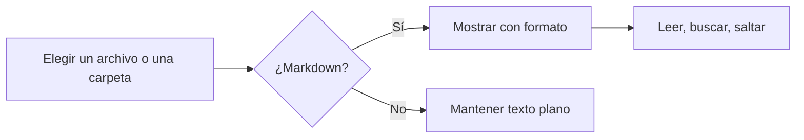
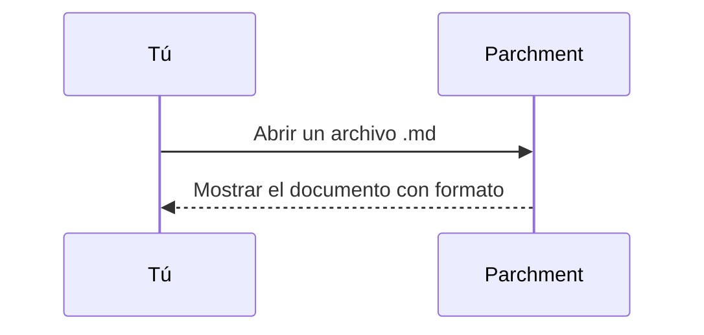
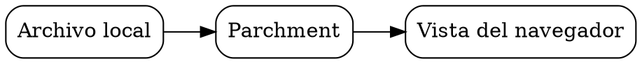

# Te damos la bienvenida a Parchment

Parchment es un **lector local de Markdown y texto plano** que funciona en tu navegador. Este documento es en sí un ejemplo: cada sección muestra un tipo de contenido que Parchment puede mostrar, para que compares el archivo original con el resultado.

> [!tip] Cómo usar este ejemplo
> - El Índice de la derecha te lleva a cualquier sección; las entradas con subtítulos se pueden plegar.
> - Abre las pestañas Etiquetas, Notas enlazadas y Enlaces entrantes para ver las etiquetas de este documento y su relación con la otra nota de ejemplo.
> - Las imágenes y los diagramas se **amplían con un clic** y se pueden guardar como PNG.

Las propiedades de arriba vienen del encabezado YAML al principio del archivo: `tags` se convierte en etiquetas en las que se puede hacer clic, y el resto de campos se muestra como una tabla.

## Formato de texto

Los párrafos pueden usar **negrita**, *cursiva*, ***negrita cursiva***, ~~tachado~~, ==resaltado==, ++texto insertado++ y `código en línea`.

La fórmula H~2~O usa subíndice y x^2^ superíndice. Los emojis se escriben directamente 🎉 o con códigos cortos :sparkles: :books: :rocket:.

Las teclas se muestran como <kbd>Ctrl</kbd> + <kbd>F</kbd>; el <mark>resaltado</mark>, el <u>subrayado</u> y H<sub>2</sub>O en HTML también funcionan.

Aquí hay una nota al pie[^read-only]; haz clic para leerla. HTML es una abreviatura: pasa el cursor por encima para ver el nombre completo.

*[HTML]: HyperText Markup Language

[^read-only]: Parchment abre los archivos en modo de solo lectura y nunca modifica tus documentos.

## Encabezados e índice

Los encabezados de `#` a `######` se reúnen en el Índice de la derecha, con sangría según su nivel.

### Encabezado de nivel 3

Los encabezados más profundos se agrupan bajo el encabezado anterior.

#### Encabezado de nivel 4

Haz clic en la flecha junto a un encabezado del Índice para plegar o desplegar ese nivel.

## Listas y tareas

- Lista con viñetas
  - Elemento anidado
    - Un nivel más
- Segundo elemento

1. Lista numerada
2. Segundo paso
   1. Subpaso
3. Tercer paso

- [x] Abrir este ejemplo
- [ ] Marcar este elemento (el estado se guarda solo en el navegador y no cambia el archivo)
- [ ] Abrir tu propia carpeta de notas

## Citas

> Caminante, no hay camino, se hace camino al andar.
> — Antonio Machado

> Las citas se pueden anidar
>> Segundo nivel
>>> Tercer nivel

## Tablas

Las columnas se pueden alinear a la izquierda, al centro o a la derecha:

| Función | Un archivo | Carpeta |
| :--- | :---: | :---: |
| Formato Markdown | ✅ | ✅ |
| Imágenes y enlaces relativos | — | ✅ |
| Enlaces wiki e incrustaciones | — | ✅ |
| Búsqueda de texto completo | — | ✅ |

Las tablas con muchas columnas ajustan su ancho automáticamente y solo se desplazan hacia los lados cuando no caben:

| N.º | Nombre | Categoría | Precio | Existencias | Origen | A la venta | Notas |
| --- | --- | --- | ---: | ---: | --- | --- | --- |
| 001 | Cuaderno de pergamino | Papelería | 11,00 € | 25 | Taiwán | 2026-01-15 | Encuadernado a mano |
| 002 | Tinta para pluma | Papelería | 15,50 € | 8 | Japón | 2026-03-02 | Azul negro, resistente al agua |

## Código

Los bloques de código se colorean según el lenguaje. Pasa el cursor por la esquina superior derecha para copiar un bloque.

```js
// Leer en modo de solo lectura el archivo que elige el usuario
const [handle] = await window.showOpenFilePicker();
const file = await handle.getFile();
console.log(await file.text());
```

```python
def greet(name: str) -> str:
    return f"¡Hola, {name}!"
```

## Fórmulas matemáticas

Fórmula en línea: equivalencia entre masa y energía $E = mc^2$, área de un círculo $A = \pi r^2$.

Fórmulas en bloque:

$$
\int_{0}^{1} x^2 \, dx = \frac{1}{3}
$$

$$
x = \frac{-b \pm \sqrt{b^2 - 4ac}}{2a}
$$

## Diagramas

Los diagramas se ajustan al ancho de lectura. **Haz clic en un diagrama** para ampliarlo, moverlo o guardarlo como PNG.

Diagrama de flujo de Mermaid:



Diagrama de secuencia de Mermaid:



Diagrama de Graphviz (`dot`):



## Avisos

> [!note]
> Una nota normal.

> [!success] Hecho
> Indica algo que ya está terminado.

> [!warning] Título personalizado
> El título es libre y el contenido puede usar **Markdown**.

> [!danger] Peligro
> Advierte de acciones que no se pueden deshacer.

> [!example] Ejemplo
> También existen los tipos info, tip, question, failure, bug, quote y abstract, cada uno con su propio icono y color.

> [!question]- ¿Se pueden plegar?
> Sí. Añade `-` después del tipo para que empiece plegado, o `+` para que empiece desplegado.

> [!NOTE]
> Las alertas con formato de GitHub también se muestran.

## Contenido plegable

<details>
<summary>Haz clic para ver más</summary>

Las etiquetas HTML `<details>` y `<summary>` permiten plegar contenido largo.

</details>

## Enlaces entre notas

Los corchetes dobles enlazan otra nota: [[linked-note]]. También puedes indicar el texto visible y un encabezado: [[linked-note#Sección incrustable|ir a una sección de la nota enlazada]].

Las direcciones web se abren en una pestaña nueva: [Parchment en GitHub](https://github.com/bruce-yang-422/parchment). También puedes saltar dentro de este documento: [volver a Tablas](#tablas).

Incrustar una sección completa:

![[linked-note#Sección incrustable]]

O solo un bloque:

![[linked-note#^summary]]

Cuando otra nota enlaza aquí, la pestaña Enlaces entrantes de la derecha muestra el origen.

## Imágenes

Una imagen Markdown normal con ruta relativa. **Haz clic en la imagen** para ampliarla:


También puedes escribir solo el nombre del archivo y un ancho; Parchment lo busca en toda la carpeta:

![[parchment-logo-transparent.png|96]]

## Lista de definiciones

Solo lectura
: Lee el contenido de los archivos sin modificar nada.

Primero local
: Los documentos se procesan en el navegador y nunca se suben.

## Ver más sintaxis

El [documento de prueba de lectura Markdown](https://github.com/bruce-yang-422/parchment/blob/main/samples/es/parchment_markdown_reader_test.md) muestra todavía más: textos en muchos idiomas, los 13 tipos de avisos, imágenes de internet y más lenguajes y diagramas. Descárgalo y ábrelo en Parchment para verlo todo de una vez.

## Próximos pasos

1. Elige **Abrir carpeta** en la esquina superior derecha y selecciona tu propia carpeta de notas.
2. Escribe en el cuadro de búsqueda de la barra lateral izquierda para buscar en todas las notas.
3. Usa el botón de configuración de la esquina superior derecha para probar otros temas y fuentes.

En el teléfono, el árbol de archivos y la información del documento se abren como paneles laterales. En documentos de más de cuatro pantallas, el botón para volver arriba aparece en la esquina inferior derecha después de desplazarte dos pantallas; los documentos cortos no lo muestran. En el ordenador, mueve el puntero a la esquina inferior derecha del área de lectura para que aparezca.

---

Este ejemplo se incluye con el sitio web y funciona sin conexión.
