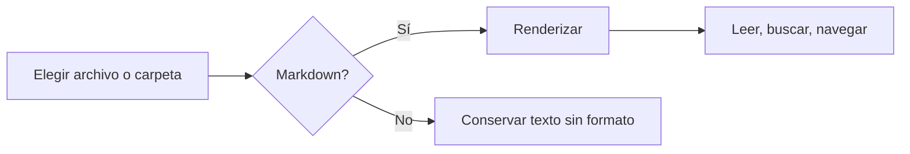

# Te damos la bienvenida a Parchment

Parchment es un **lector local de Markdown y texto** que funciona en el navegador. Este ejemplo muestra las principales sintaxis compatibles.

> [!tip] Cómo usar este ejemplo
> Usa el “Índice” de la derecha para ir a cualquier sección. Las pestañas “Etiquetas”, “Notas enlazadas” y “Enlaces entrantes” muestran las relaciones entre las notas.

Las propiedades anteriores proceden del YAML Frontmatter. Haz clic en una etiqueta para filtrar el árbol de archivos.

## Formato de texto

Usa **negrita**, *cursiva*, ~~tachado~~, ==resaltado==, ++texto insertado++ y `código en línea`.

H~2~O usa subíndice y x^2^ superíndice. Los códigos de emoji :sparkles: :books: :rocket: se convierten automáticamente.

Aquí hay una nota al pie.[^read-only]

*[HTML]: HyperText Markup Language

[^read-only]: Parchment abre los archivos en modo de solo lectura y nunca modifica el documento original.

## Listas y tareas

- Lista sin ordenar
  - Se permiten elementos anidados
- Otro elemento

1. Lista ordenada
2. Segundo paso

- [x] Abrir este ejemplo
- [ ] Alternar esta tarea; su estado queda en el navegador
- [ ] Abrir tu carpeta de notas

## Tabla

| Función | Archivo único | Carpeta |
| --- | :---: | :---: |
| Renderizado Markdown | ✅ | ✅ |
| Imágenes y enlaces relativos | — | ✅ |
| Wiki Links e incrustaciones | — | ✅ |
| Búsqueda de texto completo | — | ✅ |

## Código y fórmulas

```js
const [handle] = await window.showOpenFilePicker();
const file = await handle.getFile();
console.log(await file.text());
```

Fórmula en línea: $E = mc^2$.

$$
\int_{0}^{1} x^2 \, dx = \frac{1}{3}
$$

## Diagrama



## Avisos

> [!note]
> Una nota normal.

> [!warning] Título personalizado
> Los avisos pueden incluir **Markdown**.

> [!question]- ¿Se puede contraer?
> Sí. Añade `-` después del tipo para que aparezca contraído.

## Enlaces e incrustaciones

Abre [[linked-note]] o ve a [[linked-note#Sección incrustable|una sección de la nota enlazada]].

![[linked-note#Sección incrustable]]

![[linked-note#^summary]]

## Imagen


![[parchment-logo-transparent.png|96]]

## Siguientes pasos

1. Selecciona **Abrir carpeta** y elige tu carpeta de notas.
2. Busca en todas las notas desde la barra lateral izquierda.
3. Abre la configuración y prueba otro idioma, paleta o tipo de letra.

En el móvil, el árbol de archivos y la información del documento se abren en paneles laterales. En documentos de más de cuatro pantallas, el botón para volver arriba aparece en la esquina inferior derecha tras desplazarte dos pantallas; permanece oculto en documentos cortos. En el escritorio, mueve el puntero a la esquina inferior derecha del área de lectura para mostrarlo.

Este ejemplo está disponible sin conexión.
