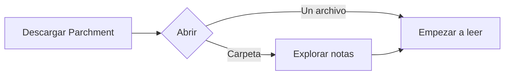
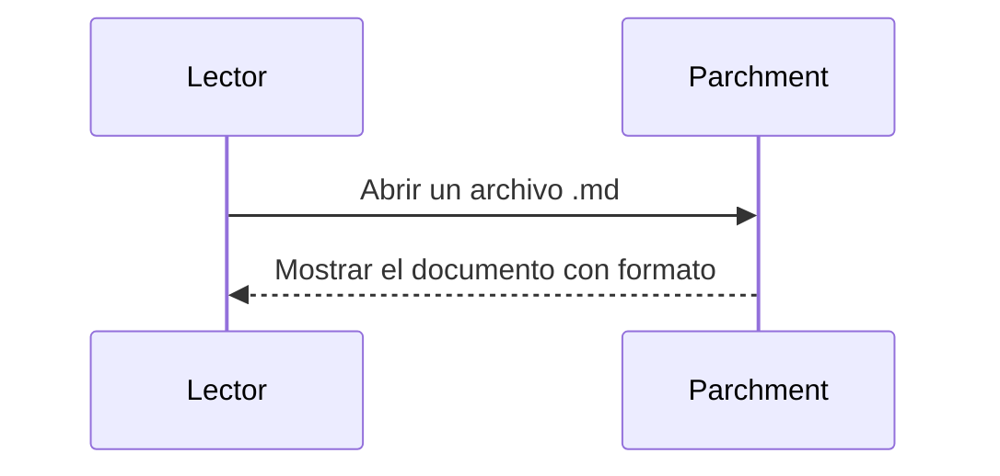
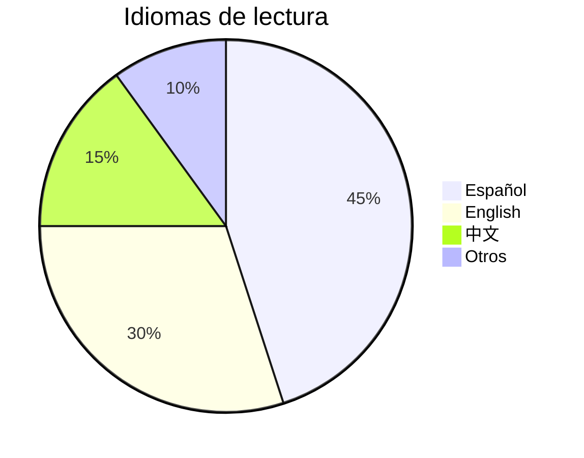
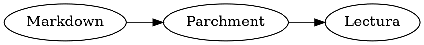

# Documento de prueba de lectura de Parchment

¡Te damos la bienvenida a **Parchment**! Este documento reúne muchas formas de escribir Markdown y textos en varios idiomas. Descárgalo y ábrelo en Parchment para ver todo lo que la app puede mostrar.

> [!tip] Cómo usar este documento
> 1. Abre este archivo en Parchment.
> 2. Toca Índice en la esquina superior derecha para ir a cualquier sección.
> 3. En Ajustes de lectura, prueba distintos temas, fuentes y tamaños de letra.

---

## 1. Encabezados

# Encabezado de nivel 1
## Encabezado de nivel 2
### Encabezado de nivel 3
#### Encabezado de nivel 4
##### Encabezado de nivel 5
###### Encabezado de nivel 6

Otra forma de escribirlo (subrayado)
====================================

Segundo nivel (subrayado)
-------------------------

---

## 2. Estilos de texto

| Efecto | Sintaxis | Resultado |
| --- | --- | --- |
| Negrita | `**negrita**` | **Negrita** |
| Cursiva | `*cursiva*` | *Cursiva* |
| Negrita cursiva | `***negrita cursiva***` | ***Negrita cursiva*** |
| Tachado | `~~tachado~~` | ~~Tachado~~ |
| Resaltado | `==resaltado==` | ==Resaltado== |
| Subrayado | `++subrayado++` | ++Subrayado++ |
| Superíndice | `x^2^` | x^2^ |
| Subíndice | `H~2~O` | H~2~O |
| Código en línea | `` `code` `` | `print("hi")` |

Los guiones bajos también funcionan: _cursiva_, __negrita__.

Caracteres escapados: \*no es cursiva\*, \# no es un encabezado, \[no es un enlace\].

Esta línea termina con dos espacios  
por eso el texto salta de línea aquí (salto de línea forzado).

---

## 3. Multilingüe

Los textos siguientes solo sirven para comprobar que las fuentes se ven bien (sin cuadros «□» ni caracteres ilegibles). No hace falta entenderlos.

### 繁體中文
落霞與孤鶩齊飛，秋水共長天一色。Parchment 是一款讓你安靜閱讀 Markdown 筆記的 App。

### 简体中文
落霞与孤鹜齐飞，秋水共长天一色。Parchment 是一款让你安静阅读 Markdown 笔记的 App。

### English
The quick brown fox jumps over the lazy dog. *Parchment* lets you read your Markdown notes in peace.

### 日本語
いろはにほへと ちりぬるを わかよたれそ つねならむ。**Parchment** は Markdown のノートを静かに読むためのアプリです。

### 한국어
다람쥐 헌 쳇바퀴에 타고파. **Parchment**는 Markdown 노트를 조용히 읽을 수 있는 앱입니다.

### Français
Portez ce vieux whisky au juge blond qui fume. Ça, c'est l'été à Noël — « déjà vu » !

### Deutsch
Victor jagt zwölf Boxkämpfer quer über den großen Sylter Deich. Straße, Größe, Übung.

### Español
El veloz murciélago hindú comía feliz cardillo y kiwi. ¿Dónde está la señal? ¡Olé!

### Italiano · Português
Quel vituperabile xenofobo zelante assaggia il whisky ed esclama: alleluja!
Luís argüia à Júlia que «brações, fé, chá, óxido, pôr, zângão» eram palavras do português.

### Русский
Съешь же ещё этих мягких французских булок, да выпей чаю.

### Ελληνικά
Ξεσκεπάζω την ψυχοφθόρα βδελυγμία.

### Tiếng Việt
Tiếng Việt có dấu: ă â đ ê ô ơ ư — Trăm năm trong cõi người ta.

### ภาษาไทย
เป็นมนุษย์สุดประเสริฐเลิศคุณค่า

### हिन्दी
ऋषियों को सताने वाले दुष्ट राक्षसों के राजा रावण का सर्वनाश करने वाले विष्णु।

### De derecha a izquierda
- العربية: مرحبًا بك في Parchment.
- עברית: ברוכים הבאים ל־Parchment.

### Mezcla
Español English 中文 日本語 한국어 en la misma línea, con los números 1234567890 y una 「puntuación」 de ancho completo junto a una (puntuación) de medio ancho.

---

## 4. Emojis

Escritos directamente: 😀 🎉 📚 ✍️ 🌏 🇪🇸 🇲🇽 🇦🇷 👍🏽 👨‍👩‍👧‍👦

Códigos cortos: :smile: :heart: :rocket: :books: :+1:

---

## 5. Listas

### Lista con viñetas
- Manzana
- Plátano
  - Segundo nivel
    - Tercer nivel
* El asterisco también sirve
+ Y el signo más

### Lista numerada
1. Primer paso
2. Segundo paso
   1. Subpaso 2.1
   2. Subpaso 2.2
3. Tercer paso

Numeración que empieza en 5:

5. Cinco
6. Seis

### Lista de tareas (márcalas y guárdalas en el archivo)
- [x] Descargar Parchment
- [x] Abrir este documento de prueba
- [ ] Probar otro tema
- [ ] Probar otra fuente
- [ ] Toca aquí para marcar esta casilla

---

## 6. Enlaces

- Enlace normal: [Parchment en GitHub](https://github.com/bruce-yang-422/parchment)
- Enlace automático: <https://www.markdownguide.org>
- Enlace con título: [Guía de Markdown](https://www.markdownguide.org "Se muestra al pasar el cursor")
- Enlace de referencia: [CommonMark][cm]
- Enlace dentro del documento: [Volver a la sección Tablas](#8-tablas)
- Enlaces wiki: [[Otra nota]], [[Otra nota|Nombre visible]]

[cm]: https://commonmark.org

---

## 7. Imágenes

### Imagen de internet
Necesita conexión a internet:


### Imagen de Wikipedia
*Viajeros entre montañas y arroyos*, de Fan Kuan, dinastía Song del Norte (Museo del Palacio Nacional, Taipéi; dominio público; fuente: [Wikimedia Commons](https://commons.wikimedia.org/wiki/File:Fan_Kuan_-_Travelers_Among_Mountains_and_Streams_-_Google_Art_Project.jpg)). Es una imagen alargada; tócala para ampliarla:


### Ancho definido con HTML


### Imagen que no existe
Esta imagen no existe a propósito, para probar el mensaje de error:


---

## 8. Tablas

| Idioma | Saludo | Dirección de escritura |
| :--- | :---: | ---: |
| Español | Hola | LTR |
| English | Hello | LTR |
| 繁體中文 | 你好 | LTR |
| 日本語 | こんにちは | LTR |
| 한국어 | 안녕하세요 | LTR |
| Français | Bonjour | LTR |
| Deutsch | Guten Tag | LTR |
| العربية | مرحبا | RTL |

### Tabla ancha (desplázate hacia los lados)

| N.º | Nombre | Categoría | Precio | Existencias | Origen | A la venta | Notas |
| --- | --- | --- | ---: | ---: | --- | --- | --- |
| 001 | Cuaderno de pergamino | Papelería | 11,00 € | 25 | Taiwán | 2026-01-15 | Encuadernado a mano, duradero |
| 002 | Tinta para pluma | Papelería | 15,50 € | 8 | Japón | 2026-03-02 | Azul negro, resistente al agua |
| 003 | Notebook A5 | Stationery | 12,50 € | 140 | Alemania | 2026-05-20 | Punteado, 120 g/m² |

---

## 9. Citas

> Caminante, no hay camino, se hace camino al andar.
> — Antonio Machado

> Primer nivel
>> Segundo nivel
>>> Tercer nivel

> Una cita puede contener **negrita**, `código` y listas:
> - Elemento uno
> - Elemento dos

---

## 10. Avisos

> [!note] Nota
> Una nota normal.

> [!info] Información
> Información adicional.

> [!tip] Consejo
> Mantén pulsado un texto para copiarlo.

> [!success] Éxito
> ¡Listo!

> [!question] Pregunta
> ¿Qué tema te gusta más?

> [!warning] Atención
> Haz una copia de seguridad antes de editar.

> [!danger] Peligro
> Esta acción no se puede deshacer.

> [!failure] Error
> No se encontró el archivo.

> [!bug] Fallo
> Adjunta una captura de pantalla al informar de un problema.

> [!example] Ejemplo
> Esto es un ejemplo.

> [!quote] Cita
> La práctica hace al maestro.

> [!abstract] Resumen
> Este documento sirve para probar cómo muestra Parchment el Markdown.

> [!tip]- Aviso plegable (plegado al principio, tócalo para abrirlo)
> ¡Encontraste el contenido oculto! 🎉

---

## 11. Código

Código en línea: `const name = 'Parchment';`

### Dart
```dart
void main() {
  final greeting = '¡Hola, Parchment!';
  print(greeting);
}
```

### Python
```python
def greet(name: str) -> str:
    """Saludo multilingüe / Multilingual greeting"""
    return f"¡Hola, {name}!"

print(greet("Parchment"))
```

### JavaScript
```javascript
const langs = ['es', 'en', 'zh-TW', 'zh-CN', 'ja', 'ko', 'fr', 'de'];
langs.forEach((lang, i) => console.log(`${i + 1}. ${lang}`));
```

### JSON
```json
{
  "app": "Parchment",
  "languages": ["Español", "English", "繁中", "日本語", "한국어"],
  "offline": true
}
```

### Shell
```bash
# Una línea de comandos muy larga para probar el desplazamiento horizontal en un bloque de código, que pasa mucho del borde
echo "Hola, Parchment" && ls -la ~/Documents/notes/markdown/very/deep/folder/structure/
```

### SQL
```sql
SELECT title, author FROM notes WHERE lang = 'Español' ORDER BY updated_at DESC;
```

### Sin lenguaje indicado
```
Bloque de código de texto plano
  se conserva la sangría
```

### Código con sangría (cuatro espacios)

    Esto también es un bloque de código
    Indented code block

---

## 12. Fórmulas matemáticas

Fórmula en línea: equivalencia entre masa y energía $E = mc^2$, área de un círculo $A = \pi r^2$.

Fórmulas en bloque:

$$
x = \frac{-b \pm \sqrt{b^2 - 4ac}}{2a}
$$

$$
\int_0^\infty e^{-x^2}\,dx = \frac{\sqrt{\pi}}{2}
$$

$$
\sum_{n=1}^{\infty} \frac{1}{n^2} = \frac{\pi^2}{6}
$$

---

## 13. Diagramas

### Diagrama de flujo de Mermaid


### Diagrama de secuencia de Mermaid


### Gráfico circular de Mermaid


### Graphviz


---

## 14. Notas al pie

Parchment admite notas al pie[^1], notas con nombre de palabra[^nota] y notas más largas[^long].

[^1]: Esta es la primera nota. Toca la flecha de regreso al final para volver al texto.
[^nota]: Las notas con nombre de palabra también se abren con normalidad.
[^long]: Una nota puede contener **negrita**, `código` y [enlaces](https://commonmark.org).

---

## 15. Etiquetas HTML

- Teclas: pulsa <kbd>Ctrl</kbd> + <kbd>C</kbd> para copiar
- <mark>Resaltado HTML</mark>, <u>subrayado</u>, <s>tachado</s>
- Química H<sub>2</sub>O, cuadrado x<sup>2</sup>
- Salto<br>de línea con la etiqueta br

<details>
<summary>Haz clic para ver más</summary>

Este contenido permanece plegado hasta que lo abras.

- Elemento oculto uno
- Elemento oculto dos

</details>

---

## 16. Lista de definiciones

Markdown
: Un lenguaje de marcado ligero para escribir documentos con formato en texto plano.

Parchment
: Una app para leer Markdown sin distracciones.
: Un término puede tener una segunda definición.

---

## 17. Abreviaturas

HTML y CSS son la base de la web, y PDF se usa mucho para imprimir.

*[HTML]: HyperText Markup Language
*[CSS]: Cascading Style Sheets
*[PDF]: Portable Document Format

---

## 18. Líneas separadoras

Las tres formas se ven igual:

***

---

___

---

## 19. Párrafo largo

Prueba de diseño y desplazamiento fluido: Lorem ipsum dolor sit amet, consectetur adipiscing elit, sed do eiusmod tempor incididunt ut labore et dolore magna aliqua. 春眠不覺曉，處處聞啼鳥。夜來風雨聲，花落知多少。Ut enim ad minim veniam, quis nostrud exercitation ullamco laboris nisi ut aliquip ex ea commodo consequat. 古池や蛙飛び込む水の音。Duis aute irure dolor in reprehenderit in voluptate velit esse cillum dolore eu fugiat nulla pariatur. 산에는 꽃 피네 꽃이 피네 갈 봄 여름 없이 꽃이 피네. Excepteur sint occaecat cupidatat non proident, sunt in culpa qui officia deserunt mollit anim id est laborum.

Una dirección o palabra muy larga sin espacios, para probar el ajuste de línea: https://example.com/a/very/long/path/that/keeps/going/and/going/without/any/spaces/to/break/the/line/naturally/index.html

---

## Prueba terminada 🎉

Si puedes leer esto, el documento se cargó completo. Toca el botón Volver arriba, en la esquina inferior derecha, para regresar al principio.

Si algo no se ve bien, avísanos en [GitHub Issues](https://github.com/bruce-yang-422/parchment/issues). ¡Gracias por tu ayuda!
