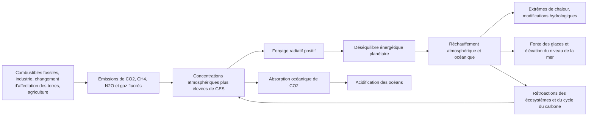
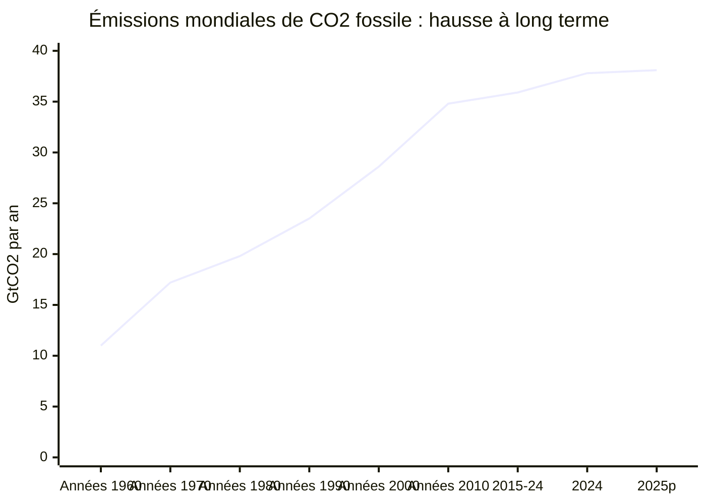
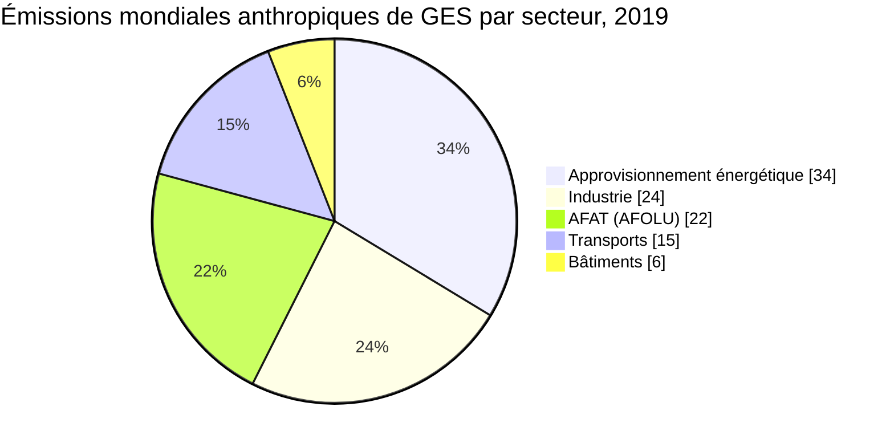
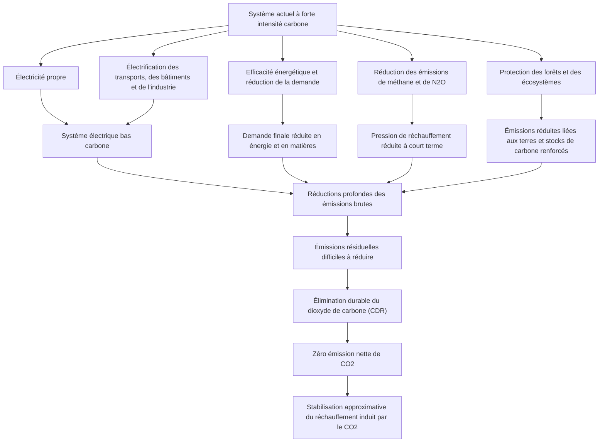

# Émissions de carbone et empreintes carbone : impacts sur le système climatique mondial

## Résumé analytique

> **Constat central.** Les preuves démontrant que les émissions anthropiques de gaz à effet de serre constituent la cause dominante du réchauffement climatique moderne sont sans équivoque. Le dioxyde de carbone (CO₂) est le principal contributeur individuel en raison des quantités cumulées considérables émises, de son influence de longue durée sur le cycle du carbone et de la relation quasi linéaire entre les émissions cumulées de CO₂ et la température moyenne mondiale. Le méthane (CH₄), le protoxyde d'azote (N₂O) et les gaz fluorés ajoutent un forçage supplémentaire substantiel.[^3] [^5]

Les activités humaines ont porté la température de surface mondiale à environ **1,1 °C au-dessus de la moyenne de 1850–1900 sur la période 2011–2020**. Le GIEC estime que le réchauffement total d'origine humaine entre 1850–1900 et 2010–2019 s'élève à environ **1,07 °C**, tandis que les influences naturelles solaires et volcaniques n'ont apporté qu'une faible contribution au changement observé à long terme. Les gaz à effet de serre seuls auraient provoqué un réchauffement plus important, mais une partie de leur effet a été masquée par les aérosols anthropiques.[^5]

L'ampleur de la perturbation carbonée sous-jacente est sans précédent au cours de l'ère observationnelle. La concentration atmosphérique de CO₂ était d'environ **270–280 ppm avant l'industrialisation** et a atteint une moyenne annuelle mondiale dans la couche limite marine de **425,62 ± 0,05 ppm en 2025**, selon la NOAA. Le forçage radiatif effectif combiné des gaz à effet de serre à longue durée de vie a atteint **3,59 W m⁻² au-dessus des conditions préindustrielles en 2025**, soit 56 % de plus que le forçage équivalent de 1990. Le CO₂ seul a contribué à hauteur de **2,37 W m⁻²**, soit environ les deux tiers du total des gaz à effet de serre à longue durée de vie.[^7]

Les émissions mondiales ont néanmoins continué d'augmenter. Le GIEC a estimé à **59 ± 6,6 GtCO₂-éq** les émissions nettes anthropiques de gaz à effet de serre en 2019, soit 54 % de plus qu'en 1990. Le *Global Carbon Budget 2025* a estimé les émissions mondiales de CO₂ d'origine fossile à **37,8 ± 2 GtCO₂ en 2024** et projeté environ **38,1 GtCO₂ en 2025**, bien que les définitions méthodologiques varient selon les jeux de données. L'AIE a estimé de manière indépendante à près de **38,4 GtCO₂ les émissions de CO₂ liées à l'énergie en 2025**. Ces chiffres ne doivent pas être considérés comme interchangeables, car leurs périmètres sectoriels diffèrent.[^1] [^2] [^4] [^6]

Les empreintes carbone prolongent l'analyse au-delà des émissions territoriales. Un *inventaire fondé sur la production* attribue les émissions au lieu où elles se produisent physiquement ; une *empreinte carbone fondée sur la consommation* réaffecte les émissions incorporées à travers les chaînes d'approvisionnement internationales jusqu'aux consommateurs finaux. Cette distinction est essentielle, car les biens échangés permettent aux régions à forte consommation d'externaliser une partie de leurs émissions territoriales. Les études fondées sur les modèles entrées-sorties multirégionaux (MRIO) comportent néanmoins une plus grande incertitude structurelle et de données que les inventaires nationaux de combustion.[^4] [^10]

La répartition des responsabilités est fortement inégale. En 2019, les 10 % des ménages les plus émetteurs représentaient environ **34 à 45 % des émissions mondiales de gaz à effet de serre des ménages fondées sur la consommation**, tandis que les 50 % les moins émetteurs n'en représentaient que **13 à 15 %**. Les écarts régionaux sont tout aussi marqués : les émissions de gaz à effet de serre en Amérique du Nord s'élevaient à environ **19 tCO₂-éq par personne** en 2019, contre environ **2,5 tCO₂-éq par personne** en Asie du Sud.[^4]

Les conséquences climatiques déjà observées comprennent l'augmentation des extrêmes de chaleur, l'intensification des précipitations fortes dans de nombreuses régions, la modification des risques de sécheresse, le réchauffement des océans, la perte de la cryosphère, l'accélération de l'élévation du niveau de la mer et l'acidification des océans. Le niveau moyen mondial des mers s'est élevé d'environ **0,20 m entre 1901 et 2018**, tandis que son rythme d'élévation a augmenté pour atteindre **3,7 [3,2–4,2] mm an⁻¹ sur la période 2006–2018**. Le pH des eaux océaniques de surface a diminué d'environ **0,1 unité depuis l'ère industrielle**, ce qui correspond à une augmentation d'environ 30 % de la concentration en ions hydrogène.[^5] [^9]

La contrainte physique la plus forte pesant sur le réchauffement futur est le CO₂ cumulé. Le GIEC évalue la meilleure estimation de la réponse climatique transitoire aux émissions cumulées (TCRE) à environ **0,45 °C pour 1 000 GtCO₂**, avec une fourchette probable de 0,27 à 0,63 °C. Par conséquent, stabiliser le réchauffement d'origine humaine exige que les émissions nettes anthropiques mondiales de CO₂ approchent de zéro ; la poursuite d'émissions positives entraîne un réchauffement supplémentaire.[^3]

Des technologies d'atténuation sont déjà disponibles à grande échelle. Les évaluations du GIEC indiquent que des options coûtant **100 USD tCO₂-éq⁻¹ ou moins pourraient réduire les émissions mondiales de gaz à effet de serre d'au moins la moitié du niveau de 2019 d'ici 2030**, plus de la moitié de ce potentiel évalué coûtant moins de 20 USD tCO₂-éq⁻¹. Les principales opportunités à faible coût comprennent l'énergie solaire et éolienne, l'efficacité énergétique, la réduction des émissions de méthane et la prévention de la conversion des forêts et d'autres écosystèmes naturels. La faisabilité dépend toutefois non seulement du coût d'ingénierie, mais aussi des infrastructures de réseau, du financement, des institutions, des contraintes foncières, des changements comportementaux, de l'acceptation sociale et des conséquences distributives.[^4]

## Résumé et introduction

Le présent document examine la relation entre **les émissions de carbone, les empreintes carbone, l'accumulation atmosphérique de gaz à effet de serre, le forçage radiatif et le changement climatique** d'environ 1850 à nos jours. Le périmètre d'analyse est mondial, sauf mention contraire. Il distingue les émissions physiques des empreintes carbone fondées sur la consommation, évalue la solidité des preuves reliant les émissions aux impacts climatiques, identifie les principales incertitudes et examine les grandes trajectoires d'atténuation.

Le terme **émissions de carbone** désigne ici principalement le CO₂ rejeté par la combustion de combustibles fossiles, les procédés industriels et le changement d'affectation des terres, tandis que les *émissions de gaz à effet de serre* incluent en outre le CH₄, le N₂O et les gaz fluorés. Une **empreinte carbone** désigne plus largement les émissions directes et indirectes de gaz à effet de serre imputables à un produit, une activité, une organisation, un ménage ou une population, généralement exprimées en tonnes d'équivalent dioxyde de carbone (tCO₂-éq). Les empreintes fondées sur la consommation incluent les émissions incorporées dans les biens et services importés, ce qui les distingue conceptuellement des inventaires nationaux territoriaux.[^4] [^10]

L'agrégation de multiples gaz à effet de serre en émissions équivalent CO₂ repose sur une métrique climatique, habituellement le **potentiel de réchauffement global sur 100 ans, PRG₁₀₀ (GWP₁₀₀)**. L'estimation du PRG₁₀₀ du sixième Rapport d'évaluation (AR6) du GIEC est de 1 pour le CO₂, d'environ **29,8 pour le CH₄ d'origine fossile**, **27,0 pour le CH₄ non fossile** et **273 pour le N₂O**, bien que les incertitudes soient notables. Un gaz doté d'un PRG₁₀₀ de 273 produit donc, par unité de masse émise, une influence radiative intégrée sur 100 ans environ 273 fois supérieure à l'influence de référence d'une masse égale de CO₂ selon les hypothèses de la métrique. Les valeurs de PRG ne doivent pas être interprétées comme des équivalences physiques exactes à chaque horizon temporel.[^3]

La séquence causale fondamentale est la suivante :

**Figure 1. Chaîne causale conceptuelle reliant les activités anthropiques aux impacts climatiques et biogéochimiques.** La direction de la principale voie des gaz à effet de serre s'appuie sur de multiples sources de preuves observationnelles, théoriques et issues de la modélisation évaluées par le GIEC.[^3] [^5]

### Hypothèses explicites

1. **Périmètre géographique :** mondial, avec des comparaisons régionales lorsque des jeux de données robustes le permettent.
2. **Période historique :** d'environ 1850 à nos jours, sauf indication d'une autre période.
3. **Comptabilisation des émissions :** les émissions fondées sur la production sont utilisées pour les totaux physiques mondiaux ; les mesures fondées sur la consommation sont explicitement désignées comme des empreintes.
4. **Métrique climatique :** les valeurs en équivalent CO₂ utilisent généralement le PRG₁₀₀ (GWP₁₀₀) de l'AR6, sauf spécification contraire de la source.
5. **Dernières observations :** les inventaires complets accusant un décalage par rapport au temps réel, le document distingue les *données historiques observées* des *valeurs provisoires ou projetées*.
6. **Coûts d'atténuation :** les fourchettes de coûts indiquées correspondent à des estimations technico-économiques mondiales plutôt qu'à des coûts garantis à l'échelle d'un projet.

La principale question de recherche n'est donc pas simplement de savoir si les émissions modifient le climat — cette attribution est déjà solidement établie — mais **comment les quantités d'émissions, les sources, la responsabilité géographique, les modes de consommation, la physique atmosphérique et les processus du cycle du carbone se combinent pour déterminer l'ampleur et la persistance du changement climatique**.

## Méthodes et sources de données

L'analyse s'appuie sur une hiérarchie des preuves scientifiques. La priorité absolue est accordée au **sixième Rapport d'évaluation du GIEC (AR6)**, car il synthétise des milliers d'études évaluées par les pairs à l'aide d'un langage de confiance calibré et de multiples sources de preuves indépendantes. L'analyse des sciences physiques repose principalement sur le Groupe de travail I de l'AR6, l'évaluation des émissions et de l'atténuation sur le Groupe de travail III, et l'évaluation intégrée des impacts sur le Rapport de synthèse de 2023.[^3] [^4] [^5]

Les données récentes sur les émissions et le cycle du carbone proviennent principalement du ***Global Carbon Budget 2025***, publié dans *Earth System Science Data*. Son bilan intègre les émissions de CO₂ fossile, le changement d'affectation des terres, l'accumulation atmosphérique, l'absorption océanique, l'absorption terrestre et un déséquilibre budgétaire explicite. Pour la période 1850–2024, il estime les émissions anthropiques cumulées à **745 ± 65 GtC**, réparties approximativement entre 290 ± 5 GtC retenues dans l'atmosphère, 200 ± 40 GtC absorbées par l'océan, 175 ± 50 GtC absorbées par les puits terrestres, plus un déséquilibre budgétaire résiduel.[^1]

Les données sur les concentrations atmosphériques et le forçage radiatif proviennent du **Global Monitoring Laboratory de la NOAA**. Le réseau mondial de long terme de la NOAA fournit des mesures de CO₂, de CH₄, de N₂O et d'autres gaz à effet de serre à longue durée de vie, et produit l'indice annuel des gaz à effet de serre (*Annual Greenhouse Gas Index*, AGGI).[^7] [^8]

Les informations relatives au CO₂ lié à l'énergie sont complétées par l'**Agence internationale de l'énergie (AIE)**, notamment lorsque les tendances sectorielles récentes sont nécessaires. Les données de l'AIE utilisent un périmètre comptable différent de celui du *Global Carbon Budget* ; par conséquent, les totaux numériques ne sont comparés qu'après définition de leurs périmètres respectifs.[^6]

Les données relatives aux empreintes fondées sur la consommation s'appuient sur les évaluations du GIEC et sur des travaux évalués par les pairs utilisant des modèles entrées-sorties multirégionaux (MRIO). Ces modèles retracent les chaînes d'approvisionnement monétaires et physiques à travers le commerce international. Ils sont utiles pour attribuer les émissions indirectes à la consommation, mais des incertitudes résultent de l'agrégation sectorielle, des statistiques commerciales, de l'harmonisation des facteurs d'émission et des différences entre bases de données MRIO. Une comparaison de cinq grands systèmes MRIO a mis en évidence des variations significatives dans les estimations des comptes carbone fondés sur la consommation, illustrant pourquoi les estimations d'empreinte ne doivent pas être considérées comme des quantités d'inventaire exactes.[^10]

### Relations physiques fondamentales

Une approximation au premier ordre largement utilisée pour le forçage radiatif du CO₂ est

\[
\boxed{\Delta F_{CO_2}\approx 5.35\ln\left(\frac{C}{C_0}\right)\;\text{W m}^{-2}}
\]

où \(C_0\) est la concentration de référence en CO₂ et \(C\) la concentration perturbée. Cette relation logarithmique signifie que chaque augmentation proportionnelle de CO₂ produit un forçage incrémental approximativement comparable ; l'AR6 utilise des traitements spectroscopiques actualisés pour ses évaluations formelles, mais l'approximation logarithmique demeure utile sur le plan pédagogique.[^3]

Le bilan carbone mondial peut s'exprimer schématiquement sous la forme

\[
E_{\mathrm{FOS}}+E_{\mathrm{LUC}}
=
G_{\mathrm{ATM}}
+
S_{\mathrm{OCEAN}}
+
S_{\mathrm{LAND}}
+
B_{\mathrm{IM}},
\]

où \(E_{\mathrm{FOS}}\) représente les émissions de CO₂ fossile et industriel, \(E_{\mathrm{LUC}}\) les émissions liées au changement d'affectation des terres, \(G_{\mathrm{ATM}}\) l'accumulation atmosphérique, \(S_{\mathrm{OCEAN}}\) et \(S_{\mathrm{LAND}}\) les puits océanique et terrestre, et \(B_{\mathrm{IM}}\) le déséquilibre budgétaire résiduel. Sur la période 2015–2024, le *Global Carbon Budget* a estimé qu'environ **50 %** des émissions anthropiques totales de CO₂ se sont accumulées dans l'atmosphère, **29 %** ont été absorbées par l'océan et **21 %** par le puits terrestre, avec un déséquilibre moyen proche de zéro au cours de cette décennie.[^1]

Pour la température, l'AR6 donne la relation cumulée approximative

\[
\Delta T \approx \mathrm{TCRE}\times
\frac{E_{\mathrm{cum}}}{1000\ \mathrm{GtCO_2}},
\]

avec

\[
\mathrm{TCRE}_{\text{meilleure estimation}}\approx0.45^{\circ}\mathrm{C}\; / \;1000\ \mathrm{GtCO_2}.
\]

Cette relation quasi linéaire est l'une des raisons pour lesquelles les émissions cumulées de CO₂, plutôt que le seul taux d'émission d'une année donnée, sont au cœur des politiques climatiques.[^3]

Pour les gaz autres que le CO₂, le PRG (GWP) sur un horizon \(H\) est conceptuellement

\[
\mathrm{GWP}_i(H)
=
\frac{\int_0^H RF_i(t)\,dt}
{\int_0^H RF_{CO_2}(t)\,dt},
\]

où \(RF_i(t)\) est le forçage radiatif dépendant du temps consécutif à une émission impulsionnelle de l'espèce \(i\). L'horizon temporel retenu modifie l'importance relative apparente des gaz à courte durée de vie tels que le CH₄.[^3]

## Résultats

Les émissions anthropiques mondiales ont fortement augmenté depuis l'industrialisation. Les émissions nettes cumulées historiques de CO₂ entre **1850 et 2019 s'élevaient à environ 2 400 ± 240 GtCO₂**, et près de 42 % de ce total cumulé ont été émis au cours de la période 1990–2019. Cela démontre l'accumulation inhabituellement rapide des émissions au cours des dernières décennies.[^4]

Le *Global Carbon Budget* révèle la même tendance à long terme pour le CO₂ fossile. Les émissions fossiles moyennes sont passées d'environ **3,0 GtC an⁻¹ dans les années 1960** à **9,8 GtC an⁻¹ sur la période 2015–2024**, ce qui équivaut respectivement à environ 11 et 36 GtCO₂ an⁻¹. Les émissions de CO₂ fossile ont atteint environ 37,8 GtCO₂ en 2024, soit 69 % de plus qu'en 1990.[^1]

**Figure 2. Tendance approximative des émissions mondiales de CO₂ fossile.** Les valeurs décennales sont converties de GtC en GtCO₂ à l'aide du facteur \(44/12\) ; la valeur de 2025 correspond à la projection du *Global Carbon Budget 2025* plutôt qu'à un inventaire définitif.[^1] [^2]

### Répartitions sectorielles et régionales des émissions

En 2019, l'approvisionnement énergétique représentait environ **34 %** des émissions nettes anthropiques mondiales de gaz à effet de serre, l'industrie 24 %, le secteur AFAT (agriculture, foresterie et autres affectations des terres, AFOLU) 22 %, les transports 15 % et les bâtiments 6 %. La somme de ces catégories atteint environ 101 % en raison de l'arrondi des parts déclarées. Lorsque les émissions liées à l'électricité et à la chaleur sont réaffectées du secteur de l'approvisionnement énergétique vers les utilisateurs finaux, les contributions relatives de l'industrie et des bâtiments augmentent considérablement, ce qui démontre que les parts sectorielles dépendent des conventions comptables.[^4]

**Figure 3. Parts sectorielles approximatives des émissions nettes anthropiques de GES en 2019.** Les valeurs sont des estimations du GIEC exprimées en équivalent CO₂ selon le PRG₁₀₀ (GWP₁₀₀) de l'AR6.[^4]

| Dimension comptable | Source / région majeure | Ordre de grandeur approximatif | Interprétation |
|---|---|---:|---|
| **Secteur, GES 2019** | Approvisionnement énergétique | 20 GtCO₂-éq ; 34 % | Premier secteur d'émissions directes au niveau mondial.[^4] |
|  | Industrie | 14 GtCO₂-éq ; 24 % | Inclut les émissions énergétiques industrielles et de procédés.[^4] |
|  | AFAT (AFOLU) | 13 GtCO₂-éq ; 22 % | Inclut l'agriculture, la foresterie et le changement d'affectation des terres.[^4] |
|  | Transports | 8,7 GtCO₂-éq ; 15 % | Dominé par les systèmes de transport à combustibles fossiles.[^4] |
|  | Bâtiments | 3,3 GtCO₂-éq ; 6 % directs | La part passe à environ 16 % lorsque les émissions indirectes d'électricité et de chaleur sont allouées aux utilisateurs.[^4] |
| **CO₂ fossile, 2024** | Chine | 12,3 GtCO₂ ; 31,7 % | Premier émetteur territorial de CO₂ fossile.[^2] |
|  | États-Unis | 4,9 GtCO₂ ; 12,7 % | CO₂ fossile par habitant d'environ 14,2 tCO₂.[^2] |
|  | Inde | 3,2 GtCO₂ ; 8,3 % | CO₂ fossile par habitant d'environ 2,2 tCO₂.[^2] |
|  | UE-27 | 2,4 GtCO₂ ; 6,3 % | CO₂ fossile par habitant d'environ 5,4 tCO₂.[^2] |
|  | Russie | 1,8 GtCO₂ ; 4,6 % | CO₂ fossile par habitant d'environ 12,3 tCO₂.[^2] |
| **Empreinte de consommation** | Amérique du Nord | ~13,4 tCO₂-éq habitant⁻¹ dans l'évaluation d'empreinte citée | Les empreintes de consommation liées aux ménages restent élevées.[^4] |
|  | Europe | ~7,5 tCO₂-éq habitant⁻¹ | Inférieure à celle de l'Amérique du Nord, mais nettement supérieure aux régions à faible revenu.[^4] |
|  | Afrique et Moyen-Orient* | ~1,7 tCO₂-éq habitant⁻¹ | Illustre de fortes inégalités mondiales ; le regroupement de la source est large.[^4] |

**Tableau 1. Principales sources d'émissions par secteur et par région.** Les chiffres sectoriels de GES, les chiffres territoriaux de CO₂ fossile et les empreintes fondées sur la consommation reposent sur des frontières de système différentes et ne doivent pas être additionnés ni substitués directement les uns aux autres. *La source d'empreinte de consommation citée agrège l'Afrique et le Moyen-Orient et ne doit donc pas être interprétée comme une valeur régionale homogène.[^4] [^10]

La répartition régionale varie également selon que l'analyse examine les émissions annuelles, la responsabilité historique cumulée, les émissions par habitant ou les empreintes fondées sur la consommation. Les économies développées ont généralement contribué à une part des émissions historiques cumulées de CO₂ supérieure à leur part actuelle dans la population mondiale, tandis que la part de l'Asie de l'Est dans les émissions annuelles contemporaines a fortement augmenté depuis 2000. Le GIEC indique que les pays développés atteignaient en moyenne environ **9,5 tCO₂ de CO₂ fossile et industriel par habitant en 2019**, contre environ **4,4 tCO₂ en Asie-Pacifique, 2,7 tCO₂ en Amérique latine et dans les Caraïbes, et 1,2 tCO₂ en Afrique**.[^4]

### Forçage radiatif et réponse climatique

Le lien physique entre émissions et réchauffement passe par les concentrations atmosphériques et le forçage radiatif. L'AR6 a estimé le forçage radiatif effectif de 2019 par rapport à 1750 à **2,16 [1,90–2,41] W m⁻²** pour le CO₂, **0,54 [0,43–0,65] W m⁻²** pour le CH₄, **0,21 [0,18–0,24] W m⁻²** pour le N₂O et **0,41 [0,33–0,49] W m⁻²** pour les gaz halogénés.[^3]

L'indice observationnel plus récent de la NOAA montre que le forçage a continué de croître : en 2025, le forçage radiatif effectif combiné des gaz à longue durée de vie pris en compte dans son AGGI a atteint environ **3,59 W m⁻² par rapport aux conditions préindustrielles**, le CO₂ en représentant environ **66 %** et le CH₄ 16 %. Depuis 1990, le CO₂ a représenté environ 81 % de l'augmentation du forçage des gaz à effet de serre à longue durée de vie.[^7]

Ce forçage engendre un déséquilibre énergétique planétaire. L'AR6 a évalué que le taux moyen observé de réchauffement du système climatique est passé d'environ **0,50 [0,32–0,69] W m⁻² en 1971–2006** à **0,79 [0,52–1,06] W m⁻² en 2006–2018**. La majeure partie de la chaleur excédentaire s'accumule dans l'océan, tandis qu'une énergie supplémentaire contribue au réchauffement atmosphérique, à la fonte des glaces continentales, à l'élévation du niveau de la mer et à d'autres modifications du système Terre.[^3]

### Impacts climatiques observés

Les preuves du réchauffement lui-même et de nombreux impacts associés sont exceptionnellement solides. Le GIEC conclut que les activités humaines, principalement par le biais des émissions de gaz à effet de serre, ont **sans équivoque provoqué le réchauffement climatique**. Il est quasiment certain que les extrêmes chauds sont devenus plus fréquents et plus intenses dans la plupart des régions continentales depuis les années 1950, tandis que l'influence humaine a très probablement contribué au quasi-doublement de la fréquence des vagues de chaleur marines depuis les années 1980.[^3] [^5]

Les effets hydrologiques sont moins uniformes dans l'espace mais néanmoins substantiels. Un air plus chaud peut contenir davantage de vapeur d'eau, ce qui intensifie les fortes précipitations dans de nombreuses régions ; le réchauffement accroît également la demande évaporative et peut intensifier les sécheresses agricoles et écologiques là où les précipitations ne compensent pas cette hausse. La solidité de l'attribution varie selon la région et l'aléa, ce qui explique pourquoi les conclusions relatives aux extrêmes de chaleur mondiaux présentent généralement un niveau de confiance plus élevé que celles concernant les sécheresses locales ou des tempêtes individuelles.[^3]

L'évolution du niveau de la mer constitue un autre indicateur intégré. Le niveau moyen mondial des mers a augmenté d'environ **0,20 [0,15–0,25] m entre 1901 et 2018**. Le rythme moyen d'élévation s'est accéléré, passant de 1,3 mm an⁻¹ sur 1901–1971 à 3,7 mm an⁻¹ sur 2006–2018, l'influence humaine en étant très probablement le principal moteur depuis au moins 1971.[^5]

Le CO₂ modifie également la chimie marine indépendamment du réchauffement. Environ 30 % du CO₂ anthropique rejeté dans l'atmosphère est absorbé par l'océan sur de vastes échelles de temps, produisant de l'acide carbonique et augmentant la concentration en ions hydrogène. Le pH moyen de l'océan de surface a diminué d'environ **0,1 unité de pH** depuis la révolution industrielle, réduisant la disponibilité en ions carbonate pour les coraux, les mollusques et d'autres organismes calcifiants.[^9]

## Discussion : preuves, incertitudes et interprétation de l'empreinte carbone

Une évaluation rigoureuse doit distinguer l'**incertitude portant sur l'ampleur** de l'**incertitude portant sur la causalité**. Le rôle causal des gaz à effet de serre anthropiques dans le réchauffement climatique actuel ne constitue pas une question scientifique majeure non résolue ; l'incertitude porte plutôt sur l'ampleur et le calendrier exacts des réponses, les configurations régionales, l'intensité des rétroactions, les futures émissions socio-économiques et l'efficacité de la mise en œuvre de l'atténuation.[^3] [^5]

| Enjeu | Solidité des preuves | Principales preuves | Incertitude importante |
|---|---|---|---|
| Les GES anthropiques causent le réchauffement climatique moderne | **Sans équivoque / très solide** | Réchauffement observé, physique radiative, études d'attribution, modèles, contraintes paléoclimatiques.[^5] | Répartition exacte entre les différents agents de forçage et les rétroactions. |
| Le CO₂ cumulé détermine le réchauffement à long terme de façon quasi linéaire | **Degré de confiance élevé** | Relation TCRE corroborée par les observations et les modèles.[^3] | Fourchette probable de la TCRE de 0,27–0,63 °C pour 1 000 GtCO₂. |
| Les extrêmes de chaleur se sont intensifiés sous l'effet de l'influence humaine | **Très solide** | Observations et attribution d'événements et de tendances à long terme.[^3] | L'ampleur varie selon les régions. |
| Les risques de fortes précipitations et de sécheresse évoluent | **Solide mais spatialement hétérogène** | Observations, thermodynamique, études d'attribution.[^3] | La variabilité naturelle et la circulation régionale engendrent une incertitude plus grande que pour la température. |
| Le niveau de la mer s'élève en raison du réchauffement et de la perte de glaces continentales | **Degré de confiance élevé** | Marégraphes, altimétrie satellitaire, observations des glaciers et calottes glaciaires, dilatation thermique des océans.[^5] | La dynamique des calottes glaciaires domine l'incertitude future aux extrêmes de long terme. |
| L'acidification des océans est principalement causée par l'absorption du CO₂ atmosphérique | **Très solide** | Chimie des carbonates et mesures directes.[^9] | Les conséquences biologiques varient selon les espèces et les écosystèmes. |
| Les empreintes fondées sur la consommation diffèrent des émissions territoriales | **Solide** | Comptabilité commerciale par modèles MRIO.[^10] | Structure des bases de données, agrégation sectorielle et incertitudes sur les échanges et facteurs d'émission. |
| Les puits terrestres et océaniques actuels absorberont indéfiniment une fraction constante | **Non étayé** | L'intensité des puits varie avec le climat et les rétroactions du cycle du carbone.[^1] [^2] | La saturation future des puits et les rétroactions régionales restent incertaines. |

**Tableau 2. Solidité des preuves et principales incertitudes.** La terminologie de confiance suit l'orientation des évaluations du GIEC lorsqu'elle est disponible, plutôt que de représenter une probabilité statistique indépendante.

Les empreintes carbone revêtent une importance particulière pour interpréter la **responsabilité**. La comptabilité territoriale répond à la question : « Où les émissions se sont-elles physiquement produites ? » La comptabilité fondée sur la consommation pose la question : « Quelle demande finale a entraîné la production ? » Un smartphone fabriqué dans un pays mais acheté dans un autre accroît donc les émissions territoriales du producteur tout en contribuant à l'empreinte de consommation de l'acheteur. Aucune des deux mesures n'est intrinsèquement « correcte » pour tous les objectifs de politique publique ; elles répondent à des questions différentes.[^4] [^10]

Cette différence a des implications majeures pour l'équité climatique. Le GIEC constate que les **10 % des ménages les plus émetteurs par habitant contribuent à 34–45 % des émissions mondiales de GES des ménages fondées sur la consommation**, tandis que la moitié inférieure n'y contribue qu'à hauteur de 13–15 %. Ces inégalités signifient que les empreintes nationales moyennes peuvent masquer des écarts intranationaux beaucoup plus importants liés au revenu, au logement, à la mobilité, à l'accès à l'énergie et à la consommation.[^4]

Une étude MRIO multipays récente illustre l'ampleur des réductions potentielles du côté de la demande, en estimant qu'un ensemble de changements vers une consommation bas carbone ciblant les 23,7 % les plus gros émetteurs dans 116 pays pourrait réduire les émissions modélisées de GES des ménages fondées sur la consommation d'environ **10,4 GtCO₂-éq**, soit 40,1 % des émissions des ménages représentées dans cette analyse. De tels résultats sont des estimations de scénarios et non des prévisions : ils reposent sur des hypothèses précises de substitutions comportementales et de réponses des chaînes d'approvisionnement et ne doivent donc pas être interprétés comme des réductions garanties.[^11]

L'incertitude liée au cycle du carbone constitue un autre domaine critique. Pour la période 1850–2024, le *Global Carbon Budget* fait état d'un déséquilibre budgétaire cumulé d'environ **80 GtC**, soit environ 11 % des émissions totales estimées, révélant des incohérences entre des sources et des puits estimés indépendamment. Sur la période mieux observée 1959–2024, le déséquilibre est plus faible. Ces écarts n'invalident pas l'effet de serre ; ils quantifient plutôt l'incertitude liée à la reconstruction de vastes flux mondiaux de carbone à partir d'observations et de modèles hétérogènes.[^1]

Une préoccupation récente majeure concerne la rétroaction climatique sur les puits naturels. Le *Global Carbon Budget 2025* a estimé qu'au cours de la période 2015–2024, le changement climatique et la variabilité climatique ont réduit le puits terrestre d'environ **25 %** et le puits océanique d'environ **7 %** par rapport à un scénario contrefactuel sans ces influences. Cela laisse entrevoir un affaiblissement potentiel de la capacité tampon naturelle qui a historiquement absorbé une grande part des émissions anthropiques, même si la variabilité annuelle et décennale demeure importante.[^2]

### Lacunes dans les données

Plusieurs limites affectent les comparaisons quantitatives. Le CO₂ mondial issu des combustibles fossiles est mieux contraint que le CO₂ lié à l'affectation des terres ; ce dernier dépend des reconstructions historiques de la couverture terrestre, des hypothèses de repousse forestière et des modèles d'écosystèmes. Les méthodes d'inventaire national diffèrent, en particulier pour le méthane et l'affectation des terres. Les empreintes de consommation dépendent de tableaux d'échanges commerciaux qui accusent souvent un retard par rapport au temps réel et agrègent des produits hétérogènes. Les facteurs d'émission pour l'agriculture, les effets hors CO₂ de l'aviation, le transport maritime, l'activité économique informelle et certains gaz fluorés sont moins complets que les statistiques de combustion des combustibles fossiles.[^1] [^10]

Il existe également un décalage temporel entre les jeux de données : les comparaisons sectorielles de l'AR6 du GIEC décrivent principalement l'année 2019, les données complètes du *Global Carbon Budget* couvrent jusqu'à 2024 avec une projection pour 2025, les observations atmosphériques de la NOAA s'étendent jusqu'en 2026 et les jeux de données énergétiques peuvent fournir des estimations préliminaires pour 2025. Les divergences apparentes doivent donc d'abord être vérifiées au regard des différences d'*année, de frontière de système, de gaz à effet de serre inclus et de méthode comptable* avant d'être interprétées comme un désaccord scientifique.[^4] [^6] [^8]

## Trajectoires d'atténuation

L'atténuation peut s'organiser autour de quatre stratégies complémentaires : **éliminer les émissions évitables, réduire la demande d'énergie et de matières, remplacer les technologies fortement carbonées et éliminer le CO₂ résiduel de l'atmosphère**. Une stabilisation efficace du climat nécessite des réductions rapides pour plusieurs gaz, mais le CO₂ occupe une place particulière car ses émissions cumulées déterminent largement le réchauffement à long terme.[^3] [^4]

**Figure 4. Trajectoire d'atténuation des réductions d'émissions brutes jusqu'au zéro émission nette de CO₂.** Le zéro émission nette ne doit pas être interprété comme un substitut à des réductions brutes rapides ; le GIEC traite l'élimination du dioxyde de carbone (CDR) principalement comme un complément permettant de contrebalancer les émissions résiduelles et, dans certains scénarios, d'inverser un dépassement temporaire (*overshoot*).[^4]

| Option d'atténuation | Efficacité indicative | Caractérisation des coûts | Faisabilité et contraintes |
|---|---|---|---|
| **Électricité solaire et éolienne** | Parmi les plus importants potentiels d'atténuation à l'horizon 2030 évalués par le GIEC.[^4] | Une large part évaluée à moins de 20 USD tCO₂-éq⁻¹.[^4] | Forte maturité technique ; le transport d'électricité, le stockage, l'octroi de permis et la flexibilité des réseaux peuvent freiner le déploiement. |
| **Efficacité énergétique** | Important potentiel intersectoriel dans les bâtiments, l'industrie et les transports.[^4] | De nombreuses mesures présentent un coût faible ou négatif sur leur durée de vie. | Les effets rebond, les incitations divergentes, le financement et le renouvellement des équipements ralentissent l'adoption. |
| **Électrification** | Peut réduire fortement les émissions d'usage final lorsque l'électricité est bas carbone.[^4] | Dépend du contexte ; la baisse des coûts des technologies propres améliore la rentabilité.[^4] | Nécessite des réseaux électriques, des infrastructures de recharge, des pompes à chaleur et une refonte des procédés industriels. |
| **Réduction des émissions de méthane** | Particulièrement précieuse pour limiter le réchauffement à court terme, car le CH₄ est puissant mais de durée de vie relativement courte.[^3] [^4] | De nombreuses mesures dans le pétrole/gaz, le charbon et les déchets coûtent moins de 20 USD tCO₂-éq⁻¹.[^4] | La surveillance, la détection des fuites, les pratiques agricoles et l'application de la réglementation sont déterminantes. |
| **Prévention de la conversion des écosystèmes** | Important potentiel d'atténuation dans le secteur des terres.[^4] | Potentiel significatif à moins de 20 USD tCO₂-éq⁻¹.[^4] | La gouvernance, le régime foncier, la sécurité alimentaire, la permanence et les fuites doivent être traités. |
| **Reboisement / boisement et gestion forestière améliorée** | Peut accroître les stocks terrestres de carbone ; le GIEC estime un potentiel de plusieurs gigatonnes dans les portefeuilles du secteur des terres.[^4] | Très variable selon les régions ; les coûts du secteur forestier augmentent avec l'échelle. | Les stocks de carbone peuvent être inversés par les incendies, les sécheresses, les coupes ou les changements d'affectation des terres. |
| **Substitution de matériaux industriels / réforme des procédés** | Importante pour le ciment, l'acier et la chimie. | Variable ; certaines options sont relativement peu coûteuses, d'autres onéreuses.[^4] | La longue durée de vie du parc industriel et les besoins en procédés à haute température créent de l'inertie. |
| **CSC (CCS) pour certains procédés industriels et fossiles** | Potentiellement utile pour les émissions de procédés difficiles à réduire.[^4] | Souvent plus coûteux que les options renouvelables et d'efficacité les moins chères ; spécifique au site. | Requiert des infrastructures de captage, de transport, un stockage géologique adapté et une surveillance à long terme. |
| **Élimination du dioxyde de carbone (CDR)** | Nécessaire dans la plupart des trajectoires modélisées pour contrebalancer certaines émissions résiduelles.[^4] | Large éventail de coûts selon la méthode. | Les contraintes foncières et énergétiques, la permanence, le passage à l'échelle, la surveillance et les arbitrages écologiques varient considérablement. |

**Tableau 3. Principales options d'atténuation, efficacité, coûts et faisabilité.** Les estimations de coûts doivent être interprétées comme des fourchettes issues de la littérature mondiale, et non comme des prix universels de projets. Les estimations du GIEC indiquent que l'ensemble des options coûtant jusqu'à 100 USD tCO₂-éq⁻¹ pourrait réduire les émissions d'au moins la moitié du niveau de 2019 d'ici 2030, mais le potentiel effectivement réalisable dépend des infrastructures, des politiques publiques et des conditions locales.[^4]

Les données énergétiques récentes montrent que le déploiement technologique peut modifier sensiblement les trajectoires d'émissions. L'AIE estime que le solaire photovoltaïque, l'éolien, la production nucléaire, les voitures électriques et les pompes à chaleur ont ensemble évité environ **3 GtCO₂ d'émissions annuelles en 2025** par rapport à un scénario contrefactuel sans leur expansion. Néanmoins, les émissions de CO₂ liées à l'énergie ont tout de même augmenté d'environ 0,4 % en 2025 pour atteindre près de 38,4 GtCO₂, ce qui montre que la croissance des énergies propres n'a pas encore dépassé à l'échelle mondiale la hausse de la demande totale d'énergie et le recours persistant aux combustibles fossiles.[^6]

La distinction entre émissions **brutes** et **nettes** est essentielle. Une trajectoire peut atteindre le zéro émission nette de CO₂ en combinant des réductions brutes profondes et des éliminations atmosphériques, mais une forte dépendance à l'égard d'éliminations futures accroît l'exposition aux risques technologiques, écologiques et de permanence. La relation physique entre le CO₂ cumulé et le réchauffement implique qu'éviter une émission aujourd'hui réduit la quantité qui devra être éliminée ultérieurement pour respecter un budget carbone cumulé donné.[^3] [^4]

Le *Global Carbon Budget 2025* a estimé qu'à compter du début de l'année 2026, il restait environ **170 GtCO₂ pour une probabilité de 50 % de limiter le réchauffement à 1,5 °C**, soit environ quatre années d'émissions au rythme de 2025. Les budgets restants pour 1,7 °C et 2 °C ont été estimés respectivement à environ 525 et 1 055 GtCO₂. Ces budgets ne sont pas des échéances précises : ils dépendent du forçage hors CO₂, des rétroactions du système Terre, du seuil de probabilité retenu et des mises à jour méthodologiques.[^1] [^2]

L'atténuation des empreintes fondées sur la consommation peut compléter la décarbonation du côté de l'offre. Les interventions à fort impact incluent la réduction de la mobilité fossile évitable, l'amélioration de l'efficacité des bâtiments, l'allongement de la durée de vie des produits, la réduction des flux de matières et du gaspillage alimentaire, l'évolution vers des énergies et des régimes alimentaires moins émetteurs lorsque cela est approprié, ainsi que la décarbonation des chaînes d'approvisionnement qui produisent les biens consommés. L'atténuation du côté de la demande doit être évaluée dans son contexte distributif, car les déficits d'accès à l'énergie de base demeurent importants au sein des populations à faible revenu dont les empreintes actuelles sont très inférieures à celles des consommateurs aisés.[^4]

## Conclusion

Les preuves scientifiques étayent une interprétation causale cohérente : **les activités humaines émettent des gaz à effet de serre ; ces émissions augmentent les concentrations atmosphériques ; l'augmentation des concentrations crée un forçage radiatif positif ; le déséquilibre énergétique planétaire qui en résulte réchauffe le système climatique ; le réchauffement et la hausse du CO₂ modifient ensuite la circulation atmosphérique, le cycle hydrologique, les océans, les glaces, le niveau de la mer, les écosystèmes et les puits de carbone.** Les observations indépendantes de la température, de la composition atmosphérique, du contenu thermique océanique, du niveau de la mer et des flux de carbone concordent pleinement avec ce cadre.[^3] [^5]

Le CO₂ revêt une importance particulière, car la réponse climatique est fortement liée à ses émissions cumulées. Environ 2 400 ± 240 GtCO₂ de CO₂ anthropique net avaient déjà été émis entre 1850 et 2019, et les émissions fossiles restent proches de niveaux records. La concentration atmosphérique de CO₂ a dépassé 425 ppm en moyenne annuelle mondiale en 2025, soit plus de 50 % au-dessus de la concentration préindustrielle.[^4] [^7]

Les empreintes carbone révèlent une dimension supplémentaire que les inventaires territoriaux ne peuvent saisir : les conséquences climatiques de **la consommation et des chaînes d'approvisionnement mondiales**. Leur interprétation met en évidence des inégalités prononcées entre régions, nations et ménages. Parce que les groupes les plus émetteurs contribuent de manière disproportionnée aux émissions liées à la consommation, les stratégies d'atténuation qui ne se concentrent que sur les moyennes nationales risquent de masquer à la fois les responsabilités et les leviers de réduction à fort impact.[^4] [^10]

L'incertitude demeure importante mais doit être située avec justesse. Il existe relativement peu d'incertitude quant au sens de l'effet de serre ou à la cause anthropique dominante du réchauffement actuel. Des incertitudes plus marquées concernent les émissions liées à l'affectation des terres, les réponses climatiques régionales, les trajectoires socio-économiques futures, les rétroactions du cycle du carbone, la dynamique des calottes glaciaires, la comptabilisation des empreintes de consommation et la vitesse à laquelle les technologies et institutions d'atténuation peuvent changer d'échelle.[^1] [^10]

Les données sur l'atténuation montrent qu'une grande part des réductions techniquement disponibles peut être réalisée à un coût économique modéré ou faible, en particulier grâce à l'électricité propre, à l'efficacité énergétique, au contrôle du méthane et à la protection des écosystèmes. Toutefois, la persistance d'émissions mondiales record démontre que la disponibilité technique seule ne suffit pas. Une stabilisation climatique efficace exige un déploiement accéléré, des investissements dans les infrastructures, des capacités institutionnelles, une coordination des politiques publiques, des changements comportementaux et de la demande, la protection des stocks naturels de carbone et une élimination du carbone rigoureusement encadrée pour les émissions résiduelles.[^4] [^6]

L'implication physique centrale est donc directe :

\[
\boxed{\text{Poursuite d'émissions nettes positives de CO₂}
\;\Rightarrow\;
\text{CO₂ cumulé plus élevé}
\;\Rightarrow\;
\text{réchauffement supplémentaire à long terme}}
\]

et, inversement,

\[
\boxed{\text{Zéro émission nette de CO₂ anthropique}
\;\approx\;
\text{condition nécessaire à la stabilisation du réchauffement induit par le CO₂}.}
\]

Cette conclusion découle directement de la relation quasi linéaire évaluée par le GIEC entre les émissions cumulées de CO₂ anthropique et l'élévation de la température de surface mondiale.[^3]

## Références

[^1]: **Friedlingstein, P., et al. (2026).** *Global Carbon Budget 2025.* **Earth System Science Data, 18**, 3211–3288. Cette évaluation fournit les émissions mondiales de CO₂ fossile et liées à l'affectation des terres, l'accumulation atmosphérique, les puits terrestres et océaniques, les tendances régionales, les incertitudes et les budgets carbone restants.

[^2]: **Global Carbon Project. (mise à jour 2025/2026).** *Global Carbon Budget 2025 datasets and key messages.* Ce jeu de données comprend les émissions nationales de carbone fossile et les composantes corrigées du changement d'affectation des terres ; les valeurs de 2025 sont des projections lorsqu'elles sont explicitement identifiées comme telles.

[^3]: **Intergovernmental Panel on Climate Change. (2021).** *Climate Change 2021: The Physical Science Basis. Contribution of Working Group I to the Sixth Assessment Report.* Cambridge University Press. Utilisé pour le forçage radiatif, la sensibilité climatique, l'attribution des événements extrêmes, les métriques des gaz à effet de serre et la réponse climatique transitoire aux émissions cumulées de CO₂.

[^4]: **Intergovernmental Panel on Climate Change. (2022).** *Climate Change 2022: Mitigation of Climate Change. Contribution of Working Group III to the Sixth Assessment Report.* Cambridge University Press. Utilisé pour les émissions sectorielles et régionales, les empreintes de consommation, les coûts d'atténuation, les technologies et la faisabilité.

[^5]: **Intergovernmental Panel on Climate Change. (2023).** *Climate Change 2023: Synthesis Report.* IPCC. Utilisé pour l'attribution intégrée, les impacts observés, les tendances des émissions, l'élévation du niveau de la mer et les énoncés de confiance évalués.

[^6]: **International Energy Agency. (2026).** *Global Energy Review 2026: Energy Demand and CO₂.* IEA, Paris. Fournit la première évaluation complète du secteur de l'énergie pour 2025, incluant les émissions de CO₂ liées à l'énergie et l'estimation des émissions évitées grâce au déploiement récent des technologies propres.

[^7]: **NOAA Global Monitoring Laboratory. (2026).** *Annual Greenhouse Gas Index.* National Oceanic and Atmospheric Administration. Fournit des estimations observationnelles de l'abondance atmosphérique des gaz à effet de serre et du forçage radiatif effectif jusqu'en 2025.

[^8]: **NOAA Global Monitoring Laboratory. (2026).** *Trends in Atmospheric Carbon Dioxide.* Fournit les observations mondiales moyennes de CO₂ en surface marine ainsi que les mesures mensuelles préliminaires pour 2026.

[^9]: **NOAA.** *Ocean Acidification.* National Oceanic and Atmospheric Administration. Fournit le contexte observationnel et chimique relatif à l'absorption du CO₂ anthropique, à la baisse du pH océanique et aux impacts sur le système des carbonates.

[^10]: **Wood, R., Moran, D. D., Rodrigues, J. F. D., et al. (2019).** « Variation in trends of consumption based carbon accounts. » *Scientific Data, 6*, 99. Compare plusieurs bases de données entrées-sorties multirégionales et documente l'incertitude méthodologique dans la comptabilisation du carbone fondée sur la consommation.

[^11]: **Analyse mondiale récente de l'empreinte des ménages. (2025).** « Unlocking global carbon reduction potential by embracing low-carbon lifestyles. » *Nature Communications.* Utilise un cadre mondial entrées-sorties multirégional pour estimer le potentiel modélisé de réduction des émissions lié aux changements de consommation des ménages dans 116 pays.
