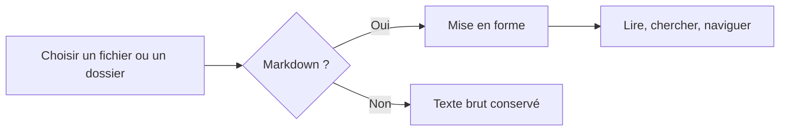
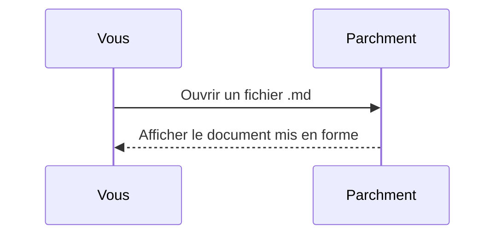
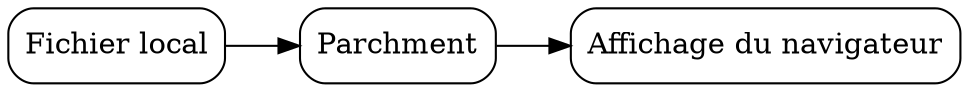

# Bienvenue dans Parchment

Parchment est un **lecteur local de Markdown et de texte brut** qui fonctionne dans votre navigateur. Ce document est lui-même un exemple : chaque section montre un type de contenu que Parchment sait afficher, pour comparer le fichier source au résultat.

> [!tip] Comment utiliser cet exemple
> - Le Sommaire à droite permet d’aller à n’importe quelle section ; les entrées avec des sous-titres peuvent être repliées.
> - Ouvrez les onglets Étiquettes, Notes liées et Liens retour pour voir les étiquettes de ce document et ses liens avec l’autre note d’exemple.
> - Les images et les diagrammes s’**agrandissent d’un clic** et peuvent être enregistrés en PNG.

Les propriétés ci-dessus viennent de l’en-tête YAML au début du fichier : `tags` devient des étiquettes cliquables, et les autres champs sont présentés sous forme de tableau.

## Mise en forme du texte

Les paragraphes peuvent contenir du **gras**, de l’*italique*, du ***gras italique***, du ~~barré~~, du ==surligné==, du ++texte inséré++ et du `code en ligne`.

La formule H~2~O utilise un indice, et x^2^ un exposant. Les émojis se tapent directement 🎉 ou s’écrivent en codes courts :sparkles: :books: :rocket:.

Les touches du clavier s’écrivent <kbd>Ctrl</kbd> + <kbd>F</kbd> ; le <mark>surlignage</mark>, le <u>soulignement</u> et H<sub>2</sub>O en HTML s’affichent aussi.

Voici une note de bas de page[^read-only] : cliquez dessus pour la lire. HTML est une abréviation : survolez-la pour voir son nom complet.

*[HTML]: HyperText Markup Language

[^read-only]: Parchment ouvre les fichiers en lecture seule et ne modifie jamais vos documents.

## Titres et sommaire

Les titres de `#` à `######` sont regroupés dans le Sommaire à droite, avec un retrait selon leur niveau.

### Titre de niveau 3

Les titres plus profonds sont rangés sous le titre qui les précède.

#### Titre de niveau 4

Cliquez sur la flèche à côté d’un titre dans le Sommaire pour replier ou déplier ce niveau.

## Listes et tâches

- Liste à puces
  - Élément imbriqué
    - Un niveau plus bas
- Deuxième élément

1. Liste numérotée
2. Deuxième étape
   1. Sous-étape
3. Troisième étape

- [x] Ouvrir cet exemple
- [ ] Cocher cet élément (l’état reste dans le navigateur et ne modifie pas le fichier)
- [ ] Ouvrir votre propre dossier de notes

## Citations

> Ce que l’on conçoit bien s’énonce clairement.
> — Nicolas Boileau

> Les citations peuvent s’imbriquer
>> Deuxième niveau
>>> Troisième niveau

## Tableaux

Les colonnes peuvent être alignées à gauche, au centre ou à droite :

| Fonction | Fichier seul | Dossier |
| :--- | :---: | :---: |
| Affichage Markdown | ✅ | ✅ |
| Images et liens relatifs | — | ✅ |
| Liens wiki et intégrations | — | ✅ |
| Recherche plein texte | — | ✅ |

Les tableaux à nombreuses colonnes ajustent leur largeur automatiquement et ne défilent horizontalement que s’ils ne tiennent pas :

| N° | Nom | Catégorie | Prix | Stock | Origine | Mise en vente | Remarques |
| --- | --- | --- | ---: | ---: | --- | --- | --- |
| 001 | Carnet en parchemin | Papeterie | 11,00 € | 25 | Taïwan | 2026-01-15 | Relié à la main |
| 002 | Encre pour stylo plume | Papeterie | 15,50 € | 8 | Japon | 2026-03-02 | Bleu-noir, résistante à l’eau |

## Code

Les blocs de code sont colorés selon le langage. Survolez le coin supérieur droit pour copier un bloc.

```js
// Lire en lecture seule le fichier choisi par l’utilisateur
const [handle] = await window.showOpenFilePicker();
const file = await handle.getFile();
console.log(await file.text());
```

```python
def greet(name: str) -> str:
    return f"Bonjour, {name} !"
```

## Formules mathématiques

Formule en ligne : équivalence masse-énergie $E = mc^2$, aire d’un disque $A = \pi r^2$.

Formules en bloc :

$$
\int_{0}^{1} x^2 \, dx = \frac{1}{3}
$$

$$
x = \frac{-b \pm \sqrt{b^2 - 4ac}}{2a}
$$

## Diagrammes

Les diagrammes s’adaptent à la largeur de lecture. **Cliquez sur un diagramme** pour l’agrandir, le déplacer ou l’enregistrer en PNG.

Organigramme Mermaid :



Diagramme de séquence Mermaid :



Diagramme Graphviz (`dot`) :



## Encadrés

> [!note]
> Une note ordinaire.

> [!success] Terminé
> Signale une tâche accomplie.

> [!warning] Titre personnalisé
> Le titre est libre, et le contenu peut utiliser le **Markdown**.

> [!danger] Danger
> Prévient d’une action irréversible.

> [!example] Exemple
> Il existe aussi les types info, tip, question, failure, bug, quote et abstract, chacun avec son icône et sa couleur.

> [!question]- Peut-on les replier ?
> Oui. Ajoutez `-` après le type pour le replier par défaut, ou `+` pour le déplier par défaut.

> [!NOTE]
> Les alertes au format GitHub s’affichent aussi.

## Contenu repliable

<details>
<summary>Cliquez pour afficher la suite</summary>

Les balises HTML `<details>` et `<summary>` permettent de replier un contenu plus long.

</details>

## Liens entre notes

Des doubles crochets créent un lien vers une autre note : [[linked-note]]. On peut aussi préciser le texte affiché et un titre : [[linked-note#Section intégrable|aller à une section de la note liée]].

Les adresses Web s’ouvrent dans un nouvel onglet : [Parchment sur GitHub](https://github.com/bruce-yang-422/parchment). On peut aussi se déplacer dans ce document : [retour aux Tableaux](#tableaux).

Intégrer une section entière :

![[linked-note#Section intégrable]]

Ou un seul bloc :

![[linked-note#^summary]]

Quand une autre note renvoie ici, l’onglet Liens retour à droite l’indique.

## Images

Une image Markdown ordinaire avec un chemin relatif. **Cliquez sur l’image** pour l’agrandir :


Vous pouvez aussi n’écrire que le nom du fichier et une largeur ; Parchment le cherche dans tout le dossier :

![[parchment-logo-transparent.png|96]]

## Liste de définitions

Lecture seule
: Lit le contenu des fichiers sans rien modifier.

Local d’abord
: Les documents sont traités dans le navigateur et ne sont jamais envoyés.

## Voir plus de syntaxe

Le [document de test de lecture Markdown](https://github.com/bruce-yang-422/parchment/blob/main/samples/fr/parchment_markdown_reader_test.md) en montre encore plus : des textes en plusieurs langues, les 13 types d’encadrés, des images en ligne, et d’autres langages et diagrammes. Téléchargez-le et ouvrez-le dans Parchment pour tout voir d’un coup.

## Étapes suivantes

1. Choisissez **Ouvrir un dossier** en haut à droite, puis votre propre dossier de notes.
2. Tapez des mots dans le champ de recherche de la barre latérale gauche pour chercher dans toutes les notes.
3. Utilisez le bouton des paramètres en haut à droite pour essayer d’autres thèmes et polices.

Sur téléphone, l’arborescence et les informations du document s’ouvrent dans des tiroirs latéraux. Dans les documents de plus de quatre écrans, le bouton de retour en haut apparaît en bas à droite après deux écrans de défilement ; les documents courts ne l’affichent pas. Sur ordinateur, placez le pointeur dans le coin inférieur droit de la zone de lecture pour le faire apparaître.

---

Cet exemple est fourni avec le site et fonctionne hors ligne.
