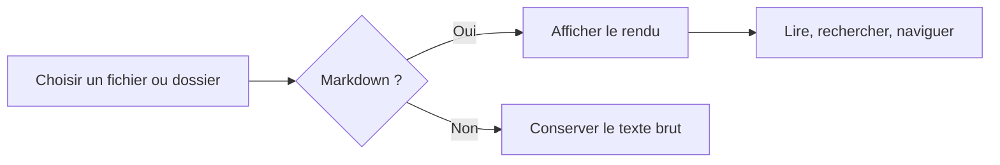

# Bienvenue dans Parchment

Parchment est un **lecteur local de fichiers Markdown et texte** qui fonctionne dans le navigateur. Cet exemple présente les principales syntaxes prises en charge.

> [!tip] Utiliser cet exemple
> Le « Sommaire » à droite permet de parcourir les sections. Les onglets « Étiquettes », « Notes liées » et « Liens retour » montrent les relations entre les notes.

Les propriétés ci-dessus proviennent du YAML Frontmatter. Cliquez sur une étiquette pour filtrer l’arborescence.

## Mise en forme

Utilisez le **gras**, l’*italique*, le ~~texte barré~~, le ==surlignage==, le ++texte inséré++ et le `code en ligne`.

H~2~O utilise un indice et x^2^ un exposant. Les codes emoji :sparkles: :books: :rocket: sont convertis automatiquement.

Voici une note de bas de page.[^read-only]

*[HTML]: HyperText Markup Language

[^read-only]: Parchment ouvre les fichiers en lecture seule et ne modifie jamais le document source.

## Listes et tâches

- Liste non ordonnée
  - Les éléments imbriqués sont pris en charge
- Autre élément

1. Liste ordonnée
2. Deuxième étape

- [x] Ouvrir cet exemple
- [ ] Cocher cette tâche ; son état reste dans le navigateur
- [ ] Ouvrir votre dossier de notes

## Tableau

| Fonction | Fichier seul | Dossier |
| --- | :---: | :---: |
| Rendu Markdown | ✅ | ✅ |
| Images et liens relatifs | — | ✅ |
| Wiki Links et intégrations | — | ✅ |
| Recherche plein texte | — | ✅ |

## Code et formules

```js
const [handle] = await window.showOpenFilePicker();
const file = await handle.getFile();
console.log(await file.text());
```

Formule en ligne : $E = mc^2$.

$$
\int_{0}^{1} x^2 \, dx = \frac{1}{3}
$$

## Diagramme



## Encadrés

> [!note]
> Une note classique.

> [!warning] Titre personnalisé
> Un encadré peut contenir du **Markdown**.

> [!question]- Peut-on le réduire ?
> Oui. Ajoutez `-` après le type pour le réduire par défaut.

## Liens et intégrations

Ouvrez [[linked-note]] ou accédez à [[linked-note#Section intégrable|une section de la note liée]].

![[linked-note#Section intégrable]]

![[linked-note#^summary]]

## Image


![[parchment-logo-transparent.png|96]]

## Pour continuer

1. Sélectionnez **Ouvrir un dossier** et choisissez votre dossier de notes.
2. Recherchez dans toutes les notes depuis la barre latérale gauche.
3. Ouvrez les paramètres pour essayer une autre langue, palette ou police.

Sur mobile, l'arborescence et les informations du document s'ouvrent dans des volets latéraux. Pour les documents de plus de quatre écrans, le bouton de retour en haut apparaît en bas à droite après deux écrans de défilement ; il reste masqué pour les documents courts. Sur ordinateur, placez le pointeur dans l'angle inférieur droit de la zone de lecture pour l'afficher.

Cet exemple reste disponible hors ligne.
