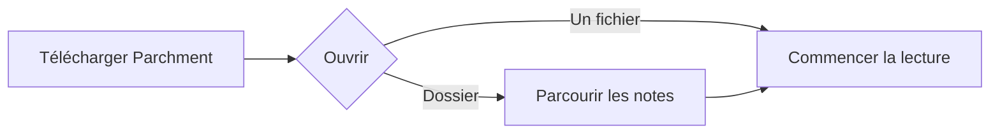
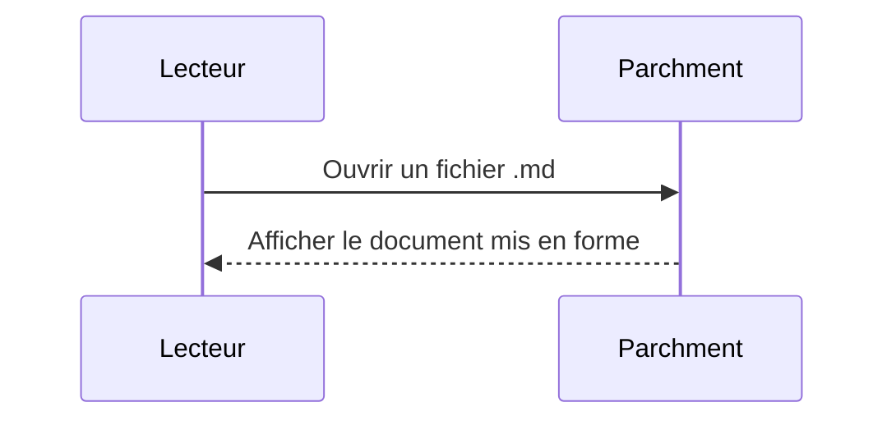
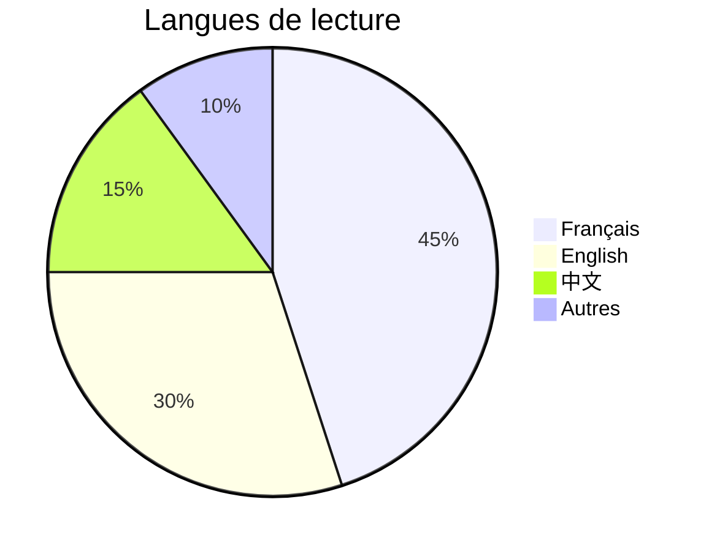

# Document de test de lecture Parchment

Bienvenue dans **Parchment** ! Ce document réunit de nombreuses syntaxes Markdown et des textes en plusieurs langues. Téléchargez-le et ouvrez-le dans Parchment pour voir tout ce que l’app sait afficher.

> [!tip] Comment utiliser ce document
> 1. Ouvrez ce fichier dans Parchment.
> 2. Touchez Sommaire en haut à droite pour aller directement à une section.
> 3. Dans Réglages de lecture, essayez différents thèmes, polices et tailles de texte.

---

## 1. Titres

# Titre de niveau 1
## Titre de niveau 2
### Titre de niveau 3
#### Titre de niveau 4
##### Titre de niveau 5
###### Titre de niveau 6

Une autre écriture (soulignée)
==============================

Deuxième niveau (souligné)
--------------------------

---

## 2. Styles de texte

| Effet | Syntaxe | Résultat |
| --- | --- | --- |
| Gras | `**gras**` | **Gras** |
| Italique | `*italique*` | *Italique* |
| Gras italique | `***gras italique***` | ***Gras italique*** |
| Barré | `~~barré~~` | ~~Barré~~ |
| Surligné | `==surligné==` | ==Surligné== |
| Souligné | `++souligné++` | ++Souligné++ |
| Exposant | `x^2^` | x^2^ |
| Indice | `H~2~O` | H~2~O |
| Code en ligne | `` `code` `` | `print("hi")` |

Les tirets bas fonctionnent aussi : _italique_, __gras__.

Caractères échappés : \*pas en italique\*, \# pas un titre, \[pas un lien\].

Cette ligne se termine par deux espaces  
le texte passe donc à la ligne ici (saut de ligne forcé).

---

## 3. Multilingue

Les textes ci-dessous servent seulement à vérifier que les polices s’affichent correctement (pas de carrés « □ » ni de caractères illisibles). Inutile de les comprendre.

### 繁體中文
落霞與孤鶩齊飛，秋水共長天一色。Parchment 是一款讓你安靜閱讀 Markdown 筆記的 App。

### 简体中文
落霞与孤鹜齐飞，秋水共长天一色。Parchment 是一款让你安静阅读 Markdown 笔记的 App。

### English
The quick brown fox jumps over the lazy dog. *Parchment* lets you read your Markdown notes in peace.

### 日本語
いろはにほへと ちりぬるを わかよたれそ つねならむ。**Parchment** は Markdown のノートを静かに読むためのアプリです。

### 한국어
다람쥐 헌 쳇바퀴에 타고파. **Parchment**는 Markdown 노트를 조용히 읽을 수 있는 앱입니다.

### Français
Portez ce vieux whisky au juge blond qui fume. Ça, c'est l'été à Noël — « déjà vu » !

### Deutsch
Victor jagt zwölf Boxkämpfer quer über den großen Sylter Deich. Straße, Größe, Übung.

### Español
El veloz murciélago hindú comía feliz cardillo y kiwi. ¿Dónde está la señal? ¡Olé!

### Italiano · Português
Quel vituperabile xenofobo zelante assaggia il whisky ed esclama: alleluja!
Luís argüia à Júlia que «brações, fé, chá, óxido, pôr, zângão» eram palavras do português.

### Русский
Съешь же ещё этих мягких французских булок, да выпей чаю.

### Ελληνικά
Ξεσκεπάζω την ψυχοφθόρα βδελυγμία.

### Tiếng Việt
Tiếng Việt có dấu: ă â đ ê ô ơ ư — Trăm năm trong cõi người ta.

### ภาษาไทย
เป็นมนุษย์สุดประเสริฐเลิศคุณค่า

### हिन्दी
ऋषियों को सताने वाले दुष्ट राक्षसों के राजा रावण का सर्वनाश करने वाले विष्णु।

### De droite à gauche
- العربية : مرحبًا بك في Parchment.
- עברית : ברוכים הבאים ל־Parchment.

### Mélange
Français English 中文 日本語 한국어 sur une même ligne, avec des chiffres 1234567890, une 「ponctuation」 pleine chasse et une (ponctuation) demi-chasse côte à côte.

---

## 4. Émojis

Saisis directement : 😀 🎉 📚 ✍️ 🌏 🇫🇷 🇧🇪 🇨🇦 👍🏽 👨‍👩‍👧‍👦

Codes courts : :smile: :heart: :rocket: :books: :+1:

---

## 5. Listes

### Liste à puces
- Pomme
- Banane
  - Deuxième niveau
    - Troisième niveau
* L’astérisque fonctionne aussi
+ Le signe plus aussi

### Liste numérotée
1. Première étape
2. Deuxième étape
   1. Sous-étape 2.1
   2. Sous-étape 2.2
3. Troisième étape

Numérotation qui commence à 5 :

5. Cinq
6. Six

### Liste de tâches (cochez et enregistrez dans le fichier)
- [x] Télécharger Parchment
- [x] Ouvrir ce document de test
- [ ] Essayer un autre thème
- [ ] Essayer une autre police
- [ ] Touchez ici pour cocher cette case

---

## 6. Liens

- Lien simple : [Parchment sur GitHub](https://github.com/bruce-yang-422/parchment)
- Lien automatique : <https://www.markdownguide.org>
- Lien avec titre : [Guide Markdown](https://www.markdownguide.org "Affiché au survol")
- Lien de référence : [CommonMark][cm]
- Lien dans ce document : [Retour à la section Tableaux](#8-tableaux)
- Liens wiki : [[Une autre note]], [[Une autre note|Nom affiché]]

[cm]: https://commonmark.org

---

## 7. Images

### Image en ligne
Nécessite une connexion Internet :


### Image de Wikipédia
*Voyageurs parmi les montagnes et les ruisseaux* de Fan Kuan, dynastie des Song du Nord (Musée national du palais, Taipei ; domaine public ; source : [Wikimedia Commons](https://commons.wikimedia.org/wiki/File:Fan_Kuan_-_Travelers_Among_Mountains_and_Streams_-_Google_Art_Project.jpg)). Une image tout en hauteur ; touchez-la pour l’agrandir :


### Largeur définie en HTML


### Image introuvable
Cette image n’existe pas exprès, pour tester le message d’erreur :


---

## 8. Tableaux

| Langue | Salutation | Sens d’écriture |
| :--- | :---: | ---: |
| Français | Bonjour | LTR |
| English | Hello | LTR |
| 繁體中文 | 你好 | LTR |
| 日本語 | こんにちは | LTR |
| 한국어 | 안녕하세요 | LTR |
| Deutsch | Guten Tag | LTR |
| Español | Hola | LTR |
| العربية | مرحبا | RTL |

### Tableau large (faites défiler horizontalement)

| N° | Nom | Catégorie | Prix | Stock | Origine | Mise en vente | Remarques |
| --- | --- | --- | ---: | ---: | --- | --- | --- |
| 001 | Carnet en parchemin | Papeterie | 11,00 € | 25 | Taïwan | 2026-01-15 | Relié à la main, fait pour durer |
| 002 | Encre pour stylo plume | Papeterie | 15,50 € | 8 | Japon | 2026-03-02 | Bleu-noir, résistante à l’eau |
| 003 | Notebook A5 | Stationery | 12,50 € | 140 | Allemagne | 2026-05-20 | Pointillés, 120 g/m² |

---

## 9. Citations

> Ce que l’on conçoit bien s’énonce clairement.
> — Nicolas Boileau

> Premier niveau
>> Deuxième niveau
>>> Troisième niveau

> Une citation peut contenir du **gras**, du `code` et des listes :
> - Élément un
> - Élément deux

---

## 10. Encadrés

> [!note] Note
> Une note ordinaire.

> [!info] Information
> Informations complémentaires.

> [!tip] Astuce
> Appuyez longuement sur un texte pour le copier.

> [!success] Réussite
> C’est fait !

> [!question] Question
> Quel thème préférez-vous ?

> [!warning] Attention
> Faites une sauvegarde avant de modifier.

> [!danger] Danger
> Cette action est irréversible.

> [!failure] Échec
> Fichier introuvable.

> [!bug] Bogue
> Joignez une capture d’écran quand vous signalez un problème.

> [!example] Exemple
> Ceci est un exemple.

> [!quote] Citation
> C’est en forgeant qu’on devient forgeron.

> [!abstract] Résumé
> Ce document sert à tester l’affichage de Parchment.

> [!tip]- Encadré repliable (replié par défaut, touchez pour l’ouvrir)
> Vous avez trouvé le contenu caché ! 🎉

---

## 11. Code

Code en ligne : `const name = 'Parchment';`

### Dart
```dart
void main() {
  final greeting = 'Bonjour, Parchment !';
  print(greeting);
}
```

### Python
```python
def greet(name: str) -> str:
    """Salutation multilingue / Multilingual greeting"""
    return f"Bonjour, {name} !"

print(greet("Parchment"))
```

### JavaScript
```javascript
const langs = ['fr', 'en', 'zh-TW', 'zh-CN', 'ja', 'ko', 'de', 'es'];
langs.forEach((lang, i) => console.log(`${i + 1}. ${lang}`));
```

### JSON
```json
{
  "app": "Parchment",
  "languages": ["Français", "English", "繁中", "日本語", "한국어"],
  "offline": true
}
```

### Shell
```bash
# Une très longue ligne de commande pour tester le défilement horizontal dans un bloc de code, qui dépasse largement le bord
echo "Bonjour, Parchment" && ls -la ~/Documents/notes/markdown/very/deep/folder/structure/
```

### SQL
```sql
SELECT title, author FROM notes WHERE lang = 'Français' ORDER BY updated_at DESC;
```

### Sans langage précisé
```
Bloc de code en texte brut
  l’indentation est conservée
```

### Code indenté (quatre espaces)

    Ceci est aussi un bloc de code
    Indented code block

---

## 12. Formules mathématiques

Formule en ligne : équivalence masse-énergie $E = mc^2$, aire d’un disque $A = \pi r^2$.

Formules en bloc :

$$
x = \frac{-b \pm \sqrt{b^2 - 4ac}}{2a}
$$

$$
\int_0^\infty e^{-x^2}\,dx = \frac{\sqrt{\pi}}{2}
$$

$$
\sum_{n=1}^{\infty} \frac{1}{n^2} = \frac{\pi^2}{6}
$$

---

## 13. Diagrammes

### Organigramme Mermaid


### Diagramme de séquence Mermaid


### Diagramme circulaire Mermaid


### Graphviz


---

## 14. Notes de bas de page

Parchment prend en charge les notes de bas de page[^1], les notes nommées avec des mots[^remarque] et les notes plus longues[^long].

[^1]: Voici la première note. Touchez la flèche de retour à la fin pour revenir au texte.
[^remarque]: Les notes nommées avec des mots s’ouvrent aussi normalement.
[^long]: Une note peut contenir du **gras**, du `code` et des [liens](https://commonmark.org).

---

## 15. Balises HTML

- Touches du clavier : appuyez sur <kbd>Ctrl</kbd> + <kbd>C</kbd> pour copier
- <mark>Surlignage HTML</mark>, <u>souligné</u>, <s>barré</s>
- Chimie H<sub>2</sub>O, carré x<sup>2</sup>
- Saut<br>de ligne avec la balise br

<details>
<summary>Cliquez pour afficher la suite</summary>

Ce contenu reste replié jusqu’à ce que vous l’ouvriez.

- Élément caché un
- Élément caché deux

</details>

---

## 16. Liste de définitions

Markdown
: Un langage de balisage léger pour écrire des documents mis en forme en texte brut.

Parchment
: Une app pour lire du Markdown sans distraction.
: Un terme peut avoir une seconde définition.

---

## 17. Abréviations

HTML et CSS sont les bases du Web, et le PDF sert souvent à l’impression.

*[HTML]: HyperText Markup Language
*[CSS]: Cascading Style Sheets
*[PDF]: Portable Document Format

---

## 18. Lignes de séparation

Les trois écritures donnent le même résultat :

***

---

___

---

## 19. Long paragraphe

Test de la mise en page et de la fluidité du défilement : Lorem ipsum dolor sit amet, consectetur adipiscing elit, sed do eiusmod tempor incididunt ut labore et dolore magna aliqua. 春眠不覺曉，處處聞啼鳥。夜來風雨聲，花落知多少。Ut enim ad minim veniam, quis nostrud exercitation ullamco laboris nisi ut aliquip ex ea commodo consequat. 古池や蛙飛び込む水の音。Duis aute irure dolor in reprehenderit in voluptate velit esse cillum dolore eu fugiat nulla pariatur. 산에는 꽃 피네 꽃이 피네 갈 봄 여름 없이 꽃이 피네. Excepteur sint occaecat cupidatat non proident, sunt in culpa qui officia deserunt mollit anim id est laborum.

Une très longue adresse ou un mot sans espaces, pour tester le retour à la ligne : https://example.com/a/very/long/path/that/keeps/going/and/going/without/any/spaces/to/break/the/line/naturally/index.html

---

## Test terminé 🎉

Si vous lisez ces lignes, le document a été chargé en entier. Touchez le bouton Retour en haut, en bas à droite, pour revenir au début.

Si quelque chose ne s’affiche pas correctement, signalez-le sur [GitHub Issues](https://github.com/bruce-yang-422/parchment/issues). Merci de votre aide !
