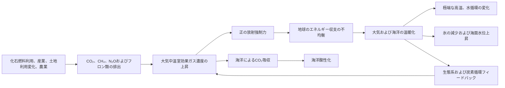
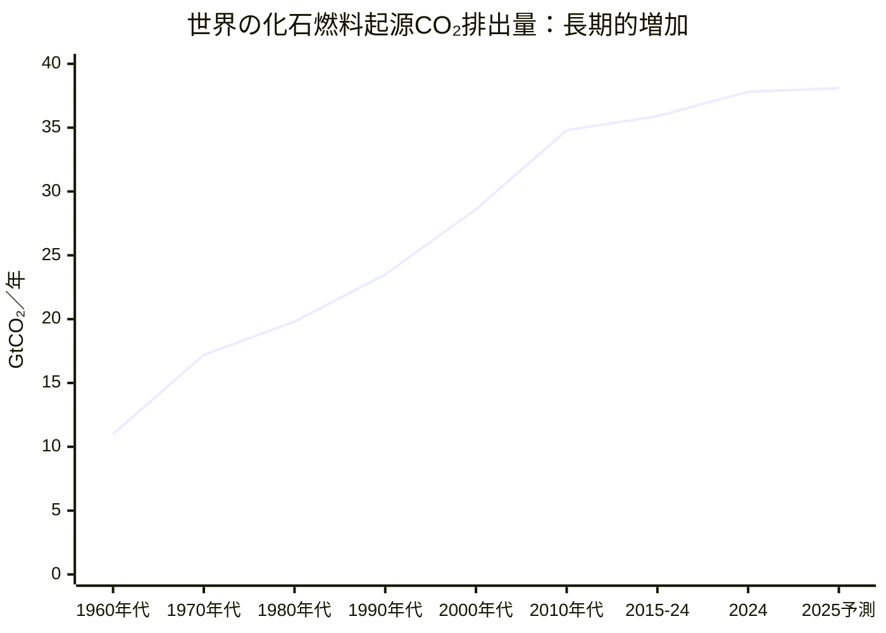
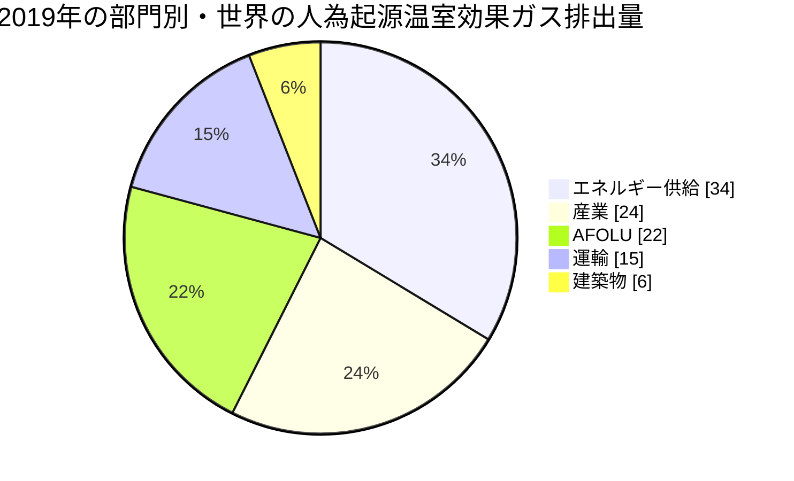
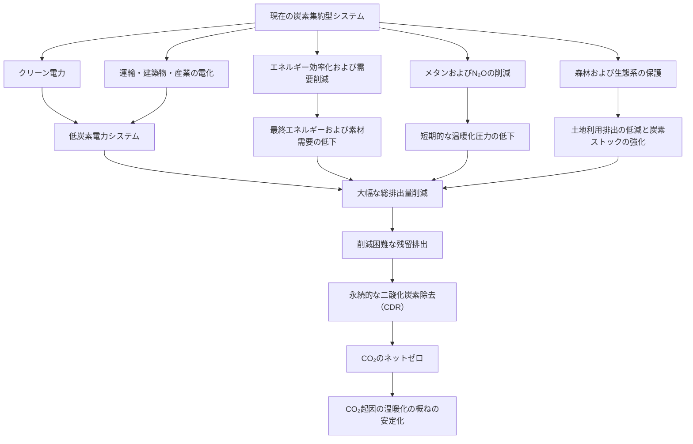

# 炭素排出とカーボンフットプリント：地球気候システムへの影響

## エグゼクティブサマリー

> **中心的知見。** 人為起源の温室効果ガス排出が現代の地球温暖化の支配的要因であることを示す証拠は、疑う余地がない。二酸化炭素（CO₂）は、その膨大な累積排出量、炭素循環に対する長期的な影響、および累積CO₂排出量と世界平均気温との間のほぼ線形な関係ゆえに、単一として最大の寄与因子である。メタン（CH₄）、一酸化二窒素（N₂O）、およびフロン類（フッ素化ガス）は、さらに相当量の放射強制力を付加している。[^3] [^5]

人間活動は、**2011–2020年において世界の地表面気温を1850–1900年の平均より約1.1°C**上昇させた。IPCCの推定によれば、1850–1900年から2010–2019年にかけての人間活動による総温暖化量は約**1.07°C**であり、太陽活動や火山活動といった自然起源の要因が観測された長期変化に与えた寄与は小さい。温室効果ガス単独であればさらに大きな温暖化が生じていたはずであるが、その効果の一部は人為起源エアロゾルによって相殺（マスク）されてきた。[^5]

背景にある炭素循環の撹乱規模は、観測史上前例がない。大気中CO₂濃度は**工業化前には約270–280 ppm**であったが、NOAAによれば**2025年には全球海洋境界層の年平均で425.62 ± 0.05 ppm**に達した。長寿命温室効果ガス全体の有効放射強制力は**2025年に工業化前比で3.59 W m⁻²**に達し、1990年時点の相当値を56%上回っている。CO₂単独では**2.37 W m⁻²**を占め、長寿命温室効果ガス全体の約3分の2に相当する。[^7]

それにもかかわらず、世界の排出量は増加し続けている。IPCCは2019年の正味人為起源温室効果ガス排出量を**59 ± 6.6 GtCO₂-eq**と推定しており、これは1990年比で54%増である。Global Carbon Budget 2025は、世界の化石燃料起源CO₂排出量を**2024年に37.8 ± 2 GtCO₂**と推定し、**2025年には約38.1 GtCO₂**になると予測しているが、データセット間では算定手法の定義が異なる。国際エネルギー機関（IEA）は独立して、**2025年のエネルギー起源CO₂排出量を約38.4 GtCO₂**と推定している。部門境界が異なるため、これらの数値をそのまま互換的に扱うべきではない。[^1] [^2] [^4] [^6]

カーボンフットプリントは、領域内排出を超えた分析へと視野を拡張する。*生産ベース排出インベントリ*は排出が物理的に発生した場所へ排出量を帰属させるのに対し、*消費ベース・カーボンフットプリント*は国際サプライチェーンを通じて製品・サービスに体化された排出量を最終消費者へと再配分する。この区別が重要である理由は、貿易財によって高消費地域が自らの領域内排出の一部を外部化できるためである。ただし、多地域間産業連関（MRIO）研究は、国別の燃焼ベース・インベントリに比べて構造面およびデータ面の不確実性が大きい。[^4] [^10]

排出責任の分布は著しく不平等である。2019年において、排出量上位10%の世帯が世界の消費ベース世帯温室効果ガス排出量の約 **34–45%** を占めたのに対し、下位50%の世帯の寄与はわずか **13–15%** にとどまった。地域間格差も同様に大きく、2019年の1人あたり温室効果ガス排出量は北米で約**19 tCO₂-eq**であったのに対し、南アジアでは約**2.5 tCO₂-eq**であった。[^4]

すでに観測されている気候上の影響には、極端な高温の増加、多くの地域における大雨の激化、干ばつリスクの変化、海洋温暖化、雪氷圏の減少、海面水位上昇の加速、および海洋酸性化が含まれる。世界平均海面水位は**1901年から2018年にかけて約0.20 m**上昇し、その上昇速度は**2006–2018年には3.7 [3.2–4.2] mm yr⁻¹**へと加速した。海洋表層のpHは**工業化以降に約0.1低下**しており、これは水素イオン濃度の約30%の増加に相当する。[^5] [^9]

将来の温暖化に対する最も強い物理的制約は累積CO₂排出量である。IPCCは累積排出量に対する過渡的気候応答（TCRE）の最良推定値を**1,000 GtCO₂あたり約0.45°C**（可能性が高い範囲：0.27–0.63°C）と評価している。したがって、人為起源の温暖化を安定化させるためには、世界全体の正味人為起源CO₂排出量をゼロに近づける必要があり、正の排出が続けばさらなる温暖化が引き起こされる。[^3]

緩和技術はすでに相当な規模で利用可能である。IPCCの評価によれば、**100米ドル tCO₂-eq⁻¹以下**のコストで実施可能な対策によって、**2030年までに世界の温室効果ガス排出量を2019年水準の少なくとも半分に削減できる**とされ、その評価ポテンシャルの半分以上は20米ドル tCO₂-eq⁻¹未満のコストで実現可能である。主な低コスト対策には、太陽光・風力発電、エネルギー効率化、メタン削減、ならびに森林およびその他の自然生態系の転換回避が含まれる。ただし、実現可能性は工学的コストだけでなく、送配電網インフラ、資金調達、制度、土地制約、行動変容、社会的受容、および分配上の影響にも依存する。[^4]

## 要旨および序論

本稿は、およそ1850年から現在にかけての**炭素排出、カーボンフットプリント、大気中温室効果ガスの蓄積、放射強制力、および気候変動**の相互関係を検討するものである。特段の断りがない限り、分析対象範囲は世界全体とする。物理的排出と消費ベース・カーボンフットプリントを区別し、排出と気候影響とを結びつける証拠の強さを評価するとともに、主要な不確実性を特定し、主要な緩和経路を検証する。

本稿において**炭素排出**という用語は、主に化石燃料の燃焼、工業プロセス、および土地利用変化によって放出されるCO₂を指し、*温室効果ガス排出*にはこれに加えてCH₄、N₂O、およびフロン類（フッ素化ガス）が含まれる。**カーボンフットプリント**はより広範に、製品、活動、組織、世帯、あるいは人口集団に帰属する直接・間接の温室効果ガス排出量を指し、通常は二酸化炭素換算トン（tCO₂-eq）で表される。消費ベース・フットプリントには輸入された財およびサービスに体化された排出量が含まれるため、領域別の国家インベントリとは概念的に異なる。[^4] [^10]

複数の温室効果ガスをCO₂換算排出量へ統合するには気候指標が用いられ、通常は **100年地球温暖化係数（GWP₁₀₀）** が使用される。IPCC第6次評価報告書（AR6）におけるGWP₁₀₀の推定値は、CO₂が1であるのに対し、**化石起源CH₄が約29.8**、**非化石起源CH₄が27.0**、**N₂Oが273**とされているが、不確実性は大きい。したがって、GWP₁₀₀が273である気体は、単位質量あたりの排出について、この指標の前提条件のもとで100年間にわたり同質量のCO₂の約273倍に相当する積分放射影響をもたらすことになる。GWPの値は、あらゆる時間軸において厳密な物理的等価性を意味するものと解釈してはならない。[^3]

基本的な因果連鎖は以下のとおりである。

**図1. 人間活動から気候および生物地球化学的影響に至る概念的因果連鎖。** 主要な温室効果ガス経路の方向性は、IPCCによって評価された複数の観測的、理論的、およびモデル的証拠によって裏付けられている。[^3] [^5]

### 明示的な前提条件

1. **地理的範囲：** 世界全体とし、堅牢なデータセットが利用可能な場合には地域比較を行う。
2. **歴史的対象期間：** 別の期間を明示しない限り、およそ1850年〜現在とする。
3. **排出算定方式：** 物理的な世界総量には生産ベース排出を用い、消費ベースの指標はフットプリントとして明示的に区別する。
4. **気候指標：** 出典に別段の指定がない限り、CO₂換算値には原則としてAR6のGWP₁₀₀を用いる。
5. **最新観測値：** 完全なインベントリは実時間から遅れて公表されるため、本稿では*確定した歴史的観測データ*と*暫定値または予測値*を区別する。
6. **緩和コスト：** 報告されるコスト範囲は世界規模の技術経済的推定値であり、個別プロジェクト単位で保証されたコストではない。

したがって、中心的な研究課題は単に排出が気候を変化させるか否か（この要因特定はすでに十分に確立されている）ではなく、**排出量、排出源、地理的責任、消費パターン、大気物理学、および炭素循環プロセスがどのように組み合わさって、気候変動の規模と持続性を規定しているか**にある。

## 方法およびデータソース

本分析は、科学的証拠の階層構造に基づく。最も高い優先度を与えたのは **IPCC第6次評価報告書（AR6）** である。これは、数千件の査読済み研究を統一された確信度表現および複数の独立した証拠系統によって統合しているためである。物理科学的分析は主にAR6第1作業部会（WG I）に、排出および緩和評価は第3作業部会（WG III）に、統合的な影響評価は2023年統合報告書（Synthesis Report）に依拠している。[^3] [^4] [^5]

近年の排出量および炭素循環データは、主に*Earth System Science Data*に掲載された**Global Carbon Budget 2025**から取得している。同炭素収支は、化石燃料起源CO₂排出、土地利用変化、大気蓄積、海洋吸収、陸域吸収、および明示的な収支不均衡を統合している。1850–2024年の累積人為起源排出量は**745 ± 65 GtC**と推定され、その内訳はおおよそ大気残留分290 ± 5 GtC、海洋吸収分200 ± 40 GtC、陸域吸収源による吸収分175 ± 50 GtC、および残差としての収支不均衡に配分される。[^1]

大気中濃度および放射強制力データは、**NOAA全球監視研究所（Global Monitoring Laboratory）** から取得している。NOAAの長年にわたる全球観測網は、CO₂、CH₄、N₂Oおよびその他の長寿命温室効果ガスの測定値を提供し、年次温室効果ガス指数（AGGI）を算出している。[^7] [^8]

エネルギー起源CO₂に関する情報は、特に近年の部門別動向が必要な箇所において **国際エネルギー機関（IEA）** のデータで補完している。IEAデータはGlobal Carbon Budgetとは異なる算定境界を採用しているため、数値総量の比較はそれぞれの適用範囲を明示したうえでのみ行う。[^6]

消費ベース・カーボンフットプリントの証拠は、IPCCの評価および査読済みの多地域間産業連関（MRIO）研究に基づいている。これらのモデルは、国際貿易を通じた金額ベースおよび物量ベースのサプライチェーンを追跡する。間接排出を消費に帰属させるうえで有用である一方、部門統合、貿易統計、排出係数の整合化、およびMRIOデータベース間の相違に起因する不確実性が生じる。主要な5つのMRIOシステムを比較した研究では、消費ベース炭素勘定の推定値に意味のある差異が認められており、フットプリント推定値を厳密なインベントリ量として扱うべきではない理由を示している。[^10]

### 基本的な物理的関係式

CO₂の放射強制力に対する広く用いられる一次近似式は次式で与えられる。

\[
\boxed{\Delta F_{CO_2}\approx 5.35\ln\left(\frac{C}{C_0}\right)\;\text{W m}^{-2}}
\]

ここで、\(C_0\)は基準CO₂濃度、\(C\)は変化後の濃度である。この対数関係は、CO₂濃度が同じ比率で増加するたびに、おおよそ同程度の追加的強制力が生じることを意味する。AR6の正式な評価では更新された分光放射モデルが用いられているが、この対数近似は教育的・概念的理解において依然として有用である。[^3]

世界の炭素収支は模式的に以下のように表される。

\[
E_{\mathrm{FOS}}+E_{\mathrm{LUC}}
=
G_{\mathrm{ATM}}
+
S_{\mathrm{OCEAN}}
+
S_{\mathrm{LAND}}
+
B_{\mathrm{IM}},
\]

ここで、\(E_{\mathrm{FOS}}\)は化石燃料および工業プロセス起源のCO₂排出、\(E_{\mathrm{LUC}}\)は土地利用変化起源の排出、\(G_{\mathrm{ATM}}\)は大気中への蓄積、\(S_{\mathrm{OCEAN}}\)および\(S_{\mathrm{LAND}}\)はそれぞれ海洋および陸域の炭素吸収源、\(B_{\mathrm{IM}}\)は残差としての収支不均衡である。2015–2024年において、Global Carbon Budgetは人為起源CO₂総排出量の約 **50%** が大気中に蓄積し、**29%** が海洋に吸収され、**21%** が陸域吸収源に取り込まれ、この10年間の平均収支不均衡はほぼゼロであったと推定している。[^1]

気温変化について、AR6は次の近似的な累積関係式を示している。

\[
\Delta T \approx \mathrm{TCRE}\times
\frac{E_{\mathrm{cum}}}{1000\ \mathrm{GtCO_2}},
\]

ここで、

\[
\mathrm{TCRE}_{\text{最良推定値}}\approx0.45^{\circ}\mathrm{C}\; / \;1000\ \mathrm{GtCO_2}.
\]

このほぼ線形な関係こそが、単年の排出速度だけでなく累積CO₂排出量が気候政策の中核となる理由の一つである。[^3]

非CO₂ガスについて、評価期間\(H\)にわたる地球温暖化係数（GWP）は概念的に次のように定義される。

\[
\mathrm{GWP}_i(H)
=
\frac{\int_0^H RF_i(t)\,dt}
{\int_0^H RF_{CO_2}(t)\,dt},
\]

ここで、\(RF_i(t)\)は物質\(i\)のパルス排出に伴う時間依存の放射強制力である。選択される評価期間によって、CH₄のような短寿命気体の見かけ上の相対的重要性は変化する。[^3]

## 結果

世界の人為起源排出量は工業化以降、急激に増加した。**1850年から2019年までの歴史的累積正味CO₂排出量は約2,400 ± 240 GtCO₂**であり、その累積量の約42%が1990–2019年の間に排出された。これは、近数十年における排出の異常に急速な蓄積を示している。[^4]

Global Carbon Budgetは化石燃料起源CO₂についても同様の長期的傾向を示している。化石燃料起源の平均排出量は、**1960年代の約3.0 GtC yr⁻¹**から**2015–2024年には9.8 GtC yr⁻¹**へと増加しており、これはそれぞれ約11 GtCO₂ yr⁻¹および約36 GtCO₂ yr⁻¹に相当する。2024年の化石燃料起源CO₂排出量は約37.8 GtCO₂に達し、1990年比で69%増となった。[^1]

**図2. 世界の化石燃料起源CO₂排出量の概略推移。** 10年平均値は\(44/12\)を用いてGtCからGtCO₂へ換算しており、2025年は確定インベントリではなくGlobal Carbon Budget 2025の予測値である。[^1] [^2]

### 部門別および地域別の排出パターン

2019年において、世界の正味人為起源温室効果ガス排出量に占める割合は、エネルギー供給が約 **34%** 、産業が24%、農業・林業・その他の土地利用（AFOLU）が22%、運輸が15%、建築物が6%であった。報告された割合が丸められているため、これらの合計は約101%となる。電力および熱の排出をエネルギー供給部門から最終需要部門へ再配分すると、産業および建築物の相対的寄与は大幅に上昇し、部門別構成比が算定規約に依存することが示される。[^4]

**図3. 2019年における正味人為起源温室効果ガス排出量の部門別割合（概算）。** 数値はAR6のGWP₁₀₀を用いてCO₂換算で表したIPCC推定値である。[^4]

| 算定軸 | 主な排出源／地域 | 概算規模 | 解釈 |
|---|---|---:|---|
| **部門別、2019年GHG** | エネルギー供給 | 20 GtCO₂-eq；34% | 世界最大の直接排出部門。[^4] |
|  | 産業 | 14 GtCO₂-eq；24% | 産業エネルギー消費および工業プロセス排出を含む。[^4] |
|  | AFOLU | 13 GtCO₂-eq；22% | 農業、林業、および土地利用変化を含む。[^4] |
|  | 運輸 | 8.7 GtCO₂-eq；15% | 化石燃料依存の輸送システムが支配的。[^4] |
|  | 建築物 | 3.3 GtCO₂-eq；直接排出6% | 電力・熱の間接排出を需要側へ配分すると割合は約16%となる。[^4] |
| **化石燃料起源CO₂、2024年** | 中国 | 12.3 GtCO₂；31.7% | 世界最大の領域内化石燃料排出国。[^2] |
|  | 米国 | 4.9 GtCO₂；12.7% | 1人あたり化石燃料起源CO₂は約14.2 tCO₂。[^2] |
|  | インド | 3.2 GtCO₂；8.3% | 1人あたり化石燃料起源CO₂は約2.2 tCO₂。[^2] |
|  | EU-27 | 2.4 GtCO₂；6.3% | 1人あたり化石燃料起源CO₂は約5.4 tCO₂。[^2] |
|  | ロシア | 1.8 GtCO₂；4.6% | 1人あたり化石燃料起源CO₂は約12.3 tCO₂。[^2] |
| **消費ベース・フットプリント** | 北米 | 引用評価で約13.4 tCO₂-eq capita⁻¹ | 世帯に関連する消費フットプリントは依然として高い。[^4] |
|  | 欧州 | 約7.5 tCO₂-eq capita⁻¹ | 北米より低いが、低所得地域を大きく上回る。[^4] |
|  | アフリカおよび中東* | 約1.7 tCO₂-eq capita⁻¹ | 大きな世界的格差を示す一方、出典の地域区分は広範である。[^4] |

**表1. 部門別および地域別の主要排出源。** 部門別温室効果ガス数値、領域内化石燃料起源CO₂数値、および消費ベース・フットプリントはそれぞれ異なるシステム境界を用いているため、合算したり相互に直接置き換えたりすべきではない。*引用した消費フットプリント出典はアフリカと中東を合算して集計しているため、均質な地域値として解釈すべきではない。[^4] [^10]

地域分布も、年次排出量、歴史的累積責任、1人あたり排出量、あるいは消費ベース・フットプリントのいずれに注目するかによって変化する。先進経済圏は一般に現在の人口比率を上回る割合の歴史的累積CO₂排出を占めてきた一方、2000年以降は東アジアの現代の年次排出シェアが大幅に上昇した。IPCCは、2019年の1人あたり化石燃料・工業起源CO₂排出量の平均について、先進国が約**9.5 tCO₂**であったのに対し、アジア太平洋地域は約**4.4 tCO₂**、ラテンアメリカ・カリブ海地域は**2.7 tCO₂**、アフリカは**1.2 tCO₂**であったと指摘している。[^4]

### 放射強制力および気候応答

排出と温暖化を結びつける物理的機構は、大気中濃度および放射強制力を通じて作用する。AR6は1750年を基準とした2019年の有効放射強制力を、CO₂が**2.16 [1.90–2.41] W m⁻²**、CH₄が**0.54 [0.43–0.65] W m⁻²**、N₂Oが**0.21 [0.18–0.24] W m⁻²**、ハロゲン化ガスが**0.41 [0.33–0.49] W m⁻²**と推定している。[^3]

NOAAによるその後の観測ベースの指数は、強制力が増加し続けていることを示している。2025年において、AGGIに含まれる長寿命気体の合計有効放射強制力は**工業化前比で約3.59 W m⁻²**に達し、CO₂が約 **66%** 、CH₄が16%を占めた。1990年以降の長寿命温室効果ガス強制力の増加分のうち、約81%はCO₂によるものである。[^7]

この強制力は地球のエネルギー収支の不均衡を生み出す。AR6は、観測された気候システムの平均加熱率が**1971–2006年の約0.50 [0.32–0.69] W m⁻²**から**2006–2018年には0.79 [0.52–1.06] W m⁻²**へと増加したと評価している。余剰熱の大半は海洋に蓄積し、残りのエネルギーは大気の温暖化、陸氷の融解、海面水位上昇、その他の地球システム変化に寄与している。[^3]

### 観測された気候影響

温暖化そのものおよび多くの関連影響に関する証拠は極めて強固である。IPCCは、人間活動（主に温室効果ガスの排出）が**疑う余地なく地球温暖化を引き起こしてきた**と結論づけている。1950年代以降、ほとんどの陸域で極端な高温がより頻繁かつ強烈になっていることはほぼ確実であり、1980年代以降の海洋熱波の頻度が約2倍に増加したことに人間の影響が寄与した可能性は非常に高い。[^3] [^5]

水循環への影響は空間的な一様性が低いものの、依然として顕著である。暖かい空気はより多くの水蒸気を保持できるため、多くの地域で大雨が激化する。また、温暖化は蒸発需要を高めるため、降水増加で補われない地域では農業的・生態学的干ばつを激化させ得る。要因特定の強さは地域およびハザードによって異なり、これが世界規模の極端な高温に関する評価が、局地的な干ばつや個別の嵐に関する評価よりも高い確信度を持つ理由である。[^3]

海面水位の変化は、もう一つの統合的指標を提供する。世界平均海面水位は**1901年から2018年の間に約0.20 [0.15–0.25] m**上昇した。平均上昇速度は1901–1971年の1.3 mm yr⁻¹から2006–2018年には3.7 mm yr⁻¹へと加速しており、少なくとも1971年以降、人間の影響が主因であった可能性が非常に高い。[^5]

CO₂は温暖化とは独立して海洋化学も変化させる。大気中へ放出された人為起源CO₂のおおよそ30%は広い時間スケールで海洋に吸収され、炭酸を生成して水素イオン濃度を上昇させる。海洋表層の平均pHは産業革命以降に約**0.1 pH単位**低下しており、サンゴ、軟体動物、その他の石灰化生物にとって利用可能な炭酸イオンが減少している。[^9]

## 考察：証拠、不確実性、およびカーボンフットプリントの解釈

厳密な評価においては、**規模に関する不確実性**と**因果関係に関する不確実性**を区別しなければならない。現在の地球温暖化における人為起源温室効果ガスの因果的役割は、未解決の主要な科学的疑問ではない。不確実性が存在するのは、応答の正確な大きさや時期、地域的パターン、フィードバックの強さ、将来の社会経済的排出経路、および緩和策実施の実効性である。[^3] [^5]

| 課題 | 証拠の強さ | 主な証拠 | 重要な不確実性 |
|---|---|---|---|
| 人為起源温室効果ガスが現代の地球温暖化を引き起こしている | **疑う余地がない／極めて強い** | 観測された温暖化、放射物理学、要因特定研究、気候モデル、古気候学的制約。[^5] | 個別の強制力要因およびフィードバック間の正確な配分。 |
| 累積CO₂排出量が長期的な温暖化をほぼ線形に規定する | **確信度が高い** | 観測およびモデル全体にわたるTCRE関係。[^3] | TCREの可能性が高い範囲は1,000 GtCO₂あたり0.27–0.63°C。 |
| 人間の影響により極端な高温が激化している | **極めて強い** | 観測データおよび個別事象・長期の要因特定研究。[^3] | 規模は地域によって異なる。 |
| 大雨および干ばつリスクが変化している | **強いが空間的に不均質** | 観測、熱力学、要因特定研究。[^3] | 自然変動および地域循環により、気温より不確実性が大きい。 |
| 温暖化と陸氷の減少により海面水位が上昇している | **確信度が高い** | 検潮所、衛星高度計、氷河・氷床観測、海洋の熱膨張。[^5] | 長期的な将来予測の上側不確実性は氷床力学が支配する。 |
| 海洋酸性化は主に大気中CO₂の吸収によって引き起こされている | **極めて強い** | 炭酸塩化学および直接観測。[^9] | 生物学的影響は種および生態系によって異なる。 |
| 消費ベース・フットプリントは領域内排出と異なる | **強い** | MRIO貿易会計。[^10] | データベース構造、部門統合、および貿易・排出係数の不確実性。 |
| 現在の陸域・海洋吸収源が今後も一定割合を吸収し続ける | **支持されない** | 吸収強度は気候および炭素循環フィードバックとともに変動する。[^1] [^2] | 将来の吸収源飽和および地域フィードバックは依然として不確実。 |

**表2. 証拠の強さと主な不確実性。** 確信度表現は、独立した統計的確率を示すものではなく、利用可能な範囲でIPCC評価の方向性に準拠している。

カーボンフットプリントは、**責任**を解釈するうえでとりわけ重要である。領域ベースの算定は「排出は物理的にどこで発生したか」に答えるのに対し、消費ベースの算定は「誰の最終需要がその生産を引き起こしたか」を問う。したがって、ある国で製造され別の国で購入されたスマートフォンは、製造国の領域内排出を増やす一方で、購入国の消費フットプリントに寄与する。いずれの指標もあらゆる政策目的にとって本質的に「正しい」わけではなく、それぞれ異なる問いに答えている。[^4] [^10]

この相違は気候公平性に重要な含意を持つ。IPCCは、**1人あたり排出量の上位10%の世帯が世界の消費ベース世帯温室効果ガス排出量の34–45%を占める**のに対し、下位半数の世帯の寄与はわずか13–15%であることを示している。このような不平等は、国別平均フットプリントが所得、住居、移動手段、エネルギーアクセス、および消費水準に結びついたはるかに大きな国内格差を覆い隠し得ることを意味する。[^4]

最近の多国間MRIO研究は、需要側削減の潜在規模を示しており、116か国における排出量上位23.7%を対象とした低炭素消費転換パッケージにより、モデル化された世帯の消費ベース温室効果ガス排出量を約**10.4 GtCO₂-eq**（同分析対象世帯排出量の40.1%に相当）削減できると推定している。ただし、こうした結果は将来予測ではなくシナリオ推計であり、特定の行動代替やサプライチェーン応答を仮定しているため、保証された削減量として解釈してはならない。[^11]

炭素循環の不確実性ももう一つの重要領域である。1850–2024年について、Global Carbon Budgetは約**80 GtC**（推定総排出量の約11%）の累積収支不均衡を報告しており、独立に推定された排出源と吸収源の間の不整合を示している。観測体制が整った1959–2024年については、この不均衡はより小さい。これらの乖離は温室効果を否定するものではなく、多様な観測とモデルから巨大な全球炭素フラックスを再構成する際の不確実性を定量化しているにすぎない。[^1]

近年の重大な懸念事項として、自然の炭素吸収源に対する気候フィードバックがある。Global Carbon Budget 2025は、2015–2024年において気候変動および気候変動性が、それらの影響がない反実仮想と比較して、陸域吸収源を約 **25%** 、海洋吸収源を約 **7%** 減少させたと推定している。年々変動および数十年規模変動は依然として大きいものの、これは人為起源排出の大きな割合を歴史的に吸収してきた自然の緩衝能力が弱まりつつある可能性を示唆している。[^2]

### データギャップ

定量的比較にはいくつかの制約が伴う。世界の化石燃料起源CO₂は土地利用変化起源CO₂よりも精度良く拘束されている。後者は歴史的な土地被覆の再構成、森林再生の仮定、および生態系モデルに依存するためである。国家インベントリの手法は特にメタンや土地利用に関して国ごとに異なる。消費フットプリントは、実時間から遅れることが多く異質な製品を統合した貿易表に依存している。また、農業、航空の非CO₂影響、海運、インフォーマル経済活動、および一部のフロン類に関する排出係数は、化石燃料燃焼統計ほど整備されていない。[^1] [^10]

さらに、データセット間には時間的なずれも存在する。IPCC AR6の部門比較は主として2019年を対象とし、Global Carbon Budgetの確定データは2024年まで（2025年は予測）をカバーし、NOAAの大気観測は2026年にまで及び、エネルギーデータセットは2025年の暫定推計を提供し得る。したがって、見かけ上の数値の差異を科学的見解の不一致と解釈する前に、まず*対象年、システム境界、対象温室効果ガス、および算定手法*の違いを確認すべきである。[^4] [^6] [^8]

## 緩和経路

緩和策は、**回避可能な排出の根絶、エネルギーおよび素材需要の削減、高炭素技術の代替、ならびに大気中からの残留CO₂の除去**という4つの相互補完的な戦略に整理できる。実効的な気候安定化には複数の温室効果ガスにわたる急速な削減が必要であるが、CO₂はその累積排出量が長期的な温暖化をほぼ規定するため、特別な位置づけを持つ。[^3] [^4]

**図4. 総排出量削減からCO₂ネットゼロに至る緩和経路。** ネットゼロは急速な総排出削減の代替として解釈してはならない。IPCCは二酸化炭素除去（CDR）を、主として残留排出を相殺し、一部のシナリオではオーバーシュートを逆転させるための補完手段として位置づけている。[^4]

| 緩和オプション | 効果の目安 | コスト特性 | 実現可能性と制約 |
|---|---|---|---|
| **太陽光・風力発電** | IPCCが評価した2030年までの緩和ポテンシャルの中で最大級。[^4] | 大きな部分が20米ドル tCO₂-eq⁻¹未満と評価されている。[^4] | 技術的成熟度は高いが、送電網、蓄電、許認可、系統柔軟性が導入の制約となり得る。 |
| **エネルギー効率化** | 建築物、産業、運輸にわたり大きな部門横断的ポテンシャル。[^4] | 多くの対策は生涯コストが低いか負（純便益）となる。 | リバウンド効果、スプリット・インセンティブ、資金調達、設備更新速度が普及を遅らせる。 |
| **電化** | 電力が低炭素であれば最終需要排出を大幅に削減可能。[^4] | 状況依存だが、クリーン技術コストの低下により経済性が向上。[^4] | 送配電網、充電インフラ、ヒートポンプ、産業プロセスの再設計が必要。 |
| **メタン削減** | CH₄は温暖化効果が強く比較的短寿命であるため、短期的な温暖化抑制にとりわけ有効。[^3] [^4] | 石油・ガス、石炭、廃棄物分野の多くの対策が20米ドル tCO₂-eq⁻¹未満。[^4] | 監視、漏出検知、農業慣行、および規制執行が極めて重要。 |
| **生態系の転換回避** | 土地部門において大きな緩和ポテンシャルを有する。[^4] | 20米ドル tCO₂-eq⁻¹未満で相当なポテンシャルが存在。[^4] | ガバナンス、土地所有権、食料安全保障、永続性、リーケージへの対処が不可欠。 |
| **再植林・新規植林および森林管理の改善** | 陸域炭素ストックを増加させ得る。IPCCは土地部門ポートフォリオ全体で数Gt規模のポテンシャルを推定。[^4] | 地域差が大きく、森林部門のコストは規模拡大に伴い上昇。 | 炭素ストックは火災、干ばつ、伐採、土地利用変化により逆転し得る。 |
| **産業素材の代替／プロセス改革** | セメント、鉄鋼、化学分野において重要。 | 多様であり、比較的安価な選択肢も高コストな選択肢もある。[^4] | 長寿命の資本ストックと高温プロセス需要が慣性を生む。 |
| **特定の産業・化石プロセス向け二酸化炭素回収・貯留（CCS）** | 削減困難なプロセス排出に対して潜在的に有用。[^4] | 最低コストの再エネ・効率化対策を上回ることが多く、立地依存性が高い。 | 回収インフラ、輸送、適地貯留、および長期監視が必要。 |
| **二酸化炭素除去（CDR）** | 多くのモデル経路において、一部の残留排出を相殺するために必要。[^4] | 手法によりコスト幅が極めて広い。 | 土地、エネルギー、永続性、拡張性、監視、および生態学的トレードオフが大きく異なる。 |

**表3. 主な緩和オプションの効果、コスト、および実現可能性。** コスト推計は普遍的なプロジェクト価格ではなく、世界規模の文献範囲として解釈すべきである。IPCCの推定によれば、100米ドル tCO₂-eq⁻¹以下のすべてのオプションを組み合わせることで2030年までに2019年水準の少なくとも半分の排出削減が可能とされるが、実際に実現可能なポテンシャルはインフラ、政策、および地域条件に依存する。[^4]

近年のエネルギーデータは、技術導入が排出軌道を実質的に変化させ得る証拠を提供している。IEAは、太陽光発電、風力発電、原子力発電、電気自動車、およびヒートポンプの普及拡大により、それらが存在しなかった反実仮想と比較して**2025年に年間約3 GtCO₂の排出が回避された**と推定している。それでもなお、2025年のエネルギー起源CO₂排出量は約0.4%増加して約38.4 GtCO₂に達しており、クリーンエネルギーの成長が総エネルギー需要の増加および残存する化石燃料利用を世界規模で上回るにはまだ至っていないことが示されている。[^6]

**総排出量（グロス）** と **正味排出量（ネット）** の区別は重要である。大幅な総排出削減と大気中からの除去を組み合わせることでCO₂のネットゼロに到達する経路は描けるものの、将来の除去技術への過度な依存は、技術的、生態学的、および永続性に関するリスクへの曝露を高める。累積CO₂と温暖化との物理的関係は、現在の排出を回避することで、一定の累積炭素予算を達成するために将来除去しなければならない量を減らせることを意味する。[^3] [^4]

Global Carbon Budget 2025は、2026年初頭時点で**温暖化を1.5°Cに抑える確率50%に対応する残余炭素予算が約170 GtCO₂**であり、これは2025年の排出速度でおよそ4年分に相当すると推定した。1.7°Cおよび2°Cに対する残余炭素予算は、それぞれ約525 GtCO₂および1,055 GtCO₂と推定されている。これらの予算は厳密な期限ではなく、非CO₂強制力、地球システムフィードバック、選択する確率閾値、および算定手法の更新に依存する。[^1] [^2]

消費ベース・カーボンフットプリントの緩和は、供給側の脱炭素化を補完し得る。影響の大きい介入策には、不要な化石燃料依存モビリティの削減、建築物効率の向上、製品寿命の延長、素材投入量および食品ロスの削減、適切な範囲での低排出エネルギーおよび食生活への移行、ならびに消費される財を生産するサプライチェーンの脱炭素化が含まれる。ただし、低所得層では基本的なエネルギー不足が依然として大きく、その現在のフットプリントは富裕層の消費者よりはるかに低いため、需要側緩和は分配上の文脈を踏まえて評価されるべきである。[^4]

## 結論

科学的証拠は一貫した因果解釈を支持している。すなわち、**人間活動が温室効果ガスを排出し、それらの排出が大気中濃度を上昇させ、上昇した濃度が正の放射強制力を生み出し、結果として生じる地球のエネルギー収支の不均衡が気候システムを温暖化させ、温暖化と高濃度CO₂が大気循環、水循環、海洋、氷、海面水位、生態系、および炭素吸収源を変化させる**のである。気温、大気組成、海洋貯熱量、海面水位、および炭素フラックスに関する独立した観測は、この枠組みと相互に整合している。[^3] [^5]

CO₂は、気候応答がその累積排出量と強く結びついているため、とりわけ重要である。1850–2019年の間にすでに約2,400 ± 240 GtCO₂の正味人為起源CO₂が排出されており、化石燃料起源排出は過去最高水準付近にとどまっている。大気中CO₂濃度は2025年に年平均の世界ベースで425 ppmを超え、工業化前濃度を50%以上上回った。[^4] [^7]

カーボンフットプリントは、領域別インベントリでは捉えきれない追加的な次元、すなわち**消費とグローバル・サプライチェーン**がもたらす気候への影響を明らかにする。その解釈は、地域間、国家間、および世帯間の顕著な不平等を浮き彫りにする。排出量上位層が消費排出の不釣り合いに大きな割合を占めているため、国別平均のみに着目する緩和戦略は、責任の所在と高いレバレッジを持つ削減機会の双方を見えにくくしてしまう可能性がある。[^4] [^10]

不確実性は依然として重要であるが、適切に位置づけられるべきである。温室効果の方向性や現在の温暖化の支配的人為要因に関する不確実性は比較的小さい。より大きな不確実性が存在するのは、土地利用変化排出、地域的な気候応答、将来の社会経済経路、炭素循環フィードバック、氷床力学、消費フットプリント算定、ならびに緩和技術と制度を拡張できる速度に関してである。[^1] [^10]

緩和に関する証拠は、特にクリーン電力、エネルギー効率化、メタン制御、および生態系保護を通じて、技術的に利用可能な削減の大きな割合が中程度または低い経済コストで達成可能であることを示している。しかしながら、世界の排出量が過去最高水準で推移し続けている事実は、技術的な利用可能性だけでは不十分であることを示している。実効的な気候安定化には、導入の加速、インフラ投資、制度的能力、政策協調、行動および需要側の変革、自然炭素ストックの保護、ならびに残留排出に対する慎重に統治された炭素除去が必要である。[^4] [^6]

したがって、中心的な物理的含意は明快である。

\[
\boxed{\text{正味のCO₂排出の継続}
\;\Rightarrow\;
\text{累積CO₂の増加}
\;\Rightarrow\;
\text{長期的なさらなる温暖化}}
\]

逆に、

\[
\boxed{\text{人為起源CO₂のネットゼロ}
\;\approx\;
\text{CO₂による温暖化を安定化させるための必要条件}}
\]

この結論は、IPCCによって評価された累積人為起源CO₂排出量と世界平均地表面気温上昇との間のほぼ線形な関係から直接導かれるものである。[^3]

## 参考文献

[^1]: **Friedlingstein, P., et al. (2026).** *Global Carbon Budget 2025.* **Earth System Science Data, 18**, 3211–3288. 世界の化石燃料起源および土地利用変化起源CO₂排出量、大気中蓄積、陸域・海洋吸収源、地域動向、不確実性、および残余炭素予算を評価・提供している。

[^2]: **Global Carbon Project. (2025/2026 update).** *Global Carbon Budget 2025 datasets and key messages.* 国別の化石炭素排出量および補正済み土地利用変化成分を含むデータセットであり、明示された箇所において2025年値は予測値である。

[^3]: **Intergovernmental Panel on Climate Change. (2021).** *Climate Change 2021: The Physical Science Basis. Contribution of Working Group I to the Sixth Assessment Report.* Cambridge University Press. 放射強制力、気候感度、極端現象の要因特定、温室効果ガス指標、および累積CO₂排出量に対する過渡的気候応答（TCRE）の根拠として参照。

[^4]: **Intergovernmental Panel on Climate Change. (2022).** *Climate Change 2022: Mitigation of Climate Change. Contribution of Working Group III to the Sixth Assessment Report.* Cambridge University Press. 部門別・地域別排出量、消費ベース・フットプリント、緩和コスト、緩和技術、および実現可能性の評価として参照。

[^5]: **Intergovernmental Panel on Climate Change. (2023).** *Climate Change 2023: Synthesis Report.* IPCC. 統合的な要因特定、観測された影響、排出動向、海面水位変化、および評価済み確信度表現の根拠として参照。

[^6]: **International Energy Agency. (2026).** *Global Energy Review 2026: Energy Demand and CO₂.* IEA, Paris. 2025年を対象とする初の包括的エネルギー部門評価を提供し、エネルギー起源CO₂排出量および近年のクリーン技術導入による推計回避排出量を含む。

[^7]: **NOAA Global Monitoring Laboratory. (2026).** *Annual Greenhouse Gas Index.* National Oceanic and Atmospheric Administration. 2025年までの大気中温室効果ガス存在量および有効放射強制力の観測ベース推定値を提供している。

[^8]: **NOAA Global Monitoring Laboratory. (2026).** *Trends in Atmospheric Carbon Dioxide.* 世界平均海洋表層CO₂観測値および2026年の月次暫定測定値を提供している。

[^9]: **NOAA.** *Ocean Acidification.* National Oceanic and Atmospheric Administration. 人為起源CO₂の海洋吸収、海洋pHの低下、および炭酸塩系への影響に関する観測的・化学的知見を提供している。

[^10]: **Wood, R., Moran, D. D., Rodrigues, J. F. D., et al. (2019).** “Variation in trends of consumption based carbon accounts.” *Scientific Data, 6*, 99. 複数の多地域間産業連関（MRIO）データベースを比較し、消費ベース炭素勘定における手法上の不確実性を明らかにしている。

[^11]: **Recent global household-footprint analysis. (2025).** “Unlocking global carbon reduction potential by embracing low-carbon lifestyles.” *Nature Communications.* 世界規模の多地域間産業連関（MRIO）枠組みを用いて、116か国における世帯の消費行動変容によるモデル化削減ポテンシャルを推計している。
