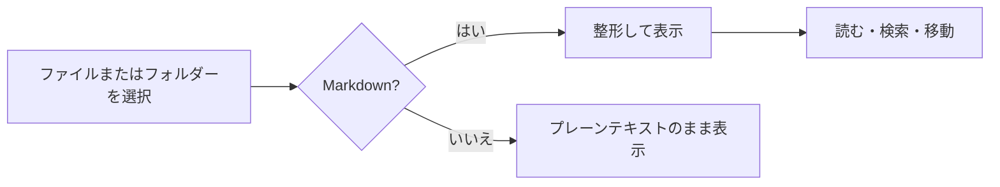

# Parchment へようこそ

Parchment はブラウザーで動作する**ローカルファーストの Markdown・テキストリーダー**です。このサンプルでは、Parchment が表示できる主な記法を紹介します。

> [!tip] このサンプルの使い方
> 右側の「目次」から各セクションへ移動できます。「タグ」「リンク先ノート」「バックリンク」タブでは、サンプルノート同士の関係を確認できます。

上のプロパティは YAML Frontmatter から生成されています。タグをクリックするとファイルツリーを絞り込めます。

## 文字の書式

**太字**、*斜体*、~~取り消し線~~、==ハイライト==、++挿入テキスト++、`インラインコード`に対応しています。

化学式 H~2~O は下付き、x^2^ は上付きです。:sparkles: :books: :rocket: などの絵文字も変換されます。

脚注の例です。[^read-only]

*[HTML]: HyperText Markup Language

[^read-only]: Parchment はファイルを読み取り専用で開き、元の文書を変更しません。

## リストとタスク

- 箇条書き
  - 入れ子にも対応
- もう一つの項目

1. 番号付きリスト
2. 2 番目の手順

- [x] このサンプルを開く
- [ ] このタスクを切り替える（状態はブラウザーだけに保存）
- [ ] 自分のノートフォルダーを開く

## 表

| 機能 | 単一ファイル | フォルダー |
| --- | :---: | :---: |
| Markdown 表示 | ✅ | ✅ |
| 相対画像とリンク | — | ✅ |
| Wiki リンクと埋め込み | — | ✅ |
| 全文検索 | — | ✅ |

## コードと数式

```js
const [handle] = await window.showOpenFilePicker();
const file = await handle.getFile();
console.log(await file.text());
```

インライン数式：$E = mc^2$。

$$
\int_{0}^{1} x^2 \, dx = \frac{1}{3}
$$

## 図



## コールアウト

> [!note]
> 標準的な補足です。

> [!warning] 任意のタイトル
> コールアウト内でも **Markdown** を利用できます。

> [!question]- 折りたためますか？
> はい。種類の後に `-` を付けると、初期状態が折りたたみになります。

## ノートのリンクと埋め込み

[[linked-note]] を開くか、[[linked-note#埋め込み可能なセクション|リンク先ノートのセクション]]へ移動します。

![[linked-note#埋め込み可能なセクション]]

![[linked-note#^summary]]

## 画像


![[parchment-logo-transparent.png|96]]

## 次のステップ

1. **フォルダーを開く**を選び、自分のノートフォルダーを開きます。
2. 左サイドバーからすべてのノートを検索します。
3. 設定で別の言語、カラーパレット、フォントを試します。

スマートフォンでは、ファイルツリーと文書情報をサイドドロワーで開きます。文書が4画面を超える場合に限り、2画面分スクロールすると右下に「先頭へ戻る」ボタンが表示されます。短い文書では表示されません。デスクトップでは、閲覧領域の右下にポインターを移動すると表示されます。

このサンプルはオフラインでも利用できます。
