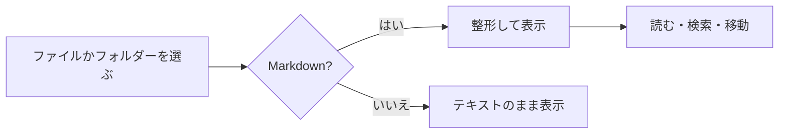
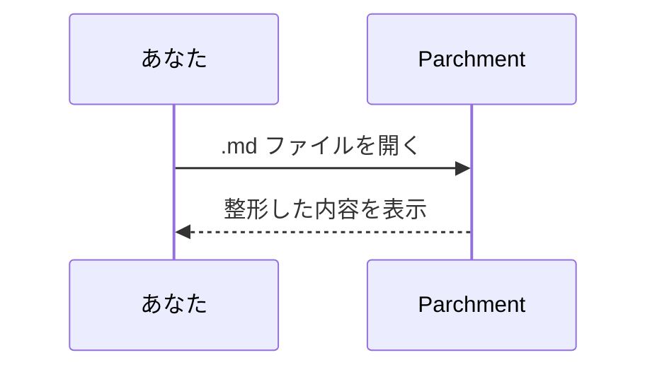

# Parchment へようこそ

Parchment は、ブラウザーで動く**ローカルの Markdown・プレーンテキストリーダー**です。この文書そのものがサンプルで、各セクションで Parchment が表示できる内容を 1 種類ずつ紹介しています。元のファイルと見比べて、書き方と表示の違いを確かめてみてください。

> [!tip] このサンプルの使い方
> - 右側の「目次」から好きなセクションへ移動できます。小見出しがある項目は折りたためます。
> - 右側のタグとリンクのタブを開くと、この文書のタグや、もう 1 つのサンプルノートとのバックリンクを確認できます。
> - 画像や図は**クリックで拡大**でき、PNG として保存もできます。

上の「プロパティ」は、ファイル先頭の YAML フロントマターから作られています。`tags` はクリックできるタグになり、ほかの項目も表にまとめて表示されます。

## 文字の書式

段落では **太字**、*斜体*、***太字斜体***、~~取り消し線~~、==マーカー==、++挿入テキスト++、`インラインコード` が使えます。

化学式 H~2~O は下付き、x^2^ は上付きです。絵文字はそのまま入力 🎉 しても、ショートコード :sparkles: :books: :rocket: で書いても表示されます。

キーは <kbd>Ctrl</kbd> + <kbd>F</kbd> のように表せます。HTML の <mark>マーカー</mark>、<u>下線</u>、H<sub>2</sub>O も表示できます。

ここに脚注[^read-only]があります。クリックすると内容が表示されます。HTML は略語なので、ポインターを合わせると正式名称が表示されます。

*[HTML]: HyperText Markup Language

[^read-only]: Parchment はファイルを読み取り専用で開き、文書を変更することはありません。

## 見出しと目次

`#` から `######` までの見出しは、右側の目次に自動でまとめられ、階層が深いほど字下げされます。

### 第 3 レベルの見出し

下の階層の見出しは、1 つ上の見出しの下にまとめられます。

#### 第 4 レベルの見出し

目次で見出しの横にある矢印をクリックすると、その階層を折りたたんだり展開したりできます。

## リストとタスク

- 箇条書き
  - 入れ子にできます
    - さらに 1 段下
- 2 つ目の項目

1. 番号付きリスト
2. 2 番目の手順
   1. 小手順
3. 3 番目の手順

- [x] このサンプルを開く
- [ ] この項目をチェックしてみる（状態はブラウザーにだけ保存され、ファイルは変わりません）
- [ ] 自分のノートフォルダーを開く

## 引用

> 学びて時に之を習う、亦説ばしからずや。
> — 『論語』

> 引用は何段にも重ねられます
>> 2 段目
>>> 3 段目

## 表

列は左寄せ・中央・右寄せにできます：

| 機能 | 単一ファイル | フォルダー |
| :--- | :---: | :---: |
| Markdown の表示 | ✅ | ✅ |
| 相対パスの画像とリンク | — | ✅ |
| Wiki リンクと埋め込み | — | ✅ |
| 全文検索 | — | ✅ |

列が多い表は列幅が自動で調整され、収まらないときだけ横にスクロールします：

| 番号 | 名称 | 分類 | 価格 | 在庫 | 産地 | 発売日 | 備考 |
| --- | --- | --- | ---: | ---: | --- | --- | --- |
| 001 | 羊皮紙ノート | 文具 | 1,800 | 25 | 台湾 | 2026-01-15 | 手製本 |
| 002 | 万年筆インク | 文具 | 2,400 | 8 | 日本 | 2026-03-02 | ブルーブラック、耐水性 |

## コード

コードブロックは言語に合わせて色分けされます。右上にポインターを合わせると、ワンクリックでコピーできます。

```js
// ユーザーが選んだファイルを読み取り専用で読む
const [handle] = await window.showOpenFilePicker();
const file = await handle.getFile();
console.log(await file.text());
```

```python
def greet(name: str) -> str:
    return f"こんにちは、{name}！"
```

## 数式

インライン数式：質量とエネルギーの等価性 $E = mc^2$、円の面積 $A = \pi r^2$。

ブロック数式：

$$
\int_{0}^{1} x^2 \, dx = \frac{1}{3}
$$

$$
x = \frac{-b \pm \sqrt{b^2 - 4ac}}{2a}
$$

## 図

図は本文の幅に合わせて縮小されます。**図をクリック**すると、拡大・移動したり PNG で保存したりできます。

Mermaid のフローチャート：



Mermaid のシーケンス図：



Graphviz（`dot`）の図：


## コールアウト

> [!note]
> 一般的な補足です。

> [!success] 完了
> 終わったことを示します。

> [!warning] 独自のタイトル
> タイトルは自由に付けられ、本文でも **Markdown** が使えます。

> [!danger] 危険
> 元に戻せない操作を知らせます。

> [!example] 例
> ほかにも info、tip、question、failure、bug、quote、abstract などの種類があり、それぞれアイコンと色が異なります。

> [!question]- 折りたためますか？
> はい。種類の後ろに `-` を付けると最初は閉じた状態、`+` を付けると開いた状態になります。

> [!NOTE]
> GitHub 形式のアラートも表示できます。

## 折りたたみ

<details>
<summary>クリックして続きを表示</summary>

HTML の `<details>` と `<summary>` を使うと、長い内容をたたんでおけます。

</details>

## ノートのリンク

二重の角かっこで別のノートにリンクできます：[[linked-note]]。表示名や見出しも指定できます：[[linked-note#埋め込み可能なセクション|リンク先ノートのセクションへ移動]]。

Web アドレスは新しいタブで開きます：[Parchment GitHub](https://github.com/bruce-yang-422/parchment)。文書内の移動もできます：[「表」へ戻る](#表)。

セクション全体を埋め込む：

![[linked-note#埋め込み可能なセクション]]

1 つのブロックだけを埋め込む：

![[linked-note#^summary]]

別のノートからここへリンクされると、右側の「バックリンク」タブにリンク元が表示されます。

## 画像

相対パスで指定した通常の Markdown 画像です。**画像をクリック**するとライトボックスで拡大できます：


ファイル名と幅だけを書くこともできます。Parchment がフォルダー全体から探します：

![[parchment-logo-transparent.png|96]]

## 定義リスト

読み取り専用
: ファイルの内容を読むだけで、何も変更しません。

ローカルファースト
: 文書はブラウザー内で処理され、アップロードされません。

## もっと書き方を見る

[Markdown 表示テスト文書](https://github.com/bruce-yang-422/parchment/blob/main/samples/ja/parchment_markdown_reader_test.md)には、さらに多くの書き方を収録しています。多言語のテキスト、13 種類のコールアウト、Web 上の画像、さまざまなプログラミング言語や図など。ダウンロードして Parchment で開けば、まとめて確認できます。

## 次のステップ

1. 右上の **フォルダーを開く** から、自分のノートフォルダーを選びます。
2. 左サイドバーの検索欄にキーワードを入力して、すべてのノートを検索します。
3. 右上の設定ボタンから、ほかの配色やフォントを試します。

スマートフォンでは、ファイルツリーと文書情報はサイドドロワーで開きます。画面 4 つ分より長い文書では、2 画面分スクロールすると右下に「先頭に戻る」ボタンが表示されます。短い文書では表示されません。デスクトップでは、本文エリアの右下にポインターを移動するとボタンが現れます。

---

このサンプルは Web サイトに含まれており、オフラインでも開けます。
