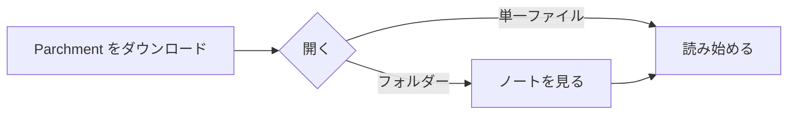
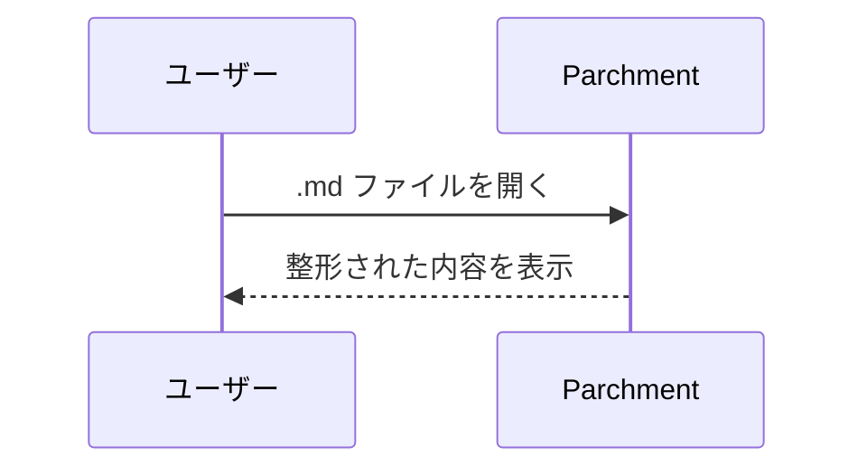
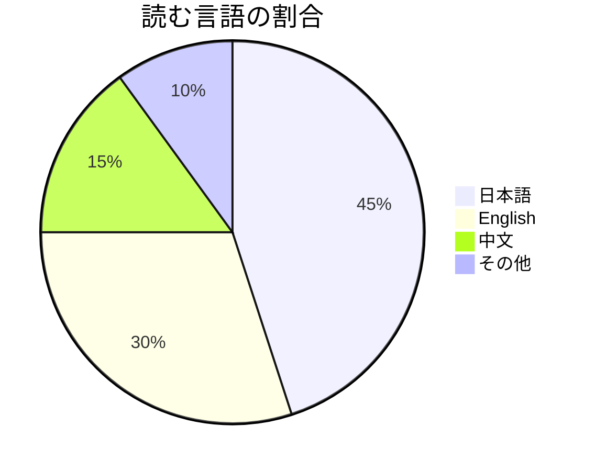

# Parchment 表示テスト文書 · Reading Test

**Parchment** へようこそ！この文書には、さまざまな Markdown の書き方と多言語のテキストを収録しています。ダウンロードして Parchment で開くと、アプリの表示をひととおり確認できます。

> [!tip] この文書の使い方
> 1. Parchment でこのファイルを開きます。
> 2. 右上の「目次」から、見たいセクションへ移動します。
> 3. 「閲覧設定」で配色・フォント・文字サイズを変えて、見え方を比べてみましょう。

---

## 1. 見出し Headings

# 見出し 1 H1
## 見出し 2 H2
### 見出し 3 H3
#### 見出し 4 H4
##### 見出し 5 H5
###### 見出し 6 H6

別の書き方（下線式）
====================

第 2 レベル（下線式）
---------------------

---

## 2. 文字の装飾 Text Styles

| 効果 | 書き方 | 表示 |
| --- | --- | --- |
| 太字 | `**太字**` | **太字 Bold** |
| 斜体 | `*斜体*` | *斜体 Italic* |
| 太字斜体 | `***太字斜体***` | ***太字斜体 Bold Italic*** |
| 取り消し線 | `~~取り消し線~~` | ~~取り消し線 Strikethrough~~ |
| マーカー | `==マーカー==` | ==マーカー Highlight== |
| 下線 | `++下線++` | ++下線 Underline++ |
| 上付き | `x^2^` | x^2^ |
| 下付き | `H~2~O` | H~2~O |
| インラインコード | `` `code` `` | `print("hi")` |

アンダースコアでも書けます：_斜体_、__太字__。

エスケープ：\*これは斜体ではない\*、\# これは見出しではない、\[これはリンクではない\]。

この行の末尾には半角スペースが 2 つあります  
そのため、ここで改行されます（強制改行）。

---

## 3. 多言語 Multilingual

以下の各言語のテキストは、フォントが正しく表示されるか（「□」や文字化けが出ないか）を確認するためのものです。内容を理解する必要はありません。

### 繁體中文
落霞與孤鶩齊飛，秋水共長天一色。Parchment 是一款讓你安靜閱讀 Markdown 筆記的 App。

### 简体中文
落霞与孤鹜齐飞，秋水共长天一色。Parchment 是一款让你安静阅读 Markdown 笔记的 App。

### English
The quick brown fox jumps over the lazy dog. *Parchment* lets you read your Markdown notes in peace.

### 日本語
いろはにほへと ちりぬるを わかよたれそ つねならむ。**Parchment** は Markdown のノートを静かに読むためのアプリです。

### 한국어
다람쥐 헌 쳇바퀴에 타고파. **Parchment**는 Markdown 노트를 조용히 읽을 수 있는 앱입니다.

### Français
Portez ce vieux whisky au juge blond qui fume. Ça, c'est l'été à Noël — « déjà vu » !

### Deutsch
Victor jagt zwölf Boxkämpfer quer über den großen Sylter Deich. Straße, Größe, Übung.

### Español
El veloz murciélago hindú comía feliz cardillo y kiwi. ¿Dónde está la señal? ¡Olé!

### Italiano · Português
Quel vituperabile xenofobo zelante assaggia il whisky ed esclama: alleluja!
Luís argüia à Júlia que «brações, fé, chá, óxido, pôr, zângão» eram palavras do português.

### Русский
Съешь же ещё этих мягких французских булок, да выпей чаю.

### Ελληνικά
Ξεσκεπάζω την ψυχοφθόρα βδελυγμία.

### Tiếng Việt
Tiếng Việt có dấu: ă â đ ê ô ơ ư — Trăm năm trong cõi người ta.

### ภาษาไทย
เป็นมนุษย์สุดประเสริฐเลิศคุณค่า

### हिन्दी
ऋषियों को सताने वाले दुष्ट राक्षसों के राजा रावण का सर्वनाश करने वाले विष्णु।

### 右から左 Right-to-left
- العربية：مرحبًا بك في Parchment.
- עברית：ברוכים הבאים ל־Parchment.

### 混在 Mixed
日本語 English 中文 한국어 を同じ行に混在させ、数字 1234567890、全角の「記号」と半角の (punctuation) を並べています。

---

## 4. 絵文字 Emoji

直接入力：😀 🎉 📚 ✍️ 🌏 🇯🇵 🇹🇼 🇰🇷 👍🏽 👨‍👩‍👧‍👦

ショートコード：:smile: :heart: :rocket: :books: :+1:

---

## 5. リスト Lists

### 箇条書き
- りんご Apple
- バナナ Banana
  - 入れ子 2 段目
    - 入れ子 3 段目
* アスタリスクでも OK
+ プラス記号でも OK

### 番号付きリスト
1. 手順 1
2. 手順 2
   1. 小手順 2.1
   2. 小手順 2.2
3. 手順 3

5 から始まる番号：

5. 五
6. 六

### チェックリスト（チェックしてファイルに保存できます）
- [x] Parchment をダウンロードする
- [x] このテスト文書を開く
- [ ] 配色を切り替えてみる
- [ ] フォントを変えてみる
- [ ] ここをタップしてチェックしてみる

---

## 6. リンク Links

- 通常のリンク：[Parchment GitHub](https://github.com/bruce-yang-422/parchment)
- 自動リンク：<https://www.markdownguide.org>
- タイトル付きリンク：[Markdown ガイド](https://www.markdownguide.org "ポインターを合わせると表示される説明")
- 参照リンク：[CommonMark][cm]
- 文書内リンク：[「表」のセクションへ戻る](#8-表-tables)
- Wiki リンク：[[別のノート]]、[[別のノート|表示名]]

[cm]: https://commonmark.org

---

## 7. 画像 Images

### Web 上の画像
表示にはインターネット接続が必要です：


### ウィキペディアの画像
北宋・范寛「谿山行旅図」（台北・国立故宮博物院所蔵、パブリックドメイン、出典：[Wikimedia Commons](https://commons.wikimedia.org/wiki/File:Fan_Kuan_-_Travelers_Among_Mountains_and_Streams_-_Google_Art_Project.jpg)）。縦長の画像です。タップすると拡大表示できます：


### リンク付き画像（Flickr）
画像をリンクで囲んだ、Flickr の「共有」で作られる埋め込み形式です。リンク付き画像の表示を確認します：

[](https://flic.kr/p/nqShrs "IMG_2247")

*2014 年春、新北市石門の老梅石槽で撮影。波に削られた火山岩の溝が鮮やかな緑藻に覆われ、長時間露光で波しぶきが白い霧のように写っています。*

### HTML で幅を指定


### 見つからない画像
次の画像はわざと存在しないものにして、エラー表示を確認します：


---

## 8. 表 Tables

| 言語 Language | あいさつ Greeting | 書字方向 |
| :--- | :---: | ---: |
| 日本語 | こんにちは | 左→右 |
| English | Hello | LTR |
| 繁體中文 | 你好 | 左→右 |
| 한국어 | 안녕하세요 | 左→右 |
| Français | Bonjour | LTR |
| Deutsch | Guten Tag | LTR |
| Español | Hola | LTR |
| العربية | مرحبا | RTL |

### 横に長い表（左右にスクロール）

| 番号 | 名称 | 分類 | 価格 | 在庫 | 産地 | 発売日 | 備考 |
| --- | --- | --- | ---: | ---: | --- | --- | --- |
| 001 | 羊皮紙ノート | 文具 | 1,800 | 25 | 台湾 | 2026-01-15 | 手製本、長期保存向け |
| 002 | 万年筆インク Ink | 文具 | 2,400 | 8 | 日本 | 2026-03-02 | ブルーブラック、耐水性 |
| 003 | Notebook A5 | Stationery | 12.5 | 140 | Germany | 2026-05-20 | Dot grid, 120 g/m² |

---

## 9. 引用 Blockquotes

> 学びて時に之を習う、亦説ばしからずや。
> — 『論語』

> 1 段目の引用
>> 2 段目の引用
>>> 3 段目の引用

> 引用の中にも **太字**、`コード`、リストを入れられます：
> - 項目 1
> - 項目 2

---

## 10. コールアウト Callouts

> [!note] メモ Note
> 一般的なメモです。

> [!info] 情報 Info
> 補足情報です。

> [!tip] ヒント Tip
> 文字を長押しするとコピーできます。

> [!success] 成功 Success
> 完了しました！

> [!question] 質問 Question
> どの配色がいちばん好きですか？

> [!warning] 注意 Warning
> 変更する前にバックアップしてください。

> [!danger] 危険 Danger
> この操作は元に戻せません。

> [!failure] 失敗 Failure
> ファイルが見つかりません。

> [!bug] バグ Bug
> 問題を報告するときはスクリーンショットを添えてください。

> [!example] 例 Example
> これは例です。

> [!quote] 引用 Quote
> 継続は力なり。

> [!abstract] 概要 Abstract
> この文書は Parchment の表示を確認するためのものです。

> [!tip]- 開閉できるコールアウト（最初は閉じています。タップで開きます）
> 隠れた内容を見つけました！🎉

---

## 11. コード Code

インラインコード：`const name = 'Parchment';`

### Dart
```dart
void main() {
  final greeting = 'こんにちは、Parchment！';
  print(greeting);
}
```

### Python
```python
def greet(name: str) -> str:
    """多言語のあいさつ / Multilingual greeting"""
    return f"こんにちは、{name}！"

print(greet("Parchment"))
```

### JavaScript
```javascript
const langs = ['ja', 'en', 'zh-TW', 'zh-CN', 'ko', 'fr', 'de', 'es'];
langs.forEach((lang, i) => console.log(`${i + 1}. ${lang}`));
```

### JSON
```json
{
  "app": "Parchment",
  "languages": ["日本語", "English", "繁中", "简中", "한국어"],
  "offline": true
}
```

### Shell
```bash
# 横スクロールを確認するためのとても長いコマンド This is a very long command line to test horizontal scrolling inside a code block
echo "Hello, Parchment" && ls -la ~/Documents/notes/markdown/very/deep/folder/structure/
```

### SQL
```sql
SELECT title, author FROM notes WHERE lang = '日本語' ORDER BY updated_at DESC;
```

### 言語指定なし
```
プレーンテキストのコードブロック
  インデントは保持されます
```

### インデント式のコード（スペース 4 つ）

    これもコードブロックです
    Indented code block

---

## 12. 数式 Math

インライン数式：質量とエネルギーの等価性 $E = mc^2$、円の面積 $A = \pi r^2$。

ブロック数式：

$$
x = \frac{-b \pm \sqrt{b^2 - 4ac}}{2a}
$$

$$
\int_0^\infty e^{-x^2}\,dx = \frac{\sqrt{\pi}}{2}
$$

$$
\sum_{n=1}^{\infty} \frac{1}{n^2} = \frac{\pi^2}{6}
$$

---

## 13. 図 Diagrams

### Mermaid フローチャート


### Mermaid シーケンス図


### Mermaid 円グラフ


### Graphviz


---

## 14. 脚注 Footnotes

Parchment は脚注[^1]に対応しています。文字の名前を付けた脚注[^説明]や、長い脚注[^long]も使えます。

[^1]: 最初の脚注です。末尾の戻る矢印で本文に戻れます。
[^説明]: 日本語の名前を付けた脚注も正しく開けます。
[^long]: 脚注にも **太字**、`コード`、[リンク](https://commonmark.org) を入れられます。

---

## 15. HTML タグ

- キー：<kbd>Ctrl</kbd> + <kbd>C</kbd> でコピー
- <mark>HTML のマーカー</mark>、<u>下線</u>、<s>取り消し線</s>
- 化学式 H<sub>2</sub>O、2 乗 x<sup>2</sup>
- 改行<br>br タグを使用

<details>
<summary>クリックして続きを表示 Click to expand</summary>

この内容は普段は折りたたまれています。

- 隠れた項目 1
- 隠れた項目 2

</details>

---

## 16. 定義リスト Definition List

Markdown
: プレーンテキストで書式付きの文書を書くための軽量マークアップ言語。

Parchment
: Markdown を落ち着いて読むためのアプリ。
: 2 つ目の説明も付けられます。

---

## 17. 略語 Abbreviations

HTML と CSS は Web の基礎で、PDF は印刷によく使われます。

*[HTML]: HyperText Markup Language
*[CSS]: Cascading Style Sheets
*[PDF]: Portable Document Format

---

## 18. 区切り線 Horizontal Rules

3 つの書き方はどれも同じ表示になります：

***

---

___

---

## 19. 長い段落 Long Paragraph

レイアウトとスクロールの滑らかさを確認します：Lorem ipsum dolor sit amet, consectetur adipiscing elit, sed do eiusmod tempor incididunt ut labore et dolore magna aliqua. 春眠不覺曉，處處聞啼鳥。夜來風雨聲，花落知多少。Ut enim ad minim veniam, quis nostrud exercitation ullamco laboris nisi ut aliquip ex ea commodo consequat. 古池や蛙飛び込む水の音。Duis aute irure dolor in reprehenderit in voluptate velit esse cillum dolore eu fugiat nulla pariatur. 산에는 꽃 피네 꽃이 피네 갈 봄 여름 없이 꽃이 피네. Excepteur sint occaecat cupidatat non proident, sunt in culpa qui officia deserunt mollit anim id est laborum.

スペースのない、とても長い URL や英単語で折り返しを確認します：https://example.com/a/very/long/path/that/keeps/going/and/going/without/any/spaces/to/break/the/line/naturally/index.html

---

## テスト完了 🎉

ここまで表示されていれば、文書を最後まで読み込めています。右下の「先頭に戻る」ボタンで最初に戻れます。

表示に問題があれば、[GitHub Issues](https://github.com/bruce-yang-422/parchment/issues) でお知らせください。ご協力ありがとうございます。
