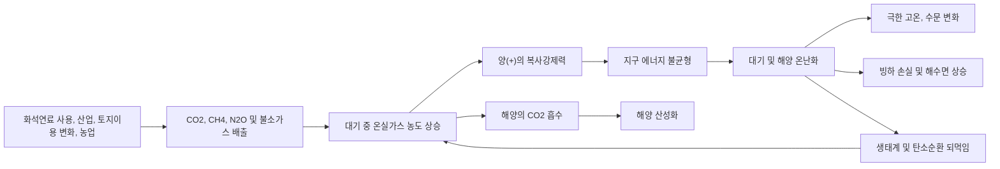
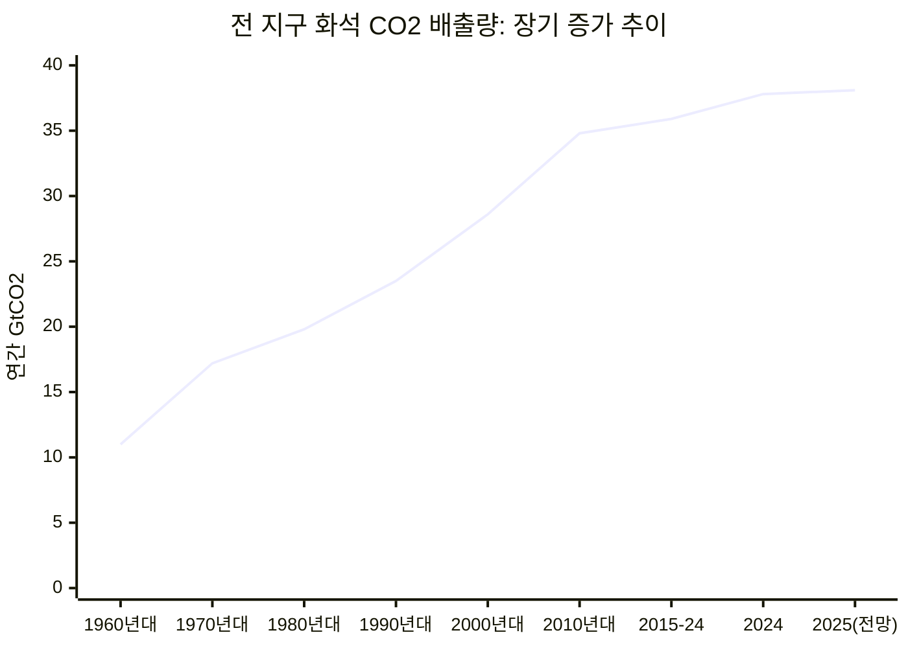
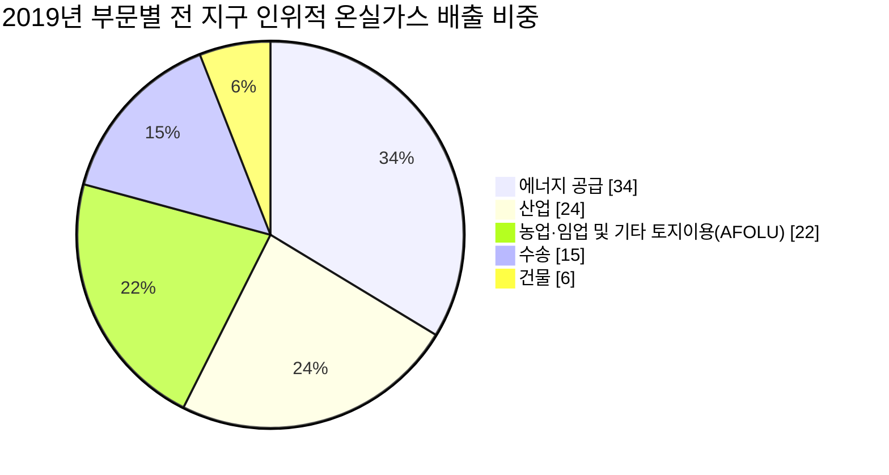
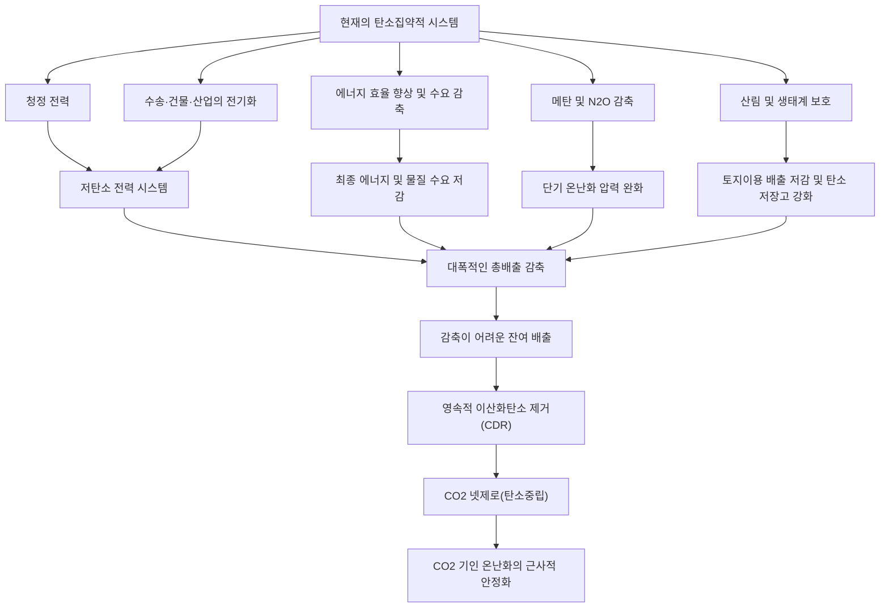

# 탄소 배출과 탄소발자국: 전 지구 기후시스템에 미치는 영향

## 핵심 요약

> **핵심 결론.** 인위적 온실가스 배출이 현대 지구온난화의 지배적 원인이라는 증거는 명백하다. 이산화탄소(CO₂)는 방대한 누적 배출량, 탄소순환에 미치는 장기적 영향, 그리고 누적 CO₂ 배출량과 전 지구 평균 기온 간의 준선형적 관계로 인해 단일 기체 중 가장 큰 기여 요인이다. 메탄(CH₄), 아산화질소(N₂O), 불소가스는 여기에 상당한 추가 복사강제력을 더한다.[^3] [^5]

인간 활동으로 인해 전 지구 지표면 온도는 **2011–2020년 기준 1850–1900년 평균 대비 약 1.1°C 상승**하였다. IPCC는 1850–1900년에서 2010–2019년 사이 인간 활동에 의한 총 온난화를 약 **1.07°C**로 추정하는 반면, 태양 활동 및 화산 활동 등 자연적 요인은 관측된 장기 변화에 소폭 기여한 데 그쳤다. 온실가스만 작용했다면 더 큰 폭의 온난화가 발생했을 것이나, 그 효과의 일부가 인위적 에어로졸에 의해 상쇄(차폐)되었다.[^5]

근저에 놓인 탄소 교란의 규모는 관측 시대 이래 유례가 없는 수준이다. 대기 중 CO₂ 농도는 **산업화 이전 약 270–280 ppm**이었으나, NOAA에 따르면 **2025년 전 지구 해양 경계층 연평균 425.62 ± 0.05 ppm**에 도달하였다. 장수명 온실가스의 합산 유효 복사강제력은 **2025년 산업화 이전 대비 3.59 W m⁻²**에 달해 1990년의 동일 강제력 대비 56% 증가하였다. CO₂ 단독 기여분은 **2.37 W m⁻²**로, 장수명 온실가스 전체의 약 3분의 2를 차지하였다.[^7]

그럼에도 불구하고 전 지구 배출량은 계속 증가해 왔다. IPCC는 2019년 순 인위적 온실가스 배출량을 **59 ± 6.6 GtCO₂-eq**으로 추정하였으며, 이는 1990년 대비 54% 증가한 수치이다. 전 지구 탄소수지 보고서 2025(Global Carbon Budget 2025)는 2024년 전 지구 화석 CO₂ 배출량을 **37.8 ± 2 GtCO₂**로 추정하고 **2025년에는 약 38.1 GtCO₂**에 이를 것으로 전망하였으나, 데이터셋 간 방법론적 정의에는 차이가 존재한다. 국제에너지기구(IEA)는 독립적으로 **2025년 에너지 관련 CO₂ 배출량이 약 38.4 GtCO₂**에 육박한 것으로 추정하였다. 이러한 수치들은 부문별 경계가 다르므로 상호 대체 가능한 값으로 취급해서는 안 된다.[^1] [^2] [^4] [^6]

탄소발자국은 분석 범위를 영토 기반 배출량 너머로 확장한다. *생산 기반 배출 인벤토리*는 배출이 물리적으로 발생한 장소에 배출량을 귀속시키는 반면, *소비 기반 탄소발자국*은 국제 공급망을 통해 재화와 서비스에 내재된 배출량을 최종 소비자에게 재할당한다. 이러한 구분이 중요한 이유는 교역재를 통해 고소비 지역이 영토 내 배출량의 일부를 외부화할 수 있기 때문이다. 다만 다지역 투입산출(MRIO) 모델 연구는 국가 연소 인벤토리에 비해 구조적·자료적 불확실성이 더 크다.[^4] [^10]

배출 책임의 분포는 극도로 불평등하다. 2019년 배출량 상위 10% 가구가 **전 지구 소비 기반 가계 온실가스 배출량의 약 34–45%** 를 차지한 반면, 하위 50% 가구는 **13–15%** 에 불과하였다. 지역 간 격차 역시 마찬가지로 커서, 2019년 북미의 1인당 온실가스 배출량은 약 **19 tCO₂-eq**인 반면 남아시아는 약 **2.5 tCO₂-eq** 수준이었다.[^4]

이미 관측된 기후적 결과로는 극한 고온의 증가, 다수 지역에서의 호우 심화, 가뭄 위험의 변화, 해양 온난화, 빙권 감소, 해수면 상승 가속화, 그리고 해양 산성화가 포함된다. 전 지구 평균 해수면은 **1901년부터 2018년까지 약 0.20 m 상승**하였으며, 상승 속도는 **2006–2018년 기간 3.7 [3.2–4.2] mm yr⁻¹**로 빨라졌다. 표층 해수의 pH는 **산업화 이후 약 0.1 단위 감소**하였으며, 이는 수소이온 농도의 약 30% 증가에 해당한다.[^5] [^9]

미래 온난화에 대한 가장 강력한 물리적 제약은 누적 CO₂ 배출량이다. IPCC는 누적 탄소배출에 대한 과도기후반응(TCRE)의 최적 추정치를 **1,000 GtCO₂당 약 0.45°C**(가능성이 높은 범위 0.27–0.63°C)로 평가한다. 따라서 인간 활동에 의한 온난화를 안정화하려면 전 지구 순 인위적 CO₂ 배출량이 0에 근접해야 하며, 양(+)의 배출이 지속되는 한 추가적인 온난화가 발생한다.[^3]

감축 기술은 이미 상당한 규모로 활용 가능하다. IPCC 평가에 따르면 **US$100 tCO₂-eq⁻¹ 이하의 비용이 드는 감축 수단만으로 2030년까지 전 지구 온실가스 배출량을 2019년 수준 대비 최소 절반 이상 감축**할 수 있으며, 평가된 잠재량의 절반 이상은 US$20 tCO₂-eq⁻¹ 미만의 비용으로 달성할 수 있다. 주요 저비용 감축 기회로는 태양광 및 풍력 발전, 에너지 효율 향상, 메탄 감축, 그리고 산림 및 기타 자연 생태계 전환 방지가 꼽힌다. 그러나 실현 가능성은 공학적 비용뿐만 아니라 전력망 인프라, 금융 조달, 제도, 토지 제약, 행동 변화, 사회적 수용성, 그리고 분배적 결과에도 좌우된다.[^4]

## 초록 및 서론

본 보고서는 대략 1850년부터 현재까지 **탄소 배출, 탄소발자국, 대기 중 온실가스 축적, 복사강제력, 그리고 기후변화** 간의 관계를 고찰한다. 별도로 명시하지 않는 한 분석 범위는 전 지구로 한다. 본고는 물리적 배출량과 소비 기반 탄소발자국을 구분하고, 배출량과 기후 영향을 연결하는 증거의 강도를 평가하며, 주요 불확실성을 규명하고, 핵심 감축 경로를 검토한다.

본문에서 **탄소 배출**이라는 용어는 주로 화석연료 연소, 산업 공정 및 토지이용 변화에서 방출되는 CO₂를 지칭하며, *온실가스 배출*은 여기에 CH₄, N₂O 및 불소가스를 추가로 포함한다. **탄소발자국**은 제품, 활동, 조직, 가구 또는 인구에 귀속되는 직·간접 온실가스 배출량을 보다 포괄적으로 의미하며, 통상 이산화탄소 환산 톤(tCO₂-eq)으로 표현된다. 소비 기반 탄소발자국은 수입 재화와 서비스에 내재된 배출량을 포함하므로 영토 기반 국가 인벤토리와 개념적으로 구별된다.[^4] [^10]

여러 온실가스를 이산화탄소 환산 배출량으로 합산하는 과정은 기후 지표에 의존하며, 일반적으로 **100년 지구온난화지수(GWP₁₀₀)** 가 사용된다. IPCC 제6차 평가보고서(AR6)의 GWP₁₀₀ 추정치는 CO₂가 1, **화석 기원 CH₄가 약 29.8**, **비화석 기원 CH₄가 27.0**, **N₂O가 273**이나 불확실성이 상당하다. 따라서 GWP₁₀₀이 273인 기체는 해당 지표의 가정하에 단위 질량 배출 시 100년간 적분된 복사 영향이 동일 질량의 CO₂ 기준 영향보다 약 273배 크다. 다만 GWP 값은 모든 시간 척도에서의 엄밀한 물리적 등가성으로 해석되어서는 안 된다.[^3]

근본적인 인과 연쇄는 다음과 같다.

**그림 1. 인위적 활동에서 기후 및 생지화학적 영향에 이르는 개념적 인과 연쇄.** 주요 온실가스 경로의 방향성은 IPCC가 평가한 다수의 관측적·이론적·모델링 증거에 의해 뒷받침된다.[^3] [^5]

### 명시적 가정

1. **지리적 범위:** 전 지구를 대상으로 하되, 신뢰성 있는 데이터셋이 허용하는 경우 지역별 비교를 병행한다.
2. **역사적 기간:** 별도의 기간이 명시되지 않는 한 대략 1850년부터 현재까지로 한다.
3. **배출 회계:** 물리적 전 지구 총량에는 생산 기반 배출량을 사용하며, 소비 기반 지표는 탄소발자국으로 명시적으로 구분한다.
4. **기후 지표:** 출처에서 별도로 지정하지 않는 한 CO₂ 환산 값은 일반적으로 AR6 GWP₁₀₀을 적용한다.
5. **최신 관측치:** 완전한 인벤토리는 실시간 대비 시차가 존재하므로, 본 보고서는 *관측된 과거 자료*와 *잠정치 또는 전망치*를 구분한다.
6. **감축 비용:** 제시된 비용 범위는 개별 사업 수준의 확정 비용이 아니라 전 지구적 기술·경제적 추정치이다.

따라서 본 연구의 핵심 질문은 단순히 배출이 기후를 변화시키는가 여부(이러한 원인 귀속은 이미 확고히 정립되어 있다)가 아니라, **배출 규모, 배출원, 지리적 책임, 소비 패턴, 대기 물리 및 탄소순환 과정이 어떻게 결합하여 기후변화의 규모와 지속성을 결정하는가**에 있다.

## 연구 방법 및 자료 출처

본 분석은 과학적 증거의 위계를 따른다. 가장 높은 우선순위는 **IPCC 제6차 평가보고서(AR6)** 에 부여하였는데, 이는 보정된 신뢰도 표현과 다수의 독립적 증거 계열을 바탕으로 수천 편의 동료 심사 연구를 종합하고 있기 때문이다. 물리과학 분석은 주로 AR6 제1실무그룹(WG I) 보고서에, 배출 및 감축 평가는 제3실무그룹(WG III) 보고서에, 통합 영향 평가는 2023년 종합보고서(Synthesis Report)에 기반하였다.[^3] [^4] [^5]

최근 배출량 및 탄소순환 자료는 주로 *Earth System Science Data*에 게재된 **전 지구 탄소수지 보고서 2025(Global Carbon Budget 2025)** 에서 인용하였다. 이 수지는 화석 CO₂ 배출, 토지이용 변화, 대기 축적, 해양 흡수, 육상 흡수 및 명시적 수지 불균형을 통합한다. 1850–2024년 누적 인위적 배출량은 **745 ± 65 GtC**으로 추정되었으며, 이 중 약 290 ± 5 GtC은 대기에 잔류하고, 200 ± 40 GtC은 해양에 흡수되었으며, 175 ± 50 GtC은 육상 탄소흡수원에 흡수되었고, 나머지는 잔여 수지 불균형으로 배분된다.[^1]

대기 농도 및 복사강제력 자료는 **미국 해양대기청(NOAA) 전 지구 감시연구소(Global Monitoring Laboratory)** 에서 확보하였다. NOAA의 장기 전 지구 관측망은 CO₂, CH₄, N₂O 및 기타 장수명 온실가스의 측정치를 제공하며 연간 온실가스 지수(AGGI)를 산출한다.[^7] [^8]

에너지 관련 CO₂ 정보는 특히 최근 부문별 추세가 필요한 경우 **국제에너지기구(IEA)** 자료로 보완하였다. IEA 자료는 전 지구 탄소수지 보고서와 다른 회계 경계를 사용하므로, 수치 총량은 각 범위를 명확히 정의한 뒤에만 비교하였다.[^6]

소비 기반 탄소발자국 증거는 IPCC 평가와 동료 심사 다지역 투입산출(MRIO) 모델 연구에 근거한다. 이러한 모델은 국제 무역을 통해 화폐적·물리적 공급망을 추적한다. 간접 배출을 소비에 귀속시키는 데 유용하지만, 부문 통합, 무역 통계, 배출계수 표준화 및 MRIO 데이터베이스 간 차이로 인해 불확실성이 발생한다. 5대 주요 MRIO 시스템을 비교한 연구에서는 소비 기반 탄소 회계 추정치에 유의미한 편차가 확인되었으며, 이는 탄소발자국 추정치를 엄밀한 인벤토리 수량으로 취급해서는 안 되는 이유를 보여준다.[^10]

### 핵심 물리 관계식

CO₂ 복사강제력에 널리 사용되는 1차 근사식은 다음과 같다.

\[
\boxed{\Delta F_{CO_2}\approx 5.35\ln\left(\frac{C}{C_0}\right)\;\text{W m}^{-2}}
\]

여기서 \(C_0\)는 기준 CO₂ 농도이고 \(C\)는 교란된 농도이다. 이 로그 관계는 CO₂ 농도가 동일한 비율로 증가할 때마다 대략 유사한 크기의 추가 복사강제력이 발생함을 의미한다. AR6는 공식 평가에 갱신된 분광학적 처리를 적용하지만, 이 로그 근사식은 교육적·개념적 이해에 여전히 유용하다.[^3]

전 지구 탄소수지는 도식적으로 다음과 같이 표현할 수 있다.

\[
E_{\mathrm{FOS}}+E_{\mathrm{LUC}}
=
G_{\mathrm{ATM}}
+
S_{\mathrm{OCEAN}}
+
S_{\mathrm{LAND}}
+
B_{\mathrm{IM}},
\]

여기서 \(E_{\mathrm{FOS}}\)는 화석 및 산업 공정 CO₂ 배출량, \(E_{\mathrm{LUC}}\)는 토지이용 변화 배출량, \(G_{\mathrm{ATM}}\)는 대기 축적량, \(S_{\mathrm{OCEAN}}\)과 \(S_{\mathrm{LAND}}\)는 각각 해양 및 육상 탄소흡수원, \(B_{\mathrm{IM}}\)는 잔여 수지 불균형이다. 2015–2024년 기간에 대해 전 지구 탄소수지 보고서는 총 인위적 CO₂ 배출량의 약 **50%** 가 대기에 축적되었고, **29%** 가 해양으로, **21%** 가 육상 흡수원으로 유입되었으며, 해당 10년간 평균 불균형은 거의 0에 가까웠던 것으로 추정하였다.[^1]

기온 상승과 관련하여 AR6는 다음과 같은 근사 누적 관계식을 제시한다.

\[
\Delta T \approx \mathrm{TCRE}\times
\frac{E_{\mathrm{cum}}}{1000\ \mathrm{GtCO_2}},
\]

여기서

\[
\mathrm{TCRE}_{\text{최적 추정치}}\approx0.45^{\circ}\mathrm{C}\; / \;1000\ \mathrm{GtCO_2}.
\]

이러한 준선형적 관계는 단일 연도의 배출률만이 아니라 누적 CO₂ 배출량이 기후 정책의 핵심이 되는 주요 이유 중 하나이다.[^3]

비(非)CO₂ 온실가스의 경우, 시간 지평 \(H\)에 걸친 GWP는 개념적으로 다음과 같이 정의된다.

\[
\mathrm{GWP}_i(H)
=
\frac{\int_0^H RF_i(t)\,dt}
{\int_0^H RF_{CO_2}(t)\,dt},
\]

여기서 \(RF_i(t)\)는 물질 \(i\)의 순간(펄스) 배출 이후 시간에 따른 복사강제력이다. 선택된 시간 지평에 따라 CH₄와 같은 단수명 기체의 상대적 중요성이 달라 보인다.[^3]

## 분석 결과

전 지구 인위적 배출량은 산업화 이후 가파르게 상승하였다. **1850년부터 2019년까지의 역사적 누적 순 CO₂ 배출량은 약 2,400 ± 240 GtCO₂**였으며, 이 누적량의 약 42%가 1990–2019년 사이에 배출되었다. 이는 최근 수십 년간 배출량이 유례없이 빠르게 축적되었음을 보여준다.[^4]

전 지구 탄소수지 보고서 역시 화석 CO₂에 대해 동일한 장기 추세를 나타낸다. 연평균 화석 배출량은 **1960년대 약 3.0 GtC yr⁻¹**에서 **2015–2024년 9.8 GtC yr⁻¹**로 증가하였으며, 이는 각각 약 11 및 36 GtCO₂ yr⁻¹에 해당한다. 화석 CO₂ 배출량은 2024년 약 37.8 GtCO₂에 도달하여 1990년 대비 69% 증가하였다.[^1]

**그림 2. 전 지구 화석 CO₂ 배출량 추이(근사치).** 10년 단위 수치는 \(44/12\) 환산계수를 적용해 GtC에서 GtCO₂로 변환하였으며, 2025년 수치는 확정 인벤토리가 아닌 전 지구 탄소수지 보고서 2025의 전망치이다.[^1] [^2]

### 부문별 및 지역별 배출 양상

2019년 전 지구 순 인위적 온실가스 배출량 중 에너지 공급 부문이 약 **34%**, 산업이 24%, 농업·임업 및 기타 토지이용(AFOLU)이 22%, 수송이 15%, 건물이 6%를 차지하였다. 보고된 비중이 반올림되었기 때문에 각 범주의 합계는 약 101%가 된다. 전력 및 열 생산 배출량을 에너지 공급 부문에서 최종 소비 부문으로 재할당하면 산업과 건물 부문의 상대적 기여도가 크게 상승하며, 이는 부문별 비중이 회계 관행에 따라 달라짐을 보여준다.[^4]

**그림 3. 2019년 순 인위적 온실가스 배출량의 부문별 근사 비중.** 수치는 AR6 GWP₁₀₀을 적용해 CO₂ 환산량으로 산출한 IPCC 추정치이다.[^4]

| 회계 차원 | 주요 배출원 / 지역 | 근사 규모 | 해석 |
|---|---|---:|---|
| **부문별, 2019년 온실가스** | 에너지 공급 | 20 GtCO₂-eq; 34% | 전 지구 최대 직접 배출 부문.[^4] |
|  | 산업 | 14 GtCO₂-eq; 24% | 산업 에너지 및 공정 배출 포함.[^4] |
|  | 농업·임업 및 기타 토지이용(AFOLU) | 13 GtCO₂-eq; 22% | 농업, 임업 및 토지이용 변화 포함.[^4] |
|  | 수송 | 8.7 GtCO₂-eq; 15% | 화석연료 기반 수송 체계가 지배적.[^4] |
|  | 건물 | 3.3 GtCO₂-eq; 직접 6% | 간접 전력·열 배출을 사용자에게 배분하면 비중이 약 16%로 증가.[^4] |
| **화석 CO₂, 2024년** | 중국 | 12.3 GtCO₂; 31.7% | 최대 영토 기반 화석 CO₂ 배출국.[^2] |
|  | 미국 | 4.9 GtCO₂; 12.7% | 1인당 화석 CO₂ 약 14.2 tCO₂.[^2] |
|  | 인도 | 3.2 GtCO₂; 8.3% | 1인당 화석 CO₂ 약 2.2 tCO₂.[^2] |
|  | EU-27 | 2.4 GtCO₂; 6.3% | 1인당 화석 CO₂ 약 5.4 tCO₂.[^2] |
|  | 러시아 | 1.8 GtCO₂; 4.6% | 1인당 화석 CO₂ 약 12.3 tCO₂.[^2] |
| **소비 기반 탄소발자국** | 북미 | 인용 발자국 평가 기준 ~13.4 tCO₂-eq capita⁻¹ | 가계 연계 소비 기반 탄소발자국이 높은 수준 유지.[^4] |
|  | 유럽 | ~7.5 tCO₂-eq capita⁻¹ | 북미보다 낮으나 저소득 지역을 크게 상회.[^4] |
|  | 아프리카 및 중동* | ~1.7 tCO₂-eq capita⁻¹ | 대규모 전 지구 불평등을 시사; 출처의 지역 구분이 포괄적임.[^4] |

**표 1. 부문별·지역별 주요 배출원.** 부문별 온실가스 수치, 영토 기반 화석 CO₂ 수치 및 소비 기반 탄소발자국은 서로 다른 시스템 경계를 사용하므로 합산하거나 상호 직접 대체해서는 안 된다. *인용된 소비 기반 탄소발자국 출처는 아프리카와 중동을 통합 집계하고 있으므로 균질한 단일 지역 값으로 해석해서는 안 된다.[^4] [^10]

지역별 분포 역시 연간 배출량, 누적 역사적 책임, 1인당 배출량, 소비 기반 탄소발자국 중 어느 기준을 적용하느냐에 따라 달라진다. 선진국들은 일반적으로 현재 인구 비중보다 역사적 누적 CO₂ 배출량에서 훨씬 큰 비중을 차지해 온 반면, 동아시아의 현대 연간 배출 비중은 2000년 이후 크게 증가하였다. IPCC는 **2019년 1인당 화석·산업 공정 CO₂ 배출량이 선진국 평균 약 9.5 tCO₂**인 반면, **아시아-태평양은 약 4.4 tCO₂, 라틴아메리카 및 카리브해는 2.7 tCO₂, 아프리카는 1.2 tCO₂**였다고 보고하였다.[^4]

### 복사강제력과 기후 반응

배출량과 온난화 사이의 물리적 연결고리는 대기 농도와 복사강제력을 통해 작동한다. AR6는 1750년 대비 2019년 유효 복사강제력을 CO₂ **2.16 [1.90–2.41] W m⁻²**, CH₄ **0.54 [0.43–0.65] W m⁻²**, N₂O **0.21 [0.18–0.24] W m⁻²**, 할로겐화 기체 **0.41 [0.33–0.49] W m⁻²**로 추정하였다.[^3]

NOAA의 최신 관측 기반 지수는 복사강제력이 계속 증가하고 있음을 보여준다. 2025년 AGGI에 포함된 장수명 기체들의 합산 유효 복사강제력은 **산업화 이전 대비 약 3.59 W m⁻²**에 도달했으며, 이 중 CO₂가 약 **66%**, CH₄가 16%를 차지하였다. 1990년 이후 장수명 온실가스 강제력 증가분의 약 81%는 CO₂에 기인하였다.[^7]

이러한 강제력은 지구 에너지 불균형을 유발한다. AR6는 기후시스템의 관측된 평균 가열 속도가 **1971–2006년 약 0.50 [0.32–0.69] W m⁻²**에서 **2006–2018년 0.79 [0.52–1.06] W m⁻²**로 증가했다고 평가하였다. 잉여 열의 대부분은 해양에 축적되며, 나머지 에너지는 대기 온난화, 육지 빙하 융해, 해수면 상승 및 기타 지구시스템 변화에 기여한다.[^3]

### 관측된 기후 영향

온난화 자체와 수많은 관련 영향에 대한 증거는 매우 강력하다. IPCC는 온실가스 배출을 중심으로 한 인간 활동이 **명백하게 지구온난화를 초래했다**고 결론지었다. 1950년대 이후 대부분의 육지 지역에서 극한 고온이 더 빈번하고 강해졌다는 것은 사실상 확실하며, 1980년대 이후 해양폭염 발생 빈도가 약 2배 증가한 데에도 인간 활동의 영향이 기여했을 가능성이 매우 높다.[^3] [^5]

수문학적 영향은 공간적으로 덜 균일하지만 여전히 상당하다. 더 따뜻한 공기는 더 많은 수증기를 머금을 수 있어 다수 지역에서 호우를 심화시키며, 온난화는 또한 증발 수요를 증가시켜 강수량이 이를 보충하지 못하는 지역에서 농업적·생태적 가뭄을 악화시킬 수 있다. 원인 귀속의 강도는 지역과 재해 유형에 따라 달라지며, 이 때문에 전 지구 극한 고온에 대한 진술은 국지적 가뭄이나 개별 폭풍에 대한 진술보다 일반적으로 더 높은 신뢰도를 갖는다.[^3]

해수면 변화는 또 다른 통합 지표이다. 전 지구 평균 해수면은 **1901년부터 2018년 사이 약 0.20 [0.15–0.25] m 상승**하였다. 평균 상승 속도는 1901–1971년 1.3 mm yr⁻¹에서 2006–2018년 3.7 mm yr⁻¹로 가속화되었으며, 적어도 1971년 이후에는 인간 활동의 영향이 주된 동인이었을 가능성이 매우 높다.[^5]

CO₂는 온난화와 별개로 해양 화학도 변화시킨다. 대기로 방출된 인위적 CO₂의 약 30%는 광범위한 시간 척도에 걸쳐 해양에 흡수되어 탄산을 형성하고 수소이온 농도를 높인다. 평균 표층 해수 pH는 산업혁명 이후 약 **0.1 pH 단위** 감소하였으며, 이로 인해 산호, 연체동물 및 기타 석회화 생물이 이용할 수 있는 탄산이온 가용성이 저하되고 있다.[^9]

## 고찰: 증거, 불확실성 및 탄소발자국 해석

엄밀한 평가는 **크기에 대한 불확실성**과 **인과관계에 대한 불확실성**을 구분해야 한다. 현재 지구온난화에서 인위적 온실가스가 담당하는 인과적 역할은 미해결 과학 쟁점이 아니다. 대신 불확실성은 반응의 정확한 크기와 시기, 지역별 양상, 되먹임 강도, 미래 사회경제적 배출 경로, 그리고 감축 정책 이행의 효과성에 존재한다.[^3] [^5]

| 쟁점 | 증거 강도 | 주요 증거 | 핵심 불확실성 |
|---|---|---|---|
| 인위적 온실가스가 현대 지구온난화를 유발함 | **명백함 / 매우 강력함** | 관측된 온난화, 복사물리학, 원인 귀속 연구, 기후모델, 고기후 제약 조건.[^5] | 개별 강제력 요인과 되먹임 간의 정확한 기여 분할. |
| 누적 CO₂가 장기 온난화를 대략 선형적으로 결정함 | **높은 신뢰도** | 관측과 모델 전반에 걸친 TCRE 관계.[^3] | TCRE 가능성이 높은 범위(1,000 GtCO₂당 0.27–0.63°C). |
| 인간 활동의 영향으로 극한 고온이 심화됨 | **매우 강력함** | 관측 자료 및 단일 사상·장기 원인 귀속 연구.[^3] | 지역별 변화 규모의 차이. |
| 호우 및 가뭄 위험이 변화하고 있음 | **강력하나 공간적으로 이질적** | 관측 자료, 열역학, 원인 귀속 연구.[^3] | 자연 변동성과 지역 순환으로 인해 기온보다 불확실성이 큼. |
| 온난화와 육지 빙하 손실로 해수면이 상승하고 있음 | **높은 신뢰도** | 검조소, 위성 고도계, 빙하·빙상 관측, 해양 열팽창.[^5] | 장기 극단(long-tail) 미래 불확실성은 빙상 역학이 지배함. |
| 해양 산성화는 주로 대기 CO₂ 흡수에 기인함 | **매우 강력함** | 탄산염 화학 및 직접 관측.[^9] | 생물학적 결과는 종과 생태계에 따라 상이함. |
| 소비 기반 탄소발자국은 영토 기반 배출량과 다름 | **강력함** | MRIO 무역 회계.[^10] | 데이터베이스 구조, 부문 통합 및 무역·배출계수 불확실성. |
| 현재의 육상·해양 흡수원이 일정 비율을 무한히 흡수할 것임 | **근거 없음** | 흡수원 강도는 기후 및 탄소순환 되먹임에 따라 변동함.[^1] [^2] | 향후 흡수원 포화 및 지역 되먹임의 불확실성 잔존. |

**표 2. 증거 강도와 주요 불확실성.** 신뢰도 표현은 독립적인 통계적 확률을 나타내는 것이 아니라, 가능한 범위 내에서 IPCC 평가의 방향성을 따른다.

탄소발자국은 **책임**을 해석하는 데 특히 중요하다. 영토 기반 회계는 “배출이 물리적으로 어디에서 발생했는가?”라는 질문에 답하며, 소비 기반 회계는 “누구의 최종 수요가 해당 생산을 유발했는가?”를 묻는다. 따라서 한 국가에서 제조되어 다른 국가에서 구매된 스마트폰은 생산국의 영토 기반 배출량을 증가시키는 동시에 구매자의 소비 기반 탄소발자국에 기여한다. 두 지표 중 어느 하나가 모든 정책 목적에 본질적으로 “정답”인 것은 아니며, 서로 다른 질문에 답한다.[^4] [^10]

이러한 차이는 기후 형평성에 시사점을 준다. IPCC에 따르면 **1인당 배출량 상위 10% 가구가 전 지구 소비 기반 가계 온실가스 배출량의 34–45%를 차지**하는 반면, 하위 절반은 13–15%에 불과하다. 이러한 불평등은 국가 평균 탄소발자국이 소득, 주거, 이동성, 에너지 접근성 및 소비와 연관된 훨씬 더 큰 국가 내부 격차를 가릴 수 있음을 의미한다.[^4]

최근의 다국가 MRIO 연구는 수요 측면 감축의 잠재 규모를 보여준다. 이 연구는 116개국 상위 23.7% 배출 계층을 대상으로 한 저탄소 소비 전환 패키지가 모델링된 가계 소비 기반 온실가스 배출량을 약 **10.4 GtCO₂-eq** 감축할 수 있다고 추정하였으며, 이는 해당 분석에 포함된 가계 배출량의 40.1%에 해당한다. 이러한 결과는 예측치가 아니라 시나리오 추정치로서 특정한 행동 대체와 공급망 반응을 가정하므로 보장된 감축량으로 해석해서는 안 된다.[^11]

탄소순환 불확실성은 또 다른 핵심 영역이다. 1850–2024년 기간에 대해 전 지구 탄소수지 보고서는 추정 총배출량의 약 11%에 해당하는 약 **80 GtC**의 누적 수지 불균형을 보고하였으며, 이는 독립적으로 추정된 배출원과 흡수원 간의 불일치를 시사한다. 관측이 더 잘 이루어진 1959–2024년 기간에는 불균형이 더 작다. 이러한 불일치는 온실효과를 반증하는 것이 아니라, 이질적인 관측 자료와 모델로부터 대규모 전 지구 탄소 플럭스를 재구성하는 과정의 불확실성을 정량화한 것이다.[^1]

최근 특히 우려되는 지점은 자연 흡수원에 대한 기후 되먹임이다. 전 지구 탄소수지 보고서 2025는 2015–2024년 동안 기후변화와 기후 변동성이 그러한 영향이 없는 반사실적(counterfactual) 조건 대비 육상 흡수원을 약 **25%**, 해양 흡수원을 약 **7%** 감소시켰다고 추정하였다. 이는 역사적으로 인위적 배출량의 상당 부분을 흡수해 온 자연적 완충 능력이 약화될 가능성을 시사하지만, 연별 및 10년 단위 변동성은 여전히 크다.[^2]

### 자료 공백

정량적 비교에는 여러 한계가 존재한다. 전 지구 화석연료 CO₂는 토지이용 CO₂보다 제약 조건이 잘 정립되어 있다. 토지이용 CO₂는 과거 토지피복 재구성, 산림 재성장 가정 및 생태계 모델에 의존하기 때문이다. 국가 인벤토리 방법론은 특히 메탄과 토지이용 부문에서 차이를 보인다. 소비 기반 탄소발자국은 실시간 대비 시차가 잦고 이질적인 품목을 통합하는 무역표에 의존한다. 농업, 항공 비CO₂ 영향, 해운, 비공식 경제 활동 및 일부 불소가스의 배출계수는 화석연료 연소 통계보다 완전성이 떨어진다.[^1] [^10]

데이터셋 간 시점 불일치도 존재한다. IPCC AR6 부문별 비교는 주로 2019년을 다루고, 완전한 전 지구 탄소수지 자료는 2024년까지(2025년 전망 포함)이며, NOAA 대기 관측은 2026년까지 이어지고, 에너지 데이터셋은 2025년 잠정 추정치를 제공할 수 있다. 따라서 외견상 불일치가 발견될 경우 과학적 이견으로 해석하기에 앞서 *기준 연도, 시스템 경계, 포함 온실가스 및 회계 방법*의 차이를 먼저 점검해야 한다.[^4] [^6] [^8]

## 감축 경로

감축은 네 가지 상호 보완적 전략으로 체계화할 수 있다. 즉, **회피 가능한 배출 제거, 에너지 및 물질 수요 감축, 고탄소 기술의 대체, 그리고 대기로부터의 잔여 CO₂ 제거**이다. 효과적인 기후 안정화를 위해서는 여러 온실가스에 걸친 신속한 감축이 필요하지만, CO₂는 누적 배출량이 장기 온난화를 크게 결정하므로 특별한 위상을 지닌다.[^3] [^4]

**그림 4. 총배출 감축에서 CO₂ 넷제로(탄소중립)로 이어지는 감축 경로.** 넷제로는 신속한 총배출 감축의 대체재로 해석되어서는 안 되며, IPCC는 이산화탄소 제거(CDR)를 주로 잔여 배출을 상쇄하고 일부 시나리오에서 오버슈트를 되돌리기 위한 보완 수단으로 다룬다.[^4]

| 감축 수단 | 대표적 효과성 | 비용 특성 | 실현 가능성 및 제약 요인 |
|---|---|---|---|
| **태양광 및 풍력 발전** | IPCC가 평가한 2030년 감축 잠재량 중 최상위권.[^4] | 상당 부분이 US$20 tCO₂-eq⁻¹ 미만으로 평가됨.[^4] | 높은 기술 성숙도; 송전망, 에너지 저장, 인허가 및 계통 유연성이 보급을 제약할 수 있음. |
| **에너지 효율** | 건물, 산업, 수송 전반에 걸쳐 대규모 부문 횡단 잠재량 보유.[^4] | 다수 수단의 생애주기 비용이 낮거나 음(-)의 값임. | 반동 효과, 인센티브 불일치, 금융 조달 및 설비 교체 주기가 확산을 지연시킴. |
| **전기화** | 전력이 저탄소화될 경우 최종 소비 배출을 대폭 감축 가능.[^4] | 맥락에 따라 상이; 청정기술 비용 하락으로 경제성 개선.[^4] | 전력망, 충전 인프라, 히트펌프 및 산업 공정 재설계가 필요함. |
| **메탄 감축** | CH₄는 온난화 효과가 강하지만 수명이 비교적 짧아 단기 온난화 완화에 특히 유용.[^3] [^4] | 석유·가스, 석탄, 폐기물 부문의 다수 수단이 US$20 tCO₂-eq⁻¹ 미만.[^4] | 모니터링, 누출 탐지, 농업 관행 및 규제 집행이 핵심임. |
| **생태계 전환 방지** | 토지 부문에서 대규모 감축 잠재량 보유.[^4] | US$20 tCO₂-eq⁻¹ 미만에서 상당한 잠재량 존재.[^4] | 거버넌스, 토지 소유권, 식량 안보, 영속성 및 누출 문제를 해결해야 함. |
| **재조림·신규 조림 및 산림 경영 개선** | 육상 탄소 저장고를 증대 가능; IPCC는 토지 부문 포트폴리오에서 수 Gt 규모의 잠재량을 추정.[^4] | 지역별 편차가 크며 규모 확대 시 산림 부문 비용 상승. | 산불, 가뭄, 벌채 또는 토지이용 변화로 탄소 저장이 역전될 수 있음. |
| **산업 소재 대체 / 공정 혁신** | 시멘트, 철강, 화학 산업에서 중요함. | 가변적; 일부 수단은 비교적 저렴하나 일부는 고비용.[^4] | 장기 가동 자본 설비와 고온 공정 요구로 인해 관성이 큼. |
| **선별된 산업·화석 공정의 탄소 포집 및 저장(CCS)** | 감축이 어려운 공정 배출에 잠재적으로 유용.[^4] | 대개 최저비용 재생에너지·효율 수단보다 고비용이며 입지 의존적. | 포집 설비, 수송, 적합한 저장소 및 장기 모니터링이 필요함. |
| **이산화탄소 제거(CDR)** | 대부분의 모델링 경로에서 일부 잔여 배출을 상쇄하기 위해 필수적.[^4] | 방식에 따라 비용 범위가 매우 넓음. | 토지, 에너지, 영속성, 확장성, 모니터링 및 생태적 상충관계가 크게 다름. |

**표 3. 주요 감축 수단의 효과성, 비용 및 실현 가능성.** 비용 추정치는 보편적인 사업 가격이 아니라 전 지구 문헌 범위로 해석해야 한다. IPCC 추정치는 US$100 tCO₂-eq⁻¹ 이하의 모든 수단을 합하면 2030년까지 2019년 수준 대비 배출량을 최소 절반 이상 줄일 수 있음을 시사하지만, 실제 실현 가능한 잠재량은 인프라, 정책 및 지역 여건에 달려 있다.[^4]

최근 에너지 자료는 기술 보급이 배출 궤적을 실질적으로 바꿀 수 있다는 증거를 제공한다. IEA는 태양광(PV), 풍력, 원자력 발전, 전기차 및 히트펌프가 합쳐서 **2025년 연간 약 3 GtCO₂의 배출을 회피**한 것으로 추정하며, 이는 이들 기술의 확산이 없었던 반사실적 조건과 비교한 값이다. 그럼에도 2025년 에너지 관련 CO₂는 약 0.4% 증가해 거의 38.4 GtCO₂에 달했으며, 이는 청정에너지 성장이 전 지구적 총에너지 수요 증가와 잔존 화석연료 사용을 아직 앞지르지 못했음을 보여준다.[^6]

**총배출(gross)** 과 **순배출(net)** 의 구분은 중요하다. 감축 경로는 대폭적인 총배출 감축과 대기 중 제거를 결합하여 CO₂ 넷제로(탄소중립)에 도달할 수 있으나, 미래 제거 기술에 과도하게 의존하면 기술적·생태적·영속성 위험에 대한 노출이 커진다. 누적 CO₂와 온난화 간의 물리적 관계는 지금 배출을 회피할수록 주어진 누적 탄소예산을 달성하기 위해 추후 제거해야 할 양이 줄어든다는 것을 의미한다.[^3] [^4]

전 지구 탄소수지 보고서 2025는 2026년 초 기준으로 **온난화를 1.5°C로 제한할 50% 확률에 해당하는 잔여 탄소예산이 약 170 GtCO₂** 남았다고 추정하였으며, 이는 2025년 배출 속도 기준으로 약 4년분에 해당한다. 1.7°C 및 2°C에 대한 잔여 예산은 각각 약 525 GtCO₂와 1,055 GtCO₂로 추정되었다. 이러한 예산은 정확한 마감 시한이 아니며, 비CO₂ 강제력, 지구시스템 되먹임, 선택된 확률 임계치 및 방법론적 갱신에 따라 달라진다.[^1] [^2]

소비 기반 탄소발자국의 감축은 공급 측면 탈탄소화를 보완할 수 있다. 고영향 개입 수단으로는 불필요한 화석연료 기반 이동 축소, 건물 효율 개선, 제품 수명 연장, 물질 소비량 및 음식물 쓰레기 저감, 적절한 경우 저배출 에너지 및 식단으로의 전환, 그리고 소비 재화를 생산하는 공급망의 탈탄소화가 포함된다. 수요 측면 감축은 현재 탄소발자국이 부유층 소비자에 비해 훨씬 낮은 저소득 인구 집단에 여전히 기초 에너지 결핍이 크게 존재한다는 점을 고려하여 분배적 맥락 속에서 평가되어야 한다.[^4]

## 결론

과학적 증거는 일관된 인과적 해석을 뒷받침한다. 즉, **인간 활동이 온실가스를 배출하고, 그 배출이 대기 농도를 높이며, 높아진 농도가 양(+)의 복사강제력을 유발하고, 그에 따른 지구 에너지 불균형이 기후시스템을 가열하며, 온난화와 높아진 CO₂ 농도가 다시 대기 순환, 수문 순환, 해양, 빙하, 해수면, 생태계 및 탄소흡수원을 변화시킨다.** 기온, 대기 조성, 해양 열함량, 해수면 및 탄소 플럭스에 대한 독립적인 관측들은 모두 이 틀과 상호 일관성을 보인다.[^3] [^5]

CO₂는 기후 반응이 그 누적 배출량과 강하게 연동되어 있기 때문에 특히 중요하다. 1850–2019년 동안 이미 약 2,400 ± 240 GtCO₂의 순 인위적 CO₂가 배출되었으며, 화석 배출량은 여전히 사상 최고 수준에 머물러 있다. 대기 중 CO₂ 농도는 2025년 전 지구 연평균 기준 425 ppm을 넘어 산업화 이전 농도보다 50% 이상 높아졌다.[^4] [^7]

탄소발자국은 영토 기반 인벤토리가 포착할 수 없는 또 하나의 차원, 즉 **소비와 전 지구 공급망**의 기후적 결과를 드러낸다. 이에 대한 해석은 지역, 국가, 가구 간의 뚜렷한 불평등을 보여준다. 최상위 배출 집단이 소비 기반 배출량에서 불균형적으로 큰 비중을 차지하므로, 국가 평균에만 초점을 맞춘 감축 전략은 책임 소재와 고효율 감축 기회를 모두 가릴 수 있다.[^4] [^10]

불확실성은 여전히 중요하지만 올바른 위치에 자리매김해야 한다. 온실효과의 방향성이나 현재 온난화의 지배적 인위적 원인에 대한 불확실성은 비교적 적다. 더 큰 불확실성은 토지이용 배출, 지역별 기후 반응, 미래 사회경제적 경로, 탄소순환 되먹임, 빙상 역학, 소비 기반 탄소발자국 회계, 그리고 감축 기술과 제도가 확장될 수 있는 속도에 존재한다.[^1] [^10]

감축 관련 증거는 기술적으로 활용 가능한 감축량의 상당 부분이 특히 청정 전력, 에너지 효율, 메탄 관리 및 생태계 보호를 통해 중간 수준 이하의 경제적 비용으로 달성될 수 있음을 보여준다. 그러나 전 지구 배출량이 사상 최고치를 유지하고 있다는 사실은 기술적 가용성만으로는 불충분함을 입증한다. 효과적인 기후 안정화를 위해서는 보급 가속화, 인프라 투자, 제도적 역량, 정책 조정, 행동 및 수요 측면 변화, 자연 탄소 저장고 보호, 그리고 잔여 배출에 대한 신중하게 관리되는 탄소 제거가 필요하다.[^4] [^6]

따라서 핵심적인 물리적 함의는 명료하다.

\[
\boxed{\text{순 양(+)의 CO₂ 배출 지속}
\;\Rightarrow\;
\text{누적 CO₂ 증가}
\;\Rightarrow\;
\text{장기 온난화 심화}}
\]

그리고 반대로,

\[
\boxed{\text{인위적 CO₂ 넷제로(탄소중립)}
\;\approx\;
\text{CO₂ 기인 온난화 안정화를 위한 필요조건}.}
\]

이러한 결론은 누적 인위적 CO₂ 배출량과 전 지구 지표면 온도 상승 사이의 준선형적 관계에 대한 IPCC 평가로부터 직접 도출된다.[^3]

## 참고문헌

[^1]: **Friedlingstein, P., et al. (2026).** *Global Carbon Budget 2025.* **Earth System Science Data, 18**, 3211–3288. 전 지구 화석 및 토지이용 CO₂ 배출량, 대기 축적, 육상 및 해양 탄소흡수원, 지역별 추이, 불확실성 및 잔여 탄소예산에 대한 평가를 제공한다.

[^2]: **Global Carbon Project. (2025/2026 update).** *Global Carbon Budget 2025 datasets and key messages.* 국가별 화석 탄소 배출량과 보정된 토지이용 변화 구성요소를 포함하며, 명시된 경우 2025년 수치는 전망치이다.

[^3]: **Intergovernmental Panel on Climate Change. (2021).** *Climate Change 2021: The Physical Science Basis. Contribution of Working Group I to the Sixth Assessment Report.* Cambridge University Press. 복사강제력, 기후 민감도, 극한 기상 원인 귀속, 온실가스 지표 및 누적 CO₂ 배출에 대한 과도기후반응(TCRE)에 관한 근거로 사용되었다.

[^4]: **Intergovernmental Panel on Climate Change. (2022).** *Climate Change 2022: Mitigation of Climate Change. Contribution of Working Group III to the Sixth Assessment Report.* Cambridge University Press. 부문별·지역별 배출량, 소비 기반 탄소발자국, 감축 비용, 기술 및 실현 가능성 평가에 사용되었다.

[^5]: **Intergovernmental Panel on Climate Change. (2023).** *Climate Change 2023: Synthesis Report.* IPCC. 통합적 원인 귀속, 관측된 영향, 배출 추이, 해수면 변화 및 평가된 신뢰도 진술에 사용되었다.

[^6]: **International Energy Agency. (2026).** *Global Energy Review 2026: Energy Demand and CO₂.* IEA, Paris. 에너지 관련 CO₂ 배출량과 최근 청정기술 보급에 따른 추정 회피 배출량을 포함하여 2025년 에너지 부문에 대한 최초의 종합 평가를 제공한다.

[^7]: **NOAA Global Monitoring Laboratory. (2026).** *Annual Greenhouse Gas Index.* National Oceanic and Atmospheric Administration. 2025년까지의 대기 중 온실가스 농도와 유효 복사강제력에 대한 관측 추정치를 제공한다.

[^8]: **NOAA Global Monitoring Laboratory. (2026).** *Trends in Atmospheric Carbon Dioxide.* 전 지구 평균 해양 표층 CO₂ 관측치와 2026년 잠정 월별 측정치를 제공한다.

[^9]: **NOAA.** *Ocean Acidification.* National Oceanic and Atmospheric Administration. 인위적 CO₂ 흡수, 해수 pH 저하 및 탄산염 시스템 영향에 대한 관측적·화학적 맥락을 제공한다.

[^10]: **Wood, R., Moran, D. D., Rodrigues, J. F. D., et al. (2019).** “Variation in trends of consumption based carbon accounts.” *Scientific Data, 6*, 99. 다수의 다지역 투입산출(MRIO) 데이터베이스를 비교하고 소비 기반 탄소 회계의 방법론적 불확실성을 규명한다.

[^11]: **Recent global household-footprint analysis. (2025).** “Unlocking global carbon reduction potential by embracing low-carbon lifestyles.” *Nature Communications.* 전 지구 다지역 투입산출(MRIO) 프레임워크를 사용하여 116개국 가계 소비 변화의 모델링된 감축 잠재량을 추정한다.
