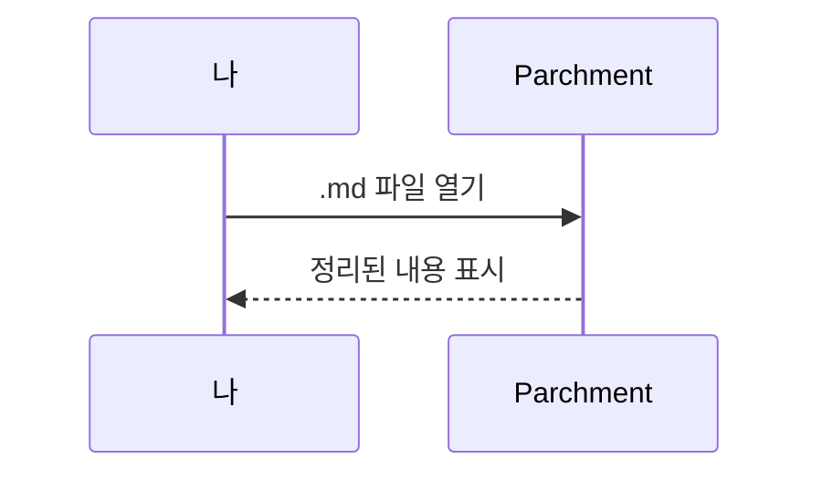

# Parchment에 오신 것을 환영합니다

Parchment는 브라우저에서 동작하는 **로컬 Markdown·일반 텍스트 리더**입니다. 이 문서 자체가 예제로, 각 섹션에서 Parchment가 표시할 수 있는 내용을 한 가지씩 보여 줍니다. 원본 파일과 비교해 보며 작성법에 따라 어떻게 보이는지 확인해 보세요.

> [!tip] 이 예제 사용법
> - 오른쪽 「목차」에서 원하는 섹션으로 이동할 수 있고, 하위 제목이 있는 항목은 접을 수 있습니다.
> - 오른쪽의 태그와 링크 탭을 열면 이 문서의 태그와 다른 예제 노트와의 백링크를 볼 수 있습니다.
> - 이미지와 다이어그램은 **클릭하면 확대**되며 PNG로 저장할 수도 있습니다.

위의 「속성」은 파일 맨 앞의 YAML 프런트매터에서 만들어집니다. `tags`는 클릭할 수 있는 태그가 되고, 다른 항목도 표로 정리됩니다.

## 글자 서식

문단에는 **굵게**, *기울임*, ***굵은 기울임***, ~~취소선~~, ==형광펜==, ++삽입 텍스트++, `인라인 코드`를 쓸 수 있습니다.

화학식 H~2~O는 아래 첨자, x^2^는 위 첨자입니다. 이모지는 그대로 입력 🎉 하거나 단축 코드 :sparkles: :books: :rocket: 로 쓸 수 있습니다.

키보드 키는 <kbd>Ctrl</kbd> + <kbd>F</kbd>처럼 표시합니다. HTML의 <mark>형광펜</mark>, <u>밑줄</u>, H<sub>2</sub>O도 표시됩니다.

여기에 각주[^read-only]가 있습니다. 클릭하면 내용이 보입니다. HTML은 약어이므로 마우스를 올리면 전체 이름이 보입니다.

*[HTML]: HyperText Markup Language

[^read-only]: Parchment는 파일을 읽기 전용으로 열며, 문서를 수정하지 않습니다.

## 제목과 목차

`#`부터 `######`까지의 제목은 오른쪽 목차에 자동으로 정리되며, 단계가 깊을수록 들여쓰기됩니다.

### 3단계 제목

아래 단계의 제목은 바로 위 제목 아래에 묶입니다.

#### 4단계 제목

목차에서 제목 옆의 화살표를 누르면 그 단계를 접거나 펼칠 수 있습니다.

## 목록과 할 일

- 순서 없는 목록
  - 중첩할 수 있습니다
    - 한 단계 더
- 두 번째 항목

1. 순서 있는 목록
2. 두 번째 단계
   1. 하위 단계
3. 세 번째 단계

- [x] 이 예제 열기
- [ ] 이 항목을 체크해 보기(상태는 브라우저에만 저장되며 파일은 바뀌지 않습니다)
- [ ] 내 노트 폴더 열기

## 인용

> 배우고 때때로 익히면 또한 기쁘지 아니한가?
> — 『논어』

> 인용은 여러 단계로 겹칠 수 있습니다
>> 두 번째 단계
>>> 세 번째 단계

## 표

열은 왼쪽, 가운데, 오른쪽으로 정렬할 수 있습니다:

| 기능 | 파일 하나 | 폴더 |
| :--- | :---: | :---: |
| Markdown 표시 | ✅ | ✅ |
| 상대 경로 이미지와 링크 | — | ✅ |
| 위키 링크와 포함 | — | ✅ |
| 전체 텍스트 검색 | — | ✅ |

열이 많은 표는 열 너비가 자동으로 조정되고, 다 들어가지 않을 때만 좌우로 스크롤됩니다:

| 번호 | 이름 | 분류 | 가격 | 재고 | 원산지 | 출시일 | 비고 |
| --- | --- | --- | ---: | ---: | --- | --- | --- |
| 001 | 양피지 노트 | 문구 | 16,000 | 25 | 대만 | 2026-01-15 | 수제 제본 |
| 002 | 만년필 잉크 | 문구 | 22,000 | 8 | 일본 | 2026-03-02 | 블루블랙, 방수 |

## 코드

코드 블록은 언어에 맞게 색이 입혀집니다. 오른쪽 위에 마우스를 올리면 한 번에 복사할 수 있습니다.

```js
// 사용자가 고른 파일을 읽기 전용으로 읽기
const [handle] = await window.showOpenFilePicker();
const file = await handle.getFile();
console.log(await file.text());
```

```python
def greet(name: str) -> str:
    return f"안녕하세요, {name}!"
```

## 수식

인라인 수식: 질량–에너지 등가 $E = mc^2$, 원의 넓이 $A = \pi r^2$.

블록 수식:

$$
\int_{0}^{1} x^2 \, dx = \frac{1}{3}
$$

$$
x = \frac{-b \pm \sqrt{b^2 - 4ac}}{2a}
$$

## 다이어그램

다이어그램은 본문 너비에 맞게 줄어듭니다. **다이어그램을 클릭**하면 확대, 이동하거나 PNG로 저장할 수 있습니다.

Mermaid 순서도:


Mermaid 시퀀스 다이어그램:



Graphviz(`dot`) 다이어그램:


## 콜아웃

> [!note]
> 일반적인 보충 설명입니다.

> [!success] 완료
> 끝난 일을 표시합니다.

> [!warning] 직접 정한 제목
> 제목을 마음대로 정할 수 있고, 본문에도 **Markdown**을 쓸 수 있습니다.

> [!danger] 위험
> 되돌릴 수 없는 작업을 알립니다.

> [!example] 예시
> 이 밖에도 info, tip, question, failure, bug, quote, abstract 등의 종류가 있으며, 각각 아이콘과 색이 다릅니다.

> [!question]- 접을 수 있나요?
> 네. 종류 뒤에 `-`를 붙이면 처음에 접혀 있고, `+`를 붙이면 펼쳐져 있습니다.

> [!NOTE]
> GitHub 형식의 알림도 표시됩니다.

## 접기

<details>
<summary>눌러서 더 보기</summary>

HTML의 `<details>`와 `<summary>`를 쓰면 긴 내용을 접어 둘 수 있습니다.

</details>

## 노트 링크

대괄호 두 개로 다른 노트에 연결할 수 있습니다: [[linked-note]]. 표시할 이름과 제목도 지정할 수 있습니다: [[linked-note#포함할 수 있는 섹션|연결된 노트의 섹션으로 이동]].

웹 주소는 새 탭에서 열립니다: [Parchment GitHub](https://github.com/bruce-yang-422/parchment). 문서 안에서도 이동할 수 있습니다: [「표」로 돌아가기](#표).

섹션 전체를 포함하기:

![[linked-note#포함할 수 있는 섹션]]

블록 하나만 포함하기:

![[linked-note#^summary]]

다른 노트가 여기로 연결하면 오른쪽 「백링크」 탭에 출처가 표시됩니다.

## 이미지

상대 경로로 지정한 일반 Markdown 이미지입니다. **이미지를 클릭**하면 라이트박스에서 확대됩니다:


파일 이름과 너비만 적을 수도 있습니다. Parchment가 폴더 전체에서 찾아 줍니다:

![[parchment-logo-transparent.png|96]]

## 정의 목록

읽기 전용
: 파일 내용을 읽기만 하고 아무것도 바꾸지 않습니다.

로컬 우선
: 문서는 브라우저 안에서 처리되며 업로드되지 않습니다.

## 더 많은 문법 보기

[Markdown 읽기 테스트 문서](https://github.com/bruce-yang-422/parchment/blob/main/samples/ko/parchment_markdown_reader_test.md)에는 더 많은 작성법이 담겨 있습니다. 여러 언어의 글, 13가지 콜아웃, 웹 이미지, 다양한 프로그래밍 언어와 다이어그램까지. 내려받아 Parchment로 열면 한 번에 볼 수 있습니다.

## 다음 단계

1. 오른쪽 위의 **폴더 열기**를 눌러 내 노트 폴더를 선택합니다.
2. 왼쪽 사이드바의 검색창에 키워드를 입력해 모든 노트를 검색합니다.
3. 오른쪽 위의 설정 버튼에서 다른 색상과 글꼴을 사용해 봅니다.

휴대폰에서는 파일 트리와 문서 정보가 옆 서랍으로 열립니다. 네 화면보다 긴 문서는 두 화면을 스크롤하면 오른쪽 아래에 맨 위로 버튼이 나타나며, 짧은 문서에는 표시되지 않습니다. 데스크톱에서는 본문 영역 오른쪽 아래로 마우스를 옮기면 버튼이 나타납니다.

---

이 예제는 웹사이트에 함께 포함되어 있어 오프라인에서도 열 수 있습니다.
