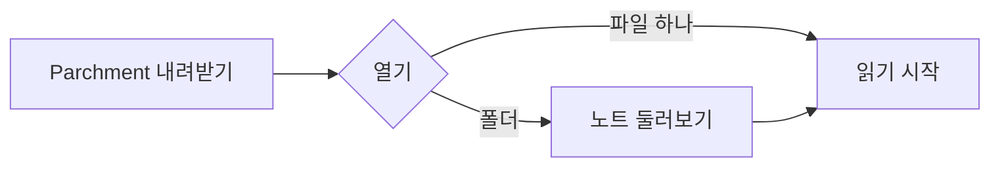
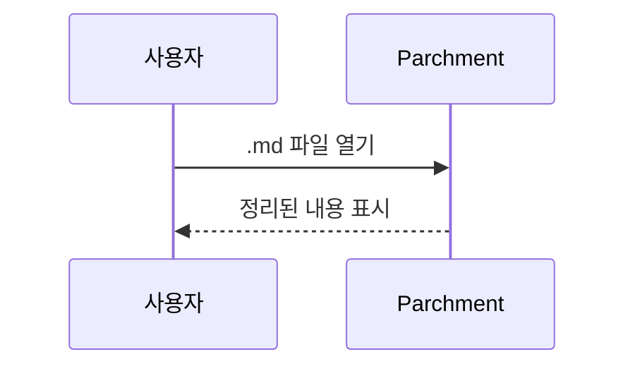
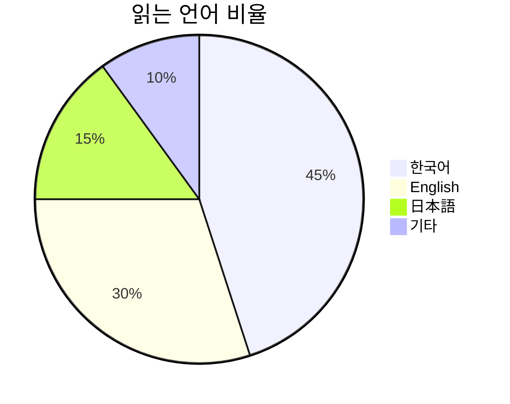

# Parchment 읽기 테스트 문서 · Reading Test

**Parchment**에 오신 것을 환영합니다! 이 문서에는 다양한 Markdown 문법과 여러 언어의 글이 담겨 있습니다. 내려받아 Parchment로 열면 앱이 어떻게 보여 주는지 한 번에 확인할 수 있습니다.

> [!tip] 이 문서 사용법
> 1. Parchment로 이 파일을 엽니다.
> 2. 오른쪽 위의 목차를 눌러 원하는 부분으로 이동합니다.
> 3. 「읽기 설정」에서 색상, 글꼴, 글자 크기를 바꿔 보며 비교해 보세요.

---

## 1. 제목 Headings

# 1단계 제목 H1
## 2단계 제목 H2
### 3단계 제목 H3
#### 4단계 제목 H4
##### 5단계 제목 H5
###### 6단계 제목 H6

다른 작성법(밑줄식)
===================

두 번째 단계(밑줄식)
--------------------

---

## 2. 글자 스타일 Text Styles

| 효과 | 작성법 | 결과 |
| --- | --- | --- |
| 굵게 | `**굵게**` | **굵게 Bold** |
| 기울임 | `*기울임*` | *기울임 Italic* |
| 굵은 기울임 | `***굵은 기울임***` | ***굵은 기울임 Bold Italic*** |
| 취소선 | `~~취소선~~` | ~~취소선 Strikethrough~~ |
| 형광펜 | `==형광펜==` | ==형광펜 Highlight== |
| 밑줄 | `++밑줄++` | ++밑줄 Underline++ |
| 위 첨자 | `x^2^` | x^2^ |
| 아래 첨자 | `H~2~O` | H~2~O |
| 인라인 코드 | `` `code` `` | `print("hi")` |

밑줄 문자로도 쓸 수 있습니다: _기울임_, __굵게__.

이스케이프 문자: \*기울임이 아님\*, \# 제목이 아님, \[링크가 아님\].

이 줄 끝에는 공백이 두 개 있습니다  
그래서 여기서 줄이 바뀝니다(강제 줄바꿈).

---

## 3. 다국어 Multilingual

아래 여러 언어의 글은 글꼴이 제대로 표시되는지(네모 「□」나 깨진 글자가 없는지) 확인하기 위한 것입니다. 내용을 이해하지 않아도 됩니다.

### 繁體中文
落霞與孤鶩齊飛，秋水共長天一色。Parchment 是一款讓你安靜閱讀 Markdown 筆記的 App。

### 简体中文
落霞与孤鹜齐飞，秋水共长天一色。Parchment 是一款让你安静阅读 Markdown 笔记的 App。

### English
The quick brown fox jumps over the lazy dog. *Parchment* lets you read your Markdown notes in peace.

### 日本語
いろはにほへと ちりぬるを わかよたれそ つねならむ。**Parchment** は Markdown のノートを静かに読むためのアプリです。

### 한국어
다람쥐 헌 쳇바퀴에 타고파. **Parchment**는 Markdown 노트를 조용히 읽을 수 있는 앱입니다.

### Français
Portez ce vieux whisky au juge blond qui fume. Ça, c'est l'été à Noël — « déjà vu » !

### Deutsch
Victor jagt zwölf Boxkämpfer quer über den großen Sylter Deich. Straße, Größe, Übung.

### Español
El veloz murciélago hindú comía feliz cardillo y kiwi. ¿Dónde está la señal? ¡Olé!

### Italiano · Português
Quel vituperabile xenofobo zelante assaggia il whisky ed esclama: alleluja!
Luís argüia à Júlia que «brações, fé, chá, óxido, pôr, zângão» eram palavras do português.

### Русский
Съешь же ещё этих мягких французских булок, да выпей чаю.

### Ελληνικά
Ξεσκεπάζω την ψυχοφθόρα βδελυγμία.

### Tiếng Việt
Tiếng Việt có dấu: ă â đ ê ô ơ ư — Trăm năm trong cõi người ta.

### ภาษาไทย
เป็นมนุษย์สุดประเสริฐเลิศคุณค่า

### हिन्दी
ऋषियों को सताने वाले दुष्ट राक्षसों के राजा रावण का सर्वनाश करने वाले विष्णु।

### 오른쪽에서 왼쪽 Right-to-left
- العربية: مرحبًا بك في Parchment.
- עברית: ברוכים הבאים ל־Parchment.

### 혼합 Mixed
한국어 English 中文 日本語를 한 줄에 섞고, 숫자 1234567890과 전각 「문장부호」, 반각 (punctuation)을 나란히 놓았습니다.

---

## 4. 이모지 Emoji

직접 입력: 😀 🎉 📚 ✍️ 🌏 🇰🇷 🇯🇵 🇹🇼 👍🏽 👨‍👩‍👧‍👦

단축 코드: :smile: :heart: :rocket: :books: :+1:

---

## 5. 목록 Lists

### 순서 없는 목록
- 사과 Apple
- 바나나 Banana
  - 중첩 2단계
    - 중첩 3단계
* 별표도 됩니다
+ 더하기 기호도 됩니다

### 순서 있는 목록
1. 첫 번째 단계
2. 두 번째 단계
   1. 하위 단계 2.1
   2. 하위 단계 2.2
3. 세 번째 단계

5부터 시작하는 번호:

5. 다섯
6. 여섯

### 할 일 목록(체크하고 파일에 저장할 수 있습니다)
- [x] Parchment 내려받기
- [x] 이 테스트 문서 열기
- [ ] 색상 바꿔 보기
- [ ] 글꼴 바꿔 보기
- [ ] 여기를 눌러 체크해 보기

---

## 6. 링크 Links

- 일반 링크: [Parchment GitHub](https://github.com/bruce-yang-422/parchment)
- 자동 링크: <https://www.markdownguide.org>
- 설명이 있는 링크: [Markdown 가이드](https://www.markdownguide.org "마우스를 올리면 보이는 설명")
- 참조 링크: [CommonMark][cm]
- 문서 안 이동: [「표」 부분으로 돌아가기](#8-표-tables)
- 위키 링크: [[다른 노트]], [[다른 노트|표시 이름]]

[cm]: https://commonmark.org

---

## 7. 이미지 Images

### 웹 이미지
인터넷에 연결되어 있어야 표시됩니다:


### 위키백과 이미지
북송 범관의 「계산행려도」(타이베이 국립고궁박물원 소장, 퍼블릭 도메인, 출처: [Wikimedia Commons](https://commons.wikimedia.org/wiki/File:Fan_Kuan_-_Travelers_Among_Mountains_and_Streams_-_Google_Art_Project.jpg)). 세로로 긴 이미지로, 누르면 크게 볼 수 있습니다:


### HTML로 너비 지정


### 찾을 수 없는 이미지
아래 이미지는 일부러 없는 파일로, 오류 메시지를 확인하기 위한 것입니다:


---

## 8. 표 Tables

| 언어 Language | 인사 Greeting | 쓰기 방향 |
| :--- | :---: | ---: |
| 한국어 | 안녕하세요 | 왼→오 |
| English | Hello | LTR |
| 繁體中文 | 你好 | 왼→오 |
| 日本語 | こんにちは | 왼→오 |
| Français | Bonjour | LTR |
| Deutsch | Guten Tag | LTR |
| Español | Hola | LTR |
| العربية | مرحبا | RTL |

### 넓은 표(좌우로 스크롤)

| 번호 | 이름 | 분류 | 가격 | 재고 | 원산지 | 출시일 | 비고 |
| --- | --- | --- | ---: | ---: | --- | --- | --- |
| 001 | 양피지 노트 | 문구 | 16,000 | 25 | 대만 | 2026-01-15 | 수제 제본, 오래 보관하기 좋음 |
| 002 | 만년필 잉크 Ink | 문구 | 22,000 | 8 | 일본 | 2026-03-02 | 블루블랙, 방수 |
| 003 | Notebook A5 | Stationery | 12.5 | 140 | Germany | 2026-05-20 | Dot grid, 120 g/m² |

---

## 9. 인용 Blockquotes

> 배우고 때때로 익히면 또한 기쁘지 아니한가?
> — 『논어』

> 첫 번째 인용
>> 두 번째 인용
>>> 세 번째 인용

> 인용 안에도 **굵은 글씨**, `코드`, 목록을 넣을 수 있습니다:
> - 항목 하나
> - 항목 둘

---

## 10. 콜아웃 Callouts

> [!note] 메모 Note
> 일반 메모입니다.

> [!info] 정보 Info
> 추가 정보입니다.

> [!tip] 팁 Tip
> 글자를 길게 누르면 복사할 수 있습니다.

> [!success] 성공 Success
> 완료되었습니다!

> [!question] 질문 Question
> 어떤 색상이 가장 마음에 드시나요?

> [!warning] 주의 Warning
> 수정하기 전에 백업하세요.

> [!danger] 위험 Danger
> 이 작업은 되돌릴 수 없습니다.

> [!failure] 실패 Failure
> 파일을 찾을 수 없습니다.

> [!bug] 버그 Bug
> 문제를 알려 주실 때 스크린샷을 함께 보내 주세요.

> [!example] 예시 Example
> 예시입니다.

> [!quote] 인용 Quote
> 천 리 길도 한 걸음부터.

> [!abstract] 요약 Abstract
> 이 문서는 Parchment의 표시를 확인하기 위한 것입니다.

> [!tip]- 펼칠 수 있는 콜아웃(처음에는 접혀 있으며, 누르면 펼쳐집니다)
> 숨겨진 내용을 찾았습니다! 🎉

---

## 11. 코드 Code

인라인 코드: `const name = 'Parchment';`

### Dart
```dart
void main() {
  final greeting = '안녕하세요, Parchment!';
  print(greeting);
}
```

### Python
```python
def greet(name: str) -> str:
    """다국어 인사 / Multilingual greeting"""
    return f"안녕하세요, {name}!"

print(greet("Parchment"))
```

### JavaScript
```javascript
const langs = ['ko', 'en', 'zh-TW', 'zh-CN', 'ja', 'fr', 'de', 'es'];
langs.forEach((lang, i) => console.log(`${i + 1}. ${lang}`));
```

### JSON
```json
{
  "app": "Parchment",
  "languages": ["한국어", "English", "繁中", "简中", "日本語"],
  "offline": true
}
```

### Shell
```bash
# 가로 스크롤을 확인하기 위한 아주 긴 명령어 This is a very long command line to test horizontal scrolling inside a code block
echo "Hello, Parchment" && ls -la ~/Documents/notes/markdown/very/deep/folder/structure/
```

### SQL
```sql
SELECT title, author FROM notes WHERE lang = '한국어' ORDER BY updated_at DESC;
```

### 언어를 지정하지 않음
```
일반 텍스트 코드 블록
  들여쓰기가 유지됩니다
```

### 들여쓰기 코드(공백 네 칸)

    이것도 코드 블록입니다
    Indented code block

---

## 12. 수식 Math

인라인 수식: 질량–에너지 등가 $E = mc^2$, 원의 넓이 $A = \pi r^2$.

블록 수식:

$$
x = \frac{-b \pm \sqrt{b^2 - 4ac}}{2a}
$$

$$
\int_0^\infty e^{-x^2}\,dx = \frac{\sqrt{\pi}}{2}
$$

$$
\sum_{n=1}^{\infty} \frac{1}{n^2} = \frac{\pi^2}{6}
$$

---

## 13. 다이어그램 Diagrams

### Mermaid 순서도


### Mermaid 시퀀스 다이어그램


### Mermaid 원형 차트


### Graphviz


---

## 14. 각주 Footnotes

Parchment는 각주[^1]를 지원하며, 글자로 이름을 붙인 각주[^설명]나 긴 각주[^long]도 쓸 수 있습니다.

[^1]: 첫 번째 각주입니다. 끝에 있는 돌아가기 화살표를 누르면 본문으로 돌아갑니다.
[^설명]: 한글 이름을 붙인 각주도 제대로 열립니다.
[^long]: 각주에도 **굵은 글씨**, `코드`, [링크](https://commonmark.org)를 넣을 수 있습니다.

---

## 15. HTML 태그

- 키보드 키: <kbd>Ctrl</kbd> + <kbd>C</kbd>로 복사
- <mark>HTML 형광펜</mark>, <u>밑줄</u>, <s>취소선</s>
- 화학식 H<sub>2</sub>O, 제곱 x<sup>2</sup>
- 줄<br>바꿈에 br 태그 사용

<details>
<summary>눌러서 더 보기 Click to expand</summary>

이 내용은 평소에는 접혀 있습니다.

- 숨겨진 항목 하나
- 숨겨진 항목 둘

</details>

---

## 16. 정의 목록 Definition List

Markdown
: 일반 텍스트로 서식 있는 문서를 쓰는 가벼운 마크업 언어.

Parchment
: Markdown을 차분하게 읽기 위한 앱.
: 두 번째 설명도 붙일 수 있습니다.

---

## 17. 약어 Abbreviations

HTML과 CSS는 웹의 기초이고, PDF는 인쇄에 자주 쓰입니다.

*[HTML]: HyperText Markup Language
*[CSS]: Cascading Style Sheets
*[PDF]: Portable Document Format

---

## 18. 구분선 Horizontal Rules

세 가지 작성법 모두 같은 모양입니다:

***

---

___

---

## 19. 긴 문단 Long Paragraph

레이아웃과 스크롤이 매끄러운지 확인합니다: Lorem ipsum dolor sit amet, consectetur adipiscing elit, sed do eiusmod tempor incididunt ut labore et dolore magna aliqua. 春眠不覺曉，處處聞啼鳥。夜來風雨聲，花落知多少。Ut enim ad minim veniam, quis nostrud exercitation ullamco laboris nisi ut aliquip ex ea commodo consequat. 古池や蛙飛び込む水の音。Duis aute irure dolor in reprehenderit in voluptate velit esse cillum dolore eu fugiat nulla pariatur. 산에는 꽃 피네 꽃이 피네 갈 봄 여름 없이 꽃이 피네. Excepteur sint occaecat cupidatat non proident, sunt in culpa qui officia deserunt mollit anim id est laborum.

공백 없이 아주 긴 주소나 영어 단어로 줄바꿈을 확인합니다: https://example.com/a/very/long/path/that/keeps/going/and/going/without/any/spaces/to/break/the/line/naturally/index.html

---

## 테스트 완료 🎉

여기까지 보인다면 문서를 끝까지 불러온 것입니다. 오른쪽 아래의 「맨 위로」 버튼을 누르면 처음으로 돌아갑니다.

표시에 문제가 있으면 [GitHub Issues](https://github.com/bruce-yang-422/parchment/issues)에 알려 주세요. 도와주셔서 감사합니다.
