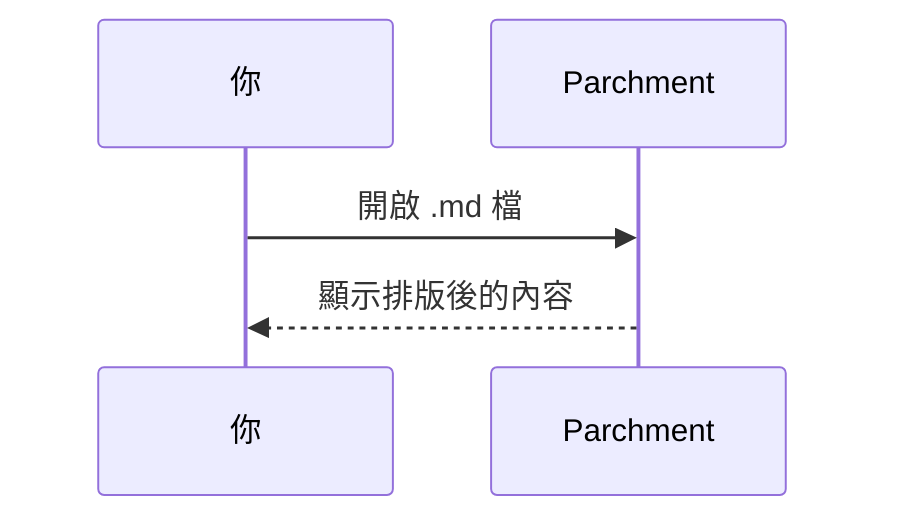

# 歡迎使用 Parchment

Parchment 是在瀏覽器中運作的**本機 Markdown 與純文字閱讀器**。這份文件本身就是範例：每一節示範一類 Parchment 能顯示的內容，你可以對照原始檔，看看各種寫法會呈現成什麼樣子。

> [!tip] 這份範例怎麼用
> - 右側的「文章目錄」可以跳到任一節，有子標題的項目還能收合。
> - 打開右側的標籤與連結頁籤，可以看到這份文件的標籤，以及它和另一份範例筆記之間的雙向連結。
> - 圖片與圖表都可以**點一下放大**，也能存成 PNG。

上方的「屬性」區塊來自文件開頭的 YAML Frontmatter：`tags` 會變成可點擊的標籤，其他欄位也會整理成表格。

## 文字格式

一般段落可以使用 **粗體**、*斜體*、***粗斜體***、~~刪除線~~、==螢光標記==、++插入文字++ 與 `行內程式碼`。

化學式 H~2~O 使用下標，平方 x^2^ 使用上標。表情符號可以直接輸入 🎉，也可以寫成短代碼 :sparkles: :books: :rocket:。

鍵盤按鍵用 <kbd>Ctrl</kbd> + <kbd>F</kbd> 表示；HTML 的 <mark>標記</mark>、<u>底線</u> 與 H<sub>2</sub>O 也能顯示。

這裡有一個註腳[^read-only]，點一下就能看到內容。HTML 是一種縮寫，把滑鼠移到它上面可以看到全名。

*[HTML]: HyperText Markup Language

[^read-only]: Parchment 以唯讀方式開啟檔案，不會修改你的任何文件。

## 標題與文章目錄

文件中的 `#` 到 `######` 標題會自動整理成右側的文章目錄，層級越深縮排越多。

### 第三層標題

第三層以下的標題會收在上一層底下。

#### 第四層標題

點目錄中標題左邊的箭頭，可以收合或展開這一層。

## 清單與工作清單

- 無序清單
  - 可以巢狀
    - 再往下一層
- 第二項

1. 有序清單
2. 第二步
   1. 子步驟
3. 第三步

- [x] 打開這份範例
- [ ] 試著勾選這個項目（勾選狀態只存在瀏覽器中，不會改到檔案）
- [ ] 打開自己的筆記資料夾

## 引用

> 學而時習之，不亦說乎？
> — 《論語》

> 引用可以有好幾層
>> 第二層
>>> 第三層

## 表格

欄位可以靠左、置中或靠右對齊：

| 功能 | 單檔模式 | 資料夾模式 |
| :--- | :---: | :---: |
| Markdown 排版 | ✅ | ✅ |
| 相對圖片與連結 | — | ✅ |
| Wiki Links 與內嵌 | — | ✅ |
| 全文搜尋 | — | ✅ |

欄位很多時，表格會自動調整欄寬；放不下才會出現左右捲動：

| 編號 | 名稱 | 分類 | 價格 | 庫存 | 產地 | 上架日期 | 備註 |
| --- | --- | --- | ---: | ---: | --- | --- | --- |
| 001 | 羊皮紙筆記本 | 文具 | 380 | 25 | 台灣 | 2026-01-15 | 手工裝訂 |
| 002 | 鋼筆墨水 | 文具 | 520 | 8 | 日本 | 2026-03-02 | 藍黑色，防水 |

## 程式碼

程式碼區塊會依語言自動上色，滑過區塊右上角可以一鍵複製。

```js
// 以唯讀方式讀取使用者選擇的檔案
const [handle] = await window.showOpenFilePicker();
const file = await handle.getFile();
console.log(await file.text());
```

```python
def greet(name: str) -> str:
    return f"你好，{name}！"
```

## 數學公式

行內公式：質能等價 $E = mc^2$，圓面積 $A = \pi r^2$。

區塊公式：

$$
\int_{0}^{1} x^2 \, dx = \frac{1}{3}
$$

$$
x = \frac{-b \pm \sqrt{b^2 - 4ac}}{2a}
$$

## 圖表

圖表會自動縮放到閱讀欄寬，**點擊圖表**可以放大、拖曳，或存成 PNG。

Mermaid 流程圖：


Mermaid 時序圖：



Graphviz（`dot`）圖表：


## 提示區塊（Callouts）

> [!note]
> 一般的補充說明。

> [!success] 完成
> 用來標示已完成的事項。

> [!warning] 自訂標題
> 標題可以自訂，內文也可以使用 **Markdown**。

> [!danger] 危險
> 用來提醒無法復原的動作。

> [!example] 範例
> 還有 info、tip、question、failure、bug、quote、abstract 等類型，各有不同的圖示與顏色。

> [!question]- 可以收合嗎？
> 可以。在類型後面加上 `-` 會預設收合，加上 `+` 則預設展開。

> [!NOTE]
> GitHub 風格的提示區塊也能顯示。

## 摺疊內容

<details>
<summary>點我展開更多內容</summary>

用 HTML 的 `<details>` 與 `<summary>` 可以把較長的內容先收起來。

</details>

## 筆記連結

用兩個中括號就能連到另一份筆記：[[linked-note]]。也可以指定顯示文字與標題：[[linked-note#可以被內嵌的段落|跳到另一份筆記的段落]]。

一般網址會在新分頁開啟：[Parchment GitHub](https://github.com/bruce-yang-422/parchment)。文件內也能跳轉：[回到「表格」](#表格)。

把整個段落直接內嵌進來：

![[linked-note#可以被內嵌的段落]]

或只內嵌某一個區塊：

![[linked-note#^summary]]

另一份筆記連回這裡時，右側的「雙向連結」頁籤會列出來源。

## 圖片

一般的 Markdown 相對路徑圖片，**點擊圖片**可以在燈箱中放大：


也可以只寫檔名並指定寬度，Parchment 會在整個資料夾中尋找：

![[parchment-logo-transparent.png|96]]

## 定義清單

唯讀
: 只讀取檔案內容，不做任何修改。

本機優先
: 文件在瀏覽器中處理，不會上傳。

## 想看更多語法

[Markdown 閱讀測試文件](https://github.com/bruce-yang-422/parchment/blob/main/samples/zh-TW/parchment_markdown_reader_test.md)收錄了更完整的寫法：多國語言文字、13 種提示區塊、網路圖片、各種程式語言與圖表。下載後用 Parchment 開啟，就能一次看完。

## 下一步

1. 按右上角的 **開啟資料夾**，選擇你自己的筆記資料夾。
2. 在左側欄的搜尋框輸入關鍵字，搜尋所有筆記。
3. 按右上角的設定按鈕，試試不同的配色與字型。

在手機上，檔案樹與文件資訊會從側邊抽屜開啟。文章超過四個畫面時，捲動兩個畫面後右下角才會顯示回到頂端按鈕；短文章不會顯示。桌面版則可將滑鼠移到閱讀欄右下角叫出按鈕。

---

這份範例會隨網站一起提供，離線時也能開啟。
