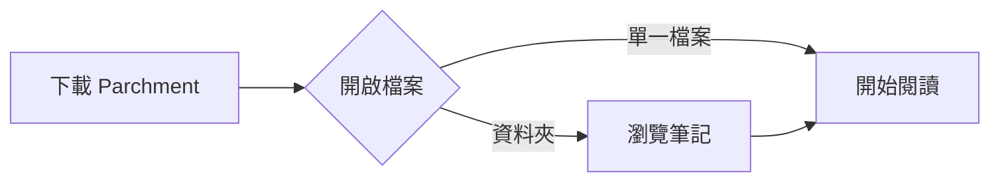
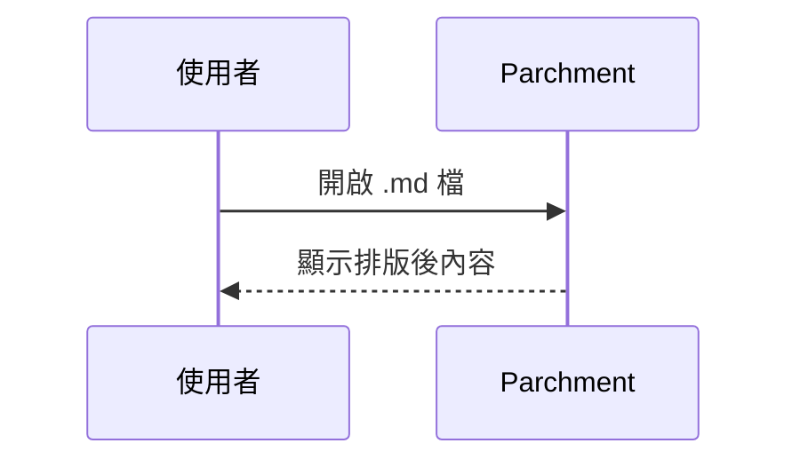
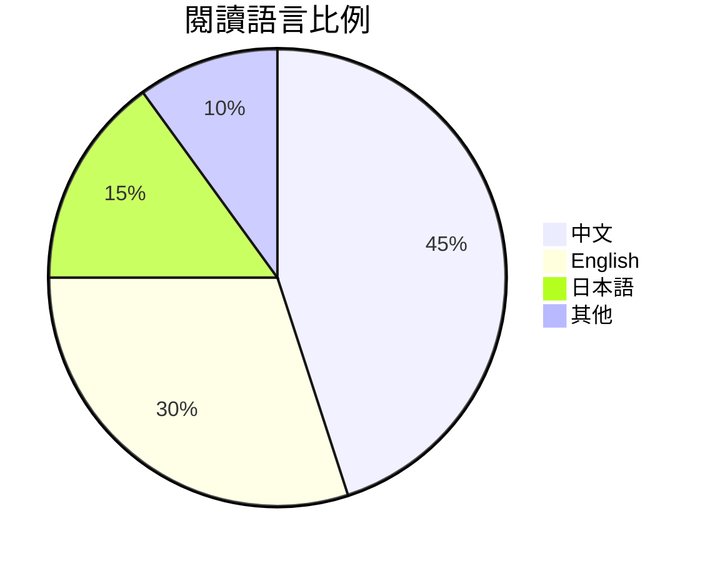

# Parchment 閱讀測試文件 · Reading Test

歡迎使用 **Parchment**！這份文件收錄了各種 Markdown 寫法與多國語言文字，下載後用 Parchment 開啟，就能一次看看 App 的閱讀效果。

> [!tip] 怎麼使用這份文件
> 1. 用 Parchment 開啟本檔。
> 2. 點右上角的目錄，跳到想看的段落。
> 3. 到「閱讀設定」換換配色、字型與字級，比較不同效果。

---

## 1. 標題 Headings

# 一級標題 H1
## 二級標題 H2
### 三級標題 H3
#### 四級標題 H4
##### 五級標題 H5
###### 六級標題 H6

另一種寫法（底線式）
===================

第二層（底線式）
----------------

---

## 2. 文字樣式 Text Styles

| 效果 | 寫法 | 顯示 |
| --- | --- | --- |
| 粗體 | `**粗體**` | **粗體 Bold** |
| 斜體 | `*斜體*` | *斜體 Italic* |
| 粗斜體 | `***粗斜體***` | ***粗斜體 Bold Italic*** |
| 刪除線 | `~~刪除線~~` | ~~刪除線 Strikethrough~~ |
| 螢光標記 | `==標記==` | ==螢光標記 Highlight== |
| 底線 | `++底線++` | ++底線 Underline++ |
| 上標 | `x^2^` | x^2^ |
| 下標 | `H~2~O` | H~2~O |
| 行內程式碼 | `` `code` `` | `print("hi")` |

底線寫法也可以：_斜體_、__粗體__。

跳脫字元：\*這不是斜體\*、\# 這不是標題、\[這不是連結\]。

這一行結尾有兩個空白  
所以這裡會換行（硬換行）。

---

## 3. 多國語言 Multilingual

以下各國文字只是用來檢查字型是否顯示正常（有沒有出現方框「□」或亂碼），不需要看懂內容。

### 繁體中文
落霞與孤鶩齊飛，秋水共長天一色。Parchment 是一款讓你安靜閱讀 Markdown 筆記的 App。

### 简体中文
落霞与孤鹜齐飞，秋水共长天一色。Parchment 是一款让你安静阅读 Markdown 笔记的 App。

### English
The quick brown fox jumps over the lazy dog. *Parchment* lets you read your Markdown notes in peace.

### 日本語
いろはにほへと ちりぬるを わかよたれそ つねならむ。**Parchment** は Markdown のノートを静かに読むためのアプリです。

### 한국어
다람쥐 헌 쳇바퀴에 타고파. **Parchment**는 Markdown 노트를 조용히 읽을 수 있는 앱입니다.

### Français
Portez ce vieux whisky au juge blond qui fume. Ça, c'est l'été à Noël — « déjà vu » !

### Deutsch
Victor jagt zwölf Boxkämpfer quer über den großen Sylter Deich. Straße, Größe, Übung.

### Español
El veloz murciélago hindú comía feliz cardillo y kiwi. ¿Dónde está la señal? ¡Olé!

### Italiano · Português
Quel vituperabile xenofobo zelante assaggia il whisky ed esclama: alleluja!
Luís argüia à Júlia que «brações, fé, chá, óxido, pôr, zângão» eram palavras do português.

### Русский
Съешь же ещё этих мягких французских булок, да выпей чаю.

### Ελληνικά
Ξεσκεπάζω την ψυχοφθόρα βδελυγμία.

### Tiếng Việt
Tiếng Việt có dấu: ă â đ ê ô ơ ư — Trăm năm trong cõi người ta.

### ภาษาไทย
เป็นมนุษย์สุดประเสริฐเลิศคุณค่า

### हिन्दी
ऋषियों को सताने वाले दुष्ट राक्षसों के राजा रावण का सर्वनाश करने वाले विष्णु।

### 由右至左 Right-to-left
- العربية：مرحبًا بك في Parchment.
- עברית：ברוכים הבאים ל־Parchment.

### 混排 Mixed
中文 English 日本語 한국어 混在同一行，數字 1234567890 與全形「標點」、半形 (punctuation) 並列。

---

## 4. 表情符號 Emoji

直接輸入：😀 🎉 📚 ✍️ 🌏 🇹🇼 🇯🇵 🇰🇷 👍🏽 👨‍👩‍👧‍👦

短代碼：:smile: :heart: :rocket: :books: :+1:

---

## 5. 清單 Lists

### 無序清單
- 蘋果 Apple
- 香蕉 Banana
  - 巢狀第二層
    - 巢狀第三層
* 星號也可以
+ 加號也可以

### 有序清單
1. 第一步
2. 第二步
   1. 子步驟 2.1
   2. 子步驟 2.2
3. 第三步

從 5 開始編號：

5. 五
6. 六

### 待辦清單（可勾選並存回檔案）
- [x] 下載 Parchment
- [x] 開啟這份測試文件
- [ ] 試試切換配色
- [ ] 試試更換字型
- [ ] 點一下這裡打勾看看

---

## 6. 連結 Links

- 一般連結：[Parchment GitHub](https://github.com/bruce-yang-422/parchment)
- 自動連結：<https://www.markdownguide.org>
- 有提示文字的連結：[Markdown 指南](https://www.markdownguide.org "滑過顯示的說明")
- 參考式連結：[CommonMark][cm]
- 文件內跳轉：[回到「表格」段落](#8-表格-tables)
- Wiki 連結：[[另一篇筆記]]、[[另一篇筆記|顯示別名]]

[cm]: https://commonmark.org

---

## 7. 圖片 Images

### 網路圖片
需要連上網路才能顯示：


### 維基百科圖片
北宋 范寬〈谿山行旅圖〉（國立故宮博物院藏，公有領域，圖片來源：[Wikimedia Commons](https://commons.wikimedia.org/wiki/File:Fan_Kuan_-_Travelers_Among_Mountains_and_Streams_-_Google_Art_Project.jpg)）。直立長圖，可點一下放大檢視：


### 用 HTML 指定寬度


### 找不到的圖片
下面這張圖故意不存在，用來測試錯誤提示：


---

## 8. 表格 Tables

| 語言 Language | 問候 Greeting | 書寫方向 |
| :--- | :---: | ---: |
| 繁體中文 | 你好 | 左→右 |
| English | Hello | LTR |
| 日本語 | こんにちは | 左→右 |
| 한국어 | 안녕하세요 | 左→右 |
| Français | Bonjour | LTR |
| Deutsch | Guten Tag | LTR |
| Español | Hola | LTR |
| العربية | مرحبا | RTL |

### 寬表格（可左右滑動）

| 編號 | 名稱 | 分類 | 價格 | 庫存 | 產地 | 上架日期 | 備註說明 |
| --- | --- | --- | ---: | ---: | --- | --- | --- |
| 001 | 羊皮紙筆記本 | 文具 | 380 | 25 | 台灣 | 2026-01-15 | 手工裝訂，適合長期保存 |
| 002 | 鋼筆墨水 Ink | 文具 | 520 | 8 | 日本 | 2026-03-02 | 藍黑色，防水 |
| 003 | Notebook A5 | Stationery | 12.5 | 140 | Germany | 2026-05-20 | Dot grid, 120 g/m² |

---

## 9. 引用 Blockquotes

> 學而時習之，不亦說乎？
> — 《論語》

> 第一層引用
>> 第二層引用
>>> 第三層引用

> 引用裡也能放 **粗體**、`程式碼` 和清單：
> - 項目一
> - 項目二

---

## 10. 提示框 Callouts

> [!note] 備註 Note
> 這是一般備註。

> [!info] 資訊 Info
> 補充資訊。

> [!tip] 小技巧 Tip
> 長按文字可以複製。

> [!success] 成功 Success
> 已完成！

> [!question] 問題 Question
> 你最喜歡哪一種配色？

> [!warning] 注意 Warning
> 修改前請先備份。

> [!danger] 危險 Danger
> 這個動作無法復原。

> [!failure] 失敗 Failure
> 找不到檔案。

> [!bug] 錯誤 Bug
> 回報問題時請附上截圖。

> [!example] 範例 Example
> 這是一個範例。

> [!quote] 引言 Quote
> 書山有路勤為徑。

> [!abstract] 摘要 Abstract
> 本文件用來測試 Parchment 的顯示效果。

> [!tip]- 可展開的提示框（預設收合，點一下展開）
> 你找到隱藏內容了！🎉

---

## 11. 程式碼 Code

行內程式碼：`const name = 'Parchment';`

### Dart
```dart
void main() {
  final greeting = '你好，Parchment！';
  print(greeting);
}
```

### Python
```python
def greet(name: str) -> str:
    """多語問候 / Multilingual greeting"""
    return f"こんにちは、{name}！"

print(greet("Parchment"))
```

### JavaScript
```javascript
const langs = ['zh-TW', 'en', 'ja', 'ko', 'fr', 'de', 'es'];
langs.forEach((lang, i) => console.log(`${i + 1}. ${lang}`));
```

### JSON
```json
{
  "app": "Parchment",
  "languages": ["繁中", "简中", "English", "日本語", "한국어"],
  "offline": true
}
```

### Shell
```bash
# 這是一段很長的指令，用來測試水平捲動 This is a very long command line to test horizontal scrolling inside a code block
echo "Hello, Parchment" && ls -la ~/Documents/notes/markdown/very/deep/folder/structure/
```

### SQL
```sql
SELECT title, author FROM notes WHERE lang = '日本語' ORDER BY updated_at DESC;
```

### 沒有指定語言
```
純文字程式碼區塊
  縮排會保留
```

### 縮排式程式碼（四個空白）

    這也是程式碼區塊
    Indented code block

---

## 12. 數學公式 Math

行內公式：質能等價 $E = mc^2$，圓面積 $A = \pi r^2$。

區塊公式：

$$
x = \frac{-b \pm \sqrt{b^2 - 4ac}}{2a}
$$

$$
\int_0^\infty e^{-x^2}\,dx = \frac{\sqrt{\pi}}{2}
$$

$$
\sum_{n=1}^{\infty} \frac{1}{n^2} = \frac{\pi^2}{6}
$$

---

## 13. 圖表 Diagrams

### Mermaid 流程圖


### Mermaid 時序圖


### Mermaid 圓餅圖


### Graphviz


---

## 14. 註腳 Footnotes

Parchment 支援註腳[^1]，也可以用文字當註腳名稱[^說明]，或寫得比較長的註腳[^long]。

[^1]: 這是第一個註腳。點文末的返回箭頭可以回到原文。
[^說明]: 中文名稱的註腳也能正常點開。
[^long]: 註腳裡也能放 **粗體**、`程式碼` 與 [連結](https://commonmark.org)。

---

## 15. HTML 標籤

- 鍵盤按鍵：按 <kbd>Ctrl</kbd> + <kbd>C</kbd> 複製
- <mark>HTML 螢光標記</mark>、<u>底線</u>、<s>刪除線</s>
- 化學式 H<sub>2</sub>O、平方 x<sup>2</sup>
- 換行<br>用 br 標籤

<details>
<summary>點我展開更多內容 Click to expand</summary>

這段內容平常是收起來的。

- 隱藏項目一
- 隱藏項目二

</details>

---

## 16. 定義清單 Definition List

Markdown
: 一種輕量標記語言，用純文字寫出有格式的文件。

Parchment
: 專心閱讀 Markdown 的 App。
: 也可以有第二個說明。

---

## 17. 縮寫 Abbreviations

HTML 與 CSS 是網頁的基礎，PDF 常用於列印。

*[HTML]: HyperText Markup Language
*[CSS]: Cascading Style Sheets
*[PDF]: Portable Document Format

---

## 18. 分隔線 Horizontal Rules

三種寫法效果相同：

***

---

___

---

## 19. 長段落 Long Paragraph

測試排版與捲動流暢度：Lorem ipsum dolor sit amet, consectetur adipiscing elit, sed do eiusmod tempor incididunt ut labore et dolore magna aliqua. 春眠不覺曉，處處聞啼鳥。夜來風雨聲，花落知多少。Ut enim ad minim veniam, quis nostrud exercitation ullamco laboris nisi ut aliquip ex ea commodo consequat. 古池や蛙飛び込む水の音。Duis aute irure dolor in reprehenderit in voluptate velit esse cillum dolore eu fugiat nulla pariatur. 산에는 꽃 피네 꽃이 피네 갈 봄 여름 없이 꽃이 피네. Excepteur sint occaecat cupidatat non proident, sunt in culpa qui officia deserunt mollit anim id est laborum.

一個非常長、沒有空白的網址或英文字，用來測試自動換行：https://example.com/a/very/long/path/that/keeps/going/and/going/without/any/spaces/to/break/the/line/naturally/index.html

---

## 測試完成 🎉

看到這裡，代表文件已經完整讀完了！可以按右下角的「回到頂端」按鈕回到開頭。

如果發現顯示問題，歡迎到 [GitHub Issues](https://github.com/bruce-yang-422/parchment/issues) 回報，感謝你的協助。
