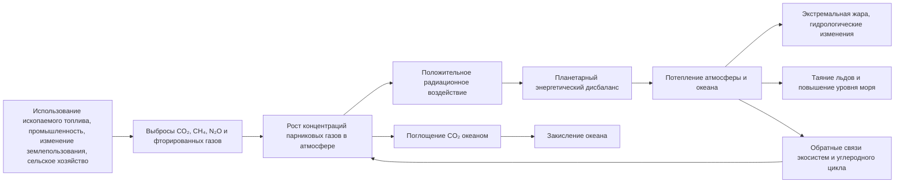
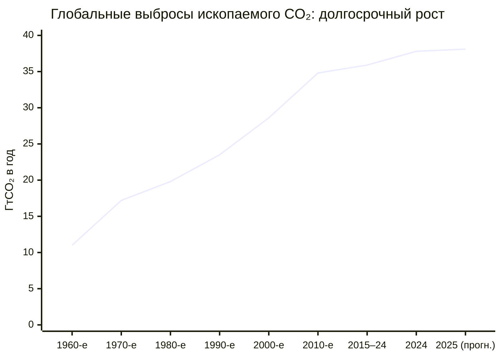
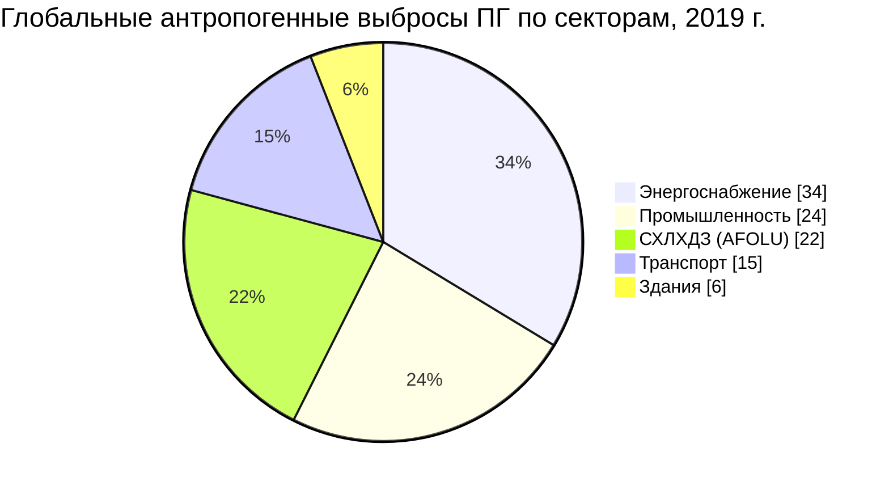
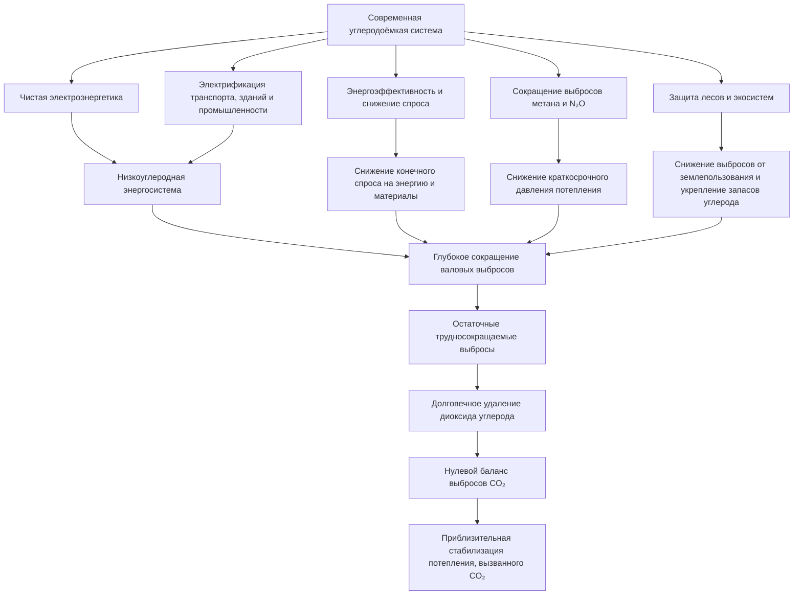

# Выбросы углерода и углеродный след: воздействие на глобальную климатическую систему

## Резюме для лиц, принимающих решения

> **Ключевой вывод.** Доказательства того, что антропогенные выбросы парниковых газов являются основной причиной современного глобального потепления, неоспоримы. Диоксид углерода (CO₂) вносит наибольший единичный вклад ввиду огромного накопленного объёма выбросов, длительного воздействия на углеродный цикл и почти линейной зависимости между кумулятивными выбросами CO₂ и глобальной средней температурой. Метан (CH₄), закись азота (N₂O) и фторированные газы создают существенное дополнительное радиационное воздействие.[^3] [^5]

В результате деятельности человека глобальная приземная температура в **2011–2020 гг. повысилась примерно на 1,1 °C по сравнению со средним уровнем 1850–1900 гг.** По оценкам МГЭИК, совокупное антропогенное потепление за период от 1850–1900 гг. до 2010–2019 гг. составило около **1,07 °C**, тогда как естественные солнечные и вулканические факторы внесли лишь незначительный вклад в наблюдаемые долгосрочные изменения. Одни только парниковые газы вызвали бы более сильное потепление, однако часть их эффекта была замаскирована антропогенными аэрозолями.[^5]

Масштаб лежащего в основе возмущения углеродного цикла беспрецедентен за всю эпоху инструментальных наблюдений. До индустриализации концентрация CO₂ в атмосфере составляла приблизительно **270–280 ppm**, а в **2025 г.**, по данным NOAA, достигла глобального среднегодового значения в морском пограничном слое атмосферы **425,62 ± 0,05 ppm**. Совокупное эффективное радиационное воздействие долгоживущих парниковых газов в **2025 г. достигло 3,59 Вт·м⁻² сверх доиндустриального уровня**, что на 56% выше аналогичного показателя 1990 г. На долю одного только CO₂ пришлось **2,37 Вт·м⁻²**, или около двух третей суммарного воздействия долгоживущих парниковых газов.[^7]

Тем не менее глобальные выбросы продолжают расти. По оценкам МГЭИК, в 2019 г. чистые антропогенные выбросы парниковых газов составили **59 ± 6,6 ГтCO₂-экв**, что на 54% выше уровня 1990 г. В докладе «Глобальный углеродный бюджет 2025» (Global Carbon Budget 2025) глобальные выбросы CO₂ от ископаемого топлива оцениваются в **37,8 ± 2 ГтCO₂ в 2024 г.** и прогнозируются на уровне примерно **38,1 ГтCO₂ в 2025 г.**, хотя методологические определения различаются между наборами данных. Международное энергетическое агентство (МЭА) независимо оценило выбросы CO₂, связанные с энергетикой, почти в **38,4 ГтCO₂ в 2025 г.** Эти показатели не следует считать взаимозаменяемыми, поскольку они охватывают разные секторальные границы.[^1] [^2] [^4] [^6]

Анализ углеродного следа расширяет оценку за пределы территориальных выбросов. *Инвентаризация (кадастр) на основе производства* относит выбросы к месту, где они физически происходят; *углеродный след на основе потребления* перераспределяет выбросы, воплощённые в товарах и услугах, по международным цепочкам поставок на конечных потребителей. Это различие имеет большое значение, поскольку международная торговля позволяет регионам с высоким уровнем потребления выносить часть своих территориальных выбросов за собственные границы. Тем не менее исследования на основе межрегиональных моделей «затраты–выпуск» (MRIO) характеризуются более высокой структурной неопределённостью и неопределённостью исходных данных по сравнению с национальными кадастрами сжигания топлива.[^4] [^10]

Распределение ответственности крайне неравномерно. В 2019 г. на 10% домохозяйств с наибольшими выбросами приходилось примерно **34–45% глобальных выбросов парниковых газов домохозяйств на основе потребления**, тогда как на 50% домохозяйств с наименьшими выбросами — лишь **13–15%**. Региональные различия столь же велики: в 2019 г. выбросы парниковых газов в Северной Америке составляли около **19 тCO₂-экв на человека**, по сравнению примерно с **2,5 тCO₂-экв на человека** в Южной Азии.[^4]

Уже наблюдаемые климатические последствия включают усиление экстремальной жары, более интенсивные осадки во многих регионах, изменение рисков засух, потепление океана, сокращение криосферы, ускорение повышения уровня моря и закисление океана. Глобальный средний уровень моря повысился примерно на **0,20 м с 1901 по 2018 г.**, при этом скорость его подъёма возросла до **3,7 [3,2–4,2] мм·год⁻¹ в 2006–2018 гг.** Показатель pH поверхностных вод океана снизился примерно на **0,1 единицы с начала индустриальной эпохи**, что соответствует увеличению концентрации ионов водорода примерно на 30%.[^5] [^9]

Наиболее жёстким физическим ограничением будущего потепления являются кумулятивные выбросы CO₂. По наилучшей оценке МГЭИК, переходный климатический отклик на кумулятивные выбросы (TCRE) составляет приблизительно **0,45 °C на 1 000 ГтCO₂** при вероятном диапазоне 0,27–0,63 °C. Следовательно, стабилизация антропогенного потепления требует приближения глобальных чистых антропогенных выбросов CO₂ к нулю; сохранение положительных выбросов ведёт к дальнейшему потеплению.[^3]

Технологии смягчения последствий изменения климата уже доступны в значительных масштабах. Оценки МГЭИК показывают, что меры стоимостью **100 долл. США за тCO₂-экв или менее способны сократить глобальные выбросы парниковых газов к 2030 г. как минимум вдвое по сравнению с уровнем 2019 г.**, причём более половины этого оценённого потенциала обходится дешевле 20 долл. США за тCO₂-экв. К основным низкозатратным направлениям относятся солнечная и ветровая энергетика, энергоэффективность, сокращение выбросов метана, а также предотвращение преобразования лесов и других природных экосистем. Однако практическая осуществимость зависит не только от инженерных издержек, но и от сетевой инфраструктуры, финансирования, институтов, земельных ограничений, изменения поведения, общественного принятия и распределительных последствий.[^4]

## Аннотация и введение

В настоящей работе исследуется взаимосвязь между **выбросами углерода, углеродным следом, накоплением парниковых газов в атмосфере, радиационным воздействием и изменением климата** примерно с 1850 г. по настоящее время. Если не указано иное, анализ носит глобальный характер. В работе разграничиваются физические выбросы и углеродный след на основе потребления, оценивается прочность доказательной базы, связывающей выбросы с климатическими воздействиями, выявляются основные источники неопределённости и рассматриваются ключевые траектории смягчения последствий изменения климата.

Термин **выбросы углерода** используется здесь преимущественно для обозначения CO₂, высвобождаемого при сжигании ископаемого топлива, в промышленных процессах и в результате изменения землепользования, тогда как *выбросы парниковых газов* дополнительно включают CH₄, N₂O и фторированные газы. **Углеродный след** в более широком смысле обозначает прямые и косвенные выбросы парниковых газов, относимые к продукту, виду деятельности, организации, домохозяйству или населению, и обычно выражается в тоннах эквивалента диоксида углерода (тCO₂-экв). Углеродный след на основе потребления включает выбросы, воплощённые в импортируемых товарах и услугах, что концептуально отличает его от территориальных национальных кадастров.[^4] [^10]

Агрегирование различных парниковых газов в единицы эквивалента CO₂ опирается на климатическую метрику, как правило на **100-летний потенциал глобального потепления (GWP₁₀₀)**. Согласно Шестому оценочному докладу МГЭИК (AR6), оценка GWP₁₀₀ составляет 1 для CO₂, приблизительно **29,8 для ископаемого CH₄**, **27,0 для неископаемого CH₄** и **273 для N₂O**, хотя неопределённости при этом значительны. Таким образом, газ со значением GWP₁₀₀, равным 273, в расчёте на единицу выброшенной массы оказывает интегральное радиационное влияние за 100 лет, примерно в 273 раза превышающее эталонное влияние равной массы CO₂ в рамках допущений данной метрики. Значения GWP не следует трактовать как точные физические эквиваленты на любом временном горизонте.[^3]

Основная причинно-следственная последовательность имеет следующий вид:

**Рисунок 1. Концептуальная причинно-следственная цепочка от антропогенной деятельности к климатическим и биогеохимическим воздействиям.** Направленность основного пути воздействия парниковых газов подтверждается множеством линий наблюдательных, теоретических и модельных доказательств, оценённых МГЭИК.[^3] [^5]

### Явные допущения

1. **Географический охват:** глобальный, с региональными сопоставлениями там, где это позволяют надёжные наборы данных.
2. **Исторический период:** примерно с 1850 г. по настоящее время, если не указан иной интервал.
3. **Учёт выбросов:** для глобальных физических итогов используются выбросы на основе производства; показатели на основе потребления прямо обозначаются как углеродный след.
4. **Климатическая метрика:** значения в эквиваленте CO₂, как правило, основаны на GWP₁₀₀ из AR6, если в источнике не указано иное.
5. **Новейшие наблюдения:** поскольку полные кадастры публикуются с временным лагом, в работе различаются *наблюдаемые исторические данные* и *предварительные или прогнозные оценки*.
6. **Издержки смягчения последствий:** приведённые диапазоны затрат представляют собой глобальные технико-экономические оценки, а не гарантированную стоимость конкретных проектов.

Таким образом, главный исследовательский вопрос заключается не просто в том, изменяют ли выбросы климат — эта атрибуция уже надёжно установлена, — а в том, **как объёмы выбросов, их источники, географическое распределение ответственности, модели потребления, физика атмосферы и процессы углеродного цикла в совокупности определяют масштабы и устойчивость изменения климата**.

## Методы и источники данных

В анализе применяется иерархия научных доказательств. Наивысший приоритет отдаётся **Шестому оценочному докладу МГЭИК (AR6)**, поскольку он синтезирует тысячи рецензируемых исследований с использованием калиброванной шкалы достоверности и множества независимых линий доказательств. Анализ физико-научных основ опирается главным образом на вклад Рабочей группы I AR6, оценка выбросов и мер смягчения — на вклад Рабочей группы III, а интегрированная оценка воздействий — на Обобщающий доклад 2023 г.[^3] [^4] [^5]

Данные о недавних выбросах и углеродном цикле взяты преимущественно из доклада **«Глобальный углеродный бюджет 2025» (Global Carbon Budget 2025)**, опубликованного в журнале *Earth System Science Data*. Этот бюджет объединяет выбросы ископаемого CO₂, изменение землепользования, накопление в атмосфере, поглощение океаном, поглощение наземными экосистемами и явный дисбаланс бюджета. За период 1850–2024 гг. кумулятивные антропогенные выбросы оценены в **745 ± 65 ГтC**, распределённые приблизительно следующим образом: 290 ± 5 ГтC остались в атмосфере, 200 ± 40 ГтC поглощены океаном, 175 ± 50 ГтC поглощены наземными поглотителями углерода, а остаток составляет дисбаланс бюджета.[^1]

Данные об атмосферных концентрациях и радиационном воздействии получены от **Лаборатории глобального мониторинга NOAA**. Долгосрочная глобальная наблюдательная сеть NOAA обеспечивает измерения CO₂, CH₄, N₂O и других долгоживущих парниковых газов и формирует Ежегодный индекс парниковых газов (AGGI).[^7] [^8]

Сведения о выбросах CO₂ в энергетике дополняются данными **Международного энергетического агентства (МЭА)**, особенно там, где требуются новейшие секторальные тенденции. В данных МЭА используется иной периметр учёта по сравнению с Global Carbon Budget; следовательно, численные итоги сопоставляются только после чёткого определения границ учёта.[^6]

Доказательная база по углеродному следу на основе потребления опирается на оценки МГЭИК и рецензируемые исследования с применением межрегиональных моделей «затраты–выпуск» (MRIO). Такие модели прослеживают денежные и физические цепочки поставок через международную торговлю. Они полезны для отнесения косвенных выбросов на конечное потребление, однако неопределённость возникает из-за агрегирования отраслей, торговой статистики, гармонизации коэффициентов выбросов и различий между базами данных MRIO. Сопоставление пяти крупнейших систем MRIO выявило заметные расхождения в оценках углеродных счетов на основе потребления, что наглядно показывает, почему оценки углеродного следа не следует трактовать как точные кадастровые величины.[^10]

### Основные физические соотношения

Широко используемое приближение первого порядка для радиационного воздействия CO₂ имеет вид

\[
\boxed{\Delta F_{CO_2}\approx 5.35\ln\left(\frac{C}{C_0}\right)\;\text{W m}^{-2}}
\]

где \(C_0\) — эталонная концентрация CO₂, а \(C\) — возмущённая концентрация. Эта логарифмическая зависимость означает, что каждое пропорциональное увеличение концентрации CO₂ даёт примерно сопоставимый прирост радиационного воздействия; в AR6 для формальных оценок используются обновлённые спектроскопические расчёты, однако логарифмическое приближение сохраняет свою ценность в методическом плане.[^3]

Глобальный углеродный бюджет можно схематически выразить уравнением

\[
E_{\mathrm{FOS}}+E_{\mathrm{LUC}}
=
G_{\mathrm{ATM}}
+
S_{\mathrm{OCEAN}}
+
S_{\mathrm{LAND}}
+
B_{\mathrm{IM}},
\]

где \(E_{\mathrm{FOS}}\) — выбросы CO₂ от ископаемого топлива и промышленности, \(E_{\mathrm{LUC}}\) — выбросы от изменения землепользования, \(G_{\mathrm{ATM}}\) — накопление в атмосфере, \(S_{\mathrm{OCEAN}}\) и \(S_{\mathrm{LAND}}\) — океанский и наземный поглотители углерода, а \(B_{\mathrm{IM}}\) — остаточный дисбаланс бюджета. По оценкам Global Carbon Budget, в 2015–2024 гг. приблизительно **50%** совокупных антропогенных выбросов CO₂ накопилось в атмосфере, **29%** поступило в океан и **21%** было поглощено наземными экосистемами при близком к нулю среднем дисбалансе за это десятилетие.[^1]

Для температуры в AR6 приводится приближённая кумулятивная зависимость

\[
\Delta T \approx \mathrm{TCRE}\times
\frac{E_{\mathrm{cum}}}{1000\ \mathrm{GtCO_2}},
\]

где

\[
\mathrm{TCRE}_{\text{наилучшая оценка}}\approx0.45^{\circ}\mathrm{C}\; / \;1000\ \mathrm{GtCO_2}.
\]

Эта почти линейная зависимость является одной из причин того, почему именно кумулятивные выбросы CO₂, а не только годовой темп выбросов, занимают центральное место в климатической политике.[^3]

Для газов, отличных от CO₂, потенциал глобального потепления (GWP) на временном горизонте \(H\) концептуально определяется как

\[
\mathrm{GWP}_i(H)
=
\frac{\int_0^H RF_i(t)\,dt}
{\int_0^H RF_{CO_2}(t)\,dt},
\]

где \(RF_i(t)\) — зависящее от времени радиационное воздействие после импульсного выброса вещества \(i\). Выбор временного горизонта изменяет кажущуюся относительную значимость короткоживущих газов, таких как CH₄.[^3]

## Результаты

Глобальные антропогенные выбросы резко выросли со времени индустриализации. Исторические кумулятивные чистые выбросы CO₂ с **1850 по 2019 г. составили около 2 400 ± 240 ГтCO₂**, причём примерно 42% этого накопленного объёма было выброшено в период 1990–2019 гг. Это свидетельствует о необычайно быстром накоплении выбросов в последние десятилетия.[^4]

Данные Global Carbon Budget демонстрируют ту же долгосрочную тенденцию для ископаемого CO₂. Средние выбросы от ископаемого топлива выросли примерно с **3,0 ГтC·год⁻¹ в 1960-х гг.** до **9,8 ГтC·год⁻¹ в 2015–2024 гг.**, что эквивалентно примерно 11 и 36 ГтCO₂·год⁻¹ соответственно. В 2024 г. выбросы ископаемого CO₂ достигли приблизительно 37,8 ГтCO₂ — на 69% выше уровня 1990 г.[^1]

**Рисунок 2. Приблизительная динамика глобальных выбросов ископаемого CO₂.** Десятилетние значения пересчитаны из ГтC в ГтCO₂ с использованием коэффициента \(44/12\); значение за 2025 г. представляет собой прогноз Global Carbon Budget 2025, а не окончательные данные инвентаризации.[^1] [^2]

### Секторальная и региональная структура выбросов

В 2019 г. на энергоснабжение приходилось примерно **34%** глобальных чистых антропогенных выбросов парниковых газов, на промышленность — 24%, на сельское хозяйство, лесное хозяйство и другие виды землепользования (СХЛХДЗ / AFOLU) — 22%, на транспорт — 15% и на здания — 6%. Сумма этих долей составляет около 101% вследствие округления опубликованных показателей. При перераспределении выбросов от производства электроэнергии и тепла из сектора энергоснабжения на конечных потребителей относительный вклад промышленности и зданий существенно возрастает, что показывает зависимость секторальных долей от принятых правил учёта.[^4]

**Рисунок 3. Приблизительные секторальные доли чистых антропогенных выбросов ПГ в 2019 г.** Значения представляют собой оценки МГЭИК, выраженные в эквиваленте CO₂ с использованием GWP₁₀₀ из AR6.[^4]

| Аспект учёта | Основной источник / регион | Приблизительная величина | Интерпретация |
|---|---|---:|---|
| **Сектор, ПГ за 2019 г.** | Энергоснабжение | 20 ГтCO₂-экв; 34% | Крупнейший сектор по прямым выбросам в мире.[^4] |
|  | Промышленность | 14 ГтCO₂-экв; 24% | Включает энергетические и технологические выбросы в промышленности.[^4] |
|  | СХЛХДЗ (AFOLU) | 13 ГтCO₂-экв; 22% | Включает сельское хозяйство, лесное хозяйство и изменение землепользования.[^4] |
|  | Транспорт | 8,7 ГтCO₂-экв; 15% | Доминируют транспортные системы на ископаемом топливе.[^4] |
|  | Здания | 3,3 ГтCO₂-экв; 6% прямых | Доля возрастает примерно до 16% при отнесении косвенных выбросов от электроэнергии и тепла на пользователей.[^4] |
| **Ископаемый CO₂, 2024 г.** | Китай | 12,3 ГтCO₂; 31,7% | Крупнейший территориальный источник выбросов ископаемого CO₂.[^2] |
|  | США | 4,9 ГтCO₂; 12,7% | Выбросы ископаемого CO₂ на душу населения — около 14,2 тCO₂.[^2] |
|  | Индия | 3,2 ГтCO₂; 8,3% | Выбросы ископаемого CO₂ на душу населения — около 2,2 тCO₂.[^2] |
|  | ЕС-27 | 2,4 ГтCO₂; 6,3% | Выбросы ископаемого CO₂ на душу населения — около 5,4 тCO₂.[^2] |
|  | Россия | 1,8 ГтCO₂; 4,6% | Выбросы ископаемого CO₂ на душу населения — около 12,3 тCO₂.[^2] |
| **Углеродный след потребления** | Северная Америка | ~13,4 тCO₂-экв на душу населения в цитируемой оценке следа | Углеродный след потребления, связанный с домохозяйствами, остаётся высоким.[^4] |
|  | Европа | ~7,5 тCO₂-экв на душу населения | Ниже, чем в Северной Америке, но значительно выше, чем в регионах с низким доходом.[^4] |
|  | Африка и Ближний Восток* | ~1,7 тCO₂-экв на душу населения | Иллюстрирует сильное глобальное неравенство; группировка в источнике широкая.[^4] |

**Таблица 1. Основные источники выбросов по секторам и регионам.** Показатели секторальных выбросов ПГ, территориальных выбросов ископаемого CO₂ и углеродного следа на основе потребления используют различные границы систем и не должны суммироваться или напрямую заменять друг друга. *Цитируемый источник по углеродному следу потребления объединяет Африку и Ближний Восток, поэтому данную величину не следует интерпретировать как однородный региональный показатель.[^4] [^10]

Региональное распределение также меняется в зависимости от того, рассматриваются ли годовые выбросы, кумулятивная историческая ответственность, выбросы на душу населения или углеродный след на основе потребления. Развитые экономики в целом внесли большую долю в кумулятивные исторические выбросы CO₂, чем соответствует их нынешней доле в мировом населении, в то время как доля Восточной Азии в современных годовых выбросах резко возросла после 2000 г. МГЭИК отмечает, что в 2019 г. в развитых странах выбросы CO₂ от ископаемого топлива и промышленности составляли в среднем около **9,5 тCO₂ на душу населения**, против примерно **4,4 тCO₂ в Азиатско-Тихоокеанском регионе, 2,7 тCO₂ в Латинской Америке и Карибском бассейне и 1,2 тCO₂ в Африке**.[^4]

### Радиационное воздействие и климатический отклик

Физическая связь между выбросами и потеплением реализуется через атмосферные концентрации и радиационное воздействие. По оценкам AR6, в 2019 г. эффективное радиационное воздействие относительно 1750 г. составило **2,16 [1,90–2,41] Вт·м⁻²** для CO₂, **0,54 [0,43–0,65] Вт·м⁻²** для CH₄, **0,21 [0,18–0,24] Вт·м⁻²** для N₂O и **0,41 [0,33–0,49] Вт·м⁻²** для галогенированных газов.[^3]

Более поздний индекс NOAA, основанный на наблюдениях, показывает, что радиационное воздействие продолжает расти: в 2025 г. совокупное эффективное радиационное воздействие долгоживущих газов, включённых в AGGI, достигло примерно **3,59 Вт·м⁻² относительно доиндустриальных условий**, причём на долю CO₂ пришлось около **66%**, а на CH₄ — 16%. Начиная с 1990 г., CO₂ обусловил около 81% прироста радиационного воздействия долгоживущих парниковых газов.[^7]

Это воздействие создаёт планетарный энергетический дисбаланс. По оценкам AR6, наблюдаемая средняя скорость нагрева климатической системы увеличилась примерно с **0,50 [0,32–0,69] Вт·м⁻² в 1971–2006 гг.** до **0,79 [0,52–1,06] Вт·м⁻² в 2006–2018 гг.** Большая часть избыточного тепла накапливается в океане, тогда как дополнительная энергия расходуется на потепление атмосферы, таяние материковых льдов, повышение уровня моря и другие изменения в системе Земли.[^3]

### Наблюдаемые климатические воздействия

Доказательства самого факта потепления и многих связанных с ним последствий исключительно убедительны. МГЭИК делает вывод, что деятельность человека — главным образом выбросы парниковых газов — **неоспоримо вызвала глобальное потепление**. Практически наверняка с 1950-х гг. волны экстремальной жары стали более частыми и интенсивными в большинстве регионов суши, а влияние человека весьма вероятно способствовало примерно двукратному увеличению частоты морских волн тепла с 1980-х гг.[^3] [^5]

Гидрологические эффекты менее однородны в пространственном отношении, но тем не менее весьма существенны. Более тёплый воздух способен удерживать больше водяного пара, что усиливает интенсивные осадки во многих регионах; одновременно потепление повышает испаряемость и может усиливать сельскохозяйственные и экологические засухи там, где осадки не компенсируют этот рост. Уверенность в атрибуции различается по регионам и видам опасных явлений, поэтому утверждения о глобальных экстремумах жары, как правило, имеют более высокую степень достоверности, чем утверждения о локальных засухах или отдельных штормах.[^3]

Изменение уровня моря служит ещё одним интегральным показателем. Глобальный средний уровень моря повысился примерно на **0,20 [0,15–0,25] м в период с 1901 по 2018 г.** Средняя скорость подъёма ускорилась с 1,3 мм·год⁻¹ в 1901–1971 гг. до 3,7 мм·год⁻¹ в 2006–2018 гг., причём весьма вероятно, что влияние человека является главной движущей силой этого процесса по крайней мере с 1971 г.[^5]

CO₂ также изменяет химический состав морской воды независимо от потепления. В широких временных масштабах океан поглощает примерно 30% антропогенного CO₂, поступающего в атмосферу, что приводит к образованию угольной кислоты и повышению концентрации ионов водорода. Средний показатель pH поверхностных вод океана снизился примерно на **0,1 единицы pH** со времён промышленной революции, уменьшая доступность карбонат-ионов для кораллов, моллюсков и других кальцифицирующих организмов.[^9]

## Обсуждение: доказательная база, неопределённость и интерпретация углеродного следа

Строгая научная оценка должна разграничивать **неопределённость в отношении масштабов** и **неопределённость в отношении причинности**. Причинная роль антропогенных парниковых газов в современном глобальном потеплении не является крупным нерешённым научным вопросом; неопределённость касается прежде всего точных масштабов и сроков откликов, региональных закономерностей, силы обратных связей, будущих социально-экономических траекторий выбросов и эффективности реализации мер по смягчению последствий.[^3] [^5]

| Вопрос | Прочность доказательств | Основные доказательства | Ключевая неопределённость |
|---|---|---|---|
| Антропогенные ПГ вызывают современное глобальное потепление | **Неоспоримо / очень сильная** | Наблюдаемое потепление, физика излучения, исследования атрибуции, модели, палеоклиматические ограничения.[^5] | Точное распределение вклада между отдельными факторами воздействия и обратными связями. |
| Кумулятивные выбросы CO₂ определяют долгосрочное потепление почти линейно | **Высокая степень достоверности** | Соотношение TCRE по данным наблюдений и моделей.[^3] | Вероятный диапазон TCRE: 0,27–0,63 °C на 1 000 ГтCO₂. |
| Экстремальная жара усилилась из-за влияния человека | **Очень сильная** | Наблюдения, а также атрибуция отдельных событий и долгосрочных трендов.[^3] | Масштаб изменений различается по регионам. |
| Риски сильных осадков и засух изменяются | **Сильная, но пространственно неоднородная** | Наблюдения, термодинамика, исследования атрибуции.[^3] | Естественная изменчивость и региональная циркуляция создают большую неопределённость, чем для температуры. |
| Уровень моря повышается из-за потепления и потери материкового льда | **Высокая степень достоверности** | Мареографы, спутниковая альтиметрия, наблюдения за ледниками и ледниковыми щитами, тепловое расширение океана.[^5] | Динамика ледниковых щитов доминирует в долгосрочной хвостовой неопределённости. |
| Закисление океана вызвано главным образом поглощением атмосферного CO₂ | **Очень сильная** | Химия карбонатной системы и прямые измерения.[^9] | Биологические последствия различаются для разных видов и экосистем. |
| Углеродный след на основе потребления отличается от территориальных выбросов | **Сильная** | Торговый учёт на основе моделей MRIO.[^10] | Структура баз данных, агрегирование отраслей, неопределённость торговых данных и коэффициентов выбросов. |
| Нынешние наземные и океанские поглотители будут бесконечно поглощать постоянную долю выбросов | **Не подтверждается** | Мощность поглотителей меняется под влиянием климата и обратных связей углеродного цикла.[^1] [^2] | Будущее насыщение поглотителей и региональные обратные связи остаются неопределёнными. |

**Таблица 2. Прочность доказательной базы и основные неопределённости.** Терминология достоверности следует направленности оценок МГЭИК там, где они доступны, а не представляет собой независимую статистическую вероятность.

Понятие углеродного следа особенно важно для интерпретации **ответственности**. Территориальный учёт отвечает на вопрос: «Где физически произошли выбросы?» Учёт на основе потребления задаёт вопрос: «Чей конечный спрос вызвал это производство?» Таким образом, смартфон, произведённый в одной стране, но купленный в другой, увеличивает территориальные выбросы страны-производителя и одновременно формирует углеродный след потребления покупателя. Ни один из этих показателей не является сам по себе единственно «правильным» для всех политических задач — они отвечают на разные вопросы.[^4] [^10]

Это различие имеет прямые последствия для климатической справедливости. МГЭИК установила, что **верхние 10% домохозяйств по уровню выбросов на душу населения обеспечивают 34–45% глобальных выбросов ПГ домохозяйств на основе потребления**, тогда как нижняя половина — лишь 13–15%. Подобное неравенство означает, что средненациональные значения углеродного следа способны скрывать гораздо более значительные внутристрановые различия, связанные с доходом, жильём, мобильностью, доступом к энергии и структурой потребления.[^4]

Недавнее многострановое исследование на основе MRIO иллюстрирует масштаб потенциального сокращения выбросов со стороны спроса: по его оценкам, комплекс низкоуглеродных изменений в потреблении, ориентированный на верхние 23,7% источников выбросов в 116 странах, мог бы снизить моделируемые выбросы ПГ домохозяйств на основе потребления примерно на **10,4 ГтCO₂-экв**, что эквивалентно 40,1% выбросов домохозяйств, охваченных данным анализом. Такие результаты представляют собой сценарные оценки, а не прогнозы: они предполагают конкретные поведенческие замещения и отклики цепочек поставок и потому не должны рассматриваться как гарантированное сокращение выбросов.[^11]

Ещё одной критически важной областью является неопределённость углеродного цикла. За период 1850–2024 гг. Global Carbon Budget зафиксировал кумулятивный дисбаланс бюджета около **80 ГтC**, или примерно 11% оценённых совокупных выбросов, что указывает на расхождения между независимо оцениваемыми источниками и поглотителями. Для лучше обеспеченного наблюдениями периода 1959–2024 гг. дисбаланс меньше. Эти расхождения не опровергают парниковый эффект; напротив, они количественно характеризуют неопределённость реконструкции крупных глобальных потоков углерода по разнородным наблюдениям и моделям.[^1]

Серьёзную обеспокоенность в последние годы вызывает климатическая обратная связь, воздействующая на природные поглотители углерода. По оценкам Global Carbon Budget 2025, в 2015–2024 гг. изменение климата и климатическая изменчивость снизили наземный поглотитель примерно на **25%**, а океанский поглотитель — примерно на **7%** по сравнению с контрфактическим сценарием без этих влияний. Это указывает на потенциальное ослабление естественной буферной способности, которая исторически поглощала значительную долю антропогенных выбросов, хотя межгодовая и десятилетняя изменчивость остаётся существенной.[^2]

### Пробелы в данных

На количественные сопоставления влияет ряд ограничений. Глобальные выбросы CO₂ от ископаемого топлива оценены точнее, чем выбросы CO₂ от землепользования; последние зависят от исторических реконструкций земного покрова, допущений о восстановлении лесов и экосистемных моделей. Национальные методики инвентаризации различаются, особенно в отношении метана и землепользования. Расчёты углеродного следа потребления опираются на торговые таблицы, которые часто отстают от реального времени и агрегируют разнородную продукцию. Коэффициенты выбросов для сельского хозяйства, не-CO₂-эффектов авиации, морского судоходства, неформальной экономической деятельности и некоторых фторированных газов менее полны, чем статистика сжигания ископаемого топлива.[^1] [^10]

Существует также временное несоответствие между наборами данных: секторальные сопоставления МГЭИК AR6 преимущественно описывают 2019 г., полные данные Global Carbon Budget охватывают период до 2024 г. с прогнозом на 2025 г., атмосферные наблюдения NOAA простираются вплоть до 2026 г., а энергетические базы данных могут содержать предварительные оценки за 2025 г. Поэтому кажущиеся расхождения следует в первую очередь проверять на различия в *годе оценки, границах системы, составе учитываемых парниковых газов и методе учёта*, прежде чем трактовать их как научные противоречия.[^4] [^6] [^8]

## Траектории смягчения последствий изменения климата

Меры по смягчению последствий можно сгруппировать вокруг четырёх взаимодополняющих стратегий: **устранение предотвратимых выбросов, снижение спроса на энергию и материалы, замена высокоуглеродных технологий и удаление остаточного CO₂ из атмосферы**. Эффективная стабилизация климата требует быстрого сокращения выбросов по целому ряду газов, однако CO₂ занимает особое положение, поскольку именно его кумулятивные выбросы в основном определяют долгосрочное потепление.[^3] [^4]

**Рисунок 4. Траектория смягчения последствий от сокращения валовых выбросов к нулевому балансу CO₂.** Достижение нулевого баланса не следует рассматривать как замену быстрому сокращению валовых выбросов; МГЭИК рассматривает удаление диоксида углерода главным образом как дополнение для компенсации остаточных выбросов и, в ряде сценариев, для преодоления временного превышения температурного порога.[^4]

| Мера смягчения последствий | Ориентировочная эффективность | Характеристика затрат | Осуществимость и ограничения |
|---|---|---|---|
| **Солнечная и ветровая электроэнергетика** | Один из крупнейших потенциалов сокращения выбросов к 2030 г. по оценкам МГЭИК.[^4] | Значительная часть потенциала оценивается ниже 20 долл. США за тCO₂-экв.[^4] | Высокая технологическая зрелость; внедрение может сдерживаться пропускной способностью сетей, системами накопления энергии, процедурами согласования и гибкостью энергосистем. |
| **Энергоэффективность** | Крупный межсекторальный потенциал в зданиях, промышленности и на транспорте.[^4] | Многие меры имеют низкие или отрицательные затраты за жизненный цикл. | Эффекты отдачи, расхождение стимулов, доступность финансирования и темпы обновления оборудования замедляют внедрение. |
| **Электрификация** | Способна резко сократить выбросы конечного потребления при низкоуглеродной генерации электроэнергии.[^4] | Зависит от контекста; падение стоимости чистых технологий улучшает экономику.[^4] | Требует развития электросетей, зарядной инфраструктуры, тепловых насосов и перепроектирования промышленных процессов. |
| **Сокращение выбросов метана** | Особенно ценно для сдерживания ближайшего потепления, поскольку CH₄ обладает сильным, но относительно кратковременным воздействием.[^3] [^4] | Многие меры в нефтегазовой, угольной отраслях и обращении с отходами стоят ниже 20 долл. США за тCO₂-экв.[^4] | Критически важны мониторинг, выявление утечек, сельскохозяйственные практики и соблюдение нормативных требований. |
| **Предотвращение преобразования экосистем** | Значительный потенциал смягчения в секторе землепользования.[^4] | Существенный потенциал стоимостью ниже 20 долл. США за тCO₂-экв.[^4] | Необходимо решать вопросы управления, прав землепользования, продовольственной безопасности, постоянства хранения и утечки выбросов. |
| **Лесовосстановление, лесоразведение и улучшение лесоуправления** | Способно увеличивать наземные запасы углерода; МГЭИК оценивает потенциал в несколько Гт в портфелях мер землепользования.[^4] | Сильно различается по регионам; издержки в лесном секторе растут с масштабом. | Запасы углерода могут быть утрачены вследствие пожаров, засух, рубок или изменения землепользования. |
| **Замена промышленных материалов и реформа процессов** | Важно для производства цемента, стали и химической продукции. | Различается: одни варианты сравнительно недороги, другие высокозатратны.[^4] | Долговечные основные фонды и потребность в высокотемпературных процессах создают инерцию. |
| **Улавливание и хранение углерода (CCS) для отдельных промышленных и ископаемых процессов** | Потенциально полезно для трудносокращаемых технологических выбросов.[^4] | Часто дороже наиболее экономичных вариантов ВИЭ и энергоэффективности; зависит от площадки. | Требует инфраструктуры улавливания, транспортировки, пригодных геологических хранилищ и долгосрочного мониторинга. |
| **Удаление диоксида углерода (CDR)** | Необходимо в большинстве моделируемых траекторий для компенсации части остаточных выбросов.[^4] | Широкий диапазон затрат в зависимости от метода. | Требования к земле и энергии, постоянство хранения, масштабируемость, мониторинг и экологические компромиссы существенно различаются. |

**Таблица 3. Основные меры смягчения последствий, их эффективность, стоимость и осуществимость.** Оценки затрат следует трактовать как глобальные диапазоны по данным научной литературы, а не как универсальные цены конкретных проектов. Оценки МГЭИК показывают, что все меры стоимостью до 100 долл. США за тCO₂-экв в совокупности могли бы сократить выбросы к 2030 г. как минимум вдвое относительно уровня 2019 г., однако фактически реализуемый потенциал зависит от инфраструктуры, политики и местных условий.[^4]

Новейшие данные по энергетике подтверждают, что внедрение технологий способно существенно изменять траектории выбросов. По оценкам МЭА, солнечная фотовольтаика, ветроэнергетика, атомная генерация, электромобили и тепловые насосы в совокупности позволили избежать примерно **3 ГтCO₂ годовых выбросов в 2025 г.** по сравнению с контрфактическим сценарием без их расширения. Тем не менее выбросы CO₂, связанные с энергетикой, всё же выросли примерно на 0,4% в 2025 г. — почти до 38,4 ГтCO₂, что свидетельствует о том, что в глобальном масштабе рост чистой энергетики пока не опередил увеличение общего спроса на энергию и сохраняющееся использование ископаемого топлива.[^6]

Принципиально важно различать **валовые** и **чистые** выбросы. Траектория может привести к нулевому балансу выбросов CO₂ за счёт сочетания глубокого сокращения валовых выбросов и удаления углерода из атмосферы, но сильная опора на будущее удаление повышает уязвимость к технологическим, экологическим рискам и рискам недолговечности хранения. Физическая связь между кумулятивным CO₂ и потеплением означает, что предотвращение выбросов сегодня уменьшает объём углерода, который потребуется удалять позже для соблюдения заданного кумулятивного углеродного бюджета.[^3] [^4]

По оценкам Global Carbon Budget 2025, на начало 2026 г. остаточный углеродный бюджет для **50%-й вероятности ограничения потепления на уровне 1,5 °C составлял примерно 170 ГтCO₂**, что эквивалентно приблизительно четырём годам выбросов при темпах 2025 г. Остаточные бюджеты для уровней 1,7 °C и 2 °C оценивались примерно в 525 и 1 055 ГтCO₂ соответственно. Эти бюджеты не являются точными календарными сроками: они зависят от воздействия не-CO₂-факторов, обратных связей системы Земли, выбранного порога вероятности и методологических уточнений.[^1] [^2]

Снижение углеродного следа на основе потребления может дополнять декарбонизацию со стороны предложения. К наиболее результативным мерам относятся сокращение избыточной мобильности на ископаемом топливе, повышение энергоэффективности зданий, продление срока службы продукции, снижение материалоёмкости и пищевых отходов, переход на менее углеродоёмкую энергию и рационы питания там, где это уместно, а также декарбонизация цепочек поставок, производящих потребляемые товары. Меры со стороны спроса следует оценивать с учётом распределительного контекста, поскольку в группах населения с низким доходом сохраняется значительный дефицит базового энергообеспечения, а их нынешний углеродный след намного ниже, чем у обеспеченных потребителей.[^4]

## Заключение

Научные данные подтверждают целостную причинно-следственную картину: **человеческая деятельность приводит к выбросам парниковых газов; эти выбросы повышают их концентрацию в атмосфере; возросшие концентрации создают положительное радиационное воздействие; возникающий планетарный энергетический дисбаланс нагревает климатическую систему; потепление и повышенный уровень CO₂, в свою очередь, изменяют атмосферную циркуляцию, гидрологический цикл, океаны, ледниковый покров, уровень моря, экосистемы и поглотители углерода.** Независимые наблюдения температуры, состава атмосферы, теплосодержания океана, уровня моря и потоков углерода взаимно согласуются с этой концептуальной схемой.[^3] [^5]

CO₂ имеет особое значение, поскольку климатический отклик тесно связан с его кумулятивными выбросами. За 1850–2019 гг. уже было выброшено примерно 2 400 ± 240 ГтCO₂ чистых антропогенных выбросов CO₂, а выбросы от ископаемого топлива остаются вблизи рекордных уровней. В 2025 г. среднегодовая глобальная концентрация CO₂ в атмосфере превысила 425 ppm — более чем на 50% выше доиндустриального уровня.[^4] [^7]

Анализ углеродного следа выявляет дополнительное измерение, которое не отражают территориальные кадастры: климатические последствия **потребления и глобальных цепочек поставок**. Его интерпретация демонстрирует выраженное неравенство между регионами, странами и домохозяйствами. Поскольку группы с наибольшими выбросами вносят непропорционально большой вклад в выбросы, связанные с потреблением, стратегии смягчения последствий, опирающиеся исключительно на средненациональные показатели, способны скрывать как распределение ответственности, так и возможности высокоэффективного сокращения выбросов.[^4] [^10]

Неопределённость остаётся важной, но её следует локализовать корректно. В отношении направленности парникового эффекта или ведущей антропогенной причины современного потепления неопределённость сравнительно невелика. Более значительные неопределённости касаются выбросов от землепользования, региональных климатических откликов, будущих социально-экономических траекторий, обратных связей углеродного цикла, динамики ледниковых щитов, учёта углеродного следа потребления и скорости масштабирования технологий и институтов смягчения последствий.[^1] [^10]

Данные по смягчению последствий свидетельствуют о том, что значительная доля технически достижимого сокращения выбросов может быть реализована при умеренных или низких экономических затратах — прежде всего за счёт чистой электроэнергетики, энергоэффективности, контроля выбросов метана и защиты экосистем. Однако сохранение рекордных глобальных выбросов показывает, что одной технической доступности недостаточно. Эффективная стабилизация климата требует ускоренного внедрения технологий, инвестиций в инфраструктуру, институционального потенциала, координации политики, поведенческих изменений и преобразований со стороны спроса, сохранения природных запасов углерода, а также тщательно регулируемого удаления углерода для компенсации остаточных выбросов.[^4] [^6]

Таким образом, центральный физический вывод предельно ясен:

\[
\boxed{\text{Продолжающиеся чистые положительные выбросы CO₂}
\;\Rightarrow\;
\text{рост кумулятивных выбросов CO₂}
\;\Rightarrow\;
\text{дополнительное долгосрочное потепление}}
\]

и, наоборот,

\[
\boxed{\text{Нулевой баланс антропогенных выбросов CO₂}
\;\approx\;
\text{необходимое условие стабилизации потепления, вызванного CO₂}.}
\]

Этот вывод непосредственно следует из оценённой МГЭИК почти линейной зависимости между кумулятивными антропогенными выбросами CO₂ и ростом глобальной приземной температуры.[^3]

## Список литературы

[^1]: **Friedlingstein, P., et al. (2026).** *Global Carbon Budget 2025.* **Earth System Science Data, 18**, 3211–3288. В оценке представлены глобальные выбросы CO₂ от ископаемого топлива и землепользования, накопление в атмосфере, наземные и океанские поглотители, региональные тенденции, неопределённости и остаточные углеродные бюджеты.

[^2]: **Global Carbon Project. (2025/2026 update).** *Global Carbon Budget 2025 datasets and key messages.* Набор данных включает национальные выбросы ископаемого углерода и скорректированные компоненты изменения землепользования; значения за 2025 г. представляют собой прогнозы там, где это прямо указано.

[^3]: **Intergovernmental Panel on Climate Change. (2021).** *Climate Change 2021: The Physical Science Basis. Contribution of Working Group I to the Sixth Assessment Report.* Cambridge University Press. Использован для данных о радиационном воздействии, чувствительности климата, атрибуции экстремальных явлений, метриках парниковых газов и переходном климатическом отклике на кумулятивные выбросы CO₂.

[^4]: **Intergovernmental Panel on Climate Change. (2022).** *Climate Change 2022: Mitigation of Climate Change. Contribution of Working Group III to the Sixth Assessment Report.* Cambridge University Press. Использован для анализа секторальных и региональных выбросов, углеродного следа потребления, затрат на смягчение последствий, технологий и осуществимости мер.

[^5]: **Intergovernmental Panel on Climate Change. (2023).** *Climate Change 2023: Synthesis Report.* IPCC. Использован для интегрированной атрибуции, наблюдаемых воздействий, тенденций выбросов, изменений уровня моря и оценённых формулировок достоверности.

[^6]: **International Energy Agency. (2026).** *Global Energy Review 2026: Energy Demand and CO₂.* IEA, Paris. Представляет первую комплексную оценку энергетического сектора за 2025 г., включая связанные с энергетикой выбросы CO₂ и оценку предотвращённых выбросов благодаря недавнему внедрению чистых технологий.

[^7]: **NOAA Global Monitoring Laboratory. (2026).** *Annual Greenhouse Gas Index.* National Oceanic and Atmospheric Administration. Содержит основанные на наблюдениях оценки содержания парниковых газов в атмосфере и эффективного радиационного воздействия вплоть до 2025 г.

[^8]: **NOAA Global Monitoring Laboratory. (2026).** *Trends in Atmospheric Carbon Dioxide.* Содержит глобально осреднённые наблюдения CO₂ в приповерхностном морском слое атмосферы и предварительные помесячные измерения за 2026 г.

[^9]: **NOAA.** *Ocean Acidification.* National Oceanic and Atmospheric Administration. Содержит наблюдательный и химический контекст поглощения антропогенного CO₂, снижения pH океана и воздействий на карбонатную систему.

[^10]: **Wood, R., Moran, D. D., Rodrigues, J. F. D., et al. (2019).** «Variation in trends of consumption based carbon accounts.» *Scientific Data, 6*, 99. Сопоставляет несколько межрегиональных баз данных «затраты–выпуск» и документирует методологическую неопределённость в учёте выбросов углерода на основе потребления.

[^11]: **Recent global household-footprint analysis. (2025).** «Unlocking global carbon reduction potential by embracing low-carbon lifestyles.» *Nature Communications.* Использует глобальную межрегиональную модель «затраты–выпуск» для оценки моделируемого потенциала сокращения выбросов за счёт изменений в потреблении домохозяйств в 116 странах.
