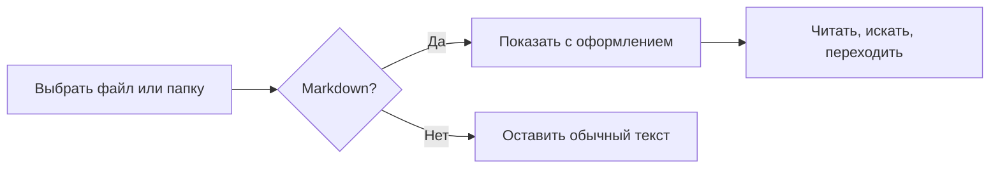
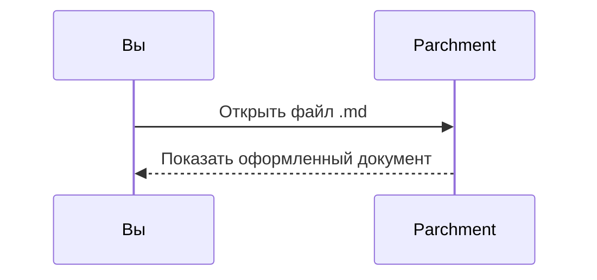
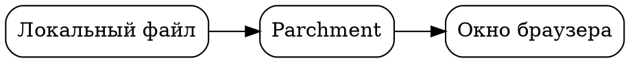

# Добро пожаловать в Parchment

Parchment — **локальный просмотрщик Markdown и обычного текста**, который работает в браузере. Этот документ сам является примером: каждый раздел показывает один вид содержимого, который умеет отображать Parchment, — сравните исходный файл с результатом.

> [!tip] Как пользоваться примером
> - Оглавление справа переносит к любому разделу; пункты с подзаголовками можно свернуть.
> - Откройте вкладки «Теги», «Связанные заметки» и «Обратные ссылки», чтобы увидеть теги документа и его связь со второй заметкой-примером.
> - Изображения и диаграммы **увеличиваются по щелчку**, их можно сохранить в PNG.

Свойства выше берутся из YAML-заголовка в начале файла: `tags` превращаются в кликабельные теги, остальные поля показываются таблицей.

## Оформление текста

В абзацах можно использовать **жирный**, *курсив*, ***жирный курсив***, ~~зачёркнутый~~, ==выделение==, ++вставленный текст++ и `код в строке`.

В формуле H~2~O используется нижний индекс, в x^2^ — верхний. Эмодзи можно вводить напрямую 🎉 или короткими кодами :sparkles: :books: :rocket:.

Клавиши записываются так: <kbd>Ctrl</kbd> + <kbd>F</kbd>; HTML-<mark>выделение</mark>, <u>подчёркивание</u> и H<sub>2</sub>O тоже работают.

Вот сноска[^read-only] — щёлкните, чтобы прочитать. HTML — это сокращение: наведите на него указатель, чтобы увидеть полное название.

*[HTML]: HyperText Markup Language

[^read-only]: Parchment открывает файлы только для чтения и никогда не изменяет ваши документы.

## Заголовки и оглавление

Заголовки от `#` до `######` собираются в оглавление справа с отступами по уровню.

### Заголовок третьего уровня

Более глубокие заголовки группируются под заголовком выше.

#### Заголовок четвёртого уровня

Нажмите стрелку рядом с заголовком в оглавлении, чтобы свернуть или развернуть этот уровень.

## Списки и задачи

- Маркированный список
  - Вложенный пункт
    - Ещё один уровень
- Второй пункт

1. Нумерованный список
2. Второй шаг
   1. Подшаг
3. Третий шаг

- [x] Открыть этот пример
- [ ] Отметить этот пункт (отметка хранится только в браузере и не меняет файл)
- [ ] Открыть свою папку с заметками

## Цитаты

> Тише едешь — дальше будешь.
> — Русская пословица

> Цитаты можно вкладывать
>> Второй уровень
>>> Третий уровень

## Таблицы

Столбцы можно выравнивать по левому краю, по центру или по правому краю:

| Возможность | Один файл | Папка |
| :--- | :---: | :---: |
| Оформление Markdown | ✅ | ✅ |
| Изображения и ссылки по относительным путям | — | ✅ |
| Вики-ссылки и встраивание | — | ✅ |
| Полнотекстовый поиск | — | ✅ |

Таблицы с большим числом столбцов подбирают ширину автоматически и прокручиваются в сторону, только если не помещаются:

| № | Название | Категория | Цена | Остаток | Страна | В продаже с | Примечание |
| --- | --- | --- | ---: | ---: | --- | --- | --- |
| 001 | Пергаментный блокнот | Канцтовары | 990 ₽ | 25 | Тайвань | 2026-01-15 | Ручной переплёт |
| 002 | Чернила для перьевой ручки | Канцтовары | 1 450 ₽ | 8 | Япония | 2026-03-02 | Сине-чёрные, водостойкие |

## Код

Блоки кода подсвечиваются по языку. Наведите указатель на правый верхний угол блока, чтобы скопировать его.

```js
// Прочитать выбранный пользователем файл только для чтения
const [handle] = await window.showOpenFilePicker();
const file = await handle.getFile();
console.log(await file.text());
```

```python
def greet(name: str) -> str:
    return f"Привет, {name}!"
```

## Формулы

Формула в строке: эквивалентность массы и энергии $E = mc^2$, площадь круга $A = \pi r^2$.

Выключные формулы:

$$
\int_{0}^{1} x^2 \, dx = \frac{1}{3}
$$

$$
x = \frac{-b \pm \sqrt{b^2 - 4ac}}{2a}
$$

## Диаграммы

Диаграммы подстраиваются под ширину текста. **Щёлкните диаграмму**, чтобы увеличить, сдвинуть или сохранить её в PNG.

Блок-схема Mermaid:



Диаграмма последовательности Mermaid:



Диаграмма Graphviz (`dot`):



## Выноски

> [!note]
> Обычная заметка.

> [!success] Готово
> Отмечает то, что уже сделано.

> [!warning] Свой заголовок
> Заголовок можно задать самостоятельно, а в тексте использовать **Markdown**.

> [!danger] Опасно
> Предупреждает о действиях, которые нельзя отменить.

> [!example] Пример
> Есть также типы info, tip, question, failure, bug, quote и abstract — у каждого свой значок и цвет.

> [!question]- Можно ли их сворачивать?
> Да. Добавьте `-` после типа, чтобы выноска была свёрнута по умолчанию, или `+`, чтобы развёрнута.

> [!NOTE]
> Оповещения в стиле GitHub тоже поддерживаются.

## Сворачиваемое содержимое

<details>
<summary>Нажмите, чтобы показать больше</summary>

HTML-теги `<details>` и `<summary>` позволяют спрятать длинный текст.

</details>

## Ссылки на заметки

Двойные квадратные скобки ссылаются на другую заметку: [[linked-note]]. Можно указать текст ссылки и заголовок: [[linked-note#Встраиваемый раздел|перейти к разделу связанной заметки]].

Веб-адреса открываются в новой вкладке: [Parchment на GitHub](https://github.com/bruce-yang-422/parchment). Можно переходить и внутри документа: [вернуться к таблицам](#таблицы).

Встроить целый раздел:

![[linked-note#Встраиваемый раздел]]

Или только один блок:

![[linked-note#^summary]]

Когда другая заметка ссылается сюда, вкладка «Обратные ссылки» справа показывает её.

## Изображения

Обычное изображение Markdown с относительным путём. **Щёлкните изображение**, чтобы увеличить его:


Можно указать только имя файла и ширину — Parchment найдёт файл во всей папке:

![[parchment-logo-transparent.png|96]]

## Список определений

Только чтение
: Содержимое файлов читается без каких-либо изменений.

Локально в первую очередь
: Документы обрабатываются в браузере и никуда не загружаются.

## Больше синтаксиса

В [тестовом документе Markdown](https://github.com/bruce-yang-422/parchment/blob/main/samples/ru/parchment_markdown_reader_test.md) собрано ещё больше: тексты на многих языках, все 13 типов выносок, изображения из сети, другие языки программирования и диаграммы. Скачайте его и откройте в Parchment, чтобы увидеть всё сразу.

## Что дальше

1. Нажмите **Открыть папку** в правом верхнем углу и выберите свою папку с заметками.
2. Введите слова в поле поиска на левой панели, чтобы искать по всем заметкам.
3. Кнопкой настроек в правом верхнем углу попробуйте другие цветовые схемы и шрифты.

На телефоне дерево файлов и сведения о документе открываются боковыми панелями. В документах длиннее четырёх экранов кнопка «Наверх» появляется в правом нижнем углу после прокрутки на два экрана; в коротких документах её нет. На компьютере наведите указатель на правый нижний угол области чтения, чтобы она появилась.

---

Этот пример входит в состав сайта и открывается без подключения к интернету.
