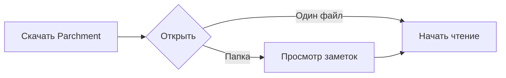
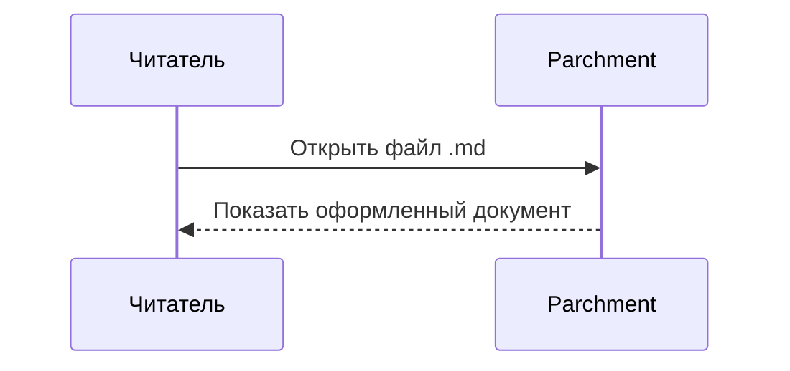
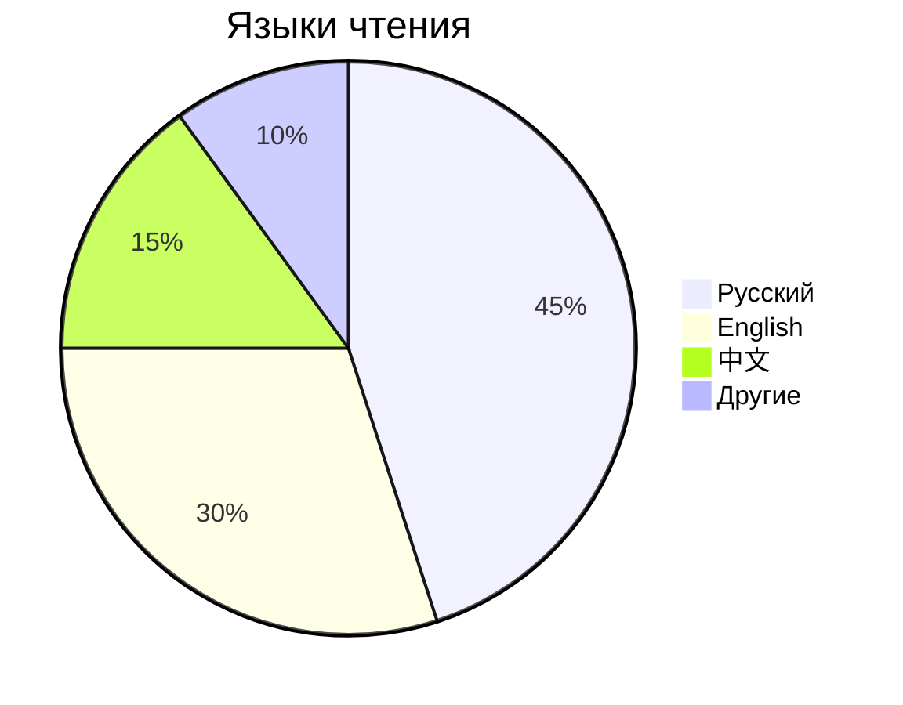

# Тестовый документ Parchment

Добро пожаловать в **Parchment**! В этом документе собраны самые разные виды разметки Markdown и тексты на многих языках. Скачайте его и откройте в Parchment, чтобы сразу увидеть всё, что умеет показывать приложение.

> [!tip] Как пользоваться этим документом
> 1. Откройте этот файл в Parchment.
> 2. Нажмите «Оглавление» в правом верхнем углу, чтобы перейти к любому разделу.
> 3. В настройках чтения попробуйте разные цветовые схемы, шрифты и размеры текста.

---

## 1. Заголовки

# Заголовок 1-го уровня
## Заголовок 2-го уровня
### Заголовок 3-го уровня
#### Заголовок 4-го уровня
##### Заголовок 5-го уровня
###### Заголовок 6-го уровня

Другой способ записи (подчёркивание)
====================================

Второй уровень (подчёркивание)
------------------------------

---

## 2. Оформление текста

| Эффект | Синтаксис | Результат |
| --- | --- | --- |
| Жирный | `**жирный**` | **Жирный** |
| Курсив | `*курсив*` | *Курсив* |
| Жирный курсив | `***жирный курсив***` | ***Жирный курсив*** |
| Зачёркнутый | `~~зачёркнутый~~` | ~~Зачёркнутый~~ |
| Выделение | `==выделение==` | ==Выделение== |
| Подчёркнутый | `++подчёркнутый++` | ++Подчёркнутый++ |
| Верхний индекс | `x^2^` | x^2^ |
| Нижний индекс | `H~2~O` | H~2~O |
| Код в строке | `` `code` `` | `print("hi")` |

Подчёркивания тоже работают: _курсив_, __жирный__.

Экранирование: \*это не курсив\*, \# это не заголовок, \[это не ссылка\].

Эта строка заканчивается двумя пробелами  
поэтому текст переносится здесь (жёсткий перенос).

---

## 3. Многоязычность

Тексты ниже нужны только для проверки шрифтов: не должно быть квадратиков «□» и нечитаемых символов. Понимать их не обязательно.

### 繁體中文
落霞與孤鶩齊飛，秋水共長天一色。Parchment 是一款讓你安靜閱讀 Markdown 筆記的 App。

### 简体中文
落霞与孤鹜齐飞，秋水共长天一色。Parchment 是一款让你安静阅读 Markdown 笔记的 App。

### English
The quick brown fox jumps over the lazy dog. *Parchment* lets you read your Markdown notes in peace.

### 日本語
いろはにほへと ちりぬるを わかよたれそ つねならむ。**Parchment** は Markdown のノートを静かに読むためのアプリです。

### 한국어
다람쥐 헌 쳇바퀴에 타고파. **Parchment**는 Markdown 노트를 조용히 읽을 수 있는 앱입니다.

### Français
Portez ce vieux whisky au juge blond qui fume. Ça, c'est l'été à Noël — « déjà vu » !

### Deutsch
Victor jagt zwölf Boxkämpfer quer über den großen Sylter Deich. Straße, Größe, Übung.

### Español
El veloz murciélago hindú comía feliz cardillo y kiwi. ¿Dónde está la señal? ¡Olé!

### Italiano · Português
Quel vituperabile xenofobo zelante assaggia il whisky ed esclama: alleluja!
Luís argüia à Júlia que «brações, fé, chá, óxido, pôr, zângão» eram palavras do português.

### Русский
Съешь же ещё этих мягких французских булок, да выпей чаю. **Parchment** — приложение для спокойного чтения заметок в Markdown.

### Ελληνικά
Ξεσκεπάζω την ψυχοφθόρα βδελυγμία.

### Tiếng Việt
Tiếng Việt có dấu: ă â đ ê ô ơ ư — Trăm năm trong cõi người ta.

### ภาษาไทย
เป็นมนุษย์สุดประเสริฐเลิศคุณค่า

### हिन्दी
ऋषियों को सताने वाले दुष्ट राक्षसों के राजा रावण का सर्वनाश करने वाले विष्णु।

### Справа налево
- العربية: مرحبًا بك في Parchment.
- עברית: ברוכים הבאים ל־Parchment.

### Смешанный текст
Русский English 中文 日本語 한국어 в одной строке, цифры 1234567890, полноширинные «знаки» 「препинания」 и обычные (punctuation) рядом.

---

## 4. Эмодзи

Набранные напрямую: 😀 🎉 📚 ✍️ 🌏 🇷🇺 🇰🇿 🇧🇾 👍🏽 👨‍👩‍👧‍👦

Короткие коды: :smile: :heart: :rocket: :books: :+1:

---

## 5. Списки

### Маркированный список
- Яблоко
- Банан
  - Второй уровень
    - Третий уровень
* Звёздочка тоже подходит
+ И знак плюс

### Нумерованный список
1. Шаг первый
2. Шаг второй
   1. Подшаг 2.1
   2. Подшаг 2.2
3. Шаг третий

Нумерация с 5:

5. Пять
6. Шесть

### Список задач (отметьте и сохраните в файл)
- [x] Скачать Parchment
- [x] Открыть этот тестовый документ
- [ ] Попробовать другую цветовую схему
- [ ] Попробовать другой шрифт
- [ ] Нажмите здесь, чтобы поставить отметку

---

## 6. Ссылки

- Обычная ссылка: [Parchment на GitHub](https://github.com/bruce-yang-422/parchment)
- Автоссылка: <https://www.markdownguide.org>
- Ссылка с подсказкой: [Руководство по Markdown](https://www.markdownguide.org "Показывается при наведении")
- Ссылка-сноска: [CommonMark][cm]
- Ссылка внутри документа: [Вернуться к разделу «Таблицы»](#8-таблицы)
- Вики-ссылки: [[Другая заметка]], [[Другая заметка|Отображаемое имя]]

[cm]: https://commonmark.org

---

## 7. Изображения

### Изображение из сети
Нужно подключение к интернету:


### Изображение из Википедии
«Путники среди гор и потоков» Фань Куаня, эпоха Северная Сун (Национальный дворцовый музей, Тайбэй; общественное достояние; источник: [Wikimedia Commons](https://commons.wikimedia.org/wiki/File:Fan_Kuan_-_Travelers_Among_Mountains_and_Streams_-_Google_Art_Project.jpg)). Высокое изображение; нажмите, чтобы увеличить:


### Изображение со ссылкой (Flickr)
Изображение внутри ссылки — так его оформляет кнопка «Поделиться» на Flickr. Проверяем изображения со ссылкой:

[](https://flic.kr/p/nqShrs "IMG_2247")

*Снято весной 2014 года на водорослевом рифе Лаомэй в районе Шимэнь (Новый Тайбэй). Ярко-зелёные водоросли покрывают вымытые волнами борозды в вулканической породе, а длинная выдержка превращает прибой в туман.*

### Ширина, заданная в HTML


### Отсутствующее изображение
Этого изображения нет намеренно — так проверяется сообщение об ошибке:


---

## 8. Таблицы

| Язык | Приветствие | Направление письма |
| :--- | :---: | ---: |
| Русский | Здравствуйте | LTR |
| English | Hello | LTR |
| 繁體中文 | 你好 | LTR |
| 日本語 | こんにちは | LTR |
| 한국어 | 안녕하세요 | LTR |
| Français | Bonjour | LTR |
| Deutsch | Guten Tag | LTR |
| العربية | مرحبا | RTL |

### Широкая таблица (прокрутка в сторону)

| № | Название | Категория | Цена | Остаток | Страна | В продаже с | Примечание |
| --- | --- | --- | ---: | ---: | --- | --- | --- |
| 001 | Пергаментный блокнот | Канцтовары | 990 ₽ | 25 | Тайвань | 2026-01-15 | Ручной переплёт, на долгие годы |
| 002 | Чернила для перьевой ручки | Канцтовары | 1 450 ₽ | 8 | Япония | 2026-03-02 | Сине-чёрные, водостойкие |
| 003 | Notebook A5 | Stationery | 12,5 € | 140 | Германия | 2026-05-20 | Точечная сетка, 120 г/м² |

---

## 9. Цитаты

> Тише едешь — дальше будешь.
> — Русская пословица

> Первый уровень
>> Второй уровень
>>> Третий уровень

> В цитате может быть **жирный текст**, `код` и списки:
> - Пункт один
> - Пункт два

---

## 10. Выноски

> [!note] Заметка
> Обычная заметка.

> [!info] Информация
> Дополнительные сведения.

> [!tip] Совет
> Удерживайте палец на тексте, чтобы скопировать его.

> [!success] Успех
> Готово!

> [!question] Вопрос
> Какая цветовая схема вам нравится больше всего?

> [!warning] Внимание
> Перед изменением сделайте резервную копию.

> [!danger] Опасно
> Это действие нельзя отменить.

> [!failure] Сбой
> Файл не найден.

> [!bug] Ошибка
> Прикладывайте снимок экрана, когда сообщаете о проблеме.

> [!example] Пример
> Это пример.

> [!quote] Цитата
> Повторение — мать учения.

> [!abstract] Кратко
> Этот документ проверяет, как Parchment отображает Markdown.

> [!tip]- Сворачиваемая выноска (свёрнута по умолчанию, нажмите, чтобы раскрыть)
> Вы нашли скрытое содержимое! 🎉

---

## 11. Код

Код в строке: `const name = 'Parchment';`

### Dart
```dart
void main() {
  final greeting = 'Привет, Parchment!';
  print(greeting);
}
```

### Python
```python
def greet(name: str) -> str:
    """Многоязычное приветствие / Multilingual greeting"""
    return f"Привет, {name}!"

print(greet("Parchment"))
```

### JavaScript
```javascript
const langs = ['ru', 'en', 'zh-TW', 'zh-CN', 'ja', 'ko', 'fr', 'de', 'es'];
langs.forEach((lang, i) => console.log(`${i + 1}. ${lang}`));
```

### JSON
```json
{
  "app": "Parchment",
  "languages": ["Русский", "English", "繁中", "日本語", "한국어"],
  "offline": true
}
```

### Shell
```bash
# Очень длинная командная строка для проверки горизонтальной прокрутки в блоке кода, которая уходит далеко за край экрана
echo "Привет, Parchment" && ls -la ~/Documents/notes/markdown/very/deep/folder/structure/
```

### SQL
```sql
SELECT title, author FROM notes WHERE lang = 'Русский' ORDER BY updated_at DESC;
```

### Без указания языка
```
Блок кода с обычным текстом
  отступы сохраняются
```

### Код с отступом (четыре пробела)

    Это тоже блок кода
    Indented code block

---

## 12. Формулы

Формула в строке: эквивалентность массы и энергии $E = mc^2$, площадь круга $A = \pi r^2$.

Выключные формулы:

$$
x = \frac{-b \pm \sqrt{b^2 - 4ac}}{2a}
$$

$$
\int_0^\infty e^{-x^2}\,dx = \frac{\sqrt{\pi}}{2}
$$

$$
\sum_{n=1}^{\infty} \frac{1}{n^2} = \frac{\pi^2}{6}
$$

---

## 13. Диаграммы

### Блок-схема Mermaid


### Диаграмма последовательности Mermaid


### Круговая диаграмма Mermaid


### Graphviz


---

## 14. Сноски

Parchment поддерживает сноски[^1], сноски с текстовыми именами[^примечание] и длинные сноски[^long].

[^1]: Это первая сноска. Нажмите стрелку возврата в конце, чтобы вернуться к тексту.
[^примечание]: Сноски с текстовыми именами тоже открываются как обычно.
[^long]: В сноске может быть **жирный текст**, `код` и [ссылки](https://commonmark.org).

---

## 15. HTML-теги

- Клавиши: нажмите <kbd>Ctrl</kbd> + <kbd>C</kbd>, чтобы скопировать
- <mark>HTML-выделение</mark>, <u>подчёркивание</u>, <s>зачёркивание</s>
- Химия H<sub>2</sub>O, квадрат x<sup>2</sup>
- Перенос<br>строки тегом br

<details>
<summary>Нажмите, чтобы показать больше</summary>

Это содержимое скрыто, пока вы его не раскроете.

- Скрытый пункт один
- Скрытый пункт два

</details>

---

## 16. Список определений

Markdown
: Лёгкий язык разметки для создания оформленных документов в виде обычного текста.

Parchment
: Приложение для чтения Markdown без отвлечений.
: У термина может быть второе определение.

---

## 17. Сокращения

HTML и CSS — основа веба, а PDF часто используют для печати.

*[HTML]: HyperText Markup Language
*[CSS]: Cascading Style Sheets
*[PDF]: Portable Document Format

---

## 18. Горизонтальные линии

Все три варианта выглядят одинаково:

***

---

___

---

## 19. Длинный абзац

Проверка вёрстки и плавности прокрутки: Lorem ipsum dolor sit amet, consectetur adipiscing elit, sed do eiusmod tempor incididunt ut labore et dolore magna aliqua. 春眠不覺曉，處處聞啼鳥。夜來風雨聲，花落知多少。Ut enim ad minim veniam, quis nostrud exercitation ullamco laboris nisi ut aliquip ex ea commodo consequat. 古池や蛙飛び込む水の音。Duis aute irure dolor in reprehenderit in voluptate velit esse cillum dolore eu fugiat nulla pariatur. 산에는 꽃 피네 꽃이 피네 갈 봄 여름 없이 꽃이 피네. Excepteur sint occaecat cupidatat non proident, sunt in culpa qui officia deserunt mollit anim id est laborum.

Очень длинный адрес или слово без пробелов для проверки переноса строк: https://example.com/a/very/long/path/that/keeps/going/and/going/without/any/spaces/to/break/the/line/naturally/index.html

---

## Тест завершён 🎉

Если вы видите этот текст, документ загружен полностью. Нажмите кнопку «Наверх» в правом нижнем углу, чтобы вернуться к началу.

Если что-то отображается неправильно, сообщите об этом в [GitHub Issues](https://github.com/bruce-yang-422/parchment/issues). Спасибо за помощь!
