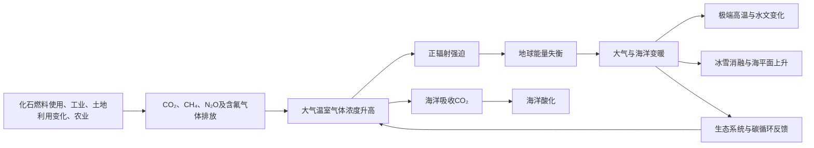
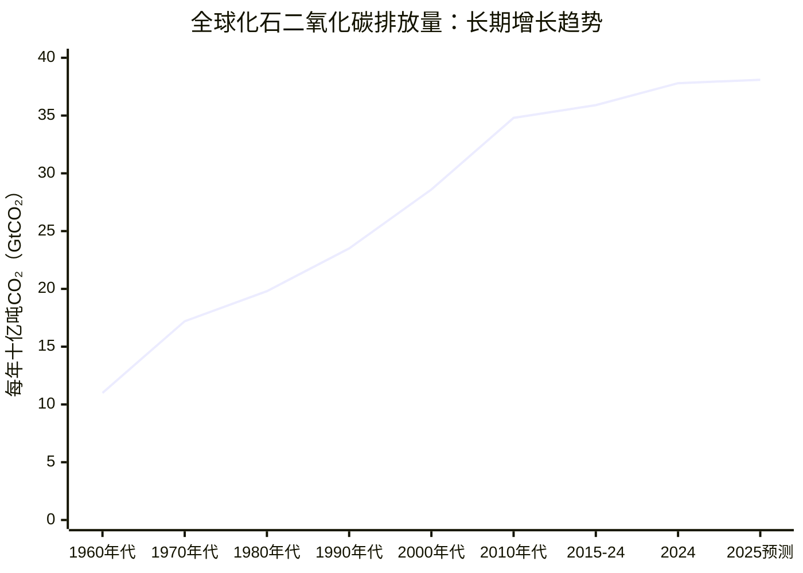
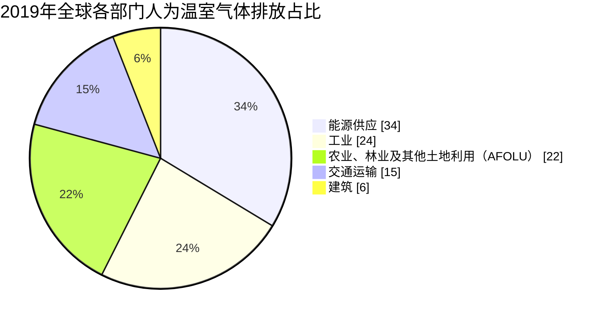
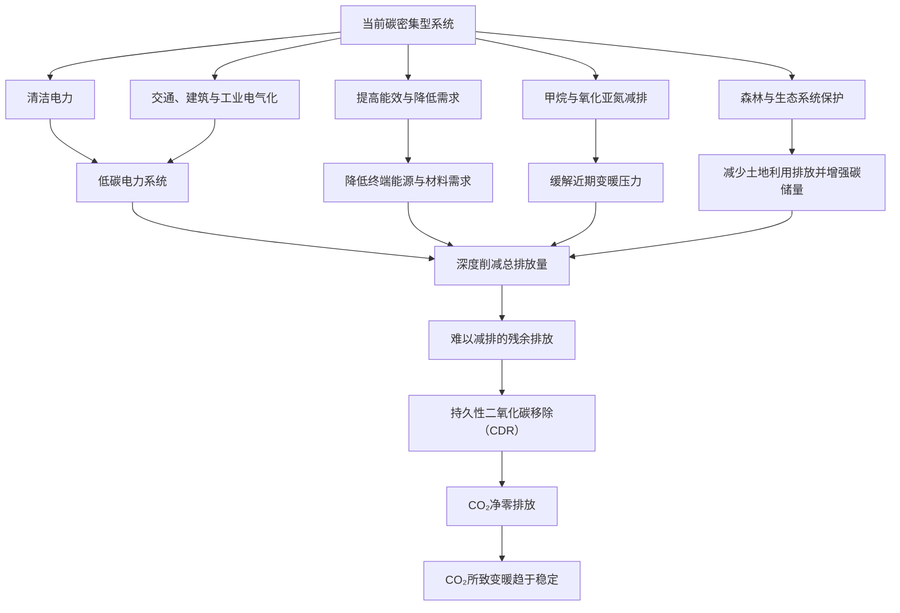

# 碳排放与碳足迹：对全球气候系统的影响

## 执行摘要

> **核心发现**。现有证据确凿表明，人为温室气体排放是现代全球变暖的主导原因。二氧化碳（CO₂）是最大的单一贡献因子，这归因于其庞大的累积排放量、对碳循环的长期影响，以及累积二氧化碳排放量与全球平均温度之间近乎线性的关系。甲烷（CH₄）、氧化亚氮（N₂O）和含氟气体则贡献了显著的额外辐射强迫。[^3] [^5]

人类活动已使 **2011—2020年全球表面温度较1850—1900年平均值升高了约1.1°C**。政府间气候变化专门委员会（IPCC）估计，从1850—1900年至2010—2019年，人类活动造成的总增温约为 **1.07°C**，而太阳活动和火山爆发等自然因素对观测到的长期变化仅作出了微小贡献。若仅考虑温室气体，其引起的增温幅度本会更大，但人为气溶胶在一定程度上掩盖了部分增温效应。[^5]

此次底层碳扰动的规模在现代观测史上前所未有。据美国国家海洋和大气管理局（NOAA）数据，工业化前大气二氧化碳浓度约为 **270–280 ppm**，而 **2025年全球海洋边界层年均浓度已达到425.62 ± 0.05 ppm**。**2025年长寿命温室气体的综合有效辐射强迫较工业化前水平达到3.59 W m⁻²**，比1990年的相应强迫高出56%。仅二氧化碳一项就贡献了 **2.37 W m⁻²**，约占长寿命温室气体总强迫的三分之二。[^7]

尽管如此，全球排放量仍在持续上升。IPCC估计，**2019年全球净人为温室气体排放量为59 ± 6.6 GtCO₂-eq**，较1990年增长54%。《2025年全球碳预算》（Global Carbon Budget 2025）估计，**2024年全球化石二氧化碳排放量为37.8 ± 2 GtCO₂**，并预测 **2025年约为38.1 GtCO₂**，不过不同数据集的方法学定义存在差异。国际能源署（IEA）独立估计，**2025年与能源相关的二氧化碳排放量接近38.4 GtCO₂**。由于部门边界不同，这些数据不应被视为可相互替代。[^1] [^2] [^4] [^6]

碳足迹将分析范围从属地排放延伸至更广阔的视角。*基于生产的排放清单* 将排放归属于排放实际发生的地点；*基于消费的碳足迹* 则通过国际供应链将隐含排放重新分配给最终消费者。这一区分至关重要，因为贸易商品使高消费地区能够将部分属地排放转移至境外。然而，多区域投入产出（MRIO）模型研究在结构和数据上的不确定性仍高于国家燃料燃烧排放清单。[^4] [^10]

排放责任的分布高度不均。2019年，排放量最高的10%家庭约占 **全球基于消费的家庭温室气体排放量的34%–45%** ，而排放量最低的50%家庭仅占 **13%–15%** 。区域差异同样悬殊：2019年北美地区的人均温室气体排放量约为 **19 tCO₂-eq/人**，而南亚地区仅约为 **2.5 tCO₂-eq/人**。[^4]

目前已观测到的气候后果包括极端高温增多、许多地区强降水加剧、干旱风险改变、海洋变暖、冰冻圈消融、海平面加速上升以及海洋酸化。**1901年至2018年间，全球平均海平面上升了约0.20 m**，而其上升速率在 **2006—2018年加快至3.7 [3.2–4.2] mm yr⁻¹**。自工业时代以来，**表层海水pH值下降了约0.1个单位**，相当于氢离子浓度增加了约30%。[^5] [^9]

制约未来变暖的最强物理约束是累积二氧化碳排放量。IPCC评估认为，累积碳排放的瞬态气候响应（TCRE）的最佳估计值约为 **每排放1,000 GtCO₂升温0.45°C**，可能范围为0.27–0.63°C。因此，稳定人类活动引起的变暖要求全球净人为二氧化碳排放量趋近于零；持续的净正排放将导致进一步变暖。[^3]

目前已经具备相当规模的可用减缓技术。IPCC评估表明，**成本不超过100美元/tCO₂-eq的减缓方案到2030年可将全球温室气体排放量在2019年水平上至少削减一半**，其中超过一半的评估潜力成本低于20美元/tCO₂-eq。主要的低成本机遇包括太阳能与风能发电、提高能效、甲烷减排，以及避免森林和其他自然生态系统被转化。然而，可行性不仅取决于工程成本，还取决于电网基础设施、融资、制度建设、土地约束、行为转变、社会接受度以及分配后果。[^4]

## 摘要与引言

本文探讨自约1850年至今 **碳排放、碳足迹、大气温室气体累积、辐射强迫与气候变化** 之间的关系。除非另有说明，本文的分析范围均为全球尺度。文章区分了物理排放与基于消费的碳足迹，评估了将排放与气候影响相联系的证据强度，识别了主要不确定性，并评估了主要减缓路径。

本文中，**碳排放** 一词主要指化石燃料燃烧、工业过程和土地利用变化所释放的二氧化碳，而 *温室气体排放* 则还包括甲烷（CH₄）、氧化亚氮（N₂O）和含氟气体。**碳足迹** 在更广义上指可归因于某一产品、活动、组织、家庭或人群的直接与间接温室气体排放，通常以吨二氧化碳当量（tCO₂-eq）表示。基于消费的碳足迹包含进口商品和服务中的隐含排放，因此在概念上有别于国家属地排放清单。[^4] [^10]

将多种温室气体汇总为二氧化碳当量排放依赖于某种气候指标，通常采用 **百年尺度全球增温潜势（GWP₁₀₀）** 。IPCC第六次评估报告（AR6）给出的GWP₁₀₀估计值为：二氧化碳为1，**化石来源甲烷约为29.8**，**非化石来源甲烷约为27.0**，**氧化亚氮约为273**，但这些数值存在较大不确定性。因此，GWP₁₀₀为273的气体在单位质量排放下，于该指标假设条件下100年内的积分辐射影响约为等质量二氧化碳参考影响的273倍。不应将GWP数值解读为在所有时间尺度上都精确相等的物理等效关系。[^3]

基本的因果链条如下：

**图1. 从人类活动到气候与生物地球化学影响的概念因果链**。主导温室气体作用路径的方向得到了IPCC评估的多重观测、理论和模式证据的支持。[^3] [^5]

### 明确假设

1. **地理范围**：全球尺度，在可靠数据集允许的情况下辅以区域比较。
2. **历史时期**：除非另行指明，一般为约1850年至今。
3. **排放核算**：全球物理排放总量采用基于生产的排放数据；基于消费的指标则明确标示为碳足迹。
4. **气候指标**：除非数据来源另有说明，二氧化碳当量数值一般采用AR6的GWP₁₀₀。
5. **最新观测数据**：由于完整排放清单滞后于实时进度，本文对 *历史观测数据* 与 *初步估算值或预测值* 加以区分。
6. **减缓成本**：文中报告的成本区间为全球技术经济估算范围，而非项目层面的保证成本。

因此，核心研究问题不再仅仅是排放是否会改变气候——这一归因早已得到充分证实——而是 **排放量、排放源、地理责任、消费模式、大气物理机制与碳循环过程如何共同决定气候变化的规模与持久性**。

## 方法与数据来源

本文分析遵循科学证据的分级体系。最高优先级赋予 **IPCC第六次评估报告（AR6）** ，因为该报告采用经校准的信度语言和多重独立证据链，综合了数千项同行评议研究。物理科学分析主要依据AR6第一工作组报告，排放与减缓评估依据第三工作组报告，综合影响评估则依据2023年综合报告。[^3] [^4] [^5]

近期排放与碳循环数据主要取自发表于《地球系统科学数据》（*Earth System Science Data*）的《**2025年全球碳预算**》。该预算综合了化石二氧化碳排放、土地利用变化、大气累积、海洋吸收、陆地吸收以及显式的预算不平衡项。报告估计1850—2024年人为累积碳排放量为 **745 ± 65 GtC**，其中约290 ± 5 GtC滞留于大气中，200 ± 40 GtC被海洋吸收，175 ± 50 GtC被陆地碳汇吸收，其余为残余预算不平衡项。[^1]

大气浓度和辐射强迫数据取自 **NOAA全球监测实验室（Global Monitoring Laboratory）** 。NOAA长期运行的全球监测网络提供了CO₂、CH₄、N₂O及其他长寿命温室气体的测量数据，并编制年度温室气体指数（AGGI）。[^7] [^8]

与能源相关的二氧化碳信息由 **国际能源署（IEA）** 数据补充，尤其是在需要分析近期分部门趋势时。IEA数据采用的核算边界与《全球碳预算》不同；因此，只有在界定各自核算范围之后才对数值总量进行比较。[^6]

基于消费的碳足迹证据源于IPCC评估报告和同行评议的多区域投入产出（MRIO）研究。这类模型通过国际贸易追踪货币流与物质供应链。它们有助于将间接排放归因于消费活动，但部门汇总方式、贸易统计数据、排放因子协调以及不同MRIO数据库之间的差异都会引入不确定性。一项针对五大主流MRIO系统的比较研究发现，基于消费的碳核算估算结果存在显著差异，这说明不应将碳足迹估算值视为精确的排放清单数值。[^10]

### 核心物理关系

广泛使用的二氧化碳辐射强迫一阶近似公式为：

\[
\boxed{\Delta F_{CO_2}\approx 5.35\ln\left(\frac{C}{C_0}\right)\;\text{W m}^{-2}}
\]

其中，\(C_0\) 为参考二氧化碳浓度，\(C\) 为扰动后的浓度。这一对数关系意味着，二氧化碳浓度每按相同比例增长，所产生的增量辐射强迫大致相当；AR6在正式评估中采用了更新的光谱学处理方法，但该对数近似公式仍具有重要的教学与概念价值。[^3]

全球碳预算可示意性地表示为：

\[
E_{\mathrm{FOS}}+E_{\mathrm{LUC}}
=
G_{\mathrm{ATM}}
+
S_{\mathrm{OCEAN}}
+
S_{\mathrm{LAND}}
+
B_{\mathrm{IM}},
\]

其中，\(E_{\mathrm{FOS}}\) 为化石燃料与工业二氧化碳排放，\(E_{\mathrm{LUC}}\) 为土地利用变化排放，\(G_{\mathrm{ATM}}\) 为大气累积量，\(S_{\mathrm{OCEAN}}\) 和 \(S_{\mathrm{LAND}}\) 分别为海洋碳汇和陆地碳汇，\(B_{\mathrm{IM}}\) 为残余预算不平衡项。《全球碳预算》估计，在2015—2024年间，全部人为二氧化碳排放中约有 **50%** 累积在大气中，**29%** 进入海洋，**21%** 进入陆地碳汇，该十年的平均预算不平衡项接近于零。[^1]

就温度而言，AR6给出了近似的累积排放关系：

\[
\Delta T \approx \mathrm{TCRE}\times
\frac{E_{\mathrm{cum}}}{1000\ \mathrm{GtCO_2}},
\]

其中：

\[
\mathrm{TCRE}_{\text{最佳估计值}}\approx0.45^{\circ}\mathrm{C}\; / \;1000\ \mathrm{GtCO_2}.
\]

正是由于这种近乎线性的关系，气候政策的核心才聚焦于累积二氧化碳排放量，而不仅仅关注单一年度的排放速率。[^3]

对于非二氧化碳气体，时间尺度 \(H\) 内的全球增温潜势（GWP）在概念上定义为：

\[
\mathrm{GWP}_i(H)
=
\frac{\int_0^H RF_i(t)\,dt}
{\int_0^H RF_{CO_2}(t)\,dt},
\]

其中，\(RF_i(t)\) 为物种 \(i\) 发生一次脉冲排放后随时间变化的辐射强迫。所选时间尺度会改变甲烷等短寿命气体在表观上的相对重要性。[^3]

## 结果

自工业化以来，全球人为排放急剧攀升。**1850年至2019年历史累积净二氧化碳排放量约为2,400 ± 240 GtCO₂**，其中约42%排放于1990—2019年间。这表明近几十年来排放量的累积速度异常迅猛。[^4]

《全球碳预算》对化石二氧化碳排放呈现出相同的长期趋势。平均化石碳排放量从 **20世纪60年代的约3.0 GtC yr⁻¹** 增至 **2015—2024年的9.8 GtC yr⁻¹**，分别折合每年约11和36 GtCO₂。2024年化石二氧化碳排放量达到约37.8 GtCO₂，较1990年高出69%。[^1]

**图2. 全球化石二氧化碳排放近似趋势**。各年代数据按 \(44/12\) 的系数由GtC折算为GtCO₂；2025年数值为《2025年全球碳预算》预测值，而非最终核定清单。[^1] [^2]

### 分部门与分区域排放格局

2019年，能源供应部门约占全球净人为温室气体排放量的 **34%** ，工业占24%，农业、林业及其他土地利用（AFOLU）占22%，交通运输占15%，建筑占6%。由于报告占比经过四舍五入，各项之和约为101%。若将电力和热力生产的排放从能源供应部门重新分配至终端用户，工业和建筑部门的相对占比将大幅上升，这表明各部门占比高度依赖于核算口径。[^4]

**图3. 2019年全球净人为温室气体排放的近似部门占比**。数值为IPCC采用AR6 GWP₁₀₀换算的二氧化碳当量估计值。[^4]

| 核算维度 | 主要排放源 / 区域 | 近似量级 | 解读 |
|---|---|---:|---|
| **2019年分部门温室气体** | 能源供应 | 20 GtCO₂-eq；34% | 全球最大的直接排放部门。[^4] |
|  | 工业 | 14 GtCO₂-eq；24% | 包含工业用能排放与工业过程排放。[^4] |
|  | AFOLU | 13 GtCO₂-eq；22% | 包含农业、林业与土地利用变化。[^4] |
|  | 交通运输 | 8.7 GtCO₂-eq；15% | 以化石燃料交通系统为主导。[^4] |
|  | 建筑 | 3.3 GtCO₂-eq；直接占比6% | 若将间接电力/热力排放计入终端用户，占比升至约16%。[^4] |
| **2024年化石CO₂** | 中国 | 12.3 GtCO₂；31.7% | 最大的属地化石CO₂排放国。[^2] |
|  | 美国 | 4.9 GtCO₂；12.7% | 人均化石CO₂排放约14.2 tCO₂。[^2] |
|  | 印度 | 3.2 GtCO₂；8.3% | 人均化石CO₂排放约2.2 tCO₂。[^2] |
|  | 欧盟27国 | 2.4 GtCO₂；6.3% | 人均化石CO₂排放约5.4 tCO₂。[^2] |
|  | 俄罗斯 | 1.8 GtCO₂；4.6% | 人均化石CO₂排放约12.3 tCO₂。[^2] |
| **基于消费的碳足迹** | 北美 | 所引足迹评估中约为13.4 tCO₂-eq/人 | 与家庭相关的消费碳足迹持续处于高位。[^4] |
|  | 欧洲 | ~7.5 tCO₂-eq/人 | 低于北美，但远高于低收入地区。[^4] |
|  | 非洲与中东* | ~1.7 tCO₂-eq/人 | 反映巨大的全球不平等；原文献的区域合并范围较宽。[^4] |

**表1. 按部门和区域划分的主要排放源**。分部门温室气体数据、属地化石二氧化碳数据与基于消费的碳足迹采用不同的系统边界，不应直接相加或相互替代。*所引用的消费碳足迹来源将非洲与中东合并统计，因此不应将其解读为均质的区域平均值。[^4] [^10]

区域分布格局还会因分析维度（年度排放量、历史累积责任、人均排放量或基于消费的碳足迹）的不同而发生变化。发达经济体在历史累积二氧化碳排放中的占比通常高于其当前人口占比，而东亚地区在当代年度排放中的占比自2000年以来大幅上升。IPCC指出，**2019年发达国家人均化石与工业二氧化碳排放量平均约为9.5 tCO₂**，相比之下，**亚太地区约为4.4 tCO₂，拉丁美洲和加勒比地区约为2.7 tCO₂，非洲约为1.2 tCO₂**。[^4]

### 辐射强迫与气候响应

排放与变暖之间的物理联系通过大气浓度和辐射强迫实现。AR6估计，2019年相对于1750年的有效辐射强迫分别为：二氧化碳 **2.16 [1.90–2.41] W m⁻²**，甲烷 **0.54 [0.43–0.65] W m⁻²**，氧化亚氮 **0.21 [0.18–0.24] W m⁻²**，卤代气体 **0.41 [0.33–0.49] W m⁻²**。[^3]

NOAA后续基于观测的指数表明，辐射强迫仍在持续上升：2025年其年度温室气体指数（AGGI）所涵盖长寿命气体的综合有效辐射强迫较工业化前水平达到约 **3.59 W m⁻²**，其中二氧化碳约占 **66%** ，甲烷占16%。自1990年以来，长寿命温室气体辐射强迫增量的约81%来自二氧化碳。[^7]

这种辐射强迫造成了地球能量失衡。AR6评估认为，观测到的气候系统平均增热速率从 **1971—2006年的约0.50 [0.32–0.69] W m⁻²** 上升至 **2006—2018年的0.79 [0.52–1.06] W m⁻²**。绝大部分多余热量储存在海洋中，其余能量则推动大气变暖、陆地冰雪融化、海平面上升以及其他地球系统变化。[^3]

### 观测到的气候影响

关于变暖本身及诸多相关影响的证据极为充分。IPCC得出结论，人类活动（主要是温室气体排放）**确凿地导致了全球变暖**。自20世纪50年代以来，绝大多数陆地地区的极端高温几乎确定变得更加频繁和剧烈；自20世纪80年代以来，人类影响很可能促成了海洋热浪发生频率大约翻倍。[^3] [^5]

水文影响在空间上不那么均匀，但同样显著。更温暖的空气可容纳更多水汽，从而加剧许多地区的强降水；变暖同时会增加蒸发需求，在降水未能弥补的情况下加剧农业干旱和生态干旱。不同区域和致灾因子的归因强度存在差异，这也是为何关于全球极端高温的科学结论通常比关于局地干旱或单一风暴的结论具有更高信度。[^3]

海平面变化提供了另一项综合性指标。**1901年至2018年间，全球平均海平面上升了约0.20 [0.15–0.25] m**。平均上升速率从1901—1971年的1.3 mm yr⁻¹加速至2006—2018年的3.7 mm yr⁻¹，且至少自1971年以来人类影响很可能是主要驱动因素。[^5]

二氧化碳还会独立于变暖之外直接改变海洋化学性质。在较长时间尺度上，释放到大气中的人为二氧化碳约有30%被海洋吸收，生成碳酸并提高氢离子浓度。自工业革命以来，表层海水平均pH值下降了约 **0.1个pH单位**，降低了珊瑚、软体动物及其他钙化生物可利用的碳酸根离子浓度。[^9]

## 讨论：证据、不确定性与碳足迹解读

严谨的科学评估必须区分 **关于量级的不确定性** 与 **关于因果关系的不确定性**。人为温室气体在当前全球变暖中的因果作用已不再是尚未解决的重大科学问题；不确定性主要集中在气候响应的精确幅度与时间进程、区域分布格局、反馈机制强度、未来社会经济排放情景以及减缓措施的实施成效。[^3] [^5]

| 科学议题 | 证据强度 | 主要证据 | 重要不确定性 |
|---|---|---|---|
| 人为温室气体导致现代全球变暖 | **确凿 / 极强** | 观测增温、辐射物理原理、归因研究、气候模式与古气候约束。[^5] | 各单一强迫因子与反馈过程之间的精确拆分。 |
| 累积CO₂排放近似线性地决定长期变暖 | **高信度** | 跨越观测数据与气候模式的TCRE关系。[^3] | TCRE可能范围为每1,000 GtCO₂对应0.27–0.63°C。 |
| 人类影响加剧极端高温事件 | **极强** | 观测记录以及单次事件与长期趋势归因研究。[^3] | 增幅在不同区域存在差异。 |
| 强降水与干旱风险正在改变 | **强但具空间异质性** | 观测记录、热力学原理与归因研究。[^3] | 自然变率与区域大气环流带来的不确定性大于温度变化。 |
| 变暖与陆地冰消融导致海平面上升 | **高信度** | 验潮站记录、卫星测高、冰川/冰盖观测与海洋热膨胀。[^5] | 冰盖动力学主导远期长尾不确定性。 |
| 海洋酸化主要由吸收大气CO₂引起 | **极强** | 碳酸盐化学原理与直接观测数据。[^9] | 不同物种与生态系统的生物学后果存在差异。 |
| 基于消费的碳足迹不同于属地排放 | **强** | MRIO贸易核算研究。[^10] | 数据库结构、部门汇总以及贸易/排放因子的不确定性。 |
| 当前陆地和海洋碳汇将无限期吸收恒定比例的排放 | **缺乏支持** | 碳汇强度随气候变化与碳循环反馈而波动。[^1] [^2] | 未来碳汇饱和及区域反馈机制仍存在不确定性。 |

**表2. 证据强度与主要不确定性**。在有依据的情况下，信度表述沿用IPCC评估的方向性分级，而非代表独立的统计概率。

碳足迹对于解读 **排放责任** 尤为重要。属地核算回答的是“排放实际发生在哪里？”，而消费核算追问的是“谁的最终需求引发了相关生产？”因此，一部在某国制造但在另一国购买的智能手机，会增加生产国的属地排放，同时计入购买者的消费碳足迹。没有任何一种核算方式在所有政策目标下都天然“唯一正确”，二者回答的是不同层面的问题。[^4] [^10]

这种差异对气候公平具有重要含义。IPCC发现，按人均排放量排序，**最高的10%家庭贡献了全球基于消费的家庭温室气体排放量的34%–45%** ，而最低的一半家庭仅贡献了13%–15%。这些不平等现象表明，国家层面的平均碳足迹往往掩盖了国家内部因收入、住房、出行、能源可及性和消费水平差异所造成的更大鸿沟。[^4]

近期一项跨国MRIO研究展示了需求侧减排的潜在规模：该研究估计，在116个国家中，针对排放量最高的23.7%人群实施一揽子低碳消费转型方案，可使模型中的基于消费的家庭温室气体排放减少约 **10.4 GtCO₂-eq**，相当于该分析所涵盖家庭排放总量的40.1%。此类结果属于情景模拟估算而非现实预测：它们以特定的行为替代和供应链响应为前提，因此不应被解读为必然实现的减排量。[^11]

碳循环的不确定性是另一项关键议题。针对1850—2024年，《全球碳预算》报告了约 **80 GtC** 的累积预算不平衡项，约占估算总排放量的11%，表明独立估算的碳源与碳汇之间存在不一致性。在观测更为完善的1959—2024年间，该不平衡项有所缩小。这些偏差并未否定温室效应，而是量化了基于异构观测数据和模式重构庞大全球碳通量时存在的不确定性。[^1]

近年来备受关注的一大问题是气候变化对自然碳汇的反馈作用。《2025年全球碳预算》估计，在2015—2024年间，相对于没有气候变化和气候变率影响的反事实情景，气候变化与变率使陆地碳汇削弱了约 **25%** ，使海洋碳汇削弱了约 **7%** 。这意味着历史上吸收了大量人为排放的自然缓冲能力可能正在减弱，不过年际和年代际变率仍然较大。[^2]

### 数据缺口

多项局限性影响着定量比较的精确度。全球化石燃料二氧化碳排放的约束精度高于土地利用二氧化碳排放；后者依赖于历史土地覆被重建、森林再生假设以及生态系统模型。各国排放清单的编制方法存在差异，在甲烷和土地利用领域尤为突出。消费碳足迹依赖于往往滞后于现实且对异质产品进行高度归类的贸易投入产出表。与化石燃料燃烧统计相比，农业、航空非二氧化碳效应、航运、非正规经济活动以及部分含氟气体的排放因子数据尚不够完整。[^1] [^10]

不同数据集之间还存在时间错配：IPCC AR6的分部门比较主要基于2019年数据，完整的《全球碳预算》数据覆盖至2024年并附带2025年预测值，NOAA大气观测数据已延伸至2026年，而能源数据集则可提供2025年的初步估算。因此，面对表面上的数值差异，应首先核查其 *年份、系统边界、所含温室气体种类及核算方法* 的异同，而不应直接将其解读为科学分歧。[^4] [^6] [^8]

## 减缓路径

减缓行动可围绕四项互补策略展开：**消除可避免的排放、降低能源与材料需求、替代高碳技术，以及从大气中移除残余二氧化碳**。实现有效的气候稳定需要多种温室气体同步快速减排，但二氧化碳具有特殊地位，因为其累积排放量在很大程度上决定了长期变暖幅度。[^3] [^4]

**图4. 从总排放削减迈向二氧化碳净零排放的减缓路径**。不应将净零排放视为快速削减总排放的替代品；IPCC主要将二氧化碳移除定位为抵消残余排放的补充手段，并在部分情景下用于逆转温升过冲。[^4]

| 减缓方案 | 指示性减排成效 | 成本特征 | 可行性与约束条件 |
|---|---|---|---|
| **太阳能与风能发电** | 属于IPCC评估的2030年最大减缓潜力选项之一。[^4] | 很大一部分评估潜力成本低于20美元/tCO₂-eq。[^4] | 技术成熟度高；输电线路、储能、审批流程和电网灵活性可能制约部署。 |
| **提高能效** | 在建筑、工业和交通领域具有广泛的跨部门潜力。[^4] | 许多措施具有低成本甚至负全生命周期成本。 | 反弹效应、激励错位、融资障碍和设备更替周期会减缓推广速度。 |
| **电气化** | 当电力实现低碳化时，可大幅削减终端用能排放。[^4] | 取决于具体情境；清洁技术成本下降改善了经济性。[^4] | 需要电网扩容、充电基础设施、热泵普及以及工业流程再造。 |
| **甲烷减排** | 对缓解近期变暖尤为重要，因为CH₄增温效力强但大气寿命相对较短。[^3] [^4] | 油气、煤炭和废弃物领域的许多措施成本低于20美元/tCO₂-eq。[^4] | 监测体系、泄漏检测、农业实践转型与监管执法至关重要。 |
| **避免生态系统转化** | 具有巨大的土地部门减缓潜力。[^4] | 有相当规模的潜力成本低于20美元/tCO₂-eq。[^4] | 必须妥善解决治理机制、土地权属、粮食安全、持久性与碳泄漏问题。 |
| **造林/再造林与改进森林管理** | 可提升陆地碳储量；IPCC估计土地部门组合具备数十亿吨级潜力。[^4] | 区域差异极大；森林部门减排成本随规模扩大而上升。 | 碳储量可能因野火、干旱、采伐或土地利用变化而逆转。 |
| **工业材料替代 / 工艺革新** | 对水泥、钢铁和化工行业至关重要。 | 差异显著；部分方案成本相对较低，另一些方案成本高昂。[^4] | 长寿命资本存量与高温工艺需求造成较强路径惯性。 |
| **面向特定工业/化石过程的碳捕集与封存（CCS）** | 对难以减排的工业过程排放具有潜在作用。[^4] | 通常高于最低成本的可再生能源/能效方案；具有高度场地特异性。 | 需要捕集设施、管网输送、适宜地质封存场所及长期监测。 |
| **二氧化碳移除（CDR）** | 在大多数模拟路径中是抵消部分残余排放的必要手段。[^4] | 成本区间宽泛，取决于具体技术路线。 | 土地占用、能源消耗、持久性、可扩展性、监测和生态权衡差异很大。 |

**表3. 主要减缓方案的成效、成本与可行性**。成本估算应理解为全球文献区间，而非普适性的项目定价。IPCC评估表明，所有成本不超过100美元/tCO₂-eq的方案合计到2030年可将排放量在2019年水平上至少削减一半，但实际可实现的潜力取决于基础设施、政策环境和当地条件。[^4]

近期能源数据证明，技术部署能够实质性改变排放轨迹。IEA估计，与未扩大部署的反事实情景相比，太阳能光伏、风电、核电、电动汽车和热泵在 **2025年合计避免了约3 GtCO₂的年度排放**。尽管如此，2025年与能源相关的二氧化碳排放量仍增长了约0.4%，达到近38.4 GtCO₂，说明全球清洁能源的增长速度尚未超过总能源需求增长与存量化石燃料使用之和。[^6]

区分 **总排放（gross emissions）** 与 **净排放（net emissions）** 具有重要意义。虽然减排路径可以通过深度削减总排放与大气碳移除的组合实现二氧化碳净零排放，但过度依赖未来的碳移除会加剧技术、生态和持久性风险。累积二氧化碳与变暖之间的物理关系意味着，当下避免一单位排放，就能减少未来在给定累积碳预算下必须移除的碳量。[^3] [^4]

《2025年全球碳预算》估计，自2026年初起，**以50%概率将升温控制在1.5°C以内的剩余碳预算仅约170 GtCO₂**，按2025年的排放速率折算大约仅够排放四年。对应1.7°C和2°C的剩余碳预算则分别估计为约525 GtCO₂和1,055 GtCO₂。这些预算并非精确的“最后期限”：它们取决于非二氧化碳辐射强迫、地球系统反馈、所选概率阈值以及方法学更新。[^1] [^2]

削减基于消费的碳足迹可以与供给侧脱碳形成互补。高影响力的干预措施包括：减少不必要的化石燃料出行、提高建筑能效、延长产品使用寿命、降低材料通量和食物浪费、在适宜条件下转向低碳能源与低碳膳食，以及推动消费品生产供应链的脱碳。评估需求侧减缓措施必须结合分配背景，因为低收入人群仍面临严重的基本能源短缺，其当前碳足迹远低于富裕消费群体。[^4]

## 结论

科学证据支持一套连贯的因果解释：**人类活动排放温室气体；这些排放推高大气温室气体浓度；浓度升高产生正辐射强迫；由此形成的地球能量失衡使气候系统变暖；变暖与二氧化碳浓度升高进而改变大气环流、水文循环、海洋、冰雪、海平面、生态系统和碳汇**。关于温度、大气成分、海洋热含量、海平面和碳通量的多项独立观测均与这一框架高度自洽。[^3] [^5]

二氧化碳之所以尤为关键，在于气候响应与其累积排放量紧密相关。1850—2019年间已排放了约2,400 ± 240 GtCO₂的净人为二氧化碳，目前化石排放仍接近历史高位。2025年全球年均大气二氧化碳浓度已超过425 ppm，较工业化前水平高出50%以上。[^4] [^7]

碳足迹揭示了属地排放清单所无法呈现的另一维度：**消费活动与全球供应链的气候后果**。对碳足迹的解读暴露出区域、国家和家庭之间显著的不平等。由于最高排放群体贡献了不成比例的消费排放份额，仅关注国家平均值的减缓策略可能同时掩盖真实的排放责任与高杠杆减排机遇。[^4] [^10]

不确定性依然重要，但必须准确界定其所在领域。关于温室效应的方向或当前变暖的人为主导成因，科学上的不确定性已微乎其微。更大的不确定性存在于土地利用排放、区域气候响应、未来社会经济路径、碳循环反馈、冰盖动力学、消费碳足迹核算，以及减缓技术与制度的规模化推进速度。[^1] [^10]

减缓研究证据表明，很大一部分技术上可行的减排量能够以中等或较低的经济成本实现，特别是通过清洁电力、提高能效、甲烷控制和生态系统保护。然而，全球排放居高不下、屡创新高这一现实表明，仅有技术可行性远远不够。实现有效的气候稳定需要加快技术部署、加大基础设施投资、提升制度能力、加强政策协调、推动行为与需求侧转型、保护自然碳储量，并对用于抵消残余排放的碳移除实施审慎治理。[^4] [^6]

由此得出的核心物理推论十分明确：

\[
\boxed{\text{持续净正CO₂排放}
\;\Rightarrow\;
\text{更高的累积CO₂排放}
\;\Rightarrow\;
\text{进一步的长期变暖}}
\]

反之亦然：

\[
\boxed{\text{人为CO₂净零排放}
\;\approx\;
\text{稳定CO₂所致变暖的必要条件}.}
\]

这一结论直接源于IPCC所评估的人为累积二氧化碳排放量与全球表面温度升高之间的近线性关系。[^3]

## 参考文献

[^1]: **Friedlingstein, P., et al. (2026).** *Global Carbon Budget 2025.* **Earth System Science Data, 18**, 3211–3288. 该评估提供了全球化石与土地利用二氧化碳排放、大气累积、陆地和海洋碳汇、区域趋势、不确定性以及剩余碳预算数据。

[^2]: **Global Carbon Project. (2025/2026 update).** *Global Carbon Budget 2025 datasets and key messages.* 该数据集包含各国化石碳排放和经修正的土地利用变化分量；凡明确标示之处，2025年数值均为预测值。

[^3]: **Intergovernmental Panel on Climate Change. (2021).** *Climate Change 2021: The Physical Science Basis. Contribution of Working Group I to the Sixth Assessment Report.* Cambridge University Press. 用于辐射强迫、气候敏感度、极端事件归因、温室气体指标以及累积二氧化碳排放的瞬态气候响应分析。

[^4]: **Intergovernmental Panel on Climate Change. (2022).** *Climate Change 2022: Mitigation of Climate Change. Contribution of Working Group III to the Sixth Assessment Report.* Cambridge University Press. 用于分部门与分区域排放、消费碳足迹、减缓成本、技术方案及可行性评估。

[^5]: **Intergovernmental Panel on Climate Change. (2023).** *Climate Change 2023: Synthesis Report.* IPCC. 用于综合归因、观测影响、排放趋势、海平面变化以及经评估的信度表述。

[^6]: **International Energy Agency. (2026).** *Global Energy Review 2026: Energy Demand and CO₂.* IEA, Paris. 提供了2025年首份全面能源部门评估，包括能源相关二氧化碳排放以及近期清洁技术部署所避免排放的估算值。

[^7]: **NOAA Global Monitoring Laboratory. (2026).** *Annual Greenhouse Gas Index.* National Oceanic and Atmospheric Administration. 提供了截至2025年的大气温室气体丰度与有效辐射强迫的观测估算数据。

[^8]: **NOAA Global Monitoring Laboratory. (2026).** *Trends in Atmospheric Carbon Dioxide.* 提供了全球平均海洋表面二氧化碳观测数据及2026年月度初步测量值。

[^9]: **NOAA.** *Ocean Acidification.* National Oceanic and Atmospheric Administration. 提供了人为二氧化碳吸收、海水pH值下降以及碳酸盐体系影响的观测与化学背景。

[^10]: **Wood, R., Moran, D. D., Rodrigues, J. F. D., et al. (2019).** “Variation in trends of consumption based carbon accounts.” *Scientific Data, 6*, 99. 比较了多个多区域投入产出数据库，并系统记录了基于消费的碳核算中的方法学不确定性。

[^11]: **Recent global household-footprint analysis. (2025).** “Unlocking global carbon reduction potential by embracing low-carbon lifestyles.” *Nature Communications.* 采用全球多区域投入产出框架，估算了116个国家家庭消费模式转型所带来的模拟减排潜力。
