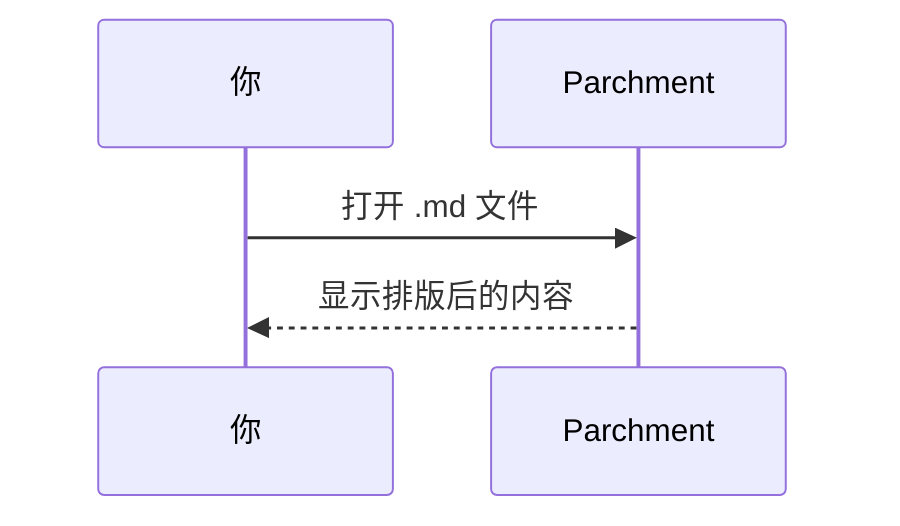

# 欢迎使用 Parchment

Parchment 是在浏览器中运行的**本地 Markdown 与纯文本阅读器**。这份文档本身就是示例：每一节演示一类 Parchment 能显示的内容，你可以对照源文件，看看各种写法会呈现成什么样子。

> [!tip] 这份示例怎么用
> - 右侧的「文章目录」可以跳到任一节，有子标题的项目还能折叠。
> - 打开右侧的标签与链接页签，可以看到这份文档的标签，以及它和另一份示例笔记之间的反向链接。
> - 图片与图表都可以**点一下放大**，也能保存为 PNG。

上方的「属性」区块来自文档开头的 YAML Frontmatter：`tags` 会变成可点击的标签，其他字段也会整理成表格。

## 文字格式

普通段落可以使用 **粗体**、*斜体*、***粗斜体***、~~删除线~~、==荧光标记==、++插入文字++ 与 `行内代码`。

化学式 H~2~O 使用下标，平方 x^2^ 使用上标。表情符号可以直接输入 🎉，也可以写成短代码 :sparkles: :books: :rocket:。

键盘按键用 <kbd>Ctrl</kbd> + <kbd>F</kbd> 表示；HTML 的 <mark>标记</mark>、<u>下划线</u> 与 H<sub>2</sub>O 也能显示。

这里有一个脚注[^read-only]，点一下就能看到内容。HTML 是一种缩写，把鼠标移到它上面可以看到全称。

*[HTML]: HyperText Markup Language

[^read-only]: Parchment 以只读方式打开文件，不会修改你的任何文档。

## 标题与文章目录

文档中的 `#` 到 `######` 标题会自动整理成右侧的文章目录，层级越深缩进越多。

### 第三级标题

第三级以下的标题会收在上一级下面。

#### 第四级标题

点目录中标题旁的箭头，可以折叠或展开这一级。

## 列表与任务清单

- 无序列表
  - 可以嵌套
    - 再往下一层
- 第二项

1. 有序列表
2. 第二步
   1. 子步骤
3. 第三步

- [x] 打开这份示例
- [ ] 试着勾选这个项目（勾选状态只保存在浏览器中，不会改动文件）
- [ ] 打开自己的笔记文件夹

## 引用

> 学而时习之，不亦说乎？
> — 《论语》

> 引用可以有好几层
>> 第二层
>>> 第三层

## 表格

列可以左对齐、居中或右对齐：

| 功能 | 单文件模式 | 文件夹模式 |
| :--- | :---: | :---: |
| Markdown 排版 | ✅ | ✅ |
| 相对路径图片与链接 | — | ✅ |
| Wiki Links 与嵌入 | — | ✅ |
| 全文搜索 | — | ✅ |

列很多时，表格会自动调整列宽；放不下才会出现左右滚动：

| 编号 | 名称 | 分类 | 价格 | 库存 | 产地 | 上架日期 | 备注 |
| --- | --- | --- | ---: | ---: | --- | --- | --- |
| 001 | 羊皮纸笔记本 | 文具 | 88 | 25 | 中国 | 2026-01-15 | 手工装订 |
| 002 | 钢笔墨水 | 文具 | 120 | 8 | 日本 | 2026-03-02 | 蓝黑色，防水 |

## 代码

代码块会按语言自动着色，鼠标移到代码块右上角可以一键复制。

```js
// 以只读方式读取用户选择的文件
const [handle] = await window.showOpenFilePicker();
const file = await handle.getFile();
console.log(await file.text());
```

```python
def greet(name: str) -> str:
    return f"你好，{name}！"
```

## 数学公式

行内公式：质能等价 $E = mc^2$，圆面积 $A = \pi r^2$。

块级公式：

$$
\int_{0}^{1} x^2 \, dx = \frac{1}{3}
$$

$$
x = \frac{-b \pm \sqrt{b^2 - 4ac}}{2a}
$$

## 图表

图表会自动缩放到阅读栏宽，**点击图表**可以放大、拖动，或保存为 PNG。

Mermaid 流程图：


Mermaid 时序图：



Graphviz（`dot`）图表：


## 提示框（Callouts）

> [!note]
> 普通的补充说明。

> [!success] 完成
> 用来标示已完成的事项。

> [!warning] 自定义标题
> 标题可以自定义，正文也可以使用 **Markdown**。

> [!danger] 危险
> 用来提醒无法撤销的操作。

> [!example] 示例
> 还有 info、tip、question、failure、bug、quote、abstract 等类型，各有不同的图标与颜色。

> [!question]- 可以折叠吗？
> 可以。在类型后面加上 `-` 会默认折叠，加上 `+` 则默认展开。

> [!NOTE]
> GitHub 风格的提示框也能显示。

## 折叠内容

<details>
<summary>点我展开更多内容</summary>

用 HTML 的 `<details>` 与 `<summary>` 可以把较长的内容先收起来。

</details>

## 笔记链接

用两个中括号就能链接到另一份笔记：[[linked-note]]。也可以指定显示文字与标题：[[linked-note#可嵌入的章节|跳到另一份笔记的章节]]。

普通网址会在新标签页打开：[Parchment GitHub](https://github.com/bruce-yang-422/parchment)。文档内也能跳转：[回到「表格」](#表格)。

把整个章节直接嵌入进来：

![[linked-note#可嵌入的章节]]

或只嵌入某一个块：

![[linked-note#^summary]]

另一份笔记链接回这里时，右侧的「反向链接」页签会列出来源。

## 图片

普通的 Markdown 相对路径图片，**点击图片**可以在灯箱中放大：


也可以只写文件名并指定宽度，Parchment 会在整个文件夹中查找：

![[parchment-logo-transparent.png|96]]

## 定义列表

只读
: 只读取文件内容，不做任何修改。

本地优先
: 文档在浏览器中处理，不会上传。

## 想看更多语法

[Markdown 阅读测试文档](https://github.com/bruce-yang-422/parchment/blob/main/samples/zh-CN/parchment_markdown_reader_test.md)收录了更完整的写法：多国语言文字、13 种提示框、网络图片、各种编程语言与图表。下载后用 Parchment 打开，就能一次看完。

## 下一步

1. 点右上角的 **打开文件夹**，选择你自己的笔记文件夹。
2. 在左侧栏的搜索框输入关键词，搜索所有笔记。
3. 点右上角的设置按钮，试试不同的配色与字体。

在手机上，文件树与文档信息会从侧边抽屉打开。文章超过四屏时，滚动两屏后右下角才会显示回到顶部按钮；短文章不会显示。桌面版则可将鼠标移到阅读栏右下角调出按钮。

---

这份示例会随网站一起提供，离线时也能打开。
