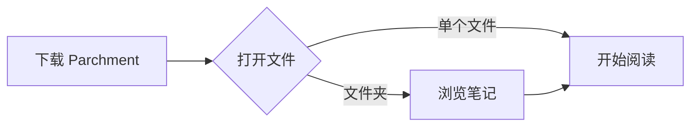
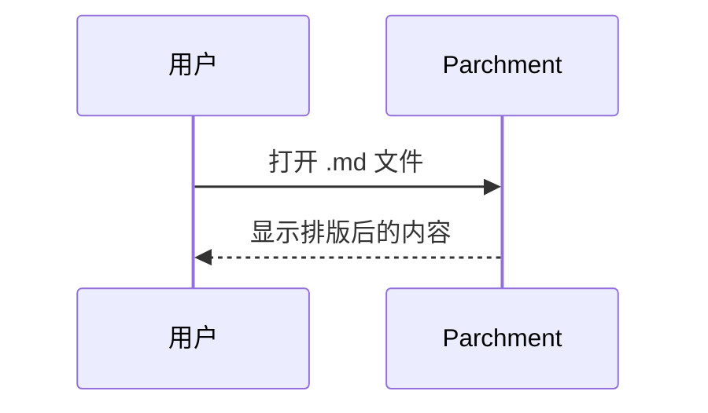
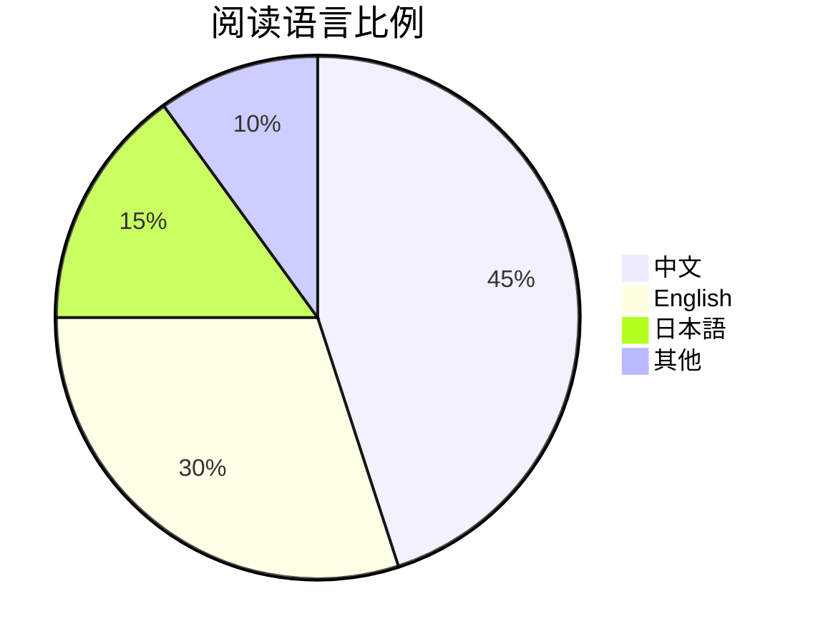

# Parchment 阅读测试文档 · Reading Test

欢迎使用 **Parchment**！这份文档收录了各种 Markdown 写法与多国语言文字，下载后用 Parchment 打开，就能一次看看 App 的阅读效果。

> [!tip] 怎么使用这份文档
> 1. 用 Parchment 打开本文件。
> 2. 点右上角的目录，跳到想看的段落。
> 3. 到「阅读设置」换换配色、字体与字号，比较不同效果。

---

## 1. 标题 Headings

# 一级标题 H1
## 二级标题 H2
### 三级标题 H3
#### 四级标题 H4
##### 五级标题 H5
###### 六级标题 H6

另一种写法（下划线式）
=====================

第二层（下划线式）
------------------

---

## 2. 文字样式 Text Styles

| 效果 | 写法 | 显示 |
| --- | --- | --- |
| 粗体 | `**粗体**` | **粗体 Bold** |
| 斜体 | `*斜体*` | *斜体 Italic* |
| 粗斜体 | `***粗斜体***` | ***粗斜体 Bold Italic*** |
| 删除线 | `~~删除线~~` | ~~删除线 Strikethrough~~ |
| 荧光标记 | `==标记==` | ==荧光标记 Highlight== |
| 下划线 | `++下划线++` | ++下划线 Underline++ |
| 上标 | `x^2^` | x^2^ |
| 下标 | `H~2~O` | H~2~O |
| 行内代码 | `` `code` `` | `print("hi")` |

下划线写法也可以：_斜体_、__粗体__。

转义字符：\*这不是斜体\*、\# 这不是标题、\[这不是链接\]。

这一行结尾有两个空格  
所以这里会换行（硬换行）。

---

## 3. 多国语言 Multilingual

以下各国文字只是用来检查字体是否显示正常（有没有出现方框「□」或乱码），不需要看懂内容。

### 繁體中文
落霞與孤鶩齊飛，秋水共長天一色。Parchment 是一款讓你安靜閱讀 Markdown 筆記的 App。

### 简体中文
落霞与孤鹜齐飞，秋水共长天一色。Parchment 是一款让你安静阅读 Markdown 笔记的 App。

### English
The quick brown fox jumps over the lazy dog. *Parchment* lets you read your Markdown notes in peace.

### 日本語
いろはにほへと ちりぬるを わかよたれそ つねならむ。**Parchment** は Markdown のノートを静かに読むためのアプリです。

### 한국어
다람쥐 헌 쳇바퀴에 타고파. **Parchment**는 Markdown 노트를 조용히 읽을 수 있는 앱입니다.

### Français
Portez ce vieux whisky au juge blond qui fume. Ça, c'est l'été à Noël — « déjà vu » !

### Deutsch
Victor jagt zwölf Boxkämpfer quer über den großen Sylter Deich. Straße, Größe, Übung.

### Español
El veloz murciélago hindú comía feliz cardillo y kiwi. ¿Dónde está la señal? ¡Olé!

### Italiano · Português
Quel vituperabile xenofobo zelante assaggia il whisky ed esclama: alleluja!
Luís argüia à Júlia que «brações, fé, chá, óxido, pôr, zângão» eram palavras do português.

### Русский
Съешь же ещё этих мягких французских булок, да выпей чаю.

### Ελληνικά
Ξεσκεπάζω την ψυχοφθόρα βδελυγμία.

### Tiếng Việt
Tiếng Việt có dấu: ă â đ ê ô ơ ư — Trăm năm trong cõi người ta.

### ภาษาไทย
เป็นมนุษย์สุดประเสริฐเลิศคุณค่า

### हिन्दी
ऋषियों को सताने वाले दुष्ट राक्षसों के राजा रावण का सर्वनाश करने वाले विष्णु।

### 从右至左 Right-to-left
- العربية：مرحبًا بك في Parchment.
- עברית：ברוכים הבאים ל־Parchment.

### 混排 Mixed
中文 English 日本語 한국어 混在同一行，数字 1234567890 与全角「标点」、半角 (punctuation) 并列。

---

## 4. 表情符号 Emoji

直接输入：😀 🎉 📚 ✍️ 🌏 🇨🇳 🇯🇵 🇰🇷 👍🏽 👨‍👩‍👧‍👦

短代码：:smile: :heart: :rocket: :books: :+1:

---

## 5. 列表 Lists

### 无序列表
- 苹果 Apple
- 香蕉 Banana
  - 嵌套第二层
    - 嵌套第三层
* 星号也可以
+ 加号也可以

### 有序列表
1. 第一步
2. 第二步
   1. 子步骤 2.1
   2. 子步骤 2.2
3. 第三步

从 5 开始编号：

5. 五
6. 六

### 待办清单（可勾选并保存回文件）
- [x] 下载 Parchment
- [x] 打开这份测试文档
- [ ] 试试切换配色
- [ ] 试试更换字体
- [ ] 点一下这里打勾看看

---

## 6. 链接 Links

- 普通链接：[Parchment GitHub](https://github.com/bruce-yang-422/parchment)
- 自动链接：<https://www.markdownguide.org>
- 带提示文字的链接：[Markdown 指南](https://www.markdownguide.org "鼠标悬停时显示的说明")
- 引用式链接：[CommonMark][cm]
- 文档内跳转：[回到「表格」段落](#8-表格-tables)
- Wiki 链接：[[另一篇笔记]]、[[另一篇笔记|显示别名]]

[cm]: https://commonmark.org

---

## 7. 图片 Images

### 网络图片
需要连上网络才能显示：


### 维基百科图片
北宋 范宽《溪山行旅图》（台北故宫博物院藏，公有领域，图片来源：[Wikimedia Commons](https://commons.wikimedia.org/wiki/File:Fan_Kuan_-_Travelers_Among_Mountains_and_Streams_-_Google_Art_Project.jpg)）。竖长图，可点一下放大查看：


### 用 HTML 指定宽度


### 找不到的图片
下面这张图故意不存在，用来测试错误提示：


---

## 8. 表格 Tables

| 语言 Language | 问候 Greeting | 书写方向 |
| :--- | :---: | ---: |
| 简体中文 | 你好 | 左→右 |
| English | Hello | LTR |
| 日本語 | こんにちは | 左→右 |
| 한국어 | 안녕하세요 | 左→右 |
| Français | Bonjour | LTR |
| Deutsch | Guten Tag | LTR |
| Español | Hola | LTR |
| العربية | مرحبا | RTL |

### 宽表格（可左右滑动）

| 编号 | 名称 | 分类 | 价格 | 库存 | 产地 | 上架日期 | 备注说明 |
| --- | --- | --- | ---: | ---: | --- | --- | --- |
| 001 | 羊皮纸笔记本 | 文具 | 88 | 25 | 中国 | 2026-01-15 | 手工装订，适合长期保存 |
| 002 | 钢笔墨水 Ink | 文具 | 120 | 8 | 日本 | 2026-03-02 | 蓝黑色，防水 |
| 003 | Notebook A5 | Stationery | 12.5 | 140 | Germany | 2026-05-20 | Dot grid, 120 g/m² |

---

## 9. 引用 Blockquotes

> 学而时习之，不亦说乎？
> — 《论语》

> 第一层引用
>> 第二层引用
>>> 第三层引用

> 引用里也能放 **粗体**、`代码` 和列表：
> - 项目一
> - 项目二

---

## 10. 提示框 Callouts

> [!note] 备注 Note
> 这是普通备注。

> [!info] 信息 Info
> 补充信息。

> [!tip] 小技巧 Tip
> 长按文字可以复制。

> [!success] 成功 Success
> 已完成！

> [!question] 问题 Question
> 你最喜欢哪一种配色？

> [!warning] 注意 Warning
> 修改前请先备份。

> [!danger] 危险 Danger
> 这个操作无法撤销。

> [!failure] 失败 Failure
> 找不到文件。

> [!bug] 错误 Bug
> 反馈问题时请附上截图。

> [!example] 示例 Example
> 这是一个示例。

> [!quote] 引言 Quote
> 书山有路勤为径。

> [!abstract] 摘要 Abstract
> 本文档用来测试 Parchment 的显示效果。

> [!tip]- 可展开的提示框（默认收起，点一下展开）
> 你找到隐藏内容了！🎉

---

## 11. 代码 Code

行内代码：`const name = 'Parchment';`

### Dart
```dart
void main() {
  final greeting = '你好，Parchment！';
  print(greeting);
}
```

### Python
```python
def greet(name: str) -> str:
    """多语问候 / Multilingual greeting"""
    return f"こんにちは、{name}！"

print(greet("Parchment"))
```

### JavaScript
```javascript
const langs = ['zh-CN', 'zh-TW', 'en', 'ja', 'ko', 'fr', 'de', 'es'];
langs.forEach((lang, i) => console.log(`${i + 1}. ${lang}`));
```

### JSON
```json
{
  "app": "Parchment",
  "languages": ["简中", "繁中", "English", "日本語", "한국어"],
  "offline": true
}
```

### Shell
```bash
# 这是一段很长的命令，用来测试水平滚动 This is a very long command line to test horizontal scrolling inside a code block
echo "Hello, Parchment" && ls -la ~/Documents/notes/markdown/very/deep/folder/structure/
```

### SQL
```sql
SELECT title, author FROM notes WHERE lang = '简体中文' ORDER BY updated_at DESC;
```

### 没有指定语言
```
纯文本代码块
  缩进会保留
```

### 缩进式代码（四个空格）

    这也是代码块
    Indented code block

---

## 12. 数学公式 Math

行内公式：质能等价 $E = mc^2$，圆面积 $A = \pi r^2$。

块级公式：

$$
x = \frac{-b \pm \sqrt{b^2 - 4ac}}{2a}
$$

$$
\int_0^\infty e^{-x^2}\,dx = \frac{\sqrt{\pi}}{2}
$$

$$
\sum_{n=1}^{\infty} \frac{1}{n^2} = \frac{\pi^2}{6}
$$

---

## 13. 图表 Diagrams

### Mermaid 流程图


### Mermaid 时序图


### Mermaid 饼图


### Graphviz


---

## 14. 脚注 Footnotes

Parchment 支持脚注[^1]，也可以用文字当脚注名称[^说明]，或写得比较长的脚注[^long]。

[^1]: 这是第一个脚注。点文末的返回箭头可以回到原文。
[^说明]: 中文名称的脚注也能正常打开。
[^long]: 脚注里也能放 **粗体**、`代码` 与 [链接](https://commonmark.org)。

---

## 15. HTML 标签

- 键盘按键：按 <kbd>Ctrl</kbd> + <kbd>C</kbd> 复制
- <mark>HTML 荧光标记</mark>、<u>下划线</u>、<s>删除线</s>
- 化学式 H<sub>2</sub>O、平方 x<sup>2</sup>
- 换行<br>用 br 标签

<details>
<summary>点我展开更多内容 Click to expand</summary>

这段内容平时是收起来的。

- 隐藏项目一
- 隐藏项目二

</details>

---

## 16. 定义列表 Definition List

Markdown
: 一种轻量标记语言，用纯文本写出有格式的文档。

Parchment
: 专心阅读 Markdown 的 App。
: 也可以有第二个说明。

---

## 17. 缩写 Abbreviations

HTML 与 CSS 是网页的基础，PDF 常用于打印。

*[HTML]: HyperText Markup Language
*[CSS]: Cascading Style Sheets
*[PDF]: Portable Document Format

---

## 18. 分隔线 Horizontal Rules

三种写法效果相同：

***

---

___

---

## 19. 长段落 Long Paragraph

测试排版与滚动流畅度：Lorem ipsum dolor sit amet, consectetur adipiscing elit, sed do eiusmod tempor incididunt ut labore et dolore magna aliqua. 春眠不觉晓，处处闻啼鸟。夜来风雨声，花落知多少。Ut enim ad minim veniam, quis nostrud exercitation ullamco laboris nisi ut aliquip ex ea commodo consequat. 古池や蛙飛び込む水の音。Duis aute irure dolor in reprehenderit in voluptate velit esse cillum dolore eu fugiat nulla pariatur. 산에는 꽃 피네 꽃이 피네 갈 봄 여름 없이 꽃이 피네. Excepteur sint occaecat cupidatat non proident, sunt in culpa qui officia deserunt mollit anim id est laborum.

一个非常长、没有空格的网址或英文单词，用来测试自动换行：https://example.com/a/very/long/path/that/keeps/going/and/going/without/any/spaces/to/break/the/line/naturally/index.html

---

## 测试完成 🎉

看到这里，说明文档已经完整读完了！可以按右下角的「回到顶部」按钮回到开头。

如果发现显示问题，欢迎到 [GitHub Issues](https://github.com/bruce-yang-422/parchment/issues) 反馈，感谢你的帮助。
