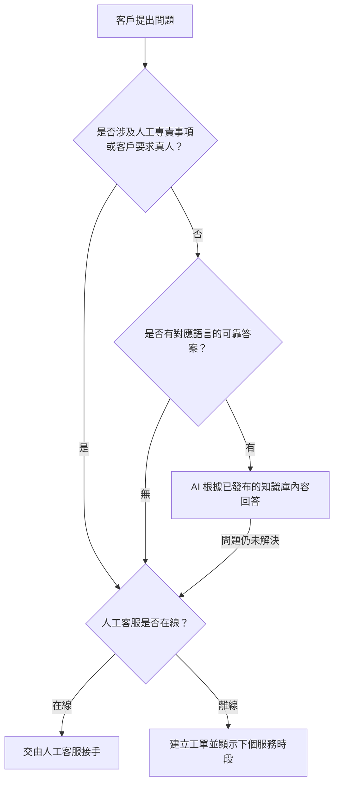

# 多語言 AI 客服系統上線準備會議紀錄

> 本文為 Parchment 閱讀範例，人物、組織與專案資料皆為虛構。

## 會議資訊

| 項目 | 內容 |
| --- | --- |
| 日期 | 2026-11-25（三） |
| 時間 | 09:00–09:45 UTC（倫敦 09:00、柏林 10:00、臺北 17:00） |
| 地點 | 線上視訊 |
| 主持人 | Maya Chen（產品） |
| 紀錄人 | 林雨彤（客服營運） |
| 出席 | Maya Chen（產品）、Alex Morgan（工程）、Lena Weber（知識庫與在地化）、林雨彤（客服營運） |
| 會議目標 | 確認首波上線範圍、AI 轉人工規則與驗收條件 |

## 議程

1. 確認首波支援語言與問題類型。
2. 確認中央知識庫的發布流程與 AI 回答規則。
3. 確認人工交接、客服離線時的處理方式及上線條件。

## 討論摘要

### 首波上線範圍

產品團隊提議先在網站客服聊天視窗開放英文與繁體中文，涵蓋登入操作、服務使用方式及訂閱方案說明。方案說明限於公開資訊，個別帳務查詢、退款與扣款爭議由人工客服接手。

客服營運指出，日文的常見問題已完成初稿，但人工支援時段與翻譯審校仍待確認。本次先保留日文試行，待人力與內容準備完成再排定日期。

### 中央知識庫與內容管理

中央資料庫是各語言共用的知識庫。每篇文章使用同一個主題識別碼串聯各語言版本，並分別記錄維護人、審核狀態及生效日期。內容維護人員更新文章後，由客服營運確認處理流程，再由在地化人員審校並發布。

AI 僅使用已發布、已生效且符合客戶語言的內容作答。工程團隊會測試指定語言缺文與文章已下架兩種狀況，確認 AI 能轉人工。客服可把重複發生的缺文問題回報給知識庫維護人員。

### AI 轉人工與跨時區交接

| 客戶情境 | 處理方式 |
| --- | --- |
| 查得到對應語言的已發布說明 | AI 直接回答，並在有公開說明頁時附上連結 |
| 查無可靠答案，或依照說明操作後問題仍未解決 | 轉由人工客服接手，記錄未解決原因 |
| 涉及個別帳務、退款爭議或疑似帳號遭冒用 | 直接轉人工，依客服流程進行身分確認 |
| 客戶主動要求真人 | 直接轉人工 |
| 人工客服離線 | 建立待處理工單，顯示下個服務時段及其時區 |

交接時，人工客服在工單內會看到客戶語言、對話紀錄、問題摘要和已嘗試的步驟。跨時區輪班時，接班人員可依工單狀態及最後一則處理紀錄繼續處理。客服營運補充，摘要應避免包含密碼、驗證碼或完整卡號。

#### 轉人工流程圖

## 決議

1. 首波開放英文及繁體中文。日文列入後續評估。
2. 採用上表的轉人工規則。人工客服離線時，採工單機制接續處理。
3. 11 月 30 日完成驗收。所有必要情境通過後，12 月 2 日開始內部試行。若有必要情境未通過，由產品負責人調整試行日期。
4. 試行期間若發現 AI 引用未發布內容、提供錯誤的帳務指引，或無法完成轉人工，工程值班人員停用 AI 回覆並切換至人工／工單入口。

## 行動項目

| 事項 | 負責人 | 期限 | 狀態 |
| --- | --- | --- | --- |
| 確認英文與繁體中文的首波常見問題清單 | Maya Chen | 2026-11-26 | 已完成 |
| 核對雙語文章的發布狀態與生效日期 | Lena Weber | 2026-11-27 | 進行中 |
| 完成轉人工、離線建單與 AI 停用演練 | Alex Morgan | 2026-11-30 | 待驗收 |
| 確認客服排班、交接流程與離線提示文案 | 林雨彤 | 2026-11-30 | 進行中 |

## 上線驗收清單

- [ ] 英文與繁體中文使用者都能取得對應語言的已發布答案。
- [ ] 文章缺漏或下架時，AI 會轉人工。
- [ ] 帳務爭議和主動要求真人都能直接轉人工。
- [ ] 人工客服可讀取對話紀錄及摘要，並從客戶最後一步接續處理。
- [ ] 客服離線時可建立工單，視窗會顯示下個服務時段及時區。
- [ ] 停用 AI 後，客服視窗仍可進入人工或工單流程。

## 待議事項

- 日文版的人工客服時段、翻譯審校日期與上線條件。
- 試行後如何以轉人工原因、人工回覆時間和雙語回答抽查結果評估服務品質。

## 下次會議

2026-11-30（一）09:00 UTC 線上召開驗收會議。各負責人會前更新行動項目狀態，會中確認 12 月 2 日是否開始內部試行。
