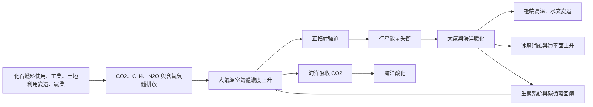
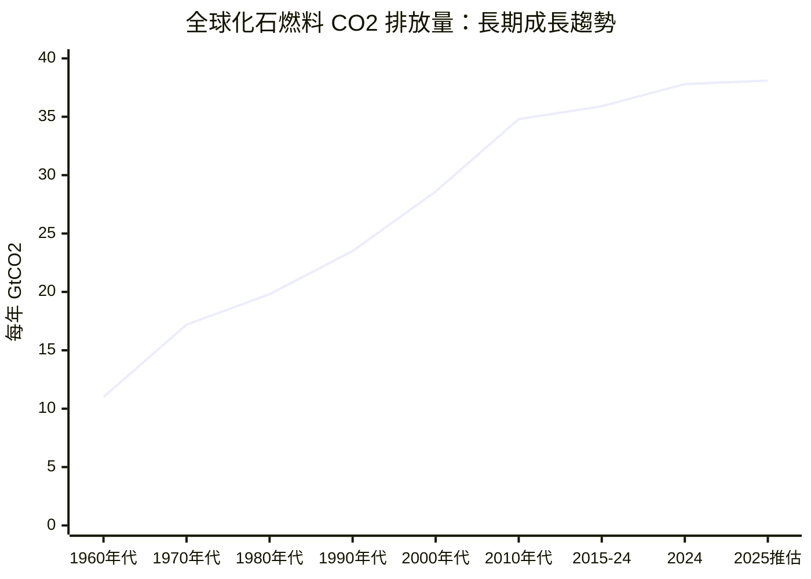
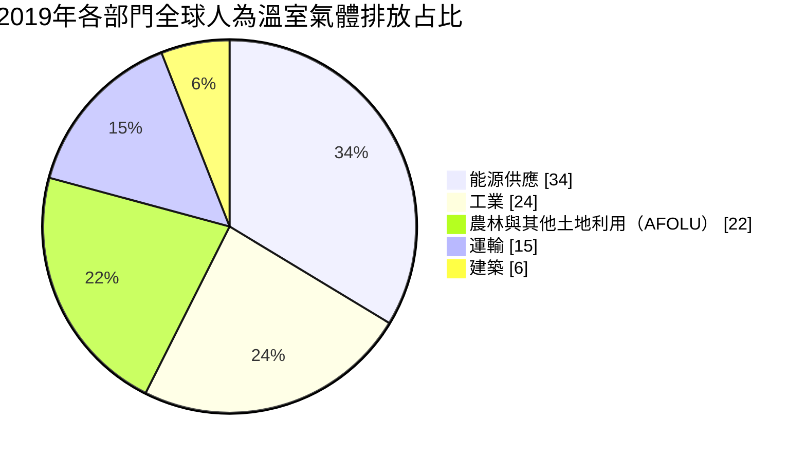
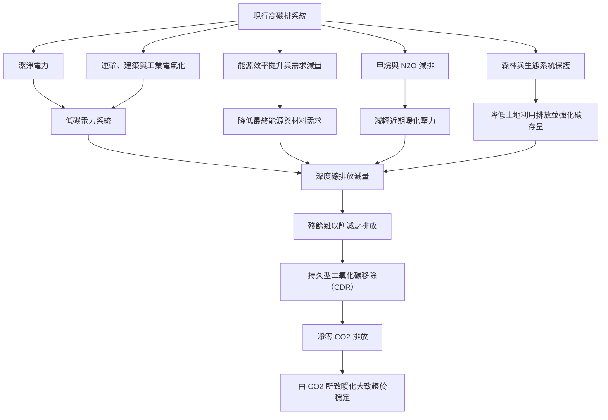

# 碳排放與碳足跡：對全球氣候系統的影響

## 執行摘要

> **核心發現**。人為溫室氣體排放是現代全球暖化主因的證據已無庸置疑。二氧化碳（CO₂）是單一最大貢獻來源，主因在於其龐大的累積排放量、對碳循環的長期影響，以及累積 CO₂ 排放量與全球平均氣溫之間近似線性的關係。甲烷（CH₄）、氧化亞氮（N₂O）與含氟氣體則進一步增加了可觀的輻射強迫。[^3] [^5]

在 2011–2020 年間，人類活動已使全球表面氣溫較 1850–1900 年平均值上升約 **1.1°C**。IPCC 估計，自 1850–1900 年至 2010–2019 年間，人類導致的總暖化幅度約為 **1.07°C**，而自然的太陽與火山活動僅對觀測到的長期變遷造成微小影響。若單就溫室氣體而言，本應引發更大規模的暖化，但其中一部分效應已遭到人為氣膠的冷卻作用所掩蓋。[^5]

此一碳擾動的規模在現代觀測史上前所未見。根據美國國家海洋暨大氣總署（NOAA）資料，工業化前的大氣 CO₂ 濃度約為 **270–280 ppm**，至 **2025 年** 全球海洋邊界層年平均濃度已達 **425.62 ± 0.05 ppm**。長生命週期溫室氣體的綜合有效輻射強迫在 2025 年達到 **高於工業化前水準 3.59 W m⁻²**，較 1990 年的相應強迫高出 56%。單獨 CO₂ 一項即貢獻了 **2.37 W m⁻²**，約占所有長生命週期溫室氣體總量的三分之二。[^7]

然而，全球排放量依然持續攀升。IPCC 估計 2019 年全球人為淨溫室氣體排放量為 **59 ± 6.6 GtCO₂-eq**，較 1990 年高出 54%。《2025 年全球碳預算》（Global Carbon Budget 2025）估計 2024 年全球化石燃料 CO₂ 排放量為 **37.8 ± 2 GtCO₂**，並推估 2025 年約為 **38.1 GtCO₂**，惟不同資料集之間的方法學定義有所差異。國際能源總署（IEA）則獨立估計 2025 年能源相關 CO₂ 排放量接近 **38.4 GtCO₂**。由於各資料集的部門邊界不同，這些數據不應互相替換使用。[^1] [^2] [^4] [^6]

碳足跡將分析視野由境內排放進一步延伸。*生產端排放清冊* 將排放量歸屬於排放實際發生的地點；*消費端碳足跡* 則透過國際供應鏈，將隱含排放量重新歸屬至最終消費者。這項區分至關重要，因為貿易商品使高消費區域得以將部分境內排放外部化。不過，多區域投入產出（MRIO）研究在結構與資料上所面臨的不確定性，仍高於國家層級的燃料燃燒排放清冊。[^4] [^10]

排放責任的分布極為不均。2019 年，排放量最高的前 10% 家戶約占全球消費端家戶溫室氣體排放量的 **34–45%** ，而排放量最低的 50% 家戶僅占 **13–15%** 。區域差異同樣懸殊：2019 年北美洲的人均溫室氣體排放量約為 **19 tCO₂-eq**，相較之下，南亞人均排放量約僅 **2.5 tCO₂-eq**。[^4]

目前已觀測到的氣候後果包括極端高溫日益頻繁、許多區域強降雨加劇、乾旱風險改變、海洋暖化、冰凍圈流失、海平面加速上升，以及海洋酸化。1901 年至 2018 年間，全球平均海平面上升約 **0.20 m**，其上升速率在 2006–2018 年間更增至 **3.7 [3.2–4.2] mm yr⁻¹**。自工業時代以來，表層海洋 pH 值已下降約 **0.1 個單位**，相當於氫離子濃度增加約 30%。[^5] [^9]

決定未來暖化幅度的最強物理限制在於累積 CO₂ 排放量。IPCC 評估累積碳排之暫態氣候反應（TCRE）的最佳估計值約為 **每 1,000 GtCO₂ 造成 0.45°C 暖化**，可能範圍為 0.27–0.63°C。因此，要使人類引發的暖化趨於穩定，全球人為淨 CO₂ 排放量必須逼近於零；持續的正排放只會造成進一步的暖化。[^3]

目前已有多項具備相當規模的減緩技術可供採用。IPCC 評估指出，成本在 **每公噸 CO₂ 當量 100 美元（US$100 tCO₂-eq⁻¹）或以下** 的減緩選項，可於 2030 年前將全球溫室氣體排放量至少削減至 2019 年水準的一半，其中超過半數的評估潛力成本更低於 US$20 tCO₂-eq⁻¹。主要的低成本契機包括太陽能與風力發電、能源效率提升、甲烷減排，以及避免森林與其他自然生態系統的開發轉用。然而，實務上的可行性不僅取決於工程成本，亦取決於電網基礎設施、融資管道、制度架構、土地限制、行為改變、社會接受度以及分配公平性等後果。[^4]

## 摘要與緒論

本文探討約自 1850 年至今，**碳排放、碳足跡、大氣溫室氣體累積、輻射強迫與氣候變遷** 之間的關聯。除另有說明外，本文之分析範疇皆為全球尺度。本文區分物理性排放與消費端碳足跡，評估排放連結至氣候衝擊的證據強度，指出主要不確定性來源，並評析核心減緩路徑。

本文中所稱的 **碳排放**，主要指由化石燃料燃燒、工業製程與土地利用變遷所釋放的 CO₂，而 *溫室氣體排放* 則額外涵蓋 CH₄、N₂O 及含氟氣體。**碳足跡** 的涵義更廣，指可歸因於特定產品、活動、組織、家戶或人口的直接與間接溫室氣體排放，通常以公噸二氧化碳當量（tCO₂-eq）表示。消費端碳足跡納入進口商品與服務中的隱含排放，使其在概念上與境內國家排放清冊有所區別。[^4] [^10]

將多種溫室氣體彙整為二氧化碳當量排放，須仰賴特定氣候指標，最常用者為 **100 年期全球暖化潛勢（GWP₁₀₀）** 。IPCC 第六次評估報告（AR6）對 GWP₁₀₀ 的估計值為：CO₂ 為 1、**化石來源 CH₄ 約為 29.8**、**非化石來源 CH₄ 為 27.0**，以及 **N₂O 為 273**，惟這些數值仍伴隨相當程度的不確定性。因此，在該指標假設條件下，GWP₁₀₀ 為 273 的氣體每排放單位質量，在 100 年間所產生的積分輻射效應約為等質量 CO₂ 基準效應的 273 倍。然而，不應將 GWP 數值解讀為在所有時間尺度下皆精確成立的物理等效關係。[^3]

其基本因果鏈如下：

**圖 1：從人類活動到氣候與生物地球化學衝擊的概念因果鏈**。主要溫室氣體作用路徑的方向，獲得 IPCC 所評估之多項觀測、理論與模式證據所支持。[^3] [^5]

### 明確假設

1. **地理範疇**：以全球為主，並在可靠資料集允許的情況下進行區域比較。
2. **歷史時期**：除另行指明其他時段外，皆涵蓋約 1850 年至今。
3. **排放盤查**：全球物理總量採用生產端排放；消費端衡量則明確標示為碳足跡。
4. **氣候指標**：除資料來源另有規定外，二氧化碳當量數值原則上採用 AR6 GWP₁₀₀。
5. **最新觀測資料**：由於完整排放清冊較即時狀況具時間落差，本文明確區分 *歷史觀測資料* 與 *初步或推估數值*。
6. **減緩成本**：文中所列成本區間係全球技術經濟估計值，並非單一專案層級的保證成本。

因此，核心研究問題不再僅是排放是否會改變氣候——此一歸因早已確立——而是 **排放規模、來源、地理責任、消費型態、大氣物理與碳循環過程，如何共同決定氣候變遷的幅度與持久性**。

## 研究方法與資料來源

本研究依據科學證據階層進行分析。最優先採用 **IPCC 第六次評估報告（AR6）** ，因該報告透過經校準的信心用語與多項獨立證據線，綜合評析數千篇同儕審查研究。物理科學分析主要依據 AR6 第一工作組報告，排放與減緩評估依據第三工作組報告，整合性衝擊評估則依據 2023 年綜合報告。[^3] [^4] [^5]

近期排放與碳循環資料主要取自發表於 *Earth System Science Data* 的《**2025 年全球碳預算**》（Global Carbon Budget 2025）。該碳預算整合化石燃料 CO₂ 排放、土地利用變遷、大氣累積量、海洋吸收、陸地吸收，以及明確的預算不平衡項。該報告估計 1850–2024 年累積人為碳排放量為 **745 ± 65 GtC**，其中約 290 ± 5 GtC 留存於大氣中、200 ± 40 GtC 由海洋吸收、175 ± 50 GtC 由陸地碳匯吸收，外加一項殘餘預算不平衡值。[^1]

大氣濃度與輻射強迫資料取自 **NOAA 全球監測實驗室（Global Monitoring Laboratory）** 。NOAA 長期運作的全球監測網提供 CO₂、CH₄、N₂O 及其他長生命週期溫室氣體的量測資料，並編製年度溫室氣體指數（AGGI）。[^7] [^8]

能源相關 CO₂ 資訊則以 **國際能源總署（IEA）** 資料作為補充，特別是在需要近期部門趨勢時。IEA 資料所採用的核算邊界與全球碳預算不同；因此，僅於明確界定涵蓋範疇後方進行數值比較。[^6]

消費端碳足跡證據立基於 IPCC 評估報告與同儕審查之多區域投入產出（MRIO）研究。此類模型透過國際貿易追蹤金流與實物供應鏈，有助於將間接排放歸因於最終消費，但其不確定性源自部門歸類加總、貿易統計資料、排放係數調和，以及不同 MRIO 資料庫之間的差異。一項針對五大主流 MRIO 系統的比較研究發現，消費端碳帳目估計值存在顯著變異，這說明為何不應將碳足跡估計值視為精確的實體排放清冊數值。[^10]

### 核心物理關係

廣為使用的 CO₂ 輻射強迫一階近似式為：

\[
\boxed{\Delta F_{CO_2}\approx 5.35\ln\left(\frac{C}{C_0}\right)\;\text{W m}^{-2}}
\]

其中 \(C_0\) 為基準 CO₂ 濃度，\(C\) 為擾動後濃度。此對數關係意味著 CO₂ 濃度每按相同比例增加，所產生的增量輻射強迫大致相近；雖然 AR6 在正式評估中採用更新的光譜輻射處理方法，但此對數近似式在概念闡釋上仍具實用價值。[^3]

全球碳預算可簡化表示為：

\[
E_{\mathrm{FOS}}+E_{\mathrm{LUC}}
=
G_{\mathrm{ATM}}
+
S_{\mathrm{OCEAN}}
+
S_{\mathrm{LAND}}
+
B_{\mathrm{IM}},
\]

其中 \(E_{\mathrm{FOS}}\) 為化石燃料與工業 CO₂ 排放，\(E_{\mathrm{LUC}}\) 為土地利用變遷排放，\(G_{\mathrm{ATM}}\) 為大氣累積量，\(S_{\mathrm{OCEAN}}\) 與 \(S_{\mathrm{LAND}}\) 分別為海洋與陸地碳匯，\(B_{\mathrm{IM}}\) 則為殘餘預算不平衡項。在 2015–2024 年間，《全球碳預算》估計總人為 CO₂ 排放量中約有 **50%** 累積於大氣、**29%** 進入海洋、**21%** 進入陸地碳匯，該十年間的平均不平衡量則接近於零。[^1]

就溫度反應而言，AR6 提出下列近似累積關係：

\[
\Delta T \approx \mathrm{TCRE}\times
\frac{E_{\mathrm{cum}}}{1000\ \mathrm{GtCO_2}},
\]

其中

\[
\mathrm{TCRE}_{\text{最佳估計值}}\approx0.45^{\circ}\mathrm{C}\; / \;1000\ \mathrm{GtCO_2}.
\]

此一近似線性關係，正是為何「累積 CO₂ 排放量」——而非僅僅單一年度的排放速率——成為氣候政策核心焦點的原因之一。[^3]

針對非 CO₂ 氣體，在時間尺度 \(H\) 下的全球暖化潛勢（GWP）概念上定義為：

\[
\mathrm{GWP}_i(H)
=
\frac{\int_0^H RF_i(t)\,dt}
{\int_0^H RF_{CO_2}(t)\,dt},
\]

其中 \(RF_i(t)\) 為氣體物種 \(i\) 在脈衝排放後隨時間變化的輻射強迫。所選定的時間尺度會大幅改變短生命週期氣體（如 CH₄）在帳面上的相對重要性。[^3]

## 研究結果

自工業化以來，全球人為排放量急遽攀升。**1850 年至 2019 年間的歷史累積淨 CO₂ 排放量約為 2,400 ± 240 GtCO₂**，其中約 42% 係於 1990–2019 年間排放，足見近數十年來排放累積速度之異常迅猛。[^4]

《全球碳預算》亦呈現出相同的化石燃料 CO₂ 長期趨勢。平均化石碳排放量由 **1960 年代約 3.0 GtC yr⁻¹**，增至 **2015–2024 年間的 9.8 GtC yr⁻¹**，分別約相當於每年 11 GtCO₂ 與 36 GtCO₂。2024 年化石燃料 CO₂ 排放量達約 37.8 GtCO₂，較 1990 年高出 69%。[^1]

**圖 2：全球化石燃料 CO₂ 排放量近似趨勢**。各年代數值係以 \(44/12\) 係數自 GtC 換算為 GtCO₂；2025 年為《2025 年全球碳預算》之推估值，而非最終定案清冊。[^1] [^2]

### 部門與區域排放型態

2019 年，能源供應約占全球人為淨溫室氣體排放量的 **34%** ，工業占 24%，農林與其他土地利用（AFOLU）占 22%，運輸占 15%，建築占 6%。由於各類占比經四捨五入，加總約為 101%。若將電力與熱能生產所產生的排放自能源供應部門重新分攤至最終使用端，工業與建築部門的相對占比將顯著提高，顯示部門排放占比取決於盤查歸類慣例。[^4]

**圖 3：2019 年人為淨溫室氣體排放量之各部門近似占比**。數值為 IPCC 採用 AR6 GWP₁₀₀ 換算為二氧化碳當量之估計值。[^4]

| 盤查維度 | 主要來源／區域 | 近似規模 | 詮釋 |
|---|---|---:|---|
| **部門別，2019 年溫室氣體** | 能源供應 | 20 GtCO₂-eq；34% | 全球最大直接排放部門。[^4] |
|  | 工業 | 14 GtCO₂-eq；24% | 涵蓋工業能源使用與製程排放。[^4] |
|  | 農林與其他土地利用（AFOLU） | 13 GtCO₂-eq；22% | 涵蓋農業、林業與土地利用變遷。[^4] |
|  | 運輸 | 8.7 GtCO₂-eq；15% | 以化石燃料運輸系統為主。[^4] |
|  | 建築 | 3.3 GtCO₂-eq；直接占 6% | 若將間接電力／熱能分攤至使用端，占比約達 16%。[^4] |
| **化石燃料 CO₂，2024 年** | 中國 | 12.3 GtCO₂；31.7% | 最大境內化石燃料排放國。[^2] |
|  | 美國 | 4.9 GtCO₂；12.7% | 人均化石燃料 CO₂ 約 14.2 tCO₂。[^2] |
|  | 印度 | 3.2 GtCO₂；8.3% | 人均化石燃料 CO₂ 約 2.2 tCO₂。[^2] |
|  | 歐盟 27 國（EU-27） | 2.4 GtCO₂；6.3% | 人均化石燃料 CO₂ 約 5.4 tCO₂。[^2] |
|  | 俄羅斯 | 1.8 GtCO₂；4.6% | 人均化石燃料 CO₂ 約 12.3 tCO₂。[^2] |
| **消費端碳足跡** | 北美洲 | 引述之碳足跡評估約 ~13.4 tCO₂-eq 人⁻¹ | 與家戶連結之消費端碳足跡仍處高檔。[^4] |
|  | 歐洲 | ~7.5 tCO₂-eq 人⁻¹ | 低於北美洲，但遠高於低所得區域。[^4] |
|  | 非洲與中東* | ~1.7 tCO₂-eq 人⁻¹ | 反映全球顯著不均；原始分組範圍較廣。[^4] |

**表 1：各部門與區域主要排放來源**。部門溫室氣體數據、境內化石燃料 CO₂ 數據與消費端碳足跡採用不同系統邊界，不應直接加總或彼此替代。*所引述之消費端碳足跡資料來源將非洲與中東合併統計，因此不應解讀為區域內部均質之數值。[^4] [^10]

區域分布亦會因分析指標選擇年度排放量、歷史累積責任、人均排放量或消費端碳足跡而有所不同。已開發經濟體在歷史累積 CO₂ 排放量中的占比，普遍高於其目前的人口占比；而東亞在當代年度排放量中的占比自 2000 年以來則大幅上升。IPCC 指出，2019 年已開發國家人均化石燃料與工業 CO₂ 排放量平均約為 **9.5 tCO₂**，相較之下，亞太地區約為 **4.4 tCO₂**、拉丁美洲與加勒比海地區為 **2.7 tCO₂**，非洲則為 **1.2 tCO₂**。[^4]

### 輻射強迫與氣候反應

排放與暖化之間的物理連結係透過大氣濃度與輻射強迫運作。AR6 估計 2019 年相對於 1750 年的有效輻射強迫如下：CO₂ 為 **2.16 [1.90–2.41] W m⁻²**、CH₄ 為 **0.54 [0.43–0.65] W m⁻²**、N₂O 為 **0.21 [0.18–0.24] W m⁻²**，鹵化氣體則為 **0.41 [0.33–0.49] W m⁻²**。[^3]

NOAA 較近期以觀測為基礎的指數顯示，輻射強迫仍持續增強：2025 年其年度溫室氣體指數（AGGI）中長生命週期氣體的綜合有效輻射強迫，相較工業化前已達約 **3.59 W m⁻²**，其中 CO₂ 約占 **66%** 、CH₄ 占 16%。自 1990 年以來，長生命週期溫室氣體輻射強迫的增量中，約有 81% 來自 CO₂。[^7]

此一輻射強迫導致行星能量失衡。AR6 評估指出，觀測到的氣候系統平均增溫速率已從 **1971–2006 年的約 0.50 [0.32–0.69] W m⁻²**，上升至 **2006–2018 年的 0.79 [0.52–1.06] W m⁻²**。絕大多數多餘熱量累積於海洋之中，其餘能量則促成大氣暖化、陸地冰層融化、海平面上升以及其他地球系統變遷。[^3]

### 已觀測之氣候衝擊

暖化本身及諸多相關衝擊的證據極為確鑿。IPCC 總結指出，人類活動——主要是溫室氣體排放——已 **無庸置疑地導致全球暖化**。自 1950 年代以來，多數陸地區域極端高溫變得更頻繁且更強烈，這一點幾乎已成定論；而人類影響也非常可能促成了自 1980 年代以來海洋熱浪頻率約倍增的現象。[^3] [^5]

水文效應在空間上較不均勻，但衝擊同樣重大。較暖的空氣可容納更多水氣，進而在許多區域加劇強降雨；同時，暖化亦會提高蒸發需求，在降雨未能彌補的地區加劇農業與生態乾旱。不同區域與災害類型的歸因強度各異，這也是為何關於全球極端高溫的科學論述，其信心水準通常高於針對局部乾旱或單一風暴事件之判斷。[^3]

海平面變化提供另一項整合性的衡量指標。**1901 年至 2018 年間，全球平均海平面上升約 0.20 [0.15–0.25] m**。平均上升速率從 1901–1971 年的 1.3 mm yr⁻¹ 加速至 2006–2018 年的 3.7 mm yr⁻¹，且至少自 1971 年以來，人類影響非常可能是主要驅動力。[^5]

CO₂ 亦會獨立於暖化之外改變海洋化學性質。在較長的時間尺度上，釋放至大氣中的人為 CO₂ 約有 30% 被海洋吸收，形成碳酸並提高氫離子濃度。自工業革命以來，表層海洋平均 pH 值已下降約 **0.1 個 pH 單位**，降低了珊瑚、軟體動物及其他鈣化生物可利用的碳酸根離子濃度。[^9]

## 討論：證據、不確定性與碳足跡詮釋

嚴謹的科學評估必須區分 **幅度的不確定性** 與 **因果關係的不確定性**。人為溫室氣體在當前全球暖化中的因果角色，並非科學界尚未解決的重大爭議；真正的不確定性在於氣候反應的確切幅度與時程、區域分布型態、回饋強度、未來社會經濟排放路徑，以及減緩措施的落實成效。[^3] [^5]

| 議題 | 證據強度 | 主要證據 | 重要不確定性 |
|---|---|---|---|
| 人為溫室氣體導致現代全球暖化 | **無庸置疑／極強** | 觀測暖化、輻射物理、歸因研究、氣候模式、古氣候限制條件。[^5] | 各別強迫因子與回饋機制之間的精確分配比例。 |
| 累積 CO₂ 大致線性決定長期暖化 | **高信心水準** | 跨觀測與氣候模式的 TCRE 關係。[^3] | TCRE 可能範圍為每 1,000 GtCO₂ 0.27–0.63°C。 |
| 極端高溫因人類影響而加劇 | **極強** | 觀測資料及單一事件／長期歸因分析。[^3] | 區域間的加劇幅度有所差異。 |
| 強降雨與乾旱風險正在改變 | **強，但具空間異質性** | 觀測資料、熱力學原理、歸因研究。[^3] | 自然變異與區域環流帶來的不確定性大於氣溫變化。 |
| 暖化與陸地冰層流失導致海平面上升 | **高信心水準** | 潮位計、衛星測高、冰河／冰原觀測、海洋熱膨脹。[^5] | 冰原動力學主導未來長尾風險的不確定性。 |
| 海洋酸化主要由大氣 CO₂ 吸收引起 | **極強** | 碳酸鹽化學與直接量測資料。[^9] | 生物學後果因物種與生態系統而異。 |
| 消費端碳足跡有別於境內排放 | **強** | MRIO 貿易碳帳目核算。[^10] | 資料庫結構、部門歸類加總及貿易／排放係數不確定性。 |
| 現行陸地與海洋碳匯將無限期維持固定吸收比例 | **不受證據支持** | 碳匯強度隨氣候與碳循環回饋而變化。[^1] [^2] | 未來碳匯飽和程度與區域回饋仍具不確定性。 |

**表 2：證據強度與主要不確定性**。凡可行處，信心用語皆遵循 IPCC 評估報告之方向，而非代表獨立計算的統計機率。

碳足跡在詮釋 **排放責任** 時尤為關鍵。境內盤查回答的是：「排放實際發生在何處？」消費端盤查則追問：「是誰的最終需求促成了該生產活動？」因此，一支在甲國製造、卻由乙國消費者購買的智慧型手機，會增加生產國的境內排放，同時計入購買者的消費端碳足跡。兩種衡量方式在所有政策用途上皆無絕對「正確」與否，而是各自回應不同的問題。[^4] [^10]

這項差異對氣候公平性具有深遠意涵。IPCC 指出，按人均排放量排序的 **前 10% 高排放家戶，貢獻了全球消費端家戶溫室氣體排放量的 34–45%** ，而底層半數家戶僅貢獻 13–15%。此等不平等意味著，國家平均碳足跡往往掩蓋了國內因所得、居住型態、移動方式、能源可近性與消費習慣所造成的更大落差。[^4]

一項近期跨國 MRIO 研究揭示了需求端減排的潛在規模：研究估計，若針對 116 個國家中前 23.7% 的高排放族群推動一系列低碳消費轉變方案，可使模型中的家戶消費端溫室氣體排放減少約 **10.4 GtCO₂-eq**，相當於該分析所涵蓋家戶排放總量的 40.1%。然而，這類結果屬於情境估計而非預測：其前提假設了特定的行為替代與供應鏈反應，因此不應視為必然實現的減碳成果。[^11]

碳循環的不確定性是另一項關鍵議題。針對 1850–2024 年間，《全球碳預算》指出累積預算不平衡量約為 **80 GtC**，約占估計總排放量的 11%，顯示獨立估計的排放源與碳匯之間存在不一致。在觀測資料較完善的 1959–2024 年間，此不平衡量則較小。這些落差並未推翻溫室效應，而是量化了結合異質觀測資料與模式重建龐大全球碳通量時的不確定性。[^1]

近期一項備受關注的隱憂在於氣候變遷對自然碳匯的回饋效應。《2025 年全球碳預算》估計，在 2015–2024 年間，相較於無此影響的反事實基準，氣候變遷與氣候變異使陸地碳匯減少約 **25%** 、海洋碳匯減少約 **7%** 。這意味著歷史上吸收大量人為排放的自然緩衝能力可能正在減弱，惟年際與年代際變異仍然顯著。[^2]

### 資料缺口

多項資料限制影響量化比較的精確度。全球化石燃料 CO₂ 排放的約束程度高於土地利用 CO₂；後者高度仰賴歷史土地覆蓋重建、森林再生假設與生態系統模式。各國盤查方法不一，尤以甲烷與土地利用為甚。消費端碳足跡所依據的貿易投入產出表往往落後於現況，且將異質產品合併歸類。農業、航空非 CO₂ 效應、航運、非正式經濟活動與部分含氟氣體的排放係數，其完整度皆不及化石燃料燃燒統計資料。[^1] [^10]

不同資料集之間亦存在時間落差：IPCC AR6 的部門比較主要描述 2019 年狀況，完整的《全球碳預算》資料涵蓋至 2024 年並附帶 2025 年推估，NOAA 大氣觀測則延伸至 2026 年，而能源資料集可提供 2025 年的初步估計值。因此，在將表面上的數值差異解讀為科學分歧之前，應先檢視其 *年份、系統邊界、納入之溫室氣體種類與盤查方法* 是否有所不同。[^4] [^6] [^8]

## 減緩路徑

減緩策略可歸納為四項互補方向：**消除可避免的排放、降低能源與材料需求、以低碳技術取代高碳技術，以及自大氣中移除殘餘 CO₂**。有效的氣候穩定需要跨多種氣體的快速減排，但 CO₂ 具有特殊地位，因其累積排放量大致決定了長期暖化幅度。[^3] [^4]

**圖 4：從總排放減量邁向淨零 CO₂ 排放之減緩路徑**。淨零排放不應被解讀為快速總減量的替代方案；IPCC 主要將二氧化碳移除（CDR）定位為互補手段，用於抵銷殘餘排放，並在部分情境中逆轉氣溫過衝（overshoot）。[^4]

| 減緩選項 | 指標性成效 | 成本特徵 | 可行性與限制條件 |
|---|---|---|---|
| **太陽能與風力發電** | 位列 IPCC 評估 2030 年最大減緩潛力選項之中。[^4] | 很大一部分經評估成本低於 US$20 tCO₂-eq⁻¹。[^4] | 技術成熟度高；輸電網路、儲能、許可審查與電網彈性可能限制部署速度。 |
| **能源效率提升** | 在建築、工業與運輸部門具備龐大的跨部門潛力。[^4] | 多項措施具低生命週期成本或甚至為負成本。 | 反彈效應、誘因錯置、融資困難與設備汰換週期皆會減緩採用速度。 |
| **電氣化** | 當電力來源低碳化時，可大幅削減終端使用排放。[^4] | 視情境而定；潔淨技術成本下降正改善經濟效益。[^4] | 須搭配電網建設、充電基礎設施、熱泵普及與工業製程再設計。 |
| **甲烷減排** | 因 CH₄ 暖化潛勢強但生命週期相對較短，對降低近期暖化極具價值。[^3] [^4] | 許多油氣、煤炭與廢棄物管理措施成本低於 US$20 tCO₂-eq⁻¹。[^4] | 監測、洩漏偵測、農業實務與法規執行至關重要。 |
| **避免生態系統開發轉用** | 具備龐大的土地部門減緩潛力。[^4] | 具顯著低於 US$20 tCO₂-eq⁻¹ 之減排潛力。[^4] | 必須妥善處理治理、土地權屬、糧食安全、持久性與碳洩漏問題。 |
| **造林／再造林與改善森林經營** | 可增強陸地碳存量；IPCC 估計土地部門組合具數十億公噸（multi-Gt）級潛力。[^4] | 各區域差異甚大；林業部門成本隨規模擴大而上升。 | 碳存量可能因野火、乾旱、伐木或土地利用變遷而逆轉釋出。 |
| **工業材料替代／製程改革** | 對水泥、鋼鐵與石化產業至為重要。 | 差異大；部分選項相對便宜，其他則成本高昂。[^4] | 長壽命資本設備與高溫製程需求形成轉型慣性。 |
| **特定工業／化石製程之碳捕捉與封存（CCS）** | 對難以削減的製程排放具潛在助益。[^4] | 成本通常高於最低成本的再生能源／能效選項；具場址特異性。 | 需建置捕捉設施、運輸管線、合適地質封存場址與長期監測。 |
| **二氧化碳移除（CDR）** | 在多數模式路徑中為抵銷部分殘餘排放所必需。[^4] | 視技術方法而定，成本範圍極廣。 | 土地需求、能源消耗、持久性、擴展規模、監測與生態權衡差異顯著。 |

**表 3：主要減緩選項之成效、成本與可行性**。成本估計應解讀為全球文獻區間，而非放諸四海皆準的單一專案價格。IPCC 估計所有成本在 US$100 tCO₂-eq⁻¹ 以下的選項合計，可於 2030 年前將排放量至少較 2019 年水準減半，但實際可實現之潛力仍取決於基礎設施、政策與在地條件。[^4]

近期能源資料顯示，潔淨技術部署確實能實質改變排放軌跡。IEA 估計，相較於未擴張這些技術的反事實情境，太陽光電、風電、核能發電、電動車與熱泵在 **2025 年合計避免了約 3 GtCO₂ 的年度排放量**。儘管如此，2025 年能源相關 CO₂ 排放量仍微幅增加約 0.4%，逼近 38.4 GtCO₂，顯示全球潔淨能源的成長速度尚未超越總能源需求的擴張及剩餘化石燃料的使用。[^6]

區分 **總排放（gross）** 與 **淨排放（net）** 至關重要。雖然一條路徑可透過深度總減量結合大氣碳移除來達成淨零 CO₂ 排放，但過度仰賴未來的碳移除技術，將大幅提高技術、生態與持久性風險。累積 CO₂ 與暖化之間的物理關係意味著，當下每避免一公噸排放，就能減少未來為了符合相同累積碳預算而必須移除的碳量。[^3] [^4]

《2025 年全球碳預算》估計，自 2026 年初起，欲維持 **50% 機率將升溫控制在 1.5°C 以內的剩餘碳預算約僅剩 170 GtCO₂**，按 2025 年的排放速率換算，僅約相當於四年的排放量。將升溫控制在 1.7°C 與 2°C 的剩餘碳預算則分別估計約為 525 GtCO₂ 與 1,055 GtCO₂。這些碳預算並非精確的倒數期限，而是會受到非 CO₂ 輻射強迫、地球系統回饋、所選機率門檻以及方法學更新之影響。[^1] [^2]

針對消費端碳足跡的減緩行動，可與供給端去碳化形成互補。高影響力的介入措施包括減少非必要的化石燃料交通移動、提升建築能源效率、延長產品使用壽命、降低物質投入量與食物浪費、在適切情況下轉向低碳能源與飲食型態，以及推動所消費商品之供應鏈去碳化。評估需求端減緩時必須納入分配脈絡，因為在低所得族群中，基本能源缺口依然龐大，其現行碳足跡遠低於富裕消費者。[^4]

## 結論

科學證據支持一套連貫一致的因果詮釋：**人類活動排放溫室氣體；這些排放推升大氣濃度；濃度升高產生正輻射強迫；由此引發的行星能量失衡使氣候系統暖化；暖化與升高的 CO₂ 進而改變大氣環流、水文循環、海洋、冰層、海平面、生態系統與碳匯**。氣溫、大氣組成、海洋熱含量、海平面與碳通量等各項獨立觀測資料，皆與此一架構相互吻合。[^3] [^5]

CO₂ 之所以特別關鍵，在於氣候反應與其累積排放量高度相關。1850–2019 年間全球已排放約 2,400 ± 240 GtCO₂ 的人為淨 CO₂，且化石燃料排放量仍維持在歷史高點附近。2025 年全球年平均大氣 CO₂ 濃度已突破 425 ppm，較工業化前濃度高出逾 50%。[^4] [^7]

碳足跡揭示了境內排放清冊所無法呈現的另一維度：**消費與全球供應鏈** 所帶來的氣候後果。碳足跡的詮釋揭露了區域、國家與家戶之間的顯著不平等。由於高排放族群在消費端排放中占據不成比例的高比重，僅聚焦於國家平均值的減緩策略，往往會模糊真實的責任歸屬與高槓桿減排契機。[^4] [^10]

不確定性固然重要，但必須予以正確定位。關於溫室效應的作用方向，或當前暖化主要由人為因素所致，科學上的不確定性相對極低。較大的不確定性主要存在於土地利用排放、區域氣候反應、未來社會經濟路徑、碳循環回饋、冰原動力學、消費端碳足跡盤查，以及減緩技術與制度得以規模化擴展的速度。[^1] [^10]

減緩相關證據顯示，技術上可行的減排量中有相當大比例能以中低經濟成本達成，特別是透過潔淨電力、能源效率提升、甲烷控管與生態系統保護。然而，全球排放量持續盤踞高點，正說明僅具備技術可行性仍遠遠不足。要有效穩定氣候，必須仰賴加速技術部署、基礎設施投資、制度能力建構、政策協調、行為與需求端轉變、保護自然碳存量，以及針對殘餘排放推動妥善治理的碳移除措施。[^4] [^6]

因此，其核心物理意涵相當明確：

\[
\boxed{\text{持續淨正 CO₂ 排放}
\;\Rightarrow\;
\text{更高的累積 CO₂}
\;\Rightarrow\;
\text{額外的長期暖化}}
\]

反之亦然：

\[
\boxed{\text{人為淨零 CO₂ 排放}
\;\approx\;
\text{穩定由 CO₂ 所致暖化的必要條件}.}
\]

此一結論直接源自 IPCC 所評估之人為累積 CO₂ 排放量與全球表面升溫之間近似線性的關係。[^3]

## 參考文獻

[^1]: **Friedlingstein, P., et al. (2026).** *Global Carbon Budget 2025.* **Earth System Science Data, 18**, 3211–3288. 本評估提供全球化石燃料與土地利用 CO₂ 排放量、大氣累積量、陸地與海洋碳匯、區域趨勢、不確定性以及剩餘碳預算。

[^2]: **Global Carbon Project. (2025/2026 update).** *Global Carbon Budget 2025 datasets and key messages.* 本資料集涵蓋各國化石碳排放量與經修正之土地利用變遷分量；其中明確標示之 2025 年數值為推估值。

[^3]: **Intergovernmental Panel on Climate Change. (2021).** *Climate Change 2021: The Physical Science Basis. Contribution of Working Group I to the Sixth Assessment Report.* Cambridge University Press. 用於輻射強迫、氣候敏感度、極端事件歸因、溫室氣體指標，以及累積 CO₂ 排放之暫態氣候反應（TCRE）。

[^4]: **Intergovernmental Panel on Climate Change. (2022).** *Climate Change 2022: Mitigation of Climate Change. Contribution of Working Group III to the Sixth Assessment Report.* Cambridge University Press. 用於部門與區域排放、消費端碳足跡、減緩成本、技術與可行性評估。

[^5]: **Intergovernmental Panel on Climate Change. (2023).** *Climate Change 2023: Synthesis Report.* IPCC. 用於整合歸因、已觀測之衝擊、排放趨勢、海平面變化，以及經評估之信心水準陳述。

[^6]: **International Energy Agency. (2026).** *Global Energy Review 2026: Energy Demand and CO₂.* IEA, Paris. 提供 2025 年首份全面性能源部門評估，涵蓋能源相關 CO₂ 排放量及近期潔淨技術部署所估計避免之排放量。

[^7]: **NOAA Global Monitoring Laboratory. (2026).** *Annual Greenhouse Gas Index.* National Oceanic and Atmospheric Administration. 提供截至 2025 年之大氣溫室氣體豐度與有效輻射強迫觀測估計值。

[^8]: **NOAA Global Monitoring Laboratory. (2026).** *Trends in Atmospheric Carbon Dioxide.* 提供全球平均海洋表面 CO₂ 觀測資料，以及 2026 年初步月均值量測結果。

[^9]: **NOAA.** *Ocean Acidification.* National Oceanic and Atmospheric Administration. 提供人為 CO₂ 吸收、海洋 pH 值下降，以及碳酸鹽系統衝擊之觀測與化學背景資訊。

[^10]: **Wood, R., Moran, D. D., Rodrigues, J. F. D., et al. (2019).** “Variation in trends of consumption based carbon accounts.” *Scientific Data, 6*, 99. 比較多個多區域投入產出（MRIO）資料庫，並記錄消費端碳盤查在方法學上的不確定性。

[^11]: **Recent global household-footprint analysis. (2025).** “Unlocking global carbon reduction potential by embracing low-carbon lifestyles.” *Nature Communications.* 運用全球多區域投入產出（MRIO）架構，估計 116 個國家家戶消費轉變所具備的模擬減碳潛力。
