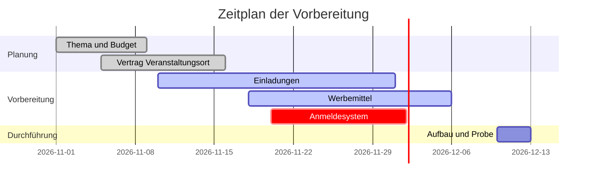

# [Projekt oder Vorhaben] z. B. Vorbereitung der Jahresveranstaltung

Zuletzt aktualisiert: 24.11.2026　|　Gesamtfortschritt: **45 %**

> [!note] Legende
> ✅ Erledigt　🔄 In Arbeit　⏳ Offen　⚠️ Verzögert

---

## 1. Übersicht

| Phase | Aufgabe | Verantwortlich | Start | Termin | Status | Fortschritt |
| :--- | :--- | :---: | :---: | :---: | :---: | ---: |
| Planung | Thema und Budget festlegen | Anna Schmidt | 01.11. | 08.11. | ✅ | 100 % |
| Planung | Veranstaltungsort buchen | Jonas Müller | 05.11. | 15.11. | ✅ | 100 % |
| Vorbereitung | Referierende einladen | Lena Weber | 10.11. | 30.11. | 🔄 | 60 % |
| Vorbereitung | Werbemittel gestalten | Felix Wagner | 18.11. | 05.12. | 🔄 | 30 % |
| Vorbereitung | Anmeldesystem einrichten | Felix Wagner | 20.11. | 01.12. | ⚠️ | 10 % |
| Durchführung | Aufbau und Probe | Alle | 10.12. | 12.12. | ⏳ | 0 % |

## 2. Zeitplan

## 3. Diese Woche erledigt

- [x] Vertrag für den Veranstaltungsort unterschrieben
- [x] Drei Referierende bestätigt
- [ ] Erster Plakatentwurf (auf nächsten Montag verschoben)

## 4. Nächste Woche

- [ ] Einladungen abschließen (noch zwei)
- [ ] Werbemittel finalisieren
- [ ] Anmeldesystem testen und freischalten

## 5. Probleme und benötigte Unterstützung

> [!warning] Das Anmeldesystem liegt hinter dem Zeitplan
> z. B. Die Schnittstellendokumentation des Zahlungsanbieters fehlt noch; etwa 3 Tage Verzögerung erwartet. Bitte um Unterstützung bei der Kontaktaufnahme mit dem Anbieter.
