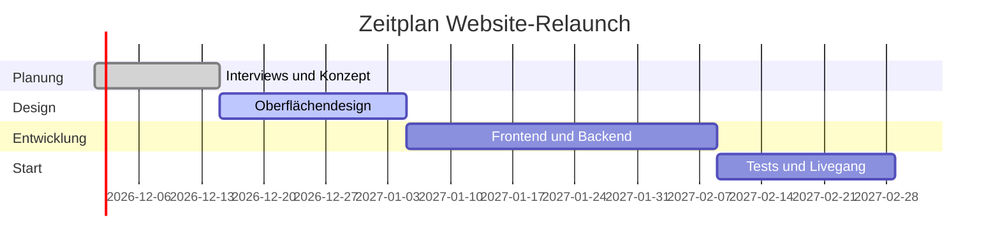

# [Projektname] z. B. Relaunch der Website

| Punkt | Details |
| :--- | :--- |
| Projektleitung | Anna Schmidt |
| Zeitraum | 01.12.2026 – 28.02.2027 |
| Status | 🟢 Im Plan |
| Budget | 18.000 € |

---

## 1. Ziele

> [!tip] Gute Ziele formulieren
> Ziele sollten **konkret, messbar und terminiert** sein. z. B. „Die mobile Kaufabschlussrate innerhalb von drei Monaten von 2,1 % auf 3 % steigern.“

1. z. B. Die mobile Nutzung verbessern und die Absprungrate um 20 % senken.
2. z. B. Den Bezahlvorgang von 5 auf 3 Schritte verkürzen.
3. z. B. Das Marketing kann Inhalte ohne Entwickler selbst pflegen.

## 2. Umfang

| Enthalten ✅ | Nicht enthalten ❌ |
| :--- | :--- |
| Neugestaltung von Start-, Produkt- und Bezahlseite | Neubau des Mitgliederbereichs |
| Mobiles Layout | Weitere Sprachen |
| Redaktionssystem | Anbindung an Filialsysteme |

## 3. Meilensteine

## 4. Zuständigkeiten

| Arbeitspaket | Verantwortlich | Unterstützung | Termin |
| :--- | :---: | :---: | :---: |
| Interviews und Konzept | Anna Schmidt | Lena Weber | 14.12.2026 |
| Oberflächendesign und Styleguide | Lena Weber | - | 04.01.2027 |
| Frontend- und Backend-Entwicklung | Felix Wagner | Agentur | 08.02.2027 |
| Tests, Livegang und Schulung | Jonas Müller | Alle | 28.02.2027 |

## 5. Risiken

| Risiko | Wahrscheinlichkeit | Auswirkung | Maßnahme |
| :--- | :---: | :---: | :--- |
| Anforderungen ändern sich während der Entwicklung | Mittel | Hoch | Änderungen nach Freigabe nur mit Zustimmung der Projektleitung und Terminprüfung |
| Agentur hat zu wenig Personal | Gering | Hoch | Vertretung vorab klären |
| Livegang fällt in eine Hochphase | Mittel | Mittel | In einer ruhigen Phase live gehen |

> [!warning] Hinweis
> Prüfen Sie die Risikotabelle alle zwei Wochen und ergänzen Sie neue Risiken sofort.

## 6. Kommunikation

* **Regeltermin**: Projektmeeting jeden Montag um 10 Uhr (30 Minuten)
* **Statusberichte**: Fortschrittstabelle jeden Freitag bis Feierabend aktualisieren
* **Probleme**: im Projekt-Chat melden; in dringenden Fällen die Projektleitung anrufen

## 7. Aufgaben dieser Woche

- [x] Interviews abschließen
- [ ] Ersten Designentwurf freigeben
- [ ] Kick-off mit der Agentur planen
