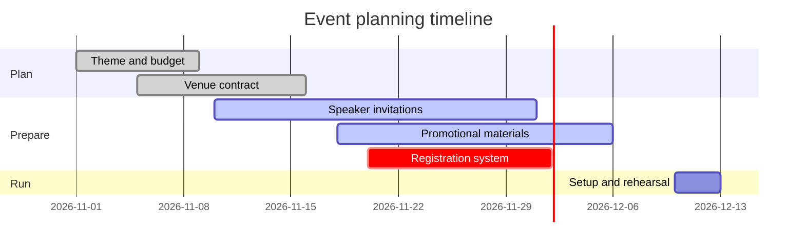

# [Project or plan name] e.g. Annual Event Planning Tracker

Last updated: 2026-11-24　|　Overall progress: **45%**

> [!note] Status key
> ✅ Done　🔄 In progress　⏳ Not started　⚠️ Delayed

---

## 1. Overview

| Phase | Task | Owner | Start | Due | Status | Progress |
| :--- | :--- | :---: | :---: | :---: | :---: | ---: |
| Plan | Confirm theme and budget | Alex Chen | 11/01 | 11/08 | ✅ | 100% |
| Plan | Book and sign the venue | Jordan Lee | 11/05 | 11/15 | ✅ | 100% |
| Prepare | Invite speakers | Taylor Morgan | 11/10 | 11/30 | 🔄 | 60% |
| Prepare | Design promotional materials | Sam Rivera | 11/18 | 12/05 | 🔄 | 30% |
| Prepare | Set up registration | Sam Rivera | 11/20 | 12/01 | ⚠️ | 10% |
| Run | Set up venue and rehearse | Everyone | 12/10 | 12/12 | ⏳ | 0% |

## 2. Timeline

## 3. Done this week

- [x] Venue contract signed
- [x] Three speakers confirmed
- [ ] First poster draft (moved to next Monday)

## 4. Next week

- [ ] Finish speaker invitations (two left)
- [ ] Finalize promotional materials
- [ ] Test and launch registration

## 5. Issues and help needed

> [!warning] Registration is behind schedule
> e.g. We are still waiting for the payment provider’s integration guide; expect a 3-day delay. Please help us contact the provider.
