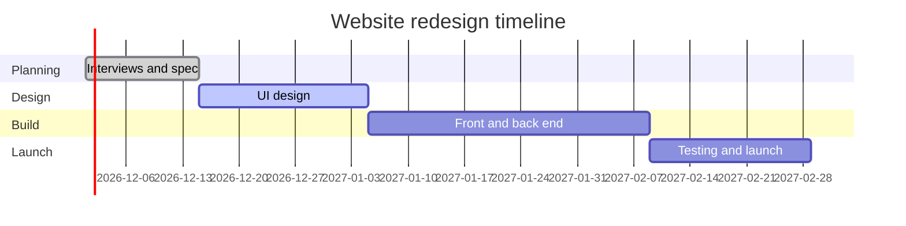

# [Project name] e.g. Website Redesign

| Item | Details |
| :--- | :--- |
| Project lead | Alex Chen |
| Timeline | 2026-12-01 – 2027-02-28 |
| Status | 🟢 On track |
| Budget | $20,000 |

---

## 1. Goals

> [!tip] Writing good goals
> Make goals **specific, measurable and time-bound**. e.g. “Raise mobile checkout conversion from 2.1% to 3% within three months.”

1. e.g. Improve mobile browsing and cut the bounce rate by 20%.
2. e.g. Shorten checkout from 5 steps to 3.
3. e.g. Let the marketing team update content without a developer.

## 2. Scope

| In scope ✅ | Out of scope ❌ |
| :--- | :--- |
| Home, product and checkout page redesign | Rebuilding the member system |
| Mobile layout | Adding more languages |
| Content management back end | In-store system integration |

## 3. Milestones

## 4. Responsibilities

| Work item | Owner | Support | Due |
| :--- | :---: | :---: | :---: |
| Interviews and specification | Alex Chen | Taylor Morgan | 2026-12-14 |
| UI design and design guide | Taylor Morgan | - | 2027-01-04 |
| Front-end and back-end build | Sam Rivera | Agency | 2027-02-08 |
| Testing, launch and training | Jordan Lee | Everyone | 2027-02-28 |

## 5. Risks

| Risk | Likelihood | Impact | Response |
| :--- | :---: | :---: | :--- |
| Requirements change mid-build | Medium | High | After sign-off, changes need the lead’s approval and a schedule review |
| Agency is short-staffed | Low | High | Confirm backup staff in advance |
| Launch clashes with a peak sales period | Medium | Medium | Launch during a quiet period |

> [!warning] Reminder
> Review the risk table every two weeks and add new risks as they come up.

## 6. Communication

* **Regular meeting**: Project check-in every Monday at 10:00 (30 minutes)
* **Status updates**: Update the progress tracker by end of day Friday
* **Issues**: Post in the project chat; call the lead for anything urgent

## 7. This week’s tasks

- [x] Finish stakeholder interviews
- [ ] Approve the first design draft
- [ ] Schedule the kickoff with the agency
