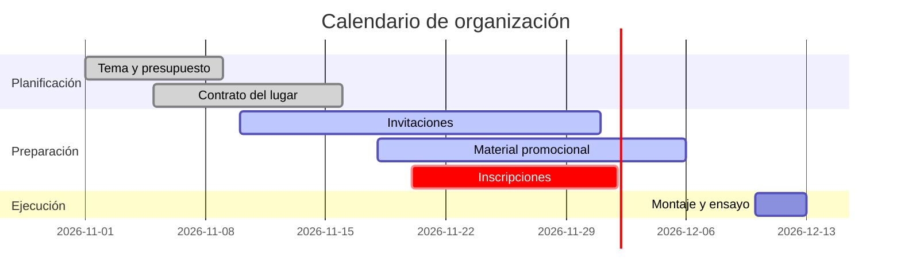

# [Proyecto o plan] p. ej. Organización del evento anual

Última actualización: 24/11/2026　|　Avance total: **45 %**

> [!note] Leyenda
> ✅ Hecho　🔄 En curso　⏳ Sin empezar　⚠️ Con retraso

---

## 1. Resumen

| Fase | Tarea | Responsable | Inicio | Fecha límite | Estado | Avance |
| :--- | :--- | :---: | :---: | :---: | :---: | ---: |
| Planificación | Definir tema y presupuesto | Lucía García | 01/11 | 08/11 | ✅ | 100 % |
| Planificación | Reservar y contratar el lugar | Mateo López | 05/11 | 15/11 | ✅ | 100 % |
| Preparación | Invitar a ponentes | Sofía Martínez | 10/11 | 30/11 | 🔄 | 60 % |
| Preparación | Diseñar material promocional | Diego Sánchez | 18/11 | 05/12 | 🔄 | 30 % |
| Preparación | Montar el sistema de inscripción | Diego Sánchez | 20/11 | 01/12 | ⚠️ | 10 % |
| Ejecución | Montaje y ensayo | Todo el equipo | 10/12 | 12/12 | ⏳ | 0 % |

## 2. Calendario

## 3. Hecho esta semana

- [x] Contrato del lugar firmado
- [x] Tres ponentes confirmados
- [ ] Primer borrador del cartel (aplazado al próximo lunes)

## 4. Próxima semana

- [ ] Terminar las invitaciones (faltan dos)
- [ ] Cerrar el material promocional
- [ ] Probar y abrir las inscripciones

## 5. Problemas y ayuda necesaria

> [!warning] Las inscripciones van con retraso
> p. ej. Aún no ha llegado la documentación de la pasarela de pago; se prevén unos 3 días de retraso. Necesitamos ayuda para contactar con el proveedor.
