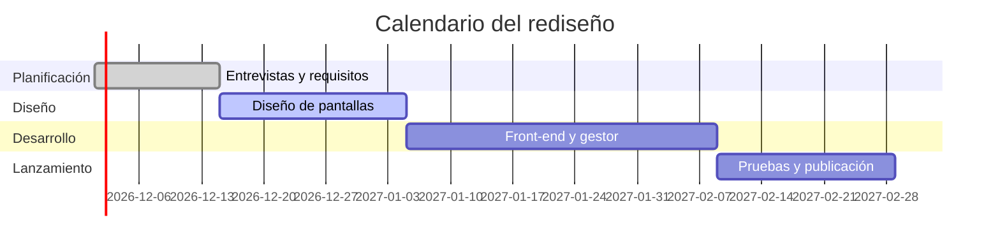

# [Nombre del proyecto] p. ej. Rediseño del sitio web

| Elemento | Detalle |
| :--- | :--- |
| Responsable | Lucía García |
| Periodo | 01/12/2026 – 28/02/2027 |
| Estado | 🟢 En marcha |
| Presupuesto | 18.000 € |

---

## 1. Objetivos

> [!tip] Cómo escribir buenos objetivos
> Los objetivos deben ser **concretos, medibles y con fecha**. p. ej. «Subir la conversión del pago en móvil del 2,1 % al 3 % en tres meses».

1. p. ej. Mejorar la navegación en móvil y reducir la tasa de rebote un 20 %.
2. p. ej. Reducir el proceso de pago de 5 a 3 pasos.
3. p. ej. Que el equipo de marketing pueda actualizar contenidos sin ayuda técnica.

## 2. Alcance

| Incluido ✅ | No incluido ❌ |
| :--- | :--- |
| Rediseño de portada, fichas de producto y pago | Rehacer el área de socios |
| Diseño para móvil | Añadir más idiomas |
| Gestor de contenidos | Integración con las tiendas físicas |

## 3. Hitos

## 4. Reparto de tareas

| Tarea | Responsable | Apoyo | Fecha límite |
| :--- | :---: | :---: | :---: |
| Entrevistas y documento de requisitos | Lucía García | Sofía Martínez | 14/12/2026 |
| Diseño de pantallas y guía de estilo | Sofía Martínez | - | 04/01/2027 |
| Desarrollo del front-end y del gestor | Diego Sánchez | Agencia externa | 08/02/2027 |
| Pruebas, publicación y formación | Mateo López | Todo el equipo | 28/02/2027 |

## 5. Riesgos

| Riesgo | Probabilidad | Impacto | Respuesta |
| :--- | :---: | :---: | :--- |
| Cambios de requisitos durante el desarrollo | Media | Alto | Tras la aprobación, los cambios requieren el visto bueno del responsable y revisar el calendario |
| Falta de personal en la agencia | Baja | Alto | Acordar refuerzos con antelación |
| Lanzamiento en plena temporada alta | Media | Medio | Publicar en una época tranquila |

> [!warning] Recordatorio
> Revisa la tabla de riesgos cada dos semanas y añade los nuevos riesgos en cuanto aparezcan.

## 6. Comunicación

* **Reunión periódica**: seguimiento del proyecto cada lunes a las 10:00 (30 minutos)
* **Informes de avance**: actualizar el seguimiento cada viernes antes de terminar la jornada
* **Incidencias**: en el chat del proyecto; para urgencias, llamar al responsable

## 7. Tareas de esta semana

- [x] Terminar las entrevistas
- [ ] Aprobar la primera propuesta de diseño
- [ ] Programar la reunión de arranque con la agencia
