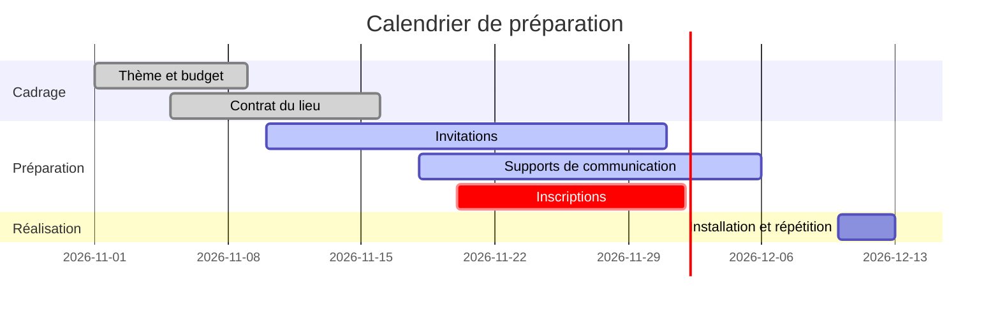

# [Projet ou plan] ex. Préparation de l’événement annuel

Dernière mise à jour : 24/11/2026　|　Avancement global : **45 %**

> [!note] Légende
> ✅ Terminé　🔄 En cours　⏳ À faire　⚠️ En retard

---

## 1. Vue d’ensemble

| Phase | Tâche | Responsable | Début | Échéance | État | Avancement |
| :--- | :--- | :---: | :---: | :---: | :---: | ---: |
| Cadrage | Valider le thème et le budget | Camille Martin | 01/11 | 08/11 | ✅ | 100 % |
| Cadrage | Réserver et signer le lieu | Lucas Bernard | 05/11 | 15/11 | ✅ | 100 % |
| Préparation | Inviter les intervenants | Léa Dubois | 10/11 | 30/11 | 🔄 | 60 % |
| Préparation | Créer les supports de communication | Hugo Petit | 18/11 | 05/12 | 🔄 | 30 % |
| Préparation | Mettre en place les inscriptions | Hugo Petit | 20/11 | 01/12 | ⚠️ | 10 % |
| Réalisation | Installation et répétition | Toute l’équipe | 10/12 | 12/12 | ⏳ | 0 % |

## 2. Calendrier

## 3. Fait cette semaine

- [x] Contrat du lieu signé
- [x] Trois intervenants confirmés
- [ ] Première version de l’affiche (reportée à lundi prochain)

## 4. Semaine prochaine

- [ ] Finir les invitations (encore deux)
- [ ] Valider les supports de communication
- [ ] Tester et ouvrir les inscriptions

## 5. Problèmes et aide nécessaire

> [!warning] Les inscriptions sont en retard
> ex. La documentation du prestataire de paiement n’est pas encore arrivée ; environ 3 jours de retard prévus. Merci de nous aider à contacter le prestataire.
