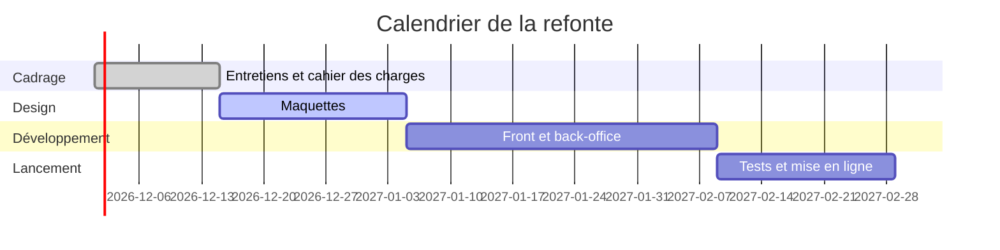

# [Nom du projet] ex. Refonte du site web

| Élément | Détail |
| :--- | :--- |
| Chef de projet | Camille Martin |
| Période | 01/12/2026 – 28/02/2027 |
| État | 🟢 En cours |
| Budget | 18 000 € |

---

## 1. Objectifs

> [!tip] Bien formuler un objectif
> Un objectif doit être **précis, mesurable et daté**. ex. « Faire passer le taux de conversion mobile de 2,1 % à 3 % en trois mois. »

1. ex. Améliorer la navigation mobile et réduire le taux de rebond de 20 %.
2. ex. Passer de 5 à 3 étapes de paiement.
3. ex. Permettre à l’équipe marketing de mettre à jour le contenu sans développeur.

## 2. Périmètre

| Inclus ✅ | Exclu ❌ |
| :--- | :--- |
| Refonte des pages d’accueil, produit et paiement | Refonte de l’espace membre |
| Mise en page mobile | Ajout de nouvelles langues |
| Outil de gestion de contenu | Connexion aux systèmes des magasins |

## 3. Jalons

## 4. Répartition des tâches

| Tâche | Responsable | Appui | Échéance |
| :--- | :---: | :---: | :---: |
| Entretiens et cahier des charges | Camille Martin | Léa Dubois | 14/12/2026 |
| Maquettes et charte | Léa Dubois | - | 04/01/2027 |
| Développement front et back-office | Hugo Petit | Prestataire | 08/02/2027 |
| Tests, mise en ligne et formation | Lucas Bernard | Toute l’équipe | 28/02/2027 |

## 5. Risques

| Risque | Probabilité | Impact | Réponse |
| :--- | :---: | :---: | :--- |
| Changement de besoins en cours de route | Moyenne | Fort | Après validation, tout changement passe par le chef de projet et une revue du planning |
| Manque de personnel chez le prestataire | Faible | Fort | Prévoir des renforts à l’avance |
| Mise en ligne pendant un pic d’activité | Moyenne | Moyen | Choisir une période calme |

> [!warning] Rappel
> Relisez le tableau des risques toutes les deux semaines et ajoutez-y les nouveaux risques.

## 6. Communication

* **Réunion régulière** : point projet chaque lundi à 10 h (30 minutes)
* **Suivi** : mise à jour du tableau d’avancement chaque vendredi avant la fin de journée
* **Problèmes** : messagerie du projet ; appeler le chef de projet en cas d’urgence

## 7. Tâches de la semaine

- [x] Terminer les entretiens
- [ ] Valider la première maquette
- [ ] Planifier la réunion de lancement avec le prestataire
