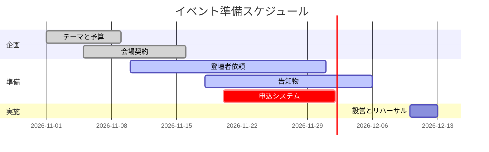

# 【プロジェクト・計画名】例：年次イベント準備 進捗表

最終更新：2026/11/24　｜　全体の進捗：**45%**

> [!note] 状況の見方
> ✅ 完了　🔄 対応中　⏳ 未着手　⚠️ 遅延

---

## 1. 進捗一覧

| 段階 | 作業 | 担当 | 開始 | 期限 | 状況 | 進捗 |
| :--- | :--- | :---: | :---: | :---: | :---: | ---: |
| 企画 | テーマと予算の決定 | 佐藤 | 11/01 | 11/08 | ✅ | 100% |
| 企画 | 会場の手配と契約 | 鈴木 | 11/05 | 11/15 | ✅ | 100% |
| 準備 | 登壇者への依頼 | 高橋 | 11/10 | 11/30 | 🔄 | 60% |
| 準備 | 告知物のデザイン | 田中 | 11/18 | 12/05 | 🔄 | 30% |
| 準備 | 申込システムの構築 | 田中 | 11/20 | 12/01 | ⚠️ | 10% |
| 実施 | 会場設営とリハーサル | 全員 | 12/10 | 12/12 | ⏳ | 0% |

## 2. スケジュール

## 3. 今週完了したこと

- [x] 会場の契約を締結
- [x] 登壇者 3 名が確定
- [ ] ポスターの初稿（来週月曜に延期）

## 4. 来週の予定

- [ ] 登壇者への依頼を完了（残り 2 名）
- [ ] 告知物を確定
- [ ] 申込システムをテストして公開

## 5. 課題と必要な支援

> [!warning] 申込システムが遅れています
> 例：決済連携の資料がまだ届いておらず、3 日ほど遅れる見込み。決済会社への連絡を上長にお願いしたい。
