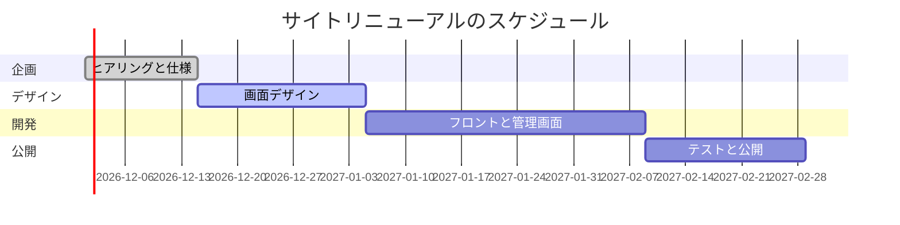

# 【プロジェクト名】例：公式サイト リニューアル

| 項目 | 内容 |
| :--- | :--- |
| 責任者 | 佐藤 健 |
| 期間 | 2026/12/01 – 2027/02/28 |
| 状況 | 🟢 進行中 |
| 予算 | 300 万円 |

---

## 1. 目標

> [!tip] 目標の書き方
> 目標は**具体的・測定可能・期限付き**に。例：「3 か月でスマホの購入率を 2.1% から 3% に上げる」。

1. 例：スマホでの閲覧体験を改善し、直帰率を 20% 下げる。
2. 例：購入手続きを 5 ステップから 3 ステップにする。
3. 例：マーケティング担当が自分でコンテンツを更新できるようにする。

## 2. 範囲

| 対象 ✅ | 対象外 ❌ |
| :--- | :--- |
| トップ・商品・購入ページの刷新 | 会員システムの作り直し |
| スマホ向けレイアウト | 多言語対応の追加 |
| コンテンツ管理画面 | 店舗システムとの連携 |

## 3. マイルストーン

## 4. 役割分担

| 作業 | 担当 | 協力 | 期限 |
| :--- | :---: | :---: | :---: |
| ヒアリングと仕様書 | 佐藤 | 高橋 | 2026/12/14 |
| 画面デザインとガイドライン | 高橋 | - | 2027/01/04 |
| フロントエンドと管理画面の開発 | 田中 | 外部パートナー | 2027/02/08 |
| テスト・公開・説明会 | 鈴木 | 全員 | 2027/02/28 |

## 5. リスクと対策

| リスク | 可能性 | 影響 | 対策 |
| :--- | :---: | :---: | :--- |
| 開発途中での要件変更 | 中 | 大 | 仕様確定後の変更は責任者の承認とスケジュール確認を必須にする |
| 外部パートナーの人手不足 | 小 | 大 | 事前に代替要員を確保する |
| 公開時期が繁忙期と重なる | 中 | 中 | 繁忙期を避けて公開する |

> [!warning] 注意
> リスク表は 2 週間ごとに見直し、新しいリスクがあればすぐに追加しましょう。

## 6. 連絡と報告

* **定例会議**：毎週月曜 10:00 プロジェクト定例（30 分）
* **進捗報告**：毎週金曜の終業までに進捗表を更新
* **問題の連絡**：プロジェクトのチャット。緊急時は責任者に電話

## 7. 今週の ToDo

- [x] ヒアリングを完了する
- [ ] デザイン案の第 1 版を確定する
- [ ] 外部パートナーとのキックオフを設定する
