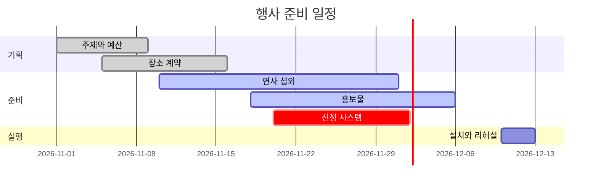

# 【프로젝트·계획명】예: 연례 행사 준비 진행표

마지막 업데이트: 2026/11/24　|　전체 진행률: **45%**

> [!note] 상태 표시
> ✅ 완료　🔄 진행 중　⏳ 시작 전　⚠️ 지연

---

## 1. 진행 현황

| 단계 | 작업 | 담당자 | 시작 | 마감 | 상태 | 진행률 |
| :--- | :--- | :---: | :---: | :---: | :---: | ---: |
| 기획 | 주제와 예산 확정 | 김민준 | 11/01 | 11/08 | ✅ | 100% |
| 기획 | 장소 섭외와 계약 | 이서연 | 11/05 | 11/15 | ✅ | 100% |
| 준비 | 연사 섭외 | 박지훈 | 11/10 | 11/30 | 🔄 | 60% |
| 준비 | 홍보물 디자인 | 최유진 | 11/18 | 12/05 | 🔄 | 30% |
| 준비 | 신청 시스템 구축 | 최유진 | 11/20 | 12/01 | ⚠️ | 10% |
| 실행 | 현장 설치와 리허설 | 전원 | 12/10 | 12/12 | ⏳ | 0% |

## 2. 일정표

## 3. 이번 주 완료

- [x] 장소 계약 체결
- [x] 연사 3명 확정
- [ ] 포스터 초안(다음 주 월요일로 연기)

## 4. 다음 주 계획

- [ ] 연사 섭외 마무리(2명 남음)
- [ ] 홍보물 최종 확정
- [ ] 신청 시스템 테스트 후 오픈

## 5. 문제와 필요한 지원

> [!warning] 신청 시스템 일정이 늦어지고 있습니다
> 예: 결제 연동 문서를 아직 받지 못해 3일 정도 지연될 예정입니다. 결제 업체 연락을 위해 팀장님의 도움이 필요합니다.
