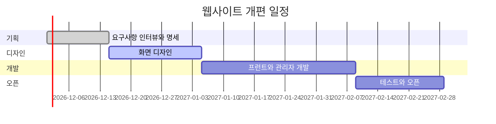

# 【프로젝트명】예: 공식 웹사이트 개편

| 항목 | 내용 |
| :--- | :--- |
| 프로젝트 책임자 | 김민준 |
| 기간 | 2026/12/01 – 2027/02/28 |
| 현재 상태 | 🟢 진행 중 |
| 예산 | 2,500만 원 |

---

## 1. 목표

> [!tip] 목표 작성 요령
> 목표는 **구체적이고, 측정할 수 있고, 기한이 있어야** 합니다. 예: 「3개월 안에 모바일 결제 전환율을 2.1%에서 3%로 높인다」.

1. 예: 모바일 이용 경험을 개선해 이탈률을 20% 낮춘다.
2. 예: 결제 단계를 5단계에서 3단계로 줄인다.
3. 예: 마케팅 담당자가 직접 콘텐츠를 수정할 수 있게 한다.

## 2. 범위

| 포함 ✅ | 제외 ❌ |
| :--- | :--- |
| 메인·상품·결제 페이지 개편 | 회원 시스템 재구축 |
| 모바일 레이아웃 | 다국어 추가 |
| 콘텐츠 관리 화면 | 오프라인 매장 시스템 연동 |

## 3. 마일스톤

## 4. 역할 분담

| 작업 | 담당자 | 협업 | 마감일 |
| :--- | :---: | :---: | :---: |
| 요구사항 인터뷰와 명세서 | 김민준 | 박지훈 | 2026/12/14 |
| 화면 디자인과 디자인 가이드 | 박지훈 | - | 2027/01/04 |
| 프런트엔드와 관리자 개발 | 최유진 | 외주 팀 | 2027/02/08 |
| 테스트, 오픈, 교육 | 이서연 | 전원 | 2027/02/28 |

## 5. 위험과 대응

| 위험 | 가능성 | 영향 | 대응 |
| :--- | :---: | :---: | :--- |
| 개발 중 요구사항 변경 | 중 | 높음 | 명세 확정 후 변경은 책임자 승인과 일정 검토를 거친다 |
| 외주 팀 인력 부족 | 낮음 | 높음 | 대체 인력을 미리 확보한다 |
| 오픈 시점이 성수기와 겹침 | 중 | 중 | 성수기를 피해 한가한 시기에 오픈한다 |

> [!warning] 참고
> 위험 표는 2주마다 점검하고, 새로운 위험은 바로 추가하세요.

## 6. 소통과 보고

* **정기 회의**: 매주 월요일 10:00 프로젝트 주간 회의(30분)
* **진행 보고**: 매주 금요일 퇴근 전 진행표 업데이트
* **문제 공유**: 프로젝트 채팅방, 긴급 시 책임자에게 바로 전화

## 7. 이번 주 할 일

- [x] 요구사항 인터뷰 완료
- [ ] 디자인 시안 1차 확정
- [ ] 외주 팀과 착수 회의 일정 잡기
