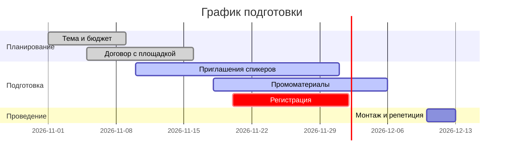

# [Проект или план] напр. Подготовка ежегодного мероприятия

Обновлено: 24.11.2026　|　Общий прогресс: **45 %**

> [!note] Обозначения
> ✅ Готово　🔄 В работе　⏳ Не начато　⚠️ Задержка

---

## 1. Обзор

| Этап | Задача | Ответственный | Начало | Срок | Статус | Прогресс |
| :--- | :--- | :---: | :---: | :---: | :---: | ---: |
| Планирование | Утвердить тему и бюджет | Анна Иванова | 01.11 | 08.11 | ✅ | 100 % |
| Планирование | Забронировать площадку | Дмитрий Смирнов | 05.11 | 15.11 | ✅ | 100 % |
| Подготовка | Пригласить спикеров | Елена Кузнецова | 10.11 | 30.11 | 🔄 | 60 % |
| Подготовка | Сделать промоматериалы | Сергей Попов | 18.11 | 05.12 | 🔄 | 30 % |
| Подготовка | Настроить регистрацию | Сергей Попов | 20.11 | 01.12 | ⚠️ | 10 % |
| Проведение | Монтаж и репетиция | Все | 10.12 | 12.12 | ⏳ | 0 % |

## 2. График

## 3. Сделано на этой неделе

- [x] Подписан договор с площадкой
- [x] Подтверждены три спикера
- [ ] Первый вариант афиши (перенесён на понедельник)

## 4. План на следующую неделю

- [ ] Завершить приглашения (осталось два спикера)
- [ ] Утвердить промоматериалы
- [ ] Протестировать и открыть регистрацию

## 5. Проблемы и нужная помощь

> [!warning] Регистрация отстаёт от графика
> напр. Документация платёжного сервиса ещё не получена, ожидаем задержку около 3 дней. Нужна помощь руководителя, чтобы связаться с поставщиком.
