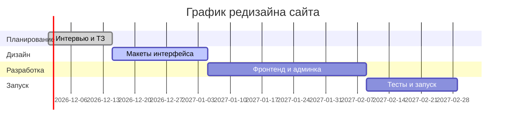

# [Название проекта] напр. Редизайн сайта

| Пункт | Значение |
| :--- | :--- |
| Руководитель проекта | Анна Иванова |
| Сроки | 01.12.2026 – 28.02.2027 |
| Статус | 🟢 По плану |
| Бюджет | 1 500 000 ₽ |

---

## 1. Цели

> [!tip] Как сформулировать цель
> Цель должна быть **конкретной, измеримой и ограниченной по времени**. Напр.: «За три месяца поднять конверсию оплаты на мобильных с 2,1 % до 3 %».

1. напр. Улучшить работу сайта на телефонах и снизить показатель отказов на 20 %.
2. напр. Сократить оформление заказа с 5 шагов до 3.
3. напр. Дать маркетологам возможность обновлять контент без разработчиков.

## 2. Границы проекта

| Входит ✅ | Не входит ❌ |
| :--- | :--- |
| Главная, карточки товаров и страница оплаты | Переделка личного кабинета |
| Мобильная вёрстка | Новые языки сайта |
| Система управления контентом | Интеграция с системами магазинов |

## 3. Вехи

## 4. Распределение работ

| Работа | Ответственный | Помогает | Срок |
| :--- | :---: | :---: | :---: |
| Интервью и техническое задание | Анна Иванова | Елена Кузнецова | 14.12.2026 |
| Макеты и дизайн-система | Елена Кузнецова | - | 04.01.2027 |
| Разработка фронтенда и админки | Сергей Попов | Подрядчик | 08.02.2027 |
| Тестирование, запуск и обучение | Дмитрий Смирнов | Все | 28.02.2027 |

## 5. Риски

| Риск | Вероятность | Влияние | Ответные меры |
| :--- | :---: | :---: | :--- |
| Требования меняются во время разработки | Средняя | Высокое | После утверждения ТЗ изменения — только с согласия руководителя и пересмотром сроков |
| Подрядчику не хватает людей | Низкая | Высокое | Заранее договориться о резерве |
| Запуск совпадает с пиком продаж | Средняя | Среднее | Запускаться в спокойный период |

> [!warning] Напоминание
> Пересматривайте таблицу рисков раз в две недели и сразу добавляйте новые.

## 6. Коммуникации

* **Регулярная встреча**: планёрка по проекту каждый понедельник в 10:00 (30 минут)
* **Отчёты о ходе работ**: обновлять таблицу прогресса каждую пятницу до конца дня
* **Проблемы**: писать в чат проекта; в срочных случаях звонить руководителю

## 7. Задачи на неделю

- [x] Провести интервью
- [ ] Утвердить первый вариант макета
- [ ] Назначить стартовую встречу с подрядчиком
