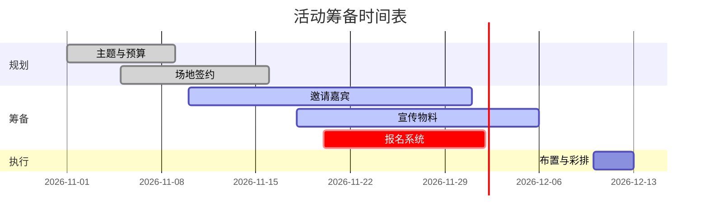

# 【项目或计划名称】例：年度活动筹备进度表

最后更新：2026/11/24　｜　整体进度：**45%**

> [!note] 状态说明
> ✅ 已完成　🔄 进行中　⏳ 未开始　⚠️ 延期

---

## 一、进度总览

| 阶段 | 工作项 | 负责人 | 开始 | 截止 | 状态 | 进度 |
| :--- | :--- | :---: | :---: | :---: | :---: | ---: |
| 规划 | 确定活动主题与预算 | 王小明 | 11/01 | 11/08 | ✅ | 100% |
| 规划 | 场地洽谈与签约 | 陈大华 | 11/05 | 11/15 | ✅ | 100% |
| 筹备 | 邀请嘉宾 | 林美玲 | 11/10 | 11/30 | 🔄 | 60% |
| 筹备 | 宣传物料设计 | 张志豪 | 11/18 | 12/05 | 🔄 | 30% |
| 筹备 | 报名系统搭建 | 张志豪 | 11/20 | 12/01 | ⚠️ | 10% |
| 执行 | 现场布置与彩排 | 全体 | 12/10 | 12/12 | ⏳ | 0% |

## 二、时间表

## 三、本周完成

- [x] 场地合同签署完成
- [x] 确定 3 位嘉宾
- [ ] 宣传海报初稿（推迟到下周一）

## 四、下周计划

- [ ] 完成嘉宾邀请（还剩 2 位）
- [ ] 宣传物料定稿
- [ ] 报名系统测试上线

## 五、问题与需要的协助

> [!warning] 报名系统进度落后
> 例：支付接口文档还没拿到，预计延期 3 天。需要请主管协助联系支付服务商。
